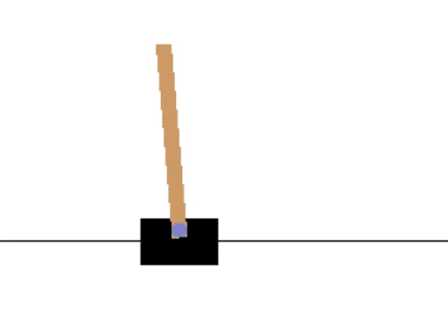

# Deep Reinforcement Learning

Reinforcement Learning (RL) ko Machine Learning ke teen main paradigms mein se ek maana jata hai, baaki do hain Supervised Learning aur Unsupervised Learning. Supervised Learning mein humein aise dataset par depend karna padta hai jisme results pehle se pata hote hain, jabki RL **karke seekhne** par based hai. Jaise, jab hum pehli baar koi computer game dekhte hain, toh hum use khelna shuru kar dete hain, chahe humein rules pata na hon. Jaldi hi, bas khelte-khelte aur apna behavior adjust karte-karte hum apni skills improve kar lete hain.

## [Pre-lecture quiz](https://ff-quizzes.netlify.app/en/ai/quiz/43)

RL karne ke liye humein chahiye:

* Ek **environment** ya **simulator**, jo game ke rules set karta hai. Humein simulator mein experiments chalane aur results dekhne ki ability honi chahiye.
* Koi **reward function**, jo batata hai ki hamara experiment kitna successful raha. Computer game khelna seekhne ke case mein, reward hamara final score hoga.

Reward function ke basis par, humein apna behavior adjust karke apni skills improve karne mein capable hona chahiye, taaki agli baar hum better khel sakein. Baaki types ke Machine Learning aur RL mein main difference yeh hai ki RL mein humein aam taur par tab tak pata nahi hota ki hum jeet rahe hain ya haar rahe hain jab tak game khatam na ho jaye. Isliye hum yeh nahi keh sakte ki koi particular move akele mein achhi hai ya nahi - humein reward sirf game ke end mein milta hai.

RL ke dauran, hum aam taur par kaafi saare experiments karte hain. Har experiment ke dauran, humein ab tak seekhi hui best strategy follow karne (**exploitation**) aur naye possible states explore karne (**exploration**) ke beech balance banana padta hai.

## OpenAI Gym

RL ke liye ek bahut badhiya tool hai [OpenAI Gym](https://gym.openai.com/) - ek **simulation environment**, jo bahut saare alag-alag environments simulate kar sakta hai, jaise Atari games se lekar pole balancing ke peeche ki physics tak. Yeh Reinforcement Learning algorithms ko train karne ke liye sabse popular simulation environments mein se ek hai, aur isse [OpenAI](https://openai.com/) maintain karta hai.

> **Note**: OpenAI Gym ke saare available environments aap [yahaan](https://gym.openai.com/envs/#classic_control) dekh sakte hain.

## CartPole balancing

Aapne shayad modern balancing devices jaise *Segway* ya *Gyroscooters* dekhe honge. Yeh devices accelerometer ya gyroscope ke signals lekar apne wheels adjust karke automatically balance kar lete hain. Is section mein, hum ek similar problem solve karna seekhenge - pole ko balance karna. Yeh waisa hi hai jaise koi circus performer apne haath par pole balance karta hai - lekin yeh pole balancing sirf 1D mein hoti hai.

Balancing ka ek simplified version **CartPole** problem ke naam se jaana jata hai. CartPole ki duniya mein, humare paas ek horizontal slider hota hai jo left ya right move kar sakta hai, aur goal hai slider ke upar ek vertical pole ko balance karna.



Is environment ko create aur use karne ke liye, humein thoda Python code chahiye hoga:

```python
import gym
env = gym.make("CartPole-v1")

env.reset()
done = False
total_reward = 0
while not done:
   env.render()
   action = env.action_space.sample()
   observaton, reward, done, info = env.step(action)
   total_reward += reward

print(f"Total reward: {total_reward}")
```

Har environment ko bilkul isi tarah access kiya ja sakta hai:
* `env.reset` ek naya experiment start karta hai
* `env.step` ek simulation step karta hai. Yeh **action space** se ek **action** receive karta hai aur (observation space se) ek **observation** return karta hai, saath mein reward aur termination flag bhi.

Upar ke example mein, hum har step par ek random action lete hain, isi wajah se experiment ki life bahut chhoti hoti hai:


RL algorithm ka goal hai ek model - jise **policy** &pi; kehte hain - ko train karna, jo diye gaye state ke response mein ek action return karega. Hum policy ko probabilistic bhi maan sakte hain, jaise kisi bhi state *s* aur action *a* ke liye woh &pi;(*a*|*s*) probability return karegi ki humein state *s* mein *a* lena chahiye.

## Policy Gradients algorithm

Policy ko model karne ka sabse obvious tareeka hai ek neural network banana, jo states ko input ke roop mein lega aur corresponding actions (ya saare actions ki probabilities) return karega. Ek tarah se, yeh ek normal classification task jaisa hoga, lekin ek bada difference hai - humein pehle se nahi pata hota ki har step par kaun sa action lena chahiye.

Yahaan idea yeh hai ki in probabilities ko estimate kiya jaye. Hum **cumulative rewards** ka ek vector banate hain, jo hamare experiment ke har step par hamara total reward dikhata hai. Hum **reward discounting** bhi apply karte hain, jisme pehle ke rewards ko kisi coefficient &gamma;=0.99 se multiply kiya jata hai, taaki pehle ke rewards ka role kam ho jaye. Phir, hum un steps ko reinforce karte hain jo bade rewards dete hain.

> Policy Gradient algorithm ke baare mein aur seekhein aur ise [example notebook](CartPole-RL-TF.ipynb) mein action mein dekhein.

## Actor-Critic algorithm

Policy Gradients approach ka ek improved version **Actor-Critic** kehlata hai. Iske peeche main idea yeh hai ki neural network ko do cheezein return karne ke liye train kiya jayega:

* Policy, jo decide karti hai ki kaun sa action lena hai. Is part ko **Actor** kehte hain.
* Us state par humein milne wale total reward ka estimate - is part ko **Critic** kehte hain.

Ek tarah se, yeh [GAN](../../4-ComputerVision/10-GANs/README.md) jaisa dikhta hai, jahaan humare paas do networks hote hain jo ek-doosre ke against train hote hain. Actor-Critic model mein, Actor woh action propose karta hai jo humein lena chahiye, aur Critic critical hokar result ka estimate lagane ki koshish karta hai. Lekin, hamara goal in networks ko saath mein train karna hai.

Kyunki humein experiment ke dauran actual cumulative rewards aur Critic dwara return kiye gaye results dono pata hote hain, ek loss function banana relatively aasaan hai jo unke beech ka difference minimize karega. Isse humein **Critic Loss** milega. Hum **Actor Loss** ko policy gradient algorithm jaisi hi approach se calculate kar sakte hain.

In algorithms mein se kisi ek ko run karne ke baad, hum expect kar sakte hain ki hamara CartPole kuch aise behave karega:


## ✍️ Exercises: Policy Gradients aur Actor-Critic RL

Agle notebooks mein apni learning continue karein:

* [TensorFlow mein RL](CartPole-RL-TF.ipynb)
* [PyTorch mein RL](CartPole-RL-PyTorch.ipynb)

## Other RL tasks

Aajkal Reinforcement Learning tezi se badhta hua research area hai. Reinforcement Learning ke kuch interesting examples hain:

* Computer ko **Atari games** khelna sikhana. Is problem ki challenge yeh hai ki humare paas ek simple state nahi hai jo vector ke roop mein represent ho, balki ek screenshot hai - aur humein is screen image ko feature vector mein convert karne ya reward information nikalne ke liye CNN use karna hoga. Atari games Gym mein available hain.
* Computer ko board games jaise Chess aur Go khelna sikhana. Haal hi mein, **Alpha Zero** jaise state-of-the-art programs ko do agents ke beech khelte hue aur har step par improve karte hue scratch se train kiya gaya.
* Industry mein, simulation se control systems banane ke liye RL use hota hai. [Bonsai](https://azure.microsoft.com/services/project-bonsai/?WT.mc_id=academic-77998-cacaste) naam ki ek service specifically isi ke liye design ki gayi hai.

## Conclusion

Ab humne seekh liya ki agents ko sirf ek reward function dekar, jo game ki desired state define karta hai, aur unhein search space ko intelligently explore karne ka mauka dekar, achhe results paane ke liye kaise train karein. Humne successfully do algorithms try kiye aur relatively kam time mein achha result paya. Lekin, yeh RL mein aapke safar ki sirf shuruaat hai, aur agar aap gehraai se seekhna chahte hain toh aapko ek alag course lene par vichaar karna chahiye.

## 🚀 Challenge

'Other RL tasks' section mein listed applications ko explore karein aur unmein se ek ko implement karne ki koshish karein!

## [Post-lecture quiz](https://ff-quizzes.netlify.app/en/ai/quiz/44)

## Review & Self Study

Hamare [Machine Learning for Beginners Curriculum](https://github.com/microsoft/ML-For-Beginners/blob/main/8-Reinforcement/README.md) mein classical Reinforcement Learning ke baare mein aur seekhein.

[Yeh shaandaar video](https://www.youtube.com/watch?v=qv6UVOQ0F44) dekhein jo batata hai ki computer Super Mario khelna kaise seekh sakta hai.

## Assignment: [Train a Mountain Car](lab/README.md)

Is assignment ke dauran aapka goal ek alag Gym environment - [Mountain Car](https://www.gymlibrary.ml/environments/classic_control/mountain_car/) ko train karna hoga.

---

