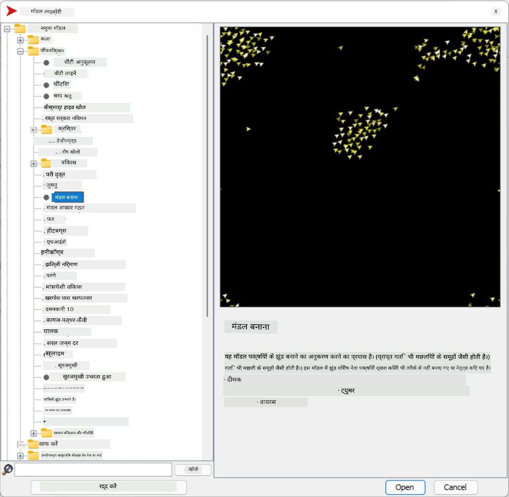
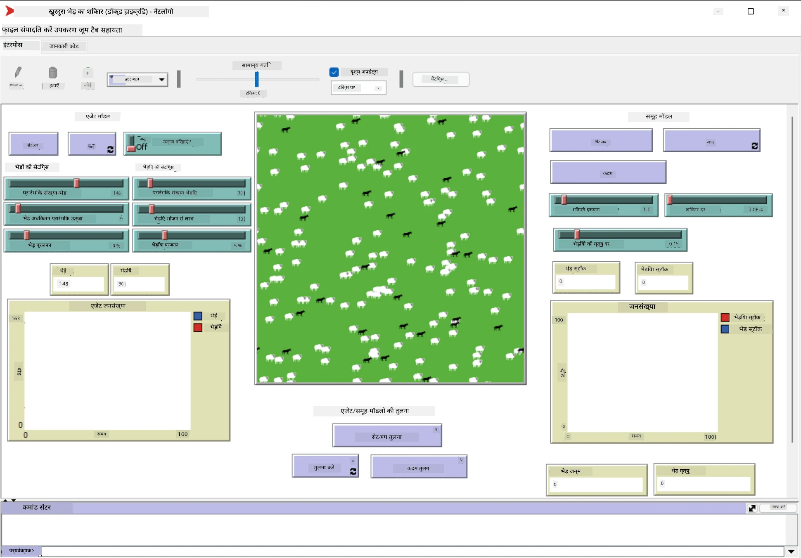

# Multi-Agent Systems

Intelligence achieve karne ke possible tareekon mein se ek hai **emergent** (ya **synergetic**) approach. Yeh is baat par based hai ki kai relatively simple agents ka combined behavior poore system ke zyada complex (ya intelligent) behavior ko janam de sakta hai. Theory ke hisaab se, yeh [Collective Intelligence](https://en.wikipedia.org/wiki/Collective_intelligence), [Emergentism](https://en.wikipedia.org/wiki/Global_brain) aur [Evolutionary Cybernetics](https://en.wikipedia.org/wiki/Global_brain) ke principles par based hai, jo kehte hain ki jab higher-level systems ko lower-level systems se sahi tarah combine kiya jaye, toh unhe ek tarah ki extra value mil jaati hai (ise *principle of metasystem transition* kehte hain).

## [Pre-lecture quiz](https://ff-quizzes.netlify.app/en/ai/quiz/45)

**Multi-Agent Systems** ki direction AI mein 1990s mein Internet aur distributed systems ke growth ke response mein ubhri. Ek classic AI textbook, [Artificial Intelligence: A Modern Approach](https://en.wikipedia.org/wiki/Artificial_Intelligence:_A_Modern_Approach), classic AI ko multi-agent systems ke point of view se dekhne par focus karti hai.

Multi-agent approach ke center mein **Agent** ka concept hai - ek aisi entity jo kisi **environment** mein rehti hai, jise woh perceive kar sakti hai aur jis par woh act kar sakti hai. Yeh ek bahut broad definition hai, aur agents ke kai alag-alag types aur classifications ho sakte hain:

* Reasoning karne ki ability ke basis par:
   - **Reactive** agents aam taur par simple request-response type ka behavior rakhte hain
   - **Deliberative** agents kisi tarah ke logical reasoning aur/ya planning capabilities use karte hain
* Agent ka code kahan execute hota hai, uske basis par:
   - **Static** agents ek dedicated network node par kaam karte hain
   - **Mobile** agents apna code network nodes ke beech move kar sakte hain
* Unke behavior ke basis par:
   - **Passive agent** ke koi specific goals nahi hote. Aise agents external stimuli par react kar sakte hain, lekin khud koi action start nahi karenge.
   - **Active agent** ke kuch goals hote hain jinhe woh achieve karne ki koshish karta hai
   - **Cognitive agents** complex planning aur reasoning mein involved hote hain

Multi-agent systems aaj kal kai applications mein use hote hain:

* Games mein, kai non-player characters kisi na kisi tarah ka AI use karte hain, aur unhe intelligent agents maana jaata hai
* Video production mein, crowds wale complex 3D scenes render karna aam taur par multi-agent simulation se kiya jaata hai
* System modeling mein, complex models ke behavior ko simulate karne ke liye multi-agent approach use hota hai. Jaise, COVID-19 bimari ke worldwide spread ko predict karne ke liye multi-agent approach safalta se use hui hai. Isi tarah ka approach shehar ke traffic ko model karne aur yeh dekhne ke liye bhi use ho sakta hai ki traffic rules badalne par woh kaise react karta hai.
* Complex automation systems mein, har device ek independent agent ki tarah kaam kar sakta hai, jisse poora system kam rigid aur zyada robust ban jaata hai.

Hum multi-agent systems par bahut gehraai mein time nahi bitayenge, lekin **multi-agent modeling** ka ek example dekhenge.

## NetLogo

[NetLogo](https://ccl.northwestern.edu/netlogo/) ek multi-agent modeling environment hai jo [Logo](https://en.wikipedia.org/wiki/Logo_(programming_language)) programming language ke modified version par based hai. Yeh language bachon ko programming concepts sikhane ke liye develop ki gayi thi, aur isme aap ek agent ko control kar sakte hain jise **turtle** kehte hain, jo peeche nishaan chhodte hue move kar sakta hai. Isse complex geometric figures banana possible hota hai, jo agent ke behavior ko samajhne ka ek bahut visual tareeka hai.

NetLogo mein, hum `create-turtles` command se kai turtles bana sakte hain. Phir hum saare turtles ko kuch actions karne ka order de sakte hain (neeche ke example mein - 10 points aage badhna):

```
create-turtles 10
ask turtles [
  forward 10
]
```

Bilkul, jab saare turtles ek hi kaam karte hain toh woh interesting nahi hota, isliye hum turtles ke groups ko `ask` kar sakte hain, jaise woh jo kisi certain point ke aas-paas hain. Hum `breed [cats cat]` command se alag-alag *breeds* ke turtles bhi bana sakte hain. Yahan `cat` breed ka naam hai, aur humein plural aur singular dono words specify karne padte hain, kyunki alag-alag commands clarity ke liye alag forms use karte hain.

> ✅ Hum NetLogo language seekhne mein bahut gehre nahi jayenge - agar aapko aur seekhne mein interest hai toh aap bahut accha resource [Beginner's Interactive NetLogo Dictionary](https://ccl.northwestern.edu/netlogo/bind/) dekh sakte hain.

Aap NetLogo ko [download](https://ccl.northwestern.edu/netlogo/download.shtml) karke try kar sakte hain.

### Models Library

NetLogo ki ek achhi baat yeh hai ki ismein working models ki ek library hoti hai jise aap try kar sakte hain. **File &rightarrow; Models Library** par jaiye, aur aapke paas choose karne ke liye kai model categories hongi.



> Dmitry Soshnikov dwara Models Library ka screenshot

Aap koi model khol sakte hain, jaise **Biology &rightarrow; Flocking**.

### Basic Principles

Model kholne ke baad, aap main NetLogo screen par pahunch jaate hain. Yahan ek sample model hai jo bhediyon aur bhedon ki population ko describe karta hai, limited resources (ghaas) ke saath.



> Dmitry Soshnikov dwara screenshot

Is screen par, aap dekh sakte hain:

* **Interface** section jisme shamil hain:
  - Main field, jahan saare agents rehte hain
  - Alag-alag controls: buttons, sliders, etc.
  - Graphs jo aap simulation ke parameters dikhane ke liye use kar sakte hain
* **Code** tab jisme editor hota hai, jahan aap NetLogo program type kar sakte hain

Zyadatar cases mein, interface mein ek **Setup** button hota hai, jo simulation ki state initialize karta hai, aur ek **Go** button jo execution start karta hai. Yeh related code handlers se control hote hain, jo is tarah dikhte hain:

```
to go [
...
]
```

NetLogo ki duniya in objects se bani hoti hai:

* **Agents** (turtles) jo field mein ghoom sakte hain aur kuch kaam kar sakte hain. Aap `ask turtles [...]` syntax se agents ko instructions dete hain, aur brackets mein jo code hota hai woh saare agents *turtle mode* mein run karte hain.
* **Patches** field ke square areas hain, jin par agents rehte hain. Aap ek hi patch par maujood saare agents ko refer kar sakte hain, ya patches ka color aur dusri properties badal sakte hain. Aap `ask patches` bhi use kar sakte hain.
* **Observer** ek unique agent hai jo duniya ko control karta hai. Saare button handlers *observer mode* mein execute hote hain.

> ✅ Multi-agent environment ki khoobsurti yeh hai ki jo code turtle mode ya patch mode mein chalta hai, woh saare agents dwara ek saath parallel mein execute hota hai. Isliye, thoda sa code likhkar aur individual agent ke behavior ko program karke, aap poore simulation system ka complex behavior bana sakte hain.

### Flocking

Multi-agent behavior ke example ke roop mein, chaliye **[Flocking](https://en.wikipedia.org/wiki/Flocking_(behavior))** ko dekhte hain. Flocking ek complex pattern hai jo pakshiyon ke jhund ki udaan se bahut milta-julta hai. Unhe udte dekhkar aapko lag sakta hai ki woh koi collective algorithm follow karte hain, ya unke paas kisi tarah ki *collective intelligence* hai. Lekin, yeh complex behavior tab ubharta hai jab har individual agent (is case mein, ek *pakshi*) sirf apne aas-paas ke agents ko dekhta hai, aur teen simple rules follow karta hai:

* **Alignment** - yeh nearby agents ke average heading ki taraf mudta hai
* **Cohesion** - yeh padosiyon ki average position ki taraf mudne ki koshish karta hai (*long-range attraction*)
* **Separation** - jab dusre pakshiyon ke bahut kareeb aata hai, toh yeh door jaane ki koshish karta hai (*short-range repulsion*)

Aap flocking example chalakar behavior dekh sakte hain. Aap parameters bhi adjust kar sakte hain, jaise *degree of separation*, ya *vision range*, jo define karta hai ki har pakshi kitni door tak dekh sakta hai. Dhyan rakhiye, agar aap vision range ko 0 kar dein, toh saare pakshi andhe ho jaate hain, aur flocking ruk jaati hai. Agar aap separation ko 0 kar dein, toh saare pakshi ek straight line mein ikatthe ho jaate hain.

> ✅ **Code** tab par jaiye aur dekhiye ki flocking ke teen rules (alignment, cohesion aur separation) code mein kahan implement kiye gaye hain. Dhyan dijiye ki hum sirf unhi agents ko address karte hain jo nazar mein hain.

### Dekhne ke liye aur models

Kuch aur interesting models hain jinke saath aap experiment kar sakte hain:

* **Art &rightarrow; Fireworks** dikhata hai ki fireworks ko individual fire streams ke collective behavior ki tarah kaise dekha ja sakta hai
* **Social Science &rightarrow; Traffic Basic** aur **Social Science &rightarrow; Traffic Grid** shehar ke traffic ke models dikhate hain, 1D aur 2D grid mein, traffic lights ke saath ya unke bina. Simulation mein har car neeche diye rules follow karti hai:
   - Agar uske aage ki jagah khaali hai - toh woh speed badhati hai (ek certain maximum speed tak)
   - Agar woh aage obstacle dekhti hai - toh brake lagati hai (aur aap adjust kar sakte hain ki driver kitni door tak dekh sakta hai)
* **Social Science &rightarrow; Party** dikhata hai ki cocktail party ke dauran log kaise groups banate hain. Aap parameters ke woh combinations dhoondh sakte hain jinse group ki happiness sabse tezi se badhti hai.

Jaisa ki aap in examples se dekh sakte hain, multi-agent simulations ek complex system ke behavior ko samajhne ka ek useful tareeka ho sakte hain, jo same ya similar logic follow karne wale individuals se bana ho. Isse computer games mein [NPCs](https://en.wikipedia.org/wiki/NPC) jaise virtual agents, ya 3D animated worlds ke agents ko control karne ke liye bhi use kiya ja sakta hai.

## Deliberative Agents

Upar bataye gaye agents bahut simple hain, jo environment ke changes par kisi algorithm se react karte hain. Isliye inhe **reactive agents** kehte hain. Lekin, kabhi-kabhi agents reasoning kar sakte hain aur apne action ki planning kar sakte hain, jise **deliberative** kehte hain.

Ek typical example ek personal agent hoga jise insaan se holiday trip book karne ke instructions milte hain. Maan lijiye internet par kai agents hain jo ismein help kar sakte hain. Use phir dusre agents se contact karna chahiye yeh dekhne ke liye ki kaun si flights available hain, alag-alag dates ke liye hotels ke prices kya hain, aur best price ke liye negotiate karna chahiye. Jab holiday plan complete ho jaye aur owner se confirm ho jaye, tab woh booking ke saath aage badh sakta hai.

Yeh karne ke liye, agents ko **communicate** karna padta hai. Successful communication ke liye unhe chahiye:

* Knowledge exchange ke liye kuch **standard languages**, jaise [Knowledge Interchange Format](https://en.wikipedia.org/wiki/Knowledge_Interchange_Format) (KIF) aur [Knowledge Query and Manipulation Language](https://en.wikipedia.org/wiki/Knowledge_Query_and_Manipulation_Language) (KQML). Yeh languages [Speech Act theory](https://en.wikipedia.org/wiki/Speech_act) par based hain.
* Un languages mein kuch **negotiation protocols** bhi shamil hone chahiye, alag-alag **auction types** ke basis par.
* Ek **common ontology** ka use, taaki woh same concepts ko refer karein aur unki semantics samjhein
* Yeh pata lagane ka ek tareeka ki alag-alag agents kya kar sakte hain, jo kisi tarah ki ontology par based ho

Deliberative agents reactive agents se kaafi zyada complex hote hain, kyunki woh sirf environment ke changes par react nahi karte, unhe actions *initiate* karne mein bhi capable hona chahiye. Deliberative agents ke liye propose kiye gaye architectures mein se ek hai Belief-Desire-Intention (BDI) agent:

* **Beliefs** agent ke environment ke baare mein knowledge ka ek set banate hain. Ise knowledge base ya rules ke set ke roop mein structure kiya ja sakta hai jo agent environment ki kisi specific situation par apply kar sakta hai.
* **Desires** define karti hain ki agent kya karna chahta hai, yaani uske goals. Jaise, upar ke personal assistant agent ka goal trip book karna hai, aur hotel agent ka goal maximum profit kamana hai.
* **Intentions** woh specific actions hain jo agent apne goals achieve karne ke liye plan karta hai. Actions aam taur par environment ko badalte hain aur dusre agents ke saath communicate karte hain.

Multi-agent systems banane ke liye kuch platforms available hain, jaise [JADE](https://jade.tilab.com/). [Yeh paper](https://arxiv.org/ftp/arxiv/papers/2007/2007.08961.pdf) multi-agent platforms ka ek review deta hai, saath hi multi-agent systems ki short history aur unke alag-alag usage scenarios bhi batata hai.

## Conclusion

Multi-agent systems alag-alag roop le sakte hain aur kai alag applications mein use ho sakte hain.
Woh sab individual agent ke simple behavior par focus karte hain, aur **synergetic effect** ki wajah se poore system ka complex behavior achieve karte hain.

## 🚀 Challenge

Is lesson ko real world mein le jaiye aur kisi problem ko solve karne wale multi-agent system ki kalpana kijiye. Jaise, school bus routes ko optimize karne ke liye multi-agent system ko kya karna padega? Yeh bakery mein kaise kaam kar sakta hai?

## [Post-lecture quiz](https://ff-quizzes.netlify.app/en/ai/quiz/46)

## Review & Self Study

Industry mein is tarah ke system ke use ko review kijiye. Manufacturing ya video game industry jaisa koi sector chuniye aur jaaniye ki multi-agent systems unique problems solve karne ke liye kaise use ho sakte hain.

## [NetLogo Assignment](assignment.md)

---

<!-- HINGLISH NOTE START -->
**Note**:
Yeh document Hindi translation ko Hinglish (Roman script) mein convert karke banaya gaya hai, taaki padhna aur samajhna aasaan ho.
Isme kuch galtiyan ya anuvaad ki kamiyan ho sakti hain. Sabse sahi jaankari ke liye original English document ko hi authoritative source maanein.
<!-- HINGLISH NOTE END -->
