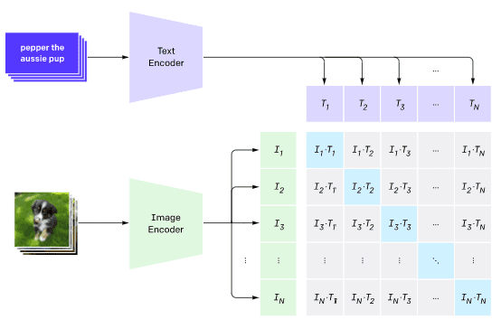
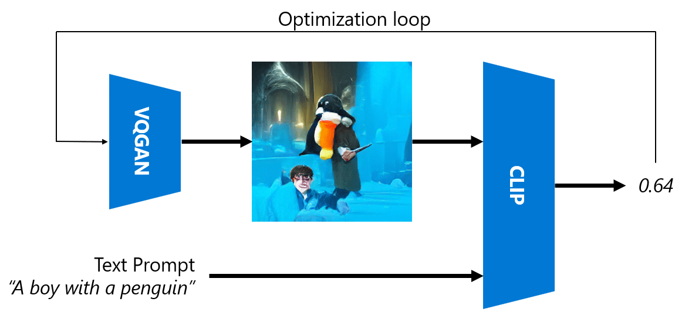
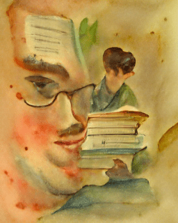
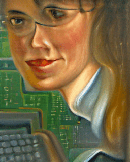
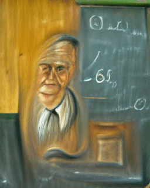

# Multi-Modal Networks

NLP tasks solve karne mein transformer models ki success ke baad, same ya similar architectures ko computer vision tasks par apply kiya gaya. Aise models banane mein interest badh raha hai jo vision aur natural language capabilities ko *combine* karke kaam kar sakein. Aisi hi ek koshish OpenAI ne ki, jise CLIP aur DALL.E kehte hain.

## Contrastive Image Pre-Training (CLIP)

CLIP ka main idea yeh hai ki text prompts aur image ki comparison ki ja sake aur yeh determine kiya ja sake ki image prompt ke saath kitni achhi tarah match karti hai.

> *Picture [is blog post](https://openai.com/blog/clip/) se liya gaya hai*

Model ko internet se li gayi images aur unke captions par train kiya gaya hai. Har batch ke liye, hum N pairs (image, text) lete hain aur unhe kuch vector representations I aur T mein convert karte hain.

Un representations ko phir ek saath match kiya jaata hai. Loss function is tarah define kiya gaya hai ki woh ek pair (jaise I aur T) ke vectors ke beech cosine similarity ko maximize kare aur baaki saari pairs ke beech cosine similarity ko minimize kare. Yahi wajah hai ki is approach ko **contrastive** kehte hain.

CLIP model/library [OpenAI GitHub](https://github.com/openai/CLIP) se available hai. Is approach ko [is blog post](https://openai.com/blog/clip/) mein aur zyada detail mein [is paper](https://arxiv.org/pdf/2103.00020.pdf) mein describe kiya gaya hai.

Ek baar yeh model pre-train ho jaaye, toh hum ise images aur text prompts ke batch de sakte hain, aur yeh humein probabilities ke saath ek tensor return karega. CLIP ko kai tasks ke liye use kiya ja sakta hai:

**Image Classification**

Maan lijiye humein images ko billi, kutta aur insaan mein classify karna hai. Is case mein, hum model ko ek image aur text prompts ki ek series dete hain: "*a picture of a cat*", "*a picture of a dog*", "*a picture of a human*". Result mein aane wale 3 probabilities ke vector mein, humein bas sabse high value wala index select karna hai.

> *Picture [is blog post](https://openai.com/blog/clip/) se liya gaya hai*

**Text-Based Image Search**

Hum iska ulta bhi kar sakte hain. Agar humare paas images ka ek collection hai, toh hum is collection ko model mein pass kar sakte hain aur ek text prompt de sakte hain - yeh humein woh image degi jo diye gaye prompt ke sabse zyada similar hai.

## ✍️ Example: [Image Classification aur Image Search ke liye CLIP ka use](../../../../../lessons/X-Extras/X1-MultiModal/Clip.ipynb)

CLIP ko action mein dekhne ke liye [Clip.ipynb](../../../../../lessons/X-Extras/X1-MultiModal/Clip.ipynb) notebook kholiye.

## VQGAN+CLIP ke saath Image Generation

CLIP ko text prompt se **image generation** ke liye bhi use kiya ja sakta hai. Iske liye, humein ek **generator model** chahiye hota hai jo kuch vector input ke basis par image generate kar sake. Aisa hi ek model [VQGAN](https://compvis.github.io/taming-transformers/) (Vector-Quantized GAN) kehlata hai.

VQGAN ki main khasiyatein jo ise ordinary [GAN](../../4-ComputerVision/10-GANs/README.md) se alag karti hain, yeh hain:
* Autoregressive transformer architecture use karke ek sequence generate karna jo context-rich visual parts banata hai jinse image banti hai. In visual parts ko [CNN](../../4-ComputerVision/07-ConvNets/README.md) seekhta hai.
* Sub-image discriminator use karna jo detect karta hai ki image ke parts "real" hain ya "fake" (traditional GAN ke "all-or-nothing" approach ke ulta).

VQGAN ke baare mein aur jaanein [Taming Transformers](https://compvis.github.io/taming-transformers/) website par.

VQGAN aur traditional GAN ke beech ek important difference yeh hai ki traditional GAN kisi bhi input vector se ek achhi image bana sakta hai, jabki VQGAN shayad ek incoherent image bana de. Isliye, humein image creation process ko aur zyada guide karna padta hai, aur yeh CLIP use karke kiya ja sakta hai.

Text prompt ke hisaab ki image generate karne ke liye, hum kuch random encoding vector se shuru karte hain jise VQGAN se pass kiya jaata hai taaki image generate ho sake. Phir CLIP ko loss function produce karne ke liye use kiya jaata hai jo dikhata hai ki image text prompt ke saath kitni achhi tarah match karti hai. Goal phir is loss ko minimize karna hota hai, back propagation use karke input vector parameters ko adjust karte hue.

VQGAN+CLIP ko implement karne wali ek behtareen library [Pixray](http://github.com/pixray/pixray) hai.

 |   | 
----|----|----
Prompt se generate ki gayi picture *a closeup watercolor portrait of young male teacher of literature with a book* | Prompt se generate ki gayi picture *a closeup oil portrait of young female teacher of computer science with a computer* | Prompt se generate ki gayi picture *a closeup oil portrait of old male teacher of math in front of blackboard*

> **Artificial Teachers** collection ki pictures [Dmitry Soshnikov](http://soshnikov.com) ki taraf se

## DALL-E
### [DALL-E 1](https://openai.com/research/dall-e)
DALL-E GPT-3 ka ek version hai jise prompts se images generate karne ke liye train kiya gaya hai. Ise 12-billion parameters ke saath train kiya gaya hai.

CLIP ke ulta, DALL-E text aur image dono ko ek hi token stream ki tarah receive karta hai. Isliye, kai prompts se, aap text ke basis par images generate kar sakte hain.

### [DALL-E 2](https://openai.com/dall-e-2)
DALL-E 1 aur 2 ke beech main difference yeh hai ki DALL-E 2 zyada realistic images aur art generate karta hai.

DALL-E ke saath image generation ke examples:
 |   | 
----|----|----
Prompt se generate ki gayi picture *a closeup watercolor portrait of young male teacher of literature with a book* | Prompt se generate ki gayi picture *a closeup oil portrait of young female teacher of computer science with a computer* | Prompt se generate ki gayi picture *a closeup oil portrait of old male teacher of math in front of blackboard*

## References

* VQGAN paper: [Taming Transformers for High-Resolution Image Synthesis](https://compvis.github.io/taming-transformers/paper/paper.pdf)
* CLIP paper: [Learning Transferable Visual Models From Natural Language Supervision](https://arxiv.org/pdf/2103.00020.pdf)

---

<!-- HINGLISH NOTE START -->
**Note**:
Yeh document Hindi translation ko Hinglish (Roman script) mein convert karke banaya gaya hai, taaki padhna aur samajhna aasaan ho.
Isme kuch galtiyan ya anuvaad ki kamiyan ho sakti hain. Sabse sahi jaankari ke liye original English document ko hi authoritative source maanein.
<!-- HINGLISH NOTE END -->
