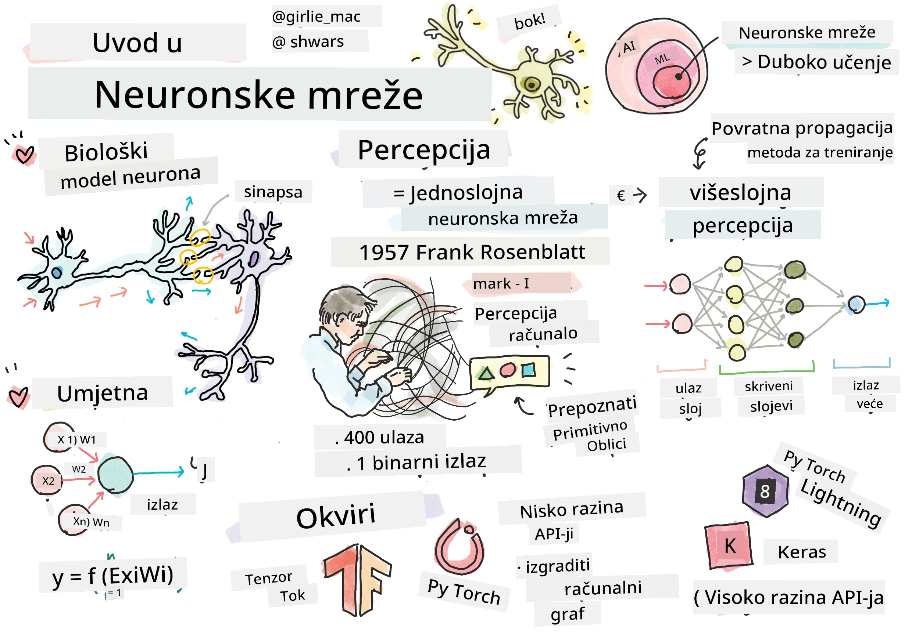
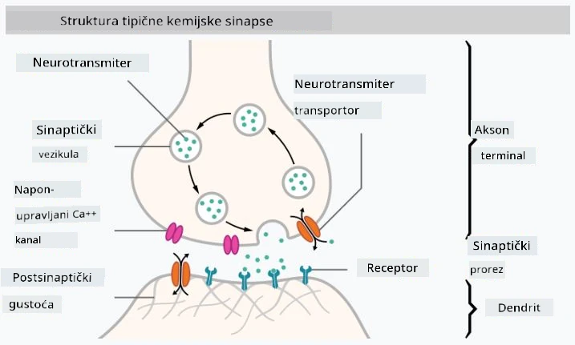

# Uvod u neuronske mreže

Kao što smo raspravljali u uvodu, jedan od načina za postizanje inteligencije je treniranje **računalnog modela** ili **umjetnog mozga**. Od sredine 20. stoljeća, istraživači su isprobavali različite matematičke modele, dok se u posljednjim godinama ovaj pravac pokazao izuzetno uspješnim. Takvi matematički modeli mozga nazivaju se **neuronske mreže**.

> Ponekad se neuronske mreže nazivaju *Umjetne neuronske mreže*, ANN, kako bi se naznačilo da govorimo o modelima, a ne o pravim mrežama neurona.

## Strojno učenje

Neuronske mreže su dio šire discipline nazvane **Strojno učenje**, čiji je cilj korištenje podataka za treniranje računalnih modela koji su sposobni rješavati probleme. Strojno učenje čini velik dio umjetne inteligencije, međutim, klasično strojno učenje ne obrađujemo u ovom kurikulumu.

> Posjetite naš zasebni **[kurikulum Strojno učenje za početnike](http://github.com/microsoft/ml-for-beginners)** za učenje više o klasičnom strojnome učenju.

U strojnome učenju pretpostavljamo da imamo neki skup podataka primjera **X** i odgovarajuće izlazne vrijednosti **Y**. Primjeri su često N-dimenzionalni vektori koji se sastoje od **značajki**, a izlazi se nazivaju **oznakama**.

Razmotrit ćemo dva najčešća problema strojnog učenja:

* **Klasifikacija**, gdje trebamo klasificirati ulazni objekt u dvije ili više klasa.
* **Regresija**, gdje trebamo predvidjeti numeričku vrijednost za svaki od ulaznih uzoraka.

> Prilikom predstavljanja ulaza i izlaza kao tenzora, ulazni skup podataka je matrica veličine M&times;N, gdje je M broj uzoraka, a N broj značajki. Izlazne oznake Y su vektor veličine M.

U ovom kurikulumu fokusirat ćemo se samo na modele neuronskih mreža.

## Model neurona

Iz biologije znamo da naš mozak se sastoji od neuronskih stanica (neurona), od kojih svaki ima više "ulaza" (dendrita) i jedan "izlaz" (akson). I dendriti i aksoni mogu provoditi električne signale, a veze između njih — poznate kao sinapse — mogu imati različite stupnjeve provodljivosti, koje reguliraju neuroprijenosnici.

 | 
----|----
Pravi neuron *([Slika](https://en.wikipedia.org/wiki/Synapse#/media/File:SynapseSchematic_lines.svg) s Wikipedije)* | Umjetni neuron *(Slika autora)*

Dakle, najjednostavniji matematički model neurona sadrži nekoliko ulaza X1, ..., XN i jedan izlaz Y, te niz težina W1, ..., WN. Izlaz se računa kao:

gdje je f neka nelinearna **aktivacijska funkcija**.

> Rani modeli neurona opisani su u klasičnom radu [A logical calculus of the ideas immanent in nervous activity](https://www.cs.cmu.edu/~./epxing/Class/10715/reading/McCulloch.and.Pitts.pdf) Warrena McCullocka i Waltera Pittsa iz 1943. Donald Hebb je u svojoj knjizi "[The Organization of Behavior: A Neuropsychological Theory](https://books.google.com/books?id=VNetYrB8EBoC)" predložio način treniranja tih mreža.

## U ovom poglavlju

U ovom poglavlju učit ćemo o:
* [Perceptronu](03-Perceptron/README.md), jednom od najranijih modela neuronskih mreža za klasifikaciju u dvije klase
* [Višeslojnim mrežama](04-OwnFramework/README.md) s pripadajućom bilježnicom [kako izgraditi vlastiti okvir](04-OwnFramework/OwnFramework.ipynb)
* [Okvirima neuronskih mreža](05-Frameworks/README.md), s bilježnicama: [PyTorch](05-Frameworks/IntroPyTorch.ipynb) i [Keras/Tensorflow](05-Frameworks/IntroKerasTF.ipynb)
* [Prenaučenju](../../../../lessons/3-NeuralNetworks/05-Frameworks#overfitting)

---

<!-- CO-OP TRANSLATOR DISCLAIMER START -->
**Napomena**:
Ovaj dokument je preveden korištenjem AI prevoditeljskog servisa [Co-op Translator](https://github.com/Azure/co-op-translator). Iako težimo točnosti, imajte na umu da automatski prijevodi mogu sadržavati greške ili netočnosti. Izvorni dokument na izvornom jeziku treba smatrati autoritativnim izvorom. Za važne informacije preporuča se profesionalni ljudski prijevod. Nismo odgovorni za bilo kakva nesporazumevanja ili pogrešne interpretacije koje proizlaze iz korištenja ovog prijevoda.
<!-- CO-OP TRANSLATOR DISCLAIMER END -->