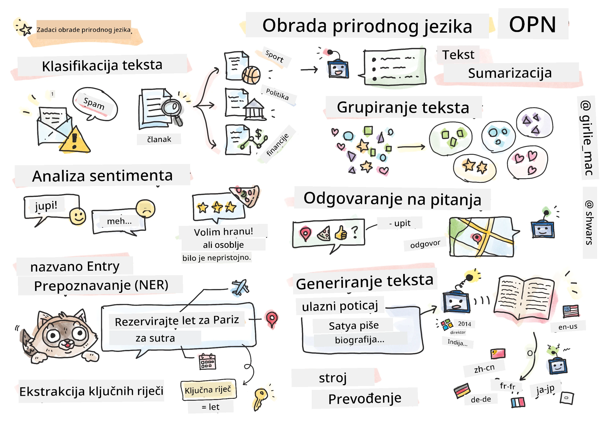

# Obrada prirodnog jezika



U ovom ćemo odjeljku fokusirati na korištenje neuronskih mreža za rješavanje zadataka vezanih uz **obradu prirodnog jezika (NLP)**. Postoji mnogo NLP problema koje želimo da računala mogu riješiti:

* **Klasifikacija teksta** je tipični problem klasifikacije koji se odnosi na tekstualne nizove. Primjeri uključuju klasifikaciju e-mail poruka kao spam ili ne-spam, ili kategorizaciju članaka kao sport, biznis, politika itd. Također, pri razvoju chat botova često moramo razumjeti što je korisnik htio reći -- u tom slučaju radimo s **klasifikacijom namjere**. Često kod klasifikacije namjere treba postupati s mnogim kategorijama.
* **Analiza sentimenta** je tipični problem regresije, gdje trebamo dodijeliti broj (sentiment) koji odgovara koliko je značenje rečenice pozitivno/negativno. Naprednija verzija analize sentimenta je **analiza sentimenta temeljena na aspektima** (ABSA), gdje sentiment pridodajemo ne cijeloj rečenici, nego različitim dijelovima (aspektima), npr. *U ovom restoranu mi se svidjela kuhinja, ali atmosfera je bila užasna*.
* **Prepoznavanje imenovanih entiteta** (NER) odnosi se na problem izdvajanja određenih entiteta iz teksta. Na primjer, trebamo razumjeti da u frazi *Morao bih sutra letjeti za Pariz* riječ *sutra* označava DATUM, a *Pariz* je LOKACIJA.  
* **Izdvajanje ključnih riječi** slično je NER-u, ali trebamo automatski izvući riječi važne za značenje rečenice, bez prethodnog učenja za specifične vrste entiteta.
* **Grupiranje teksta** može biti korisno kad želimo grupirati slične rečenice, na primjer, slične zahtjeve u razgovorima tehničke podrške.
* **Odgovaranje na pitanja** odnosi se na sposobnost modela da odgovori na specifično pitanje. Model prima tekstualni odlomak i pitanje kao ulaze, i treba dati mjesto u tekstu gdje se nalazi odgovor na pitanje (ili, ponekad, generirati tekst odgovora).
* **Generiranje teksta** je sposobnost modela da generira novi tekst. Može se smatrati klasifikacijskim zadatkom koji predviđa sljedeće slovo/riječ na temelju nekog *tekstualnog prompta*. Napredni modeli za generiranje teksta, poput GPT-3, mogu riješiti i druge NLP zadatke poput klasifikacije koristeći tehniku nazvanu [prompt programming](https://towardsdatascience.com/software-3-0-how-prompting-will-change-the-rules-of-the-game-a982fbfe1e0) ili [prompt engineering](https://medium.com/swlh/openai-gpt-3-and-prompt-engineering-dcdc2c5fcd29)
* **Sažimanje teksta** je tehnika u kojoj želimo da računalo "pročita" dugi tekst i sažme ga u nekoliko rečenica.
* **Strojno prevođenje** može se promatrati kao kombinacija razumijevanja teksta na jednom jeziku i generiranja teksta na drugom jeziku.

U početku su većina NLP zadataka rješavane tradicionalnim metodama poput gramatika. Na primjer, kod strojnog prevođenja koristili su se parseri za pretvaranje početne rečenice u sintaksno stablo, zatim su izdvojene semantičke strukture višeg nivoa za predstavljanje značenja rečenice, a na temelju tog značenja i gramatike ciljnog jezika generiran je rezultat. Danas se mnogi NLP zadaci učinkovitije rješavaju korištenjem neuronskih mreža.

> Mnoge klasične NLP metode implementirane su u Python biblioteci [Natural Language Processing Toolkit (NLTK)](https://www.nltk.org). Dostupna je izvrsna [NLTK knjiga](https://www.nltk.org/book/) online koja pokriva kako se različiti NLP zadaci mogu riješiti pomoću NLTK-a.

U našem tečaju ćemo se uglavnom fokusirati na korištenje neuronskih mreža za NLP, a NLTK ćemo koristiti tamo gdje je potrebno.

Već smo naučili o korištenju neuronskih mreža za rad s tabelarnim podacima i slikama. Glavna razlika između tih vrsta podataka i teksta je što je tekst niz varijabilne duljine, dok je veličina ulaza za slike unaprijed poznata. Dok konvolucijske mreže mogu izdvajati obrasce iz ulaznih podataka, obrasci u tekstu su složeniji. Npr., negacija može biti odvojena od subjekta proizvoljnom udaljenošću (npr. *Ne volim naranče*, nasuprot *Ne volim one velike šarene ukusne naranče*), a to se treba interpretirati kao jedan obrazac. Stoga, za rad s jezikom treba uvesti nove vrste neuronskih mreža, poput *rekurentnih mreža* i *transformera*.

## Instalacija biblioteka

Ako koristite lokalnu Python instalaciju za izvođenje ovog tečaja, možda će vam biti potrebno instalirati sve potrebne biblioteke za NLP koristeći sljedeće naredbe:

**Za PyTorch**
```bash
pip install -r requirements-pytorch.txt
```
**Za TensorFlow**
```bash
pip install -r requirements-tf.txt
```

> NLP možete isprobati i s TensorFlow-om na [Microsoft Learn](https://docs.microsoft.com/learn/modules/intro-natural-language-processing-tensorflow/?WT.mc_id=academic-77998-cacaste)

## Upozorenje vezano uz GPU

U ovom odjeljku, u nekim ćemo primjerima trenirati prilično velike modele.
* **Koristite računalo s GPU-om**: Preporučljivo je pokretati vaše bilježnice na računalu s podrškom za GPU kako bi vrijeme čekanja prilikom rada s velikim modelima bilo smanjeno.
* **Ograničenja GPU memorije**: Rad na GPU-u može dovesti do situacija u kojima istrošite dostupnu GPU memoriju, osobito pri treniranju velikih modela.
* **Potrošnja GPU memorije**: Količina GPU memorije potrošene tijekom treniranja ovisi o nekoliko faktora, uključujući veličinu minibatch-a.
* **Minimizirajte veličinu minibatch-a**: Ako naiđete na probleme s GPU memorijom, pokušajte smanjiti veličinu minibatch-a u vašem kodu kao moguću soluciju.
* **Otpuštanje GPU memorije u TensorFlow-u**: Starije verzije TensorFlow-a možda ne oslobađaju GPU memoriju ispravno kod treniranja više modela u okviru jednog Python kernela. Kako biste učinkovito upravljali korištenjem GPU memorije, možete konfigurirati TensorFlow da memoriju na GPU dodjeljuje samo prema potrebi.
* **Uključivanje koda**: Da biste postavili TensorFlow da povećava alokaciju GPU memorije samo kad je potrebno, uključite sljedeći kod u svoje bilježnice:

```python
physical_devices = tf.config.list_physical_devices('GPU') 
if len(physical_devices)>0:
    tf.config.experimental.set_memory_growth(physical_devices[0], True) 
```

Ako vas zanima učenje o NLP-u iz klasične perspektive strojnog učenja, posjetite [ovu seriju lekcija](https://github.com/microsoft/ML-For-Beginners/tree/main/6-NLP)

## U ovom odjeljku
U ovom odjeljku naučit ćemo o:

* [Predstavljanju teksta kao tenzora](13-TextRep/README.md)
* [Word Embeddings](14-Embeddings/README.md)
* [Modeliranju jezika](15-LanguageModeling/README.md)
* [Rekurentnim neuronskim mrežama](16-RNN/README.md)
* [Generativnim mrežama](17-GenerativeNetworks/README.md)
* [Transformerima](18-Transformers/README.md)

---

<!-- CO-OP TRANSLATOR DISCLAIMER START -->
**Napomena**:
Ovaj dokument je preveden korištenjem AI prevoditeljskog servisa [Co-op Translator](https://github.com/Azure/co-op-translator). Iako težimo točnosti, imajte na umu da automatski prijevodi mogu sadržavati greške ili netočnosti. Izvorni dokument na izvornom jeziku treba smatrati autoritativnim izvorom. Za važne informacije preporuča se profesionalni ljudski prijevod. Nismo odgovorni za bilo kakva nesporazumevanja ili pogrešne interpretacije koje proizlaze iz korištenja ovog prijevoda.
<!-- CO-OP TRANSLATOR DISCLAIMER END -->