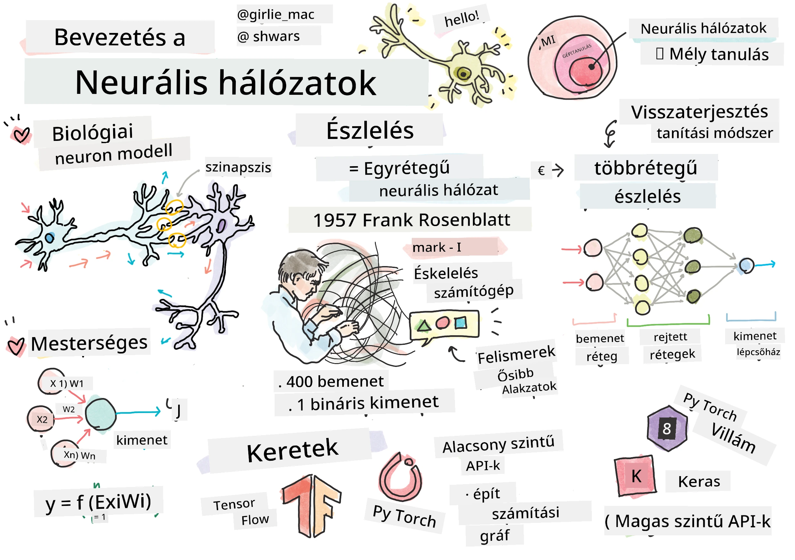
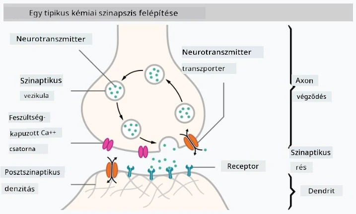

# Bevezetés a neurális hálózatokhoz

Ahogy a bevezetőben tárgyaltuk, az intelligencia elérésének egyik módja egy **számítógépes modell** vagy egy **mesterséges agy** kiképzése. A 20. század közepétől a kutatók különböző matematikai modelleket próbáltak ki, míg az utóbbi években ez az irány rendkívül sikeressé vált. Az agy ilyen matematikai modelljeit **neurális hálózatoknak** nevezzük.

> Néha a neurális hálózatokat *Mesterséges Neurális Hálózatoknak*, ANNs-nek nevezik annak jelezésére, hogy modellekről beszélünk, nem valódi idegi hálózatokról.

## Gépi tanulás

A neurális hálózatok egy nagyobb tudományterület, a **Gépi tanulás** részei, amelynek célja, hogy adatok segítségével tanítsunk számítógépes modelleket problémák megoldására. A gépi tanulás az Mesterséges Intelligencia nagy részét alkotja, azonban ebben a tananyagban a klasszikus ML-t nem tárgyaljuk.

> Látogasd meg különálló **[Gépi tanulás kezdőknek](http://github.com/microsoft/ml-for-beginners)** tananyagunkat, hogy többet tudj meg a klasszikus gépi tanulásról.

A gépi tanulásban feltételezzük, hogy van egy példa adatbázisunk **X**-szel, és a hozzá tartozó kimeneti értékek **Y**-nal. A példák gyakran N-dimenziós vektorok, amelyek **jellemzőkből** állnak, a kimeneteket pedig **címkéknek** nevezzük.

Két leggyakoribb gépi tanulási problémát tekintünk át:

* **Osztályozás**, ahol egy bemeneti objektumot két vagy több osztályba kell sorolnunk.
* **Regresszió**, ahol minden bemeneti mintához egy numerikus számot kell előre jeleznünk.

> Amikor a bemeneteket és kimeneteket tenzorként ábrázoljuk, a bemeneti adatbázis egy M&times;N méretű mátrix, ahol M a minták száma és N a jellemzők száma. A kimeneti címkék Y egy M méretű vektor.

Ebben a tananyagban kizárólag a neurális hálózat modellekre koncentrálunk.

## Egy neuron modellje

A biológiából tudjuk, hogy az agyunk idegsejtekből (neuronokból) áll, amelyeknek több "bemenete" (dendritek) és egyetlen "kimenete" (axon) van. Mind a dendritek, mind az axonok elektromos jeleket vezethetnek, és a közöttük lévő kapcsolatok — szinapszisok — változó vezetőképességűek, amelyeket neurotranszmitterek szabályoznak.

 | 
----|----
Valódi neuron *([Kép](https://en.wikipedia.org/wiki/Synapse#/media/File:SynapseSchematic_lines.svg) a Wikipédiáról)* | Mesterséges neuron *(Szerző képe)*

Így egy neuron legegyszerűbb matematikai modellje több bemenetet tartalmaz X1, ..., XN, egy kimenetet Y-t, valamint egy sor súlyt W1, ..., WN. A kimenetet a következőképpen számítjuk ki:

ahol f egy nemlineáris **aktivációs függvény**.

> A korai neuron modelleket az 1943-ban megjelent klasszikus tanulmány írta le [A logical calculus of the ideas immanent in nervous activity](https://www.cs.cmu.edu/~./epxing/Class/10715/reading/McCulloch.and.Pitts.pdf), Warren McCullock és Walter Pitts. Donald Hebb a "[The Organization of Behavior: A Neuropsychological Theory](https://books.google.com/books?id=VNetYrB8EBoC)" című könyvében javasolta, hogyan lehet ezeket a hálózatokat tanítani.

## Ebben a szakaszban

Ebben a szakaszban ezekkel ismerkedünk meg:
* [Perceptron](03-Perceptron/README.md), az egyik legkorábbi neurális hálózat modell kétosztályos osztályozáshoz
* [Többrétegű hálózatok](04-OwnFramework/README.md) egy párosított jegyzetfüzettel [hogyan építsük saját keretrendszerünket](04-OwnFramework/OwnFramework.ipynb)
* [Neurális hálózat keretrendszerek](05-Frameworks/README.md), ezek jegyzetfüzetei: [PyTorch](05-Frameworks/IntroPyTorch.ipynb) és [Keras/Tensorflow](05-Frameworks/IntroKerasTF.ipynb)
* [Túltanulás](../../../../lessons/3-NeuralNetworks/05-Frameworks#overfitting)

---

<!-- CO-OP TRANSLATOR DISCLAIMER START -->
**Jogi nyilatkozat**:
Ez a dokumentum az AI fordítási szolgáltatás, a [Co-op Translator](https://github.com/Azure/co-op-translator) segítségével készült. Bár az pontosságra törekszünk, kérjük, vegye figyelembe, hogy az automatikus fordítások hibákat vagy pontatlanságokat tartalmazhatnak. Az eredeti dokumentum az anyanyelvén tekintendő hiteles forrásnak. Fontos információk esetén professzionális emberi fordítást javasolunk. Nem vállalunk felelősséget semmilyen félreértésért vagy téves értelmezésért, amely ebből a fordításból ered.
<!-- CO-OP TRANSLATOR DISCLAIMER END -->