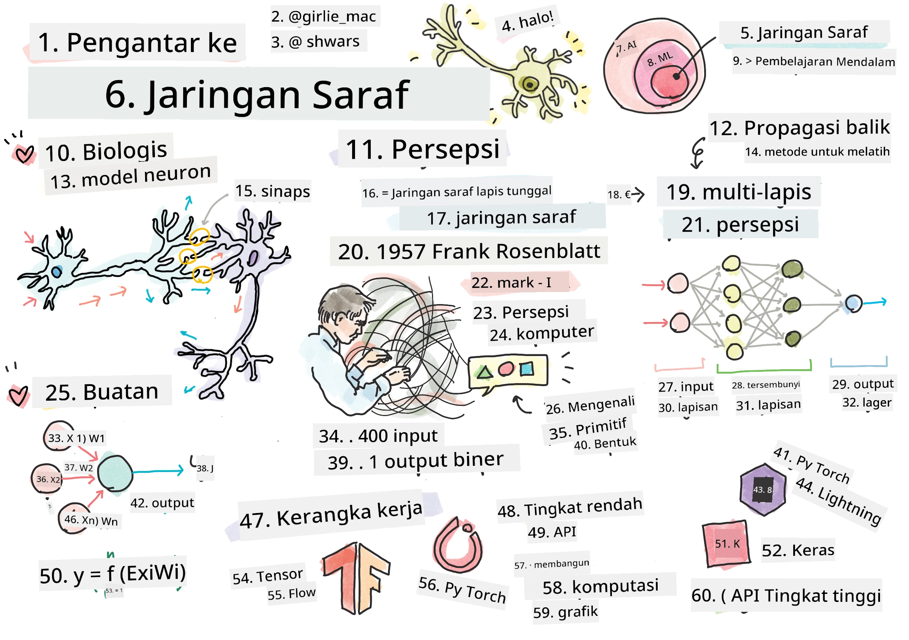
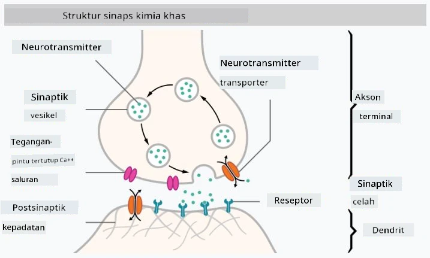

# Pengantar Jaringan Saraf

Seperti yang kita bahas dalam pengantar, salah satu cara untuk mencapai kecerdasan adalah melatih **model komputer** atau **otak buatan**. Sejak pertengahan abad ke-20, para peneliti mencoba berbagai model matematika, hingga dalam beberapa tahun terakhir arah ini terbukti sangat sukses. Model matematika otak seperti itu disebut **jaringan saraf**.

> Kadang-kadang jaringan saraf disebut *Artificial Neural Networks*, ANN, untuk menunjukkan bahwa kita berbicara tentang model, bukan jaringan neuron nyata.

## Pembelajaran Mesin

Jaringan Saraf adalah bagian dari disiplin yang lebih besar yang disebut **Pembelajaran Mesin**, yang bertujuan menggunakan data untuk melatih model komputer yang mampu menyelesaikan masalah. Pembelajaran Mesin merupakan bagian besar dari Kecerdasan Buatan, namun, kami tidak membahas pembelajaran mesin klasik dalam kurikulum ini.

> Kunjungi kurikulum **[Pembelajaran Mesin untuk Pemula](http://github.com/microsoft/ml-for-beginners)** kami yang terpisah untuk mempelajari lebih lanjut tentang Pembelajaran Mesin klasik.

Dalam Pembelajaran Mesin, kita berasumsi memiliki beberapa dataset contoh **X**, dan nilai output yang sesuai **Y**. Contoh biasanya adalah vektor N-dimensi yang terdiri dari **fitur**, dan output disebut **label**.

Kita akan mempertimbangkan dua masalah pembelajaran mesin yang paling umum:

* **Klasifikasi**, di mana kita perlu mengklasifikasikan objek input ke dalam dua kelas atau lebih.
* **Regresi**, di mana kita perlu memprediksi angka numerik untuk setiap contoh input.

> Ketika merepresentasikan input dan output sebagai tensor, dataset input adalah matriks berukuran M&times;N, di mana M adalah jumlah sampel dan N adalah jumlah fitur. Label output Y adalah vektor berukuran M.

Dalam kurikulum ini, kita hanya akan fokus pada model jaringan saraf.

## Model Neuron

Dari biologi, kita tahu bahwa otak kita terdiri dari sel saraf (neuron), masing-masing memiliki beberapa "input" (dendrit) dan satu "output" (akson). Baik dendrit maupun akson dapat menghantarkan sinyal listrik, dan koneksi di antaranya — yang dikenal sebagai sinapsis — dapat menunjukkan tingkat konduktivitas yang bervariasi, yang diatur oleh neurotransmitter.

 | 
----|----
Neuron Asli *([Gambar](https://en.wikipedia.org/wiki/Synapse#/media/File:SynapseSchematic_lines.svg) dari Wikipedia)* | Neuron Buatan *(Gambar oleh Penulis)*

Dengan demikian, model matematika termudah dari neuron memiliki beberapa input X1, ..., XN dan output Y, serta serangkaian bobot W1, ..., WN. Output dihitung sebagai:

di mana f adalah beberapa **fungsi aktivasi** non-linear.

> Model neuron awal dijelaskan dalam makalah klasik [A logical calculus of the ideas immanent in nervous activity](https://www.cs.cmu.edu/~./epxing/Class/10715/reading/McCulloch.and.Pitts.pdf) oleh Warren McCullock dan Walter Pitts pada tahun 1943. Donald Hebb dalam bukunya "[The Organization of Behavior: A Neuropsychological Theory](https://books.google.com/books?id=VNetYrB8EBoC)" mengusulkan cara melatih jaringan tersebut.

## Dalam Bagian Ini

Dalam bagian ini kita akan mempelajari tentang:
* [Perceptron](03-Perceptron/README.md), salah satu model jaringan saraf paling awal untuk klasifikasi dua kelas
* [Jaringan berlapis](04-OwnFramework/README.md) dengan notebook pendamping [cara membangun kerangka kerja sendiri](04-OwnFramework/OwnFramework.ipynb)
* [Kerangka Jaringan Saraf](05-Frameworks/README.md), dengan notebook ini: [PyTorch](05-Frameworks/IntroPyTorch.ipynb) dan [Keras/Tensorflow](05-Frameworks/IntroKerasTF.ipynb)
* [Overfitting](../../../../lessons/3-NeuralNetworks/05-Frameworks#overfitting)

---

<!-- CO-OP TRANSLATOR DISCLAIMER START -->
**Penafian**:
Dokumen ini telah diterjemahkan menggunakan layanan terjemahan AI [Co-op Translator](https://github.com/Azure/co-op-translator). Meskipun kami berupaya untuk mencapai akurasi, harap diketahui bahwa terjemahan otomatis mungkin mengandung kesalahan atau ketidakakuratan. Dokumen asli dalam bahasa aslinya harus dianggap sebagai sumber yang sah. Untuk informasi penting, disarankan menggunakan terjemahan profesional oleh manusia. Kami tidak bertanggung jawab atas kesalahpahaman atau penafsiran yang keliru yang timbul dari penggunaan terjemahan ini.
<!-- CO-OP TRANSLATOR DISCLAIMER END -->