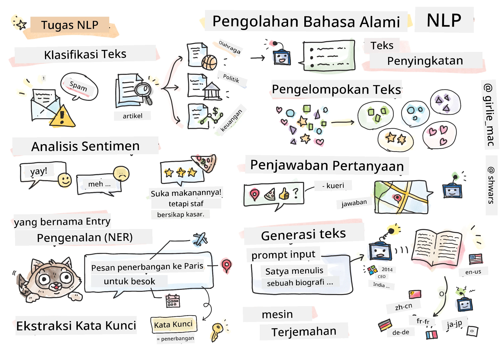

# Pemrosesan Bahasa Alami



Pada bagian ini, kita akan fokus pada penggunaan Jaringan Saraf untuk menangani tugas-tugas yang berkaitan dengan **Pemrosesan Bahasa Alami (NLP)**. Ada banyak masalah NLP yang ingin kita supaya komputer bisa menyelesaikannya:

* **Klasifikasi teks** adalah masalah klasifikasi khas yang berkaitan dengan urutan teks. Contohnya mencakup mengklasifikasikan pesan e-mail sebagai spam vs. bukan spam, atau mengkategorikan artikel sebagai olahraga, bisnis, politik, dll. Juga, saat mengembangkan bot obrolan, seringkali kita perlu memahami apa yang ingin dikatakan pengguna -- dalam kasus ini kita berurusan dengan **klasifikasi maksud**. Sering kali, dalam klasifikasi maksud kita perlu menangani banyak kategori.
* **Analisis sentimen** adalah masalah regresi khas, di mana kita perlu memberikan sebuah angka (sebuah sentimen) yang menggambarkan seberapa positif/negatif makna sebuah kalimat. Versi analisis sentimen yang lebih maju adalah **analisis sentimen berbasis aspek** (ABSA), di mana kita mengatribusi sentimen tidak untuk seluruh kalimat, tetapi untuk bagian-bagian tertentu (aspek), misalnya *Di restoran ini, saya suka makanannya, tapi suasananya mengerikan*.
* **Pengenalan Entitas Bernama** (NER) merujuk pada masalah mengekstrak entitas tertentu dari teks. Misalnya, kita mungkin perlu memahami bahwa dalam frasa *Saya perlu terbang ke Paris besok* kata *besok* merujuk pada TANGGAL, dan *Paris* adalah LOKASI.  
* **Ekstraksi kata kunci** mirip dengan NER, tetapi kita perlu mengekstrak kata-kata yang penting bagi makna kalimat secara otomatis, tanpa pelatihan awal untuk jenis entitas tertentu.
* **Pengelompokan teks** bisa berguna ketika kita ingin mengelompokkan kalimat-kalimat yang mirip, misalnya, permintaan serupa dalam percakapan dukungan teknis.
* **Menjawab pertanyaan** merujuk pada kemampuan sebuah model untuk menjawab pertanyaan spesifik. Model menerima sebuah potongan teks dan sebuah pertanyaan sebagai input, dan perlu memberikan tempat dalam teks di mana jawaban atas pertanyaan tersebut terkandung (atau, terkadang, membuat teks jawaban).
* **Generasi Teks** adalah kemampuan sebuah model untuk menghasilkan teks baru. Ini dapat dianggap sebagai tugas klasifikasi yang memprediksi huruf/kata berikutnya berdasarkan beberapa *prompt teks*. Model generasi teks canggih, seperti GPT-3, dapat menyelesaikan tugas NLP lain seperti klasifikasi menggunakan teknik yang disebut [program prompt](https://towardsdatascience.com/software-3-0-how-prompting-will-change-the-rules-of-the-game-a982fbfe1e0) atau [rekayasa prompt](https://medium.com/swlh/openai-gpt-3-and-prompt-engineering-dcdc2c5fcd29)
* **Ringkasan teks** adalah teknik ketika kita ingin komputer "membaca" teks panjang dan merangkumnya dalam beberapa kalimat.
* **Terjemahan mesin** dapat dilihat sebagai gabungan pemahaman teks dalam satu bahasa, dan generasi teks dalam bahasa lain.

Awalnya, sebagian besar tugas NLP diselesaikan menggunakan metode tradisional seperti tata bahasa. Misalnya, dalam terjemahan mesin, parser digunakan untuk mengubah kalimat awal menjadi pohon sintaksis, kemudian struktur makna tingkat lebih tinggi diekstrak untuk mewakili makna kalimat, dan berdasarkan makna ini dan tata bahasa bahasa sasaran, hasil dibuat. Saat ini, banyak tugas NLP lebih efektif diselesaikan menggunakan jaringan saraf.

> Banyak metode NLP klasik diimplementasikan dalam perpustakaan Python [Natural Language Processing Toolkit (NLTK)](https://www.nltk.org). Ada [Buku NLTK](https://www.nltk.org/book/) yang sangat baik tersedia online yang membahas bagaimana berbagai tugas NLP dapat diselesaikan menggunakan NLTK.

Dalam kursus kami, kami akan lebih banyak fokus pada penggunaan Jaringan Saraf untuk NLP, dan akan menggunakan NLTK jika diperlukan.

Kami sudah belajar tentang penggunaan jaringan saraf untuk menangani data tabular dan gambar. Perbedaan utama antara jenis data tersebut dan teks adalah bahwa teks adalah urutan dengan panjang variabel, sementara ukuran input untuk gambar sudah diketahui sebelumnya. Sementara jaringan konvolusi dapat mengekstrak pola dari data input, pola dalam teks lebih kompleks. Misalnya, kita bisa memiliki negasi yang dipisahkan dari subjek dengan jarak beberapa kata (misalnya *Saya tidak suka jeruk*, vs. *Saya tidak suka jeruk besar warna-warni yang lezat itu*), dan itu harus tetap diinterpretasikan sebagai satu pola. Oleh karena itu, untuk menangani bahasa kita perlu memperkenalkan tipe jaringan saraf baru, seperti *jaringan rekuren* dan *transformer*.

## Instalasi Perpustakaan

Jika Anda menggunakan instalasi Python lokal untuk menjalankan kursus ini, Anda mungkin perlu menginstal semua perpustakaan yang dibutuhkan untuk NLP menggunakan perintah berikut:

**Untuk PyTorch**
```bash
pip install -r requirements-pytorch.txt
```
**Untuk TensorFlow**
```bash
pip install -r requirements-tf.txt
```

> Anda dapat mencoba NLP dengan TensorFlow di [Microsoft Learn](https://docs.microsoft.com/learn/modules/intro-natural-language-processing-tensorflow/?WT.mc_id=academic-77998-cacaste)

## Peringatan GPU

Pada bagian ini, dalam beberapa contoh kita akan melatih model yang cukup besar.
* **Gunakan Komputer yang Mendukung GPU**: Dianjurkan menjalankan notebook Anda di komputer yang mendukung GPU untuk mengurangi waktu tunggu saat bekerja dengan model besar.
* **Keterbatasan Memori GPU**: Menjalankan di GPU dapat menyebabkan situasi di mana memori GPU habis, terutama saat melatih model besar.
* **Konsumsi Memori GPU**: Besarnya memori GPU yang digunakan selama pelatihan tergantung pada berbagai faktor, termasuk ukuran minibatch.
* **Perkecil Ukuran Minibatch**: Jika Anda mengalami masalah memori GPU, pertimbangkan untuk mengurangi ukuran minibatch dalam kode Anda sebagai solusi potensial.
* **Pelepasan Memori GPU di TensorFlow**: Versi TensorFlow yang lebih lama mungkin tidak melepaskan memori GPU dengan benar saat melatih beberapa model dalam satu kernel Python. Untuk mengelola penggunaan memori GPU secara efektif, Anda dapat mengonfigurasi TensorFlow agar mengalokasikan memori GPU hanya saat diperlukan.
* **Penyertaan Kode**: Untuk mengatur TensorFlow agar memperbesar alokasi memori GPU hanya saat dibutuhkan, sertakan kode berikut dalam notebook Anda:

```python
physical_devices = tf.config.list_physical_devices('GPU') 
if len(physical_devices)>0:
    tf.config.experimental.set_memory_growth(physical_devices[0], True) 
```

Jika Anda tertarik belajar tentang NLP dari perspektif ML klasik, kunjungi [suite pelajaran ini](https://github.com/microsoft/ML-For-Beginners/tree/main/6-NLP)

## Di Bagian Ini
Pada bagian ini kita akan belajar tentang:

* [Merepresentasikan teks sebagai tensor](13-TextRep/README.md)
* [Word Embeddings](14-Embeddings/README.md)
* [Pemodelan Bahasa](15-LanguageModeling/README.md)
* [Jaringan Saraf Rekuren](16-RNN/README.md)
* [Jaringan Generatif](17-GenerativeNetworks/README.md)
* [Transformer](18-Transformers/README.md)

---

<!-- CO-OP TRANSLATOR DISCLAIMER START -->
**Penafian**:
Dokumen ini telah diterjemahkan menggunakan layanan terjemahan AI [Co-op Translator](https://github.com/Azure/co-op-translator). Meskipun kami berupaya untuk mencapai akurasi, harap diketahui bahwa terjemahan otomatis mungkin mengandung kesalahan atau ketidakakuratan. Dokumen asli dalam bahasa aslinya harus dianggap sebagai sumber yang sah. Untuk informasi penting, disarankan menggunakan terjemahan profesional oleh manusia. Kami tidak bertanggung jawab atas kesalahpahaman atau penafsiran yang keliru yang timbul dari penggunaan terjemahan ini.
<!-- CO-OP TRANSLATOR DISCLAIMER END -->