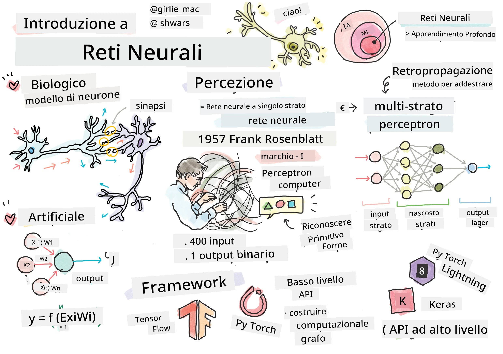
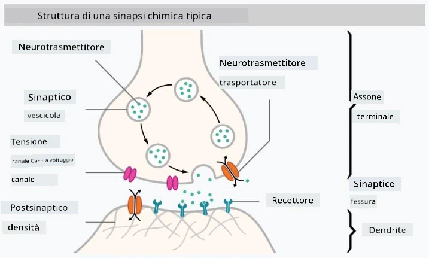

# Introduzione alle Reti Neurali

Come discusso nell'introduzione, uno dei modi per ottenere l'intelligenza è addestrare un **modello computerizzato** o un **cervello artificiale**. Dalla metà del XX secolo, i ricercatori hanno sperimentato diversi modelli matematici, fino a quando negli ultimi anni questa direzione si è dimostrata estremamente efficace. Tali modelli matematici del cervello sono chiamati **reti neurali**.

> A volte le reti neurali sono chiamate *Reti Neurali Artificiali*, ANN, per indicare che si parla di modelli, non di reti reali di neuroni.

## Apprendimento Automatico

Le Reti Neurali fanno parte di una disciplina più ampia chiamata **Apprendimento Automatico**, il cui obiettivo è utilizzare i dati per addestrare modelli computerizzati capaci di risolvere problemi. L'Apprendimento Automatico costituisce una larga parte dell'Intelligenza Artificiale, tuttavia non copriamo l'apprendimento automatico classico in questo percorso.

> Visitate il nostro curriculum separato **[Apprendimento Automatico per Principianti](http://github.com/microsoft/ml-for-beginners)** per approfondire l'apprendimento automatico classico.

Nell'apprendimento automatico, si assume di avere un dataset di esempi **X**, e valori di output corrispondenti **Y**. Gli esempi sono spesso vettori N-dimensionali composti da **caratteristiche**, mentre gli output sono chiamati **etichette**.

Considereremo i due problemi di apprendimento automatico più comuni:

* **Classificazione**, dove è necessario classificare un oggetto di input in due o più classi.
* **Regressione**, dove è necessario prevedere un numero numerico per ciascun campione di input.

> Quando si rappresentano input e output come tensori, il dataset di input è una matrice di dimensione M&times;N, dove M è il numero di campioni e N è il numero di caratteristiche. L'etichetta di output Y è un vettore di dimensione M.

In questo curriculum, ci concentreremo solo sui modelli di reti neurali.

## Un Modello di Neurone

Dalla biologia sappiamo che il nostro cervello è costituito da cellule neurali (neuroni), ognuna delle quali possiede molteplici "ingressi" (dendriti) e un singolo "uscita" (assone). Sia i dendriti che gli assoni possono condurre segnali elettrici, e le connessioni tra di essi — note come sinapsi — possono mostrare vari gradi di conducibilità, regolati dai neurotrasmettitori.

 | 
----|----
Neurone Reale *([Immagine](https://en.wikipedia.org/wiki/Synapse#/media/File:SynapseSchematic_lines.svg) da Wikipedia)* | Neurone Artificiale *(Immagine dell'autore)*

Pertanto, il modello matematico più semplice di un neurone contiene diversi ingressi X1, ..., XN e un'uscita Y, e una serie di pesi W1, ..., WN. Un'uscita viene calcolata come:

dove f è una qualche **funzione di attivazione** non lineare.

> I primi modelli di neuroni furono descritti nell'articolo classico [A logical calculus of the ideas immanent in nervous activity](https://www.cs.cmu.edu/~./epxing/Class/10715/reading/McCulloch.and.Pitts.pdf) di Warren McCullock e Walter Pitts nel 1943. Donald Hebb nel suo libro "[The Organization of Behavior: A Neuropsychological Theory](https://books.google.com/books?id=VNetYrB8EBoC)" propose il modo in cui quelle reti possono essere addestrate.

## In questa Sezione

In questa sezione impareremo:
* [Perceptron](03-Perceptron/README.md), uno dei primi modelli di rete neurale per la classificazione a due classi
* [Reti a più strati](04-OwnFramework/README.md) con un notebook associato su [come costruire il nostro framework](04-OwnFramework/OwnFramework.ipynb)
* [Framework per Reti Neurali](05-Frameworks/README.md), con questi notebook: [PyTorch](05-Frameworks/IntroPyTorch.ipynb) e [Keras/Tensorflow](05-Frameworks/IntroKerasTF.ipynb)
* [Sovradattamento](../../../../lessons/3-NeuralNetworks/05-Frameworks#overfitting)

---

<!-- CO-OP TRANSLATOR DISCLAIMER START -->
**Disclaimer**:
Questo documento è stato tradotto utilizzando il servizio di traduzione AI [Co-op Translator](https://github.com/Azure/co-op-translator). Sebbene ci impegniamo per garantire la precisione, si prega di notare che le traduzioni automatizzate possono contenere errori o imprecisioni. Il documento originale nella sua lingua nativa deve essere considerato la fonte autorevole. Per informazioni critiche, si raccomanda una traduzione professionale effettuata da un essere umano. Non siamo responsabili per eventuali malintesi o interpretazioni errate derivanti dall’uso di questa traduzione.
<!-- CO-OP TRANSLATOR DISCLAIMER END -->