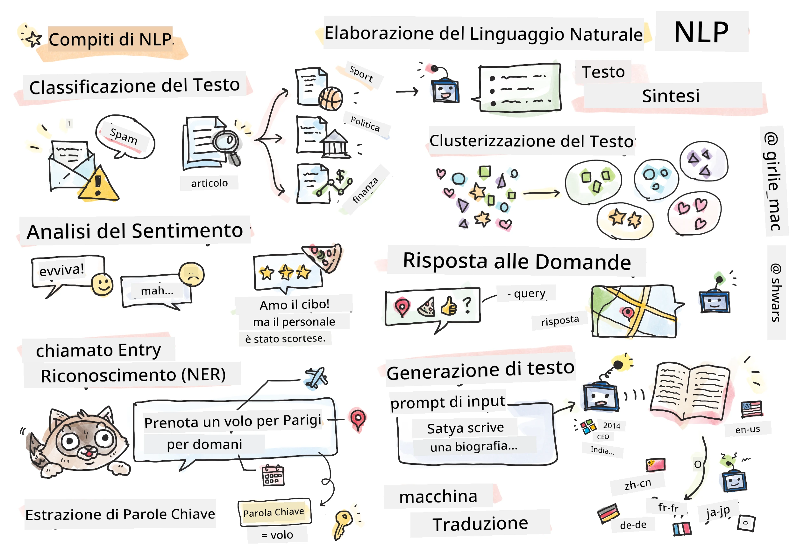

# Elaborazione del Linguaggio Naturale



In questa sezione, ci concentreremo sull'uso delle Reti Neurali per affrontare compiti relativi all'**Elaborazione del Linguaggio Naturale (NLP)**. Ci sono molti problemi di NLP che vogliamo che i computer siano in grado di risolvere:

* **Classificazione del testo** è un tipico problema di classificazione riguardante sequenze di testo. Esempi includono classificare messaggi e-mail come spam o non spam, oppure categorizzare articoli come sport, affari, politica, ecc. Inoltre, durante lo sviluppo di chatbot, spesso è necessario comprendere cosa l'utente ha voluto dire -- in questo caso ci occupiamo di **classificazione delle intenzioni**. Spesso, nella classificazione delle intenzioni, dobbiamo gestire molte categorie.
* **Analisi del sentiment** è un tipico problema di regressione, dove dobbiamo attribuire un numero (un sentiment) che corrisponda a quanto il significato di una frase sia positivo/negativo. Una versione più avanzata dell'analisi del sentiment è l'**analisi del sentiment basata sugli aspetti** (ABSA), dove attribuiamo il sentiment non all'intera frase, ma a diverse parti di essa (aspetti), ad esempio *In questo ristorante, mi è piaciuta la cucina, ma l'atmosfera era terribile*.
* **Riconoscimento di Entità Nominate** (NER) si riferisce al problema di estrarre certe entità dal testo. Per esempio, potremmo dover capire che nella frase *Devo volare a Parigi domani* la parola *domani* si riferisce a DATA, e *Parigi* è un LUOGO.  
* **Estrazione di parole chiave** è simile al NER, ma dobbiamo estrarre automaticamente parole importanti per il significato della frase, senza un pre-addestramento per tipi specifici di entità.
* **Clustering del testo** può essere utile quando vogliamo raggruppare frasi simili, ad esempio, richieste simili in conversazioni di supporto tecnico.
* **Risposta a domande** si riferisce alla capacità di un modello di rispondere a una domanda specifica. Il modello riceve come input un passaggio di testo e una domanda, e deve fornire un luogo nel testo dove è contenuta la risposta alla domanda (o, a volte, generare il testo della risposta).
* **Generazione di testo** è la capacità di un modello di generare nuovo testo. Può essere considerata un'attività di classificazione che predice la lettera/parola successiva basata su un *prompt testuale*. Modelli avanzati di generazione del testo, come GPT-3, sono in grado di risolvere altri compiti NLP come la classificazione usando una tecnica chiamata [prompt programming](https://towardsdatascience.com/software-3-0-how-prompting-will-change-the-rules-of-the-game-a982fbfe1e0) o [prompt engineering](https://medium.com/swlh/openai-gpt-3-and-prompt-engineering-dcdc2c5fcd29)
* **Sintesi del testo** è una tecnica utilizzata quando vogliamo che un computer "legga" un testo lungo e lo riassuma in poche frasi.
* **Traduzione automatica** può essere vista come una combinazione della comprensione del testo in una lingua e della generazione del testo in un'altra.

Inizialmente, la maggior parte dei compiti NLP veniva risolta usando metodi tradizionali come le grammatiche. Ad esempio, nella traduzione automatica venivano utilizzati parser per trasformare la frase iniziale in un albero sintattico, poi venivano estratte strutture semantiche a livello superiore per rappresentare il significato della frase, e basandosi su questo significato e sulla grammatica della lingua di destinazione veniva generato il risultato. Oggi, molti compiti NLP vengono risolti più efficacemente usando reti neurali.

> Molti metodi classici di NLP sono implementati nella libreria Python [Natural Language Processing Toolkit (NLTK)](https://www.nltk.org). Esiste un ottimo [NLTK Book](https://www.nltk.org/book/) disponibile online che spiega come diversi compiti NLP possano essere risolti usando NLTK.

Nel nostro corso, ci concentreremo principalmente sull'uso delle Reti Neurali per NLP, e utilizzeremo NLTK dove necessario.

Abbiamo già imparato ad usare reti neurali per lavorare con dati tabellari e immagini. La principale differenza tra quei tipi di dati e il testo è che il testo è una sequenza di lunghezza variabile, mentre la dimensione di input nel caso delle immagini è nota in anticipo. Mentre le reti convoluzionali possono estrarre schemi dai dati di input, gli schemi nel testo sono più complessi. Ad esempio, possiamo avere una negazione separata dal soggetto con un numero arbitrario di parole (ad esempio *Non mi piacciono le arance*, contro *Non mi piacciono quelle arance grandi, colorate e gustose*), e questo dovrebbe comunque essere interpretato come un unico schema. Quindi, per gestire il linguaggio è necessario introdurre nuovi tipi di reti neurali, come le *reti ricorrenti* e i *transformer*.

## Installare le Librerie

Se stai usando un'installazione locale di Python per seguire questo corso, potresti dover installare tutte le librerie richieste per NLP usando i seguenti comandi:

**Per PyTorch**
```bash
pip install -r requirements-pytorch.txt
```
**Per TensorFlow**
```bash
pip install -r requirements-tf.txt
```

> Puoi provare NLP con TensorFlow su [Microsoft Learn](https://docs.microsoft.com/learn/modules/intro-natural-language-processing-tensorflow/?WT.mc_id=academic-77998-cacaste)

## Avviso GPU

In questa sezione, in alcuni degli esempi alleneremo modelli abbastanza grandi.
* **Usa un Computer con GPU abilitata**: È consigliabile eseguire i tuoi notebook su un computer con GPU abilitata per ridurre i tempi di attesa quando si lavora con modelli di grandi dimensioni.
* **Vincoli di memoria GPU**: L'esecuzione su GPU può portare a situazioni di esaurimento della memoria GPU, specialmente durante l'addestramento di modelli grandi.
* **Consumo di memoria GPU**: La quantità di memoria GPU consumata durante l'addestramento dipende da vari fattori, inclusa la dimensione del minibatch.
* **Minimizza la dimensione del minibatch**: Se incontri problemi di memoria GPU, considera di ridurre la dimensione del minibatch nel tuo codice come possibile soluzione.
* **Rilascio della memoria GPU in TensorFlow**: Le versioni più vecchie di TensorFlow potrebbero non rilasciare correttamente la memoria GPU quando si allenano più modelli all'interno di un unico kernel Python. Per gestire efficacemente l'uso della memoria GPU, puoi configurare TensorFlow in modo che allochi la memoria GPU solo quando necessario.
* **Inclusione del codice**: Per impostare TensorFlow affinché cresca l'allocazione della memoria GPU solo quando richiesta, includi il seguente codice nei tuoi notebook:

```python
physical_devices = tf.config.list_physical_devices('GPU') 
if len(physical_devices)>0:
    tf.config.experimental.set_memory_growth(physical_devices[0], True) 
```

Se ti interessa apprendere NLP da una prospettiva classica di ML, visita [questa serie di lezioni](https://github.com/microsoft/ML-For-Beginners/tree/main/6-NLP)

## In questa Sezione
In questa sezione impareremo su:

* [Rappresentare il testo come tensori](13-TextRep/README.md)
* [Word Embeddings](14-Embeddings/README.md)
* [Modellazione del linguaggio](15-LanguageModeling/README.md)
* [Reti Neurali Ricorrenti](16-RNN/README.md)
* [Reti Generative](17-GenerativeNetworks/README.md)
* [Transformer](18-Transformers/README.md)

---

<!-- CO-OP TRANSLATOR DISCLAIMER START -->
**Disclaimer**:
Questo documento è stato tradotto utilizzando il servizio di traduzione AI [Co-op Translator](https://github.com/Azure/co-op-translator). Sebbene ci impegniamo per garantire la precisione, si prega di notare che le traduzioni automatizzate possono contenere errori o imprecisioni. Il documento originale nella sua lingua nativa deve essere considerato la fonte autorevole. Per informazioni critiche, si raccomanda una traduzione professionale effettuata da un essere umano. Non siamo responsabili per eventuali malintesi o interpretazioni errate derivanti dall’uso di questa traduzione.
<!-- CO-OP TRANSLATOR DISCLAIMER END -->