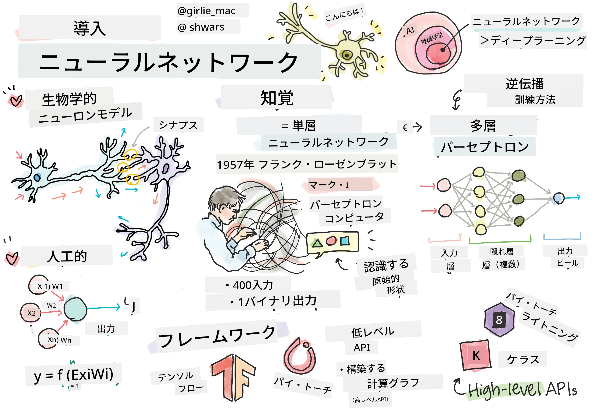
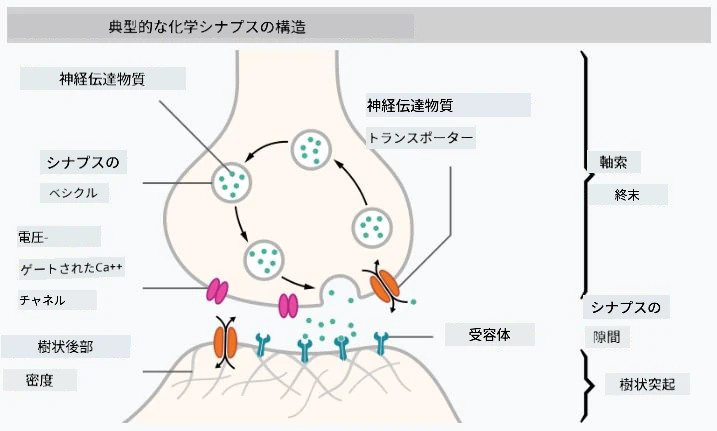
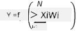

# ニューラルネットワークの紹介

はじめにで述べたように、知能を実現する方法の一つは<strong>コンピュータモデル</strong>または<strong>人工の脳</strong>を訓練することです。20世紀中頃から、研究者たちはさまざまな数学モデルを試みましたが、近年この方向性が非常に成功を収めています。このような脳の数学モデルは<strong>ニューラルネットワーク</strong>と呼ばれます。

> ニューラルネットワークはときに<em>人工ニューラルネットワーク</em>（ANN）と呼ばれます。これは実際のニューロンのネットワークではなく、モデルを指していることを示すためです。

## 機械学習

ニューラルネットワークは<strong>機械学習</strong>というもっと大きな分野の一部です。機械学習の目的は、問題解決が可能なコンピュータモデルをデータを使って訓練することにあります。機械学習は人工知能の大部分を占めていますが、このカリキュラムでは従来の機械学習は扱いません。

> 従来の機械学習について詳しく学ぶには、別の<strong>[Machine Learning for Beginners](http://github.com/microsoft/ml-for-beginners)</strong>カリキュラムをご覧ください。

機械学習では、例のデータセット<strong>X</strong>と対応する出力値<strong>Y</strong>を持っていると仮定します。例はしばしば<strong>特徴</strong>と呼ばれるN次元ベクトルで構成され、出力は<strong>ラベル</strong>と呼ばれます。

ここでは最も一般的な機械学習の2つの問題を考えます：

* <strong>分類</strong>：入力オブジェクトを2つ以上のクラスに分類する必要がある問題。
* <strong>回帰</strong>：各入力サンプルに対して数値を予測する必要がある問題。

> 入力と出力をテンソルで表すとき、入力データセットはM×Nの行列です。ここでMはサンプル数、Nは特徴の数です。出力ラベルYはサイズMのベクトルです。

このカリキュラムでは、ニューラルネットワークモデルのみに焦点を当てます。

## ニューロンのモデル

生物学からわかっているように、私たちの脳は神経細胞（ニューロン）で構成されています。それぞれのニューロンは複数の「入力」（樹状突起）と単一の「出力」（軸索）を持っています。樹状突起と軸索の両方は電気信号を伝え、これらの間の接続部であるシナプスは伝導度が変化し、神経伝達物質によって調節されます。

 | 
----|----
実際のニューロン *([Image](https://en.wikipedia.org/wiki/Synapse#/media/File:SynapseSchematic_lines.svg) ウィキペディアより)* | 人工ニューロン *(作者による画像)*

このように、ニューロンの最も単純な数学モデルは、複数の入力 X1, ..., XN と出力 Y、そして一連の重み W1, ..., WN を含みます。出力は次のように計算されます:

ここで f は何らかの非線形の<strong>活性化関数</strong>です。

> ニューロンの初期モデルは、1943年にウォーレン・マカロックとウォルター・ピッツによって書かれた古典論文 [A logical calculus of the ideas immanent in nervous activity](https://www.cs.cmu.edu/~./epxing/Class/10715/reading/McCulloch.and.Pitts.pdf) に記述されています。ドナルド・ヘッブは彼の著書「[The Organization of Behavior: A Neuropsychological Theory](https://books.google.com/books?id=VNetYrB8EBoC)」で、それらのネットワークの訓練方法を提案しました。

## このセクションで

このセクションでは以下について学びます：
* [パーセプトロン](03-Perceptron/README.md)、2クラス分類の初期のニューラルネットワークモデルの一つ
* [多層ネットワーク](04-OwnFramework/README.md) とペアになったノートブック [独自フレームワークの構築方法](04-OwnFramework/OwnFramework.ipynb)
* [ニューラルネットワークフレームワーク](05-Frameworks/README.md)、これらのノートブック付き: [PyTorch](05-Frameworks/IntroPyTorch.ipynb) と [Keras/Tensorflow](05-Frameworks/IntroKerasTF.ipynb)
* [過学習](../../../../lessons/3-NeuralNetworks/05-Frameworks#overfitting)

---

<!-- CO-OP TRANSLATOR DISCLAIMER START -->
**免責事項**：
本書類は AI 翻訳サービス [Co-op Translator](https://github.com/Azure/co-op-translator) を使用して翻訳されています。正確性を期していますが、自動翻訳には誤りや不正確な部分が含まれる可能性があることをご承知おきください。原文の原語版が正式な情報源とみなされるべきです。重要な情報については、専門の人間による翻訳を推奨します。本翻訳の利用により生じたいかなる誤解や解釈違いについても、当方は責任を負いかねます。
<!-- CO-OP TRANSLATOR DISCLAIMER END -->