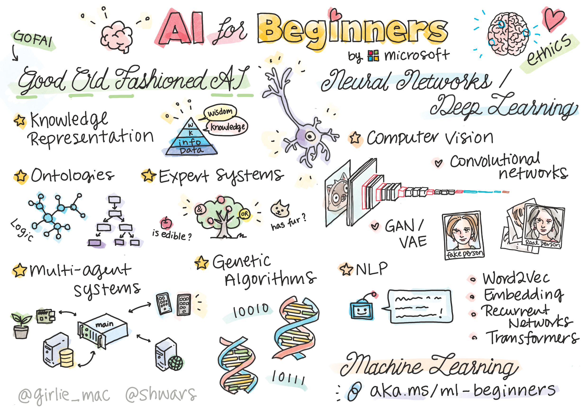

[](https://github.com/microsoft/AI-For-Beginners/blob/main/LICENSE)
[](https://GitHub.com/microsoft/AI-For-Beginners/graphs/contributors/)
[](https://GitHub.com/microsoft/AI-For-Beginners/issues/)
[](https://GitHub.com/microsoft/AI-For-Beginners/pulls/)
[](http://makeapullrequest.com)

[](https://GitHub.com/microsoft/AI-For-Beginners/watchers/)
[](https://GitHub.com/microsoft/AI-For-Beginners/network/)
[](https://GitHub.com/microsoft/AI-For-Beginners/stargazers/)
[](https://mybinder.org/v2/gh/microsoft/ai-for-beginners/HEAD)
[](https://gitter.im/Microsoft/ai-for-beginners?utm_source=badge&utm_medium=badge&utm_campaign=pr-badge)

[](https://discord.gg/nTYy5BXMWG)

# បច្ចេកវិទ្យាបញ្ញាសិប្បនិម្មិតសម្រាប់អ្នកចាប់ផ្តើម - មេរៀន

||
|:---:|
| បញ្ញាសិប្បនិម្មិតសម្រាប់អ្នកចាប់ផ្តើម - _រូបសំណាក់ដោយ [@girlie_mac](https://twitter.com/girlie_mac)_ |

ស្វែងរកពិភពជុំវិញ **បញ្ញាសិប្បនិម្មិត** (AI) ដោយមានមេរៀនប្រចាំសប្តាហ៍ 12 សប្តាហ៍ 24 មេរៀននេះ! វារួមមានមេរៀនជាក់ស្តែង ការប្រលង និងមណ្ឌលលំហាត់។ មេរៀននេះសមស្របសម្រាប់អ្នកចាប់ផ្តើម ហើយគ្របដណ្តប់ឧបករណ៍ដូចជា TensorFlow និង PyTorch ព្រមទាំងទ្រឹស្តីគ្រប់គ្រងផ្លូវច្បាប់ AI។


### 🌐 ការគាំទ្រភាសាច្រើន

#### ការបកប្រែដែលរក្សាទុកដោយ [Co-op Translator](https://github.com/Azure/co-op-translator)

<!-- CO-OP TRANSLATOR LANGUAGES TABLE START -->
[អារ៉ាប់](../ar/README.md) | [បង់ក្លា](../bn/README.md) | [ប៊ុលហ្គារី](../bg/README.md) | [មីយ៉ាន់ម៉ា (ភាសាប៊ឺម៉ា)](../my/README.md) | [ចិន (សាមញ្ញ)](../zh-CN/README.md) | [ចិន (បុរាណ, ហុងកុង)](../zh-HK/README.md) | [ចិន (បុរាណ, ម៉ាកាវ)](../zh-MO/README.md) | [ចិន (បុរាណ, តៃវ៉ាន់)](../zh-TW/README.md) | [ក្រូអាស៊ី](../hr/README.md) | [ឆែក](../cs/README.md) | [ដាណឺម៉ាក](../da/README.md) | [ដutches](../nl/README.md) | [អេស្តូនី](../et/README.md) | [ហ្វាំងឡែន](../fi/README.md) | [បារាំង](../fr/README.md) | [អាល្លឺម៉ង់](../de/README.md) | [ក្រិក](../el/README.md) | [ហេប្រ៊៊វ](../he/README.md) | [ហិណ្ឌី](../hi/README.md) | [ហុងករ៉ង់](../hu/README.md) | [អ៊ីណ្ឌोណេ ស៊ី ហ្ស៊ី](../id/README.md) | [អ៊ីតាលី](../it/README.md) | [ជប៉ុន](../ja/README.md) | [កណ្ដាដា](../kn/README.md) | [ខ្មែរ](./README.md) | [កូរ៉េ](../ko/README.md) | [លីទុយអានី](../lt/README.md) | [ម៉ាឡៃ](../ms/README.md) | [ម៉ាឡាឡាំ](../ml/README.md) | [ម៉ានីបូរី (មីតេ មយ៉ក)](../mni/README.md) | [ម៉ារ័តី](../mr/README.md) | [នេប៉ាល់](../ne/README.md) | [ភាសាពីឌីជិននីហ្សេរី](../pcm/README.md) | [ន័រវ៉េស](../no/README.md) | [ភាសាប៉ឺស៊ី (ហ្វាស៊ី)](../fa/README.md) | [ប៉ូលូស](../pl/README.md) | [ព័រទុយហ្គាល់ (ប្រេស៊ីល)](../pt-BR/README.md) | [ព័រទុយហ្គាល់ (ព័រទុយហ្គាល់)](../pt-PT/README.md) | [ភាសាពជាណាភាគខាងលិច (គឺមុខខ៊ី)](../pa/README.md) | [រូម៉ានី](../ro/README.md) | [រុស្ស៊ី](../ru/README.md) | [ស៊ែប៊ៀ (ស៊ីរីលិច)](../sr/README.md) | [ស្ឡូវ៉ាក់](../sk/README.md) | [ស្ឡូវេនី](../sl/README.md) | [អេស្ប៉ាញ](../es/README.md) | [ស្វាហ៊ីលី](../sw/README.md) | [ស៊ុយអែត](../sv/README.md) | [តាឡាហ្គោ (ហ្វីលីពីន)](../tl/README.md) | [តាមីល](../ta/README.md) | [តេលិងហ្គូ](../te/README.md) | [ថៃ](../th/README.md) | [តួគី](../tr/README.md) | [អ៊ុយក្រែន](../uk/README.md) | [អ៊ឺឌូ](../ur/README.md) | [វៀតណាម](../vi/README.md)

> **ចូលចិត្ត Clone ក្នុងមូលដ្ឋានបណ្តាញភាគី)?
>
> ទីនេះផ្ទុកឯកសារជាមួយការប្រែភាសាជាង ៥០ ដែលបន្ថែមទំហំនៃការទាញយកយ៉ាងខ្លាំង។ ដើម្បី clone ដោយមិនមានការប្រែភាសា អ្នកអាចប្រើ sparse checkout៖
>
> **Bash / macOS / Linux:**
> ```bash
> git clone --filter=blob:none --sparse https://github.com/microsoft/AI-For-Beginners.git
> cd AI-For-Beginners
> git sparse-checkout set --no-cone '/*' '!translations' '!translated_images'
> ```
>
> **CMD (Windows):**
> ```cmd
> git clone --filter=blob:none --sparse https://github.com/microsoft/AI-For-Beginners.git
> cd AI-For-Beginners
> git sparse-checkout set --no-cone "/*" "!translations" "!translated_images"
> ```
>
> វាប្រើឲ្យអ្នកទាំងអស់ដែលត្រូវការ ដើម្បីបញ្ចប់វគ្គនេះជាមួយការទាញយកលឿនជាងមុន។
<!-- CO-OP TRANSLATOR LANGUAGES TABLE END -->

**បើអ្នកចង់បានការគាំទ្រភាសាបន្ថែម សូមមើលបញ្ជី [នៅទីនេះ](https://github.com/Azure/co-op-translator/blob/main/docs/supported-languages.md)**

## ចូលរួមក្នុងសហគមន៍
[](https://discord.gg/nTYy5BXMWG)

## 🤝 ការរួមចំណែក

យើងស្វាគមន៍ការរួមចំណែកពីសហគមន៍! មិនថាអ្នកកំពុងកែសម្រួលកំហុស ត្រូវធ្វើឲ្យឯកសារល្អប្រសើរឡើង ឬបន្ថែមឧទាហរណ៍ថ្មីៗ ការជួយរបស់អ្នកធ្វើឲ្យមេរៀននេះកាន់តែប្រសើរឡើងសម្រាប់គ្រប់គ្នា។ សូមពិនិត្យមើលមគ្គុទេសក៍ [CONTRIBUTING.md](CONTRIBUTING.md) ដើម្បីចាប់ផ្តើម។

## អ្វីដែលអ្នកនឹងរៀន

**[ផែនទីមនសិក្សារបស់វគ្គ](http://soshnikov.com/courses/ai-for-beginners/mindmap.html)**

ក្នុងមេរៀននេះ អ្នកនឹងរៀន៖

* វិធីសាស្រ្តផ្ទាល់ខ្លួននៃបញ្ញាសិប្បនិម្មិត រួមទាំងវិធីសាស្រ្ត "ចាស់ប្ដូរ" symbolic ពោរពេញដោយ **ការទំនាក់ទំនងចំណេះដឹង** និងការតម្រឹម ([GOFAI](https://en.wikipedia.org/wiki/Symbolic_artificial_intelligence))។
* **បណ្ដាញស្វ័យប្រវត្តិ** និង **ការរៀនជ្រៅ** ដែលជាគ្រឹះសំខាន់នៃ AI សម័យទំនើប។ យើងនឹងបញ្ជាក់យ៉ាងច្បាស់ពីគំនិតនៅពីក្រោយប្រធានបទសំខាន់ៗទាំងនេះដោយការសរសេរកូដក្នុងគ្រប់ផ្នែកពីរដែលពេញនិយមសម្រាប់ [TensorFlow](http://Tensorflow.org) និង [PyTorch](http://pytorch.org)។
* **ស្ថាបត្យកម្មស្វ័យប្រវត្តិ** សម្រាប់ការងារជាមួយរូបភាព និងអត្ថបទ។ យើងនឹងគ្របដណ្តប់ម៉ូដែលថ្មីៗ ប៉ុន្តែអាចមិនទាន់ទាន់សម័យថ្មីបំផុតទេ។
* វិធីសាស្រ្ត AI ដែលមិនពេញនិយមប៉ុន្មាន ដូចជា **អាល់ហ្គរីធម៍បដិវត្តន៍** និង **ប្រព័ន្ធអ្នកដំណើរក្នុងច្រើន**។

អ្វីដែលយើងមិនគ្របដណ្តប់នៅក្នុងមេរៀននេះ៖

> [ស្វែងរកធនធានបន្ថែមទាំងអស់សម្រាប់វគ្គនេះក្នុងបណ្ដុំ Microsoft Learn របស់យើង](https://learn.microsoft.com/en-us/collections/7w28iy2xrqzdj0?WT.mc_id=academic-77998-bethanycheum)

* ប្រករណ៍អាជីវកម្មនៃការប្រើប្រាស់ **AI នៅក្នុងអាជីវកម្ម**។ សូមពិចារណារើសយកផ្លូវបង្រៀន [មូលដ្ឋាន AI សម្រាប់អ្នកប្រើប្រាស់អាជីវកម្ម](https://docs.microsoft.com/learn/paths/introduction-ai-for-business-users/?WT.mc_id=academic-77998-bethanycheum) នៅ Microsoft Learn ឬ [សាលា AI សម្រាប់អាជីវកម្ម](https://www.microsoft.com/ai/ai-business-school/?WT.mc_id=academic-77998-bethanycheum) ដែលបានអភិវឌ្ឍន៍រួមគ្នាជាមួយ [INSEAD](https://www.insead.edu/)។
* **ការរៀនម៉ាស៊ីនបែបបុរាណ** ដែលបានពិពណ៌នាយ៉ាងល្អនៅក្នុងមេរៀន [Machine Learning for Beginners Curriculum](http://github.com/Microsoft/ML-for-Beginners) របស់យើង។
* ការប្រើប្រាស់ AI ដែលជាក់ស្ដែង ដែលបានបង្កើតដោយប្រើប្រាស់ **[សេវាកម្មប្រាជ្ញា](https://azure.microsoft.com/services/cognitive-services/?WT.mc_id=academic-77998-bethanycheum)**។ សម្រាប់នេះ យើងសូមផ្តើមជាមួយម៉ូឌុល Microsoft Learn ដល់ [ចក្ខុវិស័យ](https://docs.microsoft.com/learn/paths/create-computer-vision-solutions-azure-cognitive-services/?WT.mc_id=academic-77998-bethanycheum), [កែប្រែភាសាប្រពៃណី](https://docs.microsoft.com/learn/paths/explore-natural-language-processing/?WT.mc_id=academic-77998-bethanycheum), **[AI បង្កើតដោយប្រើ Azure OpenAI Service](https://learn.microsoft.com/en-us/training/paths/develop-ai-solutions-azure-openai/?WT.mc_id=academic-77998-bethanycheum)** និងផ្សេងៗទៀត។
* ស៊ុម​ផ្នែក ML **Cloud Frameworks** ពិសេស ដូចជា [Azure Machine Learning](https://azure.microsoft.com/services/machine-learning/?WT.mc_id=academic-77998-bethanycheum), [Microsoft Fabric](https://learn.microsoft.com/en-us/training/paths/get-started-fabric/?WT.mc_id=academic-77998-bethanycheum), ឬ [Azure Databricks](https://docs.microsoft.com/learn/paths/data-engineer-azure-databricks?WT.mc_id=academic-77998-bethanycheum)។ សូមពិចារណាប្រើប្រាស់ [Build and operate machine learning solutions with Azure Machine Learning](https://docs.microsoft.com/learn/paths/build-ai-solutions-with-azure-ml-service/?WT.mc_id=academic-77998-bethanycheum) និង [Build and Operate Machine Learning Solutions with Azure Databricks](https://docs.microsoft.com/learn/paths/build-operate-machine-learning-solutions-azure-databricks/?WT.mc_id=academic-77998-bethanycheum) ផ្លូវការរៀន។
* **ការសន្ទនាដោយប្រើ AI** និង **Chat Bots**។ មានផ្លូវការរៀនបំបែកមួយសម្រាប់ [Create conversational AI solutions](https://docs.microsoft.com/learn/paths/create-conversational-ai-solutions/?WT.mc_id=academic-77998-bethanycheum) ហើយអ្នកក៏អាចយោងទៅកាន់ [this blog post](https://soshnikov.com/azure/hello-bot-conversational-ai-on-microsoft-platform/) សម្រាប់ព័ត៌មានលម្អិតបន្ថែមផងដែរ។
* **គណិតវិទ្យាលំឡុងស្វាគមន៍ជ្រៅ** ខាងក្រោយការស្វាគមន៍ជ្រៅ។ សម្រាប់នេះ យើងសូមណែនាំ [Deep Learning](https://www.amazon.com/Deep-Learning-Adaptive-Computation-Machine/dp/0262035618) ដោយ Ian Goodfellow, Yoshua Bengio និង Aaron Courville ដែលអាចរកបានផងដែរ នៅលើអ៊ិនធឺរណេតនៅ [https://www.deeplearningbook.org/](https://www.deeplearningbook.org/).

សម្រាប់ការណែនាំយ៉ាងហ្មត់ចត់ទៅកាន់ប្រធានបទ _AI នៅលើពពក_ អ្នកអាចពិចារណាដំណើររៀន [Get started with artificial intelligence on Azure](https://docs.microsoft.com/learn/paths/get-started-with-artificial-intelligence-on-azure/?WT.mc_id=academic-77998-bethanycheum) បាន។

# មាតិកា

|     |                                                                 តំណភ្ជាប់មេរៀន                                                                  |                                           PyTorch/Keras/TensorFlow                                          | ហត្ថកម្ម                                                          |
| :-: | :------------------------------------------------------------------------------------------------------------------------------------------: | :---------------------------------------------------------------------------------------------: | ------------------------------------------------------------------------------ |
| 0  |                                 [Course Setup](./lessons/0-course-setup/setup.md)                                 |                      [រៀបចំបរិស្ថានអភិវឌ្ឍន៍របស់អ្នក](./lessons/0-course-setup/how-to-run.md)                       |   |
| I  |               [**ការណែនាំអំពី AI**](./lessons/1-Intro/README.md)      | | |
| 01  |       [ការណែនាំ និងប្រវត្តិសាស្ត្រ AI](./lessons/1-Intro/README.md)       |           -                            | -  |
| II |              **Symbolic AI**              |
| 02  |       [ការបង្ហាញចំណេះដឹង និងប្រព័ន្ធអ្នកជំនាញ](./lessons/2-Symbolic/README.md)       |            [ប្រព័ន្ធអ្នកជំនាញ](./lessons/2-Symbolic/Animals.ipynb) /  [Ontology](./lessons/2-Symbolic/FamilyOntology.ipynb) /[Concept Graph](./lessons/2-Symbolic/MSConceptGraph.ipynb)                             |  |
| III |                        [**ការណែនាំអំពីបណ្តាញប្រព័ន្ធប្រសាទ**](./lessons/3-NeuralNetworks/README.md) |||
| 03  |                [Perceptron](./lessons/3-NeuralNetworks/03-Perceptron/README.md)                 |                       [សៀវភៅកំណត់អង់តួយ៉ង](./lessons/3-NeuralNetworks/03-Perceptron/Perceptron.ipynb)                      | [ហត្ថកម្ម](./lessons/3-NeuralNetworks/03-Perceptron/lab/README.md) |
| 04  |                   [Multi-Layered Perceptron និងការបង្កើតគ្រោងការបស់យើង](./lessons/3-NeuralNetworks/04-OwnFramework/README.md)                   |        [សៀវភៅកំណត់អង់តួយ៉ង](./lessons/3-NeuralNetworks/04-OwnFramework/OwnFramework.ipynb)        | [ហត្ថកម្ម](./lessons/3-NeuralNetworks/04-OwnFramework/lab/README.md) |
| 05  |            [ការណែនាំអំពីគ្រោងការកម្មវិធី (PyTorch/TensorFlow) និងការកើនឡើងលើ](./lessons/3-NeuralNetworks/05-Frameworks/README.md)             |           [PyTorch](./lessons/3-NeuralNetworks/05-Frameworks/IntroPyTorch.ipynb) / [Keras](./lessons/3-NeuralNetworks/05-Frameworks/IntroKeras.ipynb) / [TensorFlow](./lessons/3-NeuralNetworks/05-Frameworks/IntroKerasTF.ipynb)             | [ហត្ថកម្ម](./lessons/3-NeuralNetworks/05-Frameworks/lab/README.md) |
| IV  |            [**កម្រងឈីត្រកុំព្យូទ័រ**](./lessons/4-ComputerVision/README.md)             | [PyTorch](https://docs.microsoft.com/learn/modules/intro-computer-vision-pytorch/?WT.mc_id=academic-77998-cacaste) / [TensorFlow](https://docs.microsoft.com/learn/modules/intro-computer-vision-TensorFlow/?WT.mc_id=academic-77998-cacaste)| [ស្វែងយល់អំពីកម្រងឈីត្រ កុំព្យូទ័រនៅ Microsoft Azure](https://learn.microsoft.com/en-us/collections/7w28iy2xrqzdj0?WT.mc_id=academic-77998-bethanycheum) |
| 06  |            [ការណែនាំអំពីកម្រងឈីត្រ កុំព្យូទ័រ។ OpenCV](./lessons/4-ComputerVision/06-IntroCV/README.md)             |           [សៀវភៅកំណត់អង់តួយ៉ង](./lessons/4-ComputerVision/06-IntroCV/OpenCV.ipynb)         | [ហត្ថកម្ម](./lessons/4-ComputerVision/06-IntroCV/lab/README.md) |
| 07  |            [បណ្តាញប្រព័ន្ធប្រសាទប្រូកុងវូលូសិន](./lessons/4-ComputerVision/07-ConvNets/README.md) &  [រចនាសម្ព័ន្ធ CNN](./lessons/4-ComputerVision/07-ConvNets/CNN_Architectures.md)             |           [PyTorch](./lessons/4-ComputerVision/07-ConvNets/ConvNetsPyTorch.ipynb) /[TensorFlow](./lessons/4-ComputerVision/07-ConvNets/ConvNetsTF.ipynb)             | [ហត្ថកម្ម](./lessons/4-ComputerVision/07-ConvNets/lab/README.md) |
| 08  |            [បណ្តាញដែលមានហ្វឹកហាត់រួច និងការបញ្ជូនការរៀន](./lessons/4-ComputerVision/08-TransferLearning/README.md) និង [ពិធីបន្លាស់ប្ដូរ](./lessons/4-ComputerVision/08-TransferLearning/TrainingTricks.md)             |           [PyTorch](./lessons/4-ComputerVision/08-TransferLearning/TransferLearningPyTorch.ipynb) / [TensorFlow](./lessons/3-NeuralNetworks/05-Frameworks/IntroKerasTF.ipynb)             | [ហត្ថកម្ម](./lessons/4-ComputerVision/08-TransferLearning/lab/README.md) |
| 09  |            [Autoencoders និង VAEs](./lessons/4-ComputerVision/09-Autoencoders/README.md)             |           [PyTorch](./lessons/4-ComputerVision/09-Autoencoders/AutoEncodersPyTorch.ipynb) / [TensorFlow](./lessons/4-ComputerVision/09-Autoencoders/AutoencodersTF.ipynb)             |  |
| 10  |            [បណ្តាញប្រកួតប្រជែងបង្កើតនិងការផ្ទេរទម្រង់សិល្បៈ](./lessons/4-ComputerVision/10-GANs/README.md)             |           [PyTorch](./lessons/4-ComputerVision/10-GANs/GANPyTorch.ipynb) / [TensorFlow](./lessons/4-ComputerVision/10-GANs/GANTF.ipynb)             |  |
| 11  |            [ការរកមុខវិជ្ជាជីវៈវត្ថុ](./lessons/4-ComputerVision/11-ObjectDetection/README.md)             |         [TensorFlow](./lessons/4-ComputerVision/11-ObjectDetection/ObjectDetection.ipynb)             | [Lab](./lessons/4-ComputerVision/11-ObjectDetection/lab/README.md) |
| 12  |            [ការបែងចែកប្រភេទសំភារៈ។ U-Net](./lessons/4-ComputerVision/12-Segmentation/README.md)             |           [PyTorch](./lessons/4-ComputerVision/12-Segmentation/SemanticSegmentationPytorch.ipynb) / [TensorFlow](./lessons/4-ComputerVision/12-Segmentation/SemanticSegmentationTF.ipynb)             |  |
| V  |            [**ការបំលែងភាសាធម្មជាតិ**](./lessons/5-NLP/README.md)             | [PyTorch](https://docs.microsoft.com/learn/modules/intro-natural-language-processing-pytorch/?WT.mc_id=academic-77998-cacaste) /[TensorFlow](https://docs.microsoft.com/learn/modules/intro-natural-language-processing-TensorFlow/?WT.mc_id=academic-77998-cacaste) | [ស្វែងយល់អំពីការបំលែងភាសាធម្មជីតិនៅលើ Microsoft Azure](https://learn.microsoft.com/en-us/collections/7w28iy2xrqzdj0?WT.mc_id=academic-77998-bethanycheum)|
| 13  |            [ការបំណាងអត្ថបទ។ Bow/TF-IDF](./lessons/5-NLP/13-TextRep/README.md)             |           [PyTorch](https://github.com/microsoft/AI-For-Beginners/blob/main/lessons/5-NLP/13-TextRep/TextRepresentationPyTorch.ipynb) / [TensorFlow](https://github.com/microsoft/AI-For-Beginners/blob/main/lessons/5-NLP/13-TextRep/TextRepresentationTF.ipynb)             | |
| 14  |            [ការចាក់សញ្ញាសំដៅន័យពាក្យ។ Word2Vec និង GloVe](./lessons/5-NLP/14-Embeddings/README.md)             |           [PyTorch](https://github.com/microsoft/AI-For-Beginners/blob/main/lessons/5-NLP/14-Embeddings/EmbeddingsPyTorch.ipynb) / [TensorFlow](https://github.com/microsoft/AI-For-Beginners/blob/main/lessons/5-NLP/14-Embeddings/EmbeddingsTF.ipynb)             |  |
| 15  |            [ម៉ូឌែលភាសា។ បណ្តុះបណ្តាលការចាក់សញ្ញាឯករាជ្យរបស់អ្នក](./lessons/5-NLP/15-LanguageModeling/README.md)             |           [PyTorch](https://github.com/microsoft/AI-For-Beginners/blob/main/lessons/5-NLP/15-LanguageModeling/CBoW-PyTorch.ipynb) / [TensorFlow](https://github.com/microsoft/AI-For-Beginners/blob/main/lessons/5-NLP/15-LanguageModeling/CBoW-TF.ipynb)             | [Lab](./lessons/5-NLP/15-LanguageModeling/lab/README.md) |
| 16  |            [បណ្តាញប្រព័ន្ធប្រើប្រាស់ឡើងវិញ](./lessons/5-NLP/16-RNN/README.md)             |           [PyTorch](https://github.com/microsoft/AI-For-Beginners/blob/main/lessons/5-NLP/16-RNN/RNNPyTorch.ipynb) / [TensorFlow](https://github.com/microsoft/AI-For-Beginners/blob/main/lessons/5-NLP/16-RNN/RNNTF.ipynb)             |  |
| 17  |            [បណ្តាញប្រព័ន្ធប្រើប្រាស់ឡើងវិញបង្កើត](./lessons/5-NLP/17-GenerativeNetworks/README.md)             |           [PyTorch](https://github.com/microsoft/AI-For-Beginners/blob/main/lessons/5-NLP/17-GenerativeNetworks/GenerativePyTorch.ipynb) / [TensorFlow](https://github.com/microsoft/AI-For-Beginners/blob/main/lessons/5-NLP/17-GenerativeNetworks/GenerativeTF.ipynb)             | [Lab](./lessons/5-NLP/17-GenerativeNetworks/lab/README.md) |
| 18  |            [Transformers. BERT.](./lessons/5-NLP/18-Transformers/README.md)             |           [PyTorch](https://github.com/microsoft/AI-For-Beginners/blob/main/lessons/5-NLP/18-Transformers/TransformersPyTorch.ipynb) /[TensorFlow](https://github.com/microsoft/AI-For-Beginners/blob/main/lessons/5-NLP/18-Transformers/TransformersTF.ipynb)             |  |
| 19  |            [ការកំណត់អត្តសញ្ញាណអង្គភាព​មាន​ឈ្មោះ](./lessons/5-NLP/19-NER/README.md)             |           [TensorFlow](https://microsoft.github.io/AI-For-Beginners/lessons/5-NLP/19-NER/NER-TF.ipynb)             | [Lab](./lessons/5-NLP/19-NER/lab/README.md) |
| 20  |            [ម៉ូឌែលភាសាធំ, ការសរសេរកូដប្រើប្រាស់លំដាប់ និងភារកិច្ច Few-Shot](./lessons/5-NLP/20-LangModels/README.md)             |           [PyTorch](https://microsoft.github.io/AI-For-Beginners/lessons/5-NLP/20-LangModels/GPT-PyTorch.ipynb) | |
| VI |            **បច្ចេកទេស AI ផ្សេងទៀត** || |
| 21  |            [អាល់ហ្គរីធម៍វីជេនេទិក](./lessons/6-Other/21-GeneticAlgorithms/README.md)             |           [Notebook](./lessons/6-Other/21-GeneticAlgorithms/Genetic.ipynb) | |
| 22  |            [ការសិក្សាការតំឡើងជ្រៅនៃការបង្រៀនដោយប្រាក់រង្វាន់](./lessons/6-Other/22-DeepRL/README.md)             |           [PyTorch](./lessons/6-Other/22-DeepRL/CartPole-RL-PyTorch.ipynb) /[TensorFlow](./lessons/6-Other/22-DeepRL/CartPole-RL-TF.ipynb)             | [Lab](./lessons/6-Other/22-DeepRL/lab/README.md) |
| 23  |            [ប្រព័ន្ធភាគីជាច្រើន](./lessons/6-Other/23-MultiagentSystems/README.md)             |  | |
| VII |            **ចរិត​វិជ្ជា AI** | | |
| 24  |            [ចរិតវិជ្ជា AI និង AI មានចម្ងល់ទទួលខុសត្រូវ](./lessons/7-Ethics/README.md)             |           [Microsoft Learn: គោលការណ៍ AI មានចម្ងល់](https://docs.microsoft.com/learn/paths/responsible-ai-business-principles/?WT.mc_id=academic-77998-cacaste) | |
| IX  |            **បន្ថែម** | | |
| 25  |            [បណ្តាញ Multi-Modal, CLIP និង VQGAN](./lessons/X-Extras/X1-MultiModal/README.md)             |           [Notebook](./lessons/X-Extras/X1-MultiModal/Clip.ipynb)    | |

## មេរៀនមួយៗមាន

* សម្ភារៈអានមុន
* សៀវភៅ Jupyter ដែលអាចបំពេញបាន ដែលជាច្រើនជាក់លាក់ចំពោះស៊ុមហ្វ្រេមវើក (**PyTorch** ឬ **TensorFlow**)។ សៀវភៅបំពេញបានក៏មានខ្លឹមសារទ្រឹស្តីដ៏ច្រើន ដូច្នេះដើម្បីយល់ពីប្រធានបទ អ្នកត្រូវតែធ្វើតាមយ៉ាងហោចណាស់មួយកំណែសៀវភៅ (ដូចជា PyTorch ឬ TensorFlow)។
* **មន្ទីរពិសោធន៍** មានសម្រាប់ប្រធានបង្ហាញខ្លះៗ ដែលផ្ដល់ឱកាសឲ្យអ្នកសាកល្បងអនុវត្តសម្ភារៈដែលអ្នកបានរៀនទៅលើបញ្ហាជាក់លាក់។
* បរិវេណខ្លះៗមានតំណខ្សែទៅកាន់ម៉ូឌុល [**MS Learn**](https://learn.microsoft.com/en-us/collections/7w28iy2xrqzdj0?WT.mc_id=academic-77998-bethanycheum) ដែលគ្របដណ្តប់ប្រធានបទទាក់ទង។

## ការចាប់ផ្តើម

### 🎯 ថ្មីចំពោះ AI? ចាប់ផ្តើមនៅទីនេះ!

បើអ្នកគ្មានបទពិសោធន៍ចំពោះ AI យ៉ាងស្មោះត្រង់ហើយចង់បានឧទាហរណ៍ដ៏រហ័សនិងរត់បាន ដូកមកមើល [**ឧទាហរណ៍សាមញ្ញសម្រាប់អ្នកចាប់ផ្តើម**](./examples/README.md)! នេះរួមមាន៖

- 🌟 **សួស្តីពិភព AI** - កម្មវិធី AI ដំបូងរបស់អ្នក (ការទទួលស្គាល់លំនាំ)
- 🧠 **បណ្តាញប្រព័ន្ធប្រើប្រាស់សាមញ្ញ** - សង់បណ្តាញប្រព័ន្ធប្រើប្រាស់ពីគ្មានអ្វី
- 🖼️ **កម្មវិធីចាត់ថ្នាក់រូបភាព** - ចាត់ថ្នាក់រូបភាពជាមួយការពន្យល់លំអិត
- 💬 **អារម្មណ៍អត្ថបទ** - វិភាគអារម្មណ៍វិជ្ជមាន/អវិជ្ជមានអត្ថបទ

ឧទាហរណ៍ទាំងនេះត្រូវបានរចនាឡើងដើម្បីជួយអ្នកយល់ពីមូលដ្ឋាន AI មុនពេលចូលទៅក្នុងកម្មវិធីពេញលេញ។

### 📚 ការរៀបចំប្រជុំគ្រប់គ្រាន់

- យើងបានបង្កើត [មេរៀនរៀបចំ](./lessons/0-course-setup/setup.md) ដើម្បីជួយអ្នករៀបចំបរិយាកាសអភិវឌ្ឍន៍របស់អ្នក។ - ចំពោះគ្រូបង្រៀន យើងបានបង្កើត [មេរៀនរៀបចំកម្មវិធីសិក្សា](./lessons/0-course-setup/for-teachers.md) សម្រាប់អ្នកផងដែរ!
- របៀប [រត់កូដនៅក្នុង VSCode ឬ Codespace](./lessons/0-course-setup/how-to-run.md)

សូមអនុវត្តជំហានទាំងនេះ៖

Fork ដើម្បីបង្កើតចម្លែក៖ ចុចប៊ូតុង "Fork" នៅខាងឆ្វេងលើនៃទំព័រនេះ។

Clone Repository: `git clone https://github.com/microsoft/AI-For-Beginners.git`

កុំភ្លេចផ្ដល់ផ្កាយ (🌟) ទៅលើ repo នេះដើម្បីស្វែងរកវា​បានងាយឡើងនៅពេលក្រោយ។

## ជួបក្រុមរៀនផ្សេងទៀត

ចូលរួមក្នុង [server Discord AI ផ្លូវការរបស់យើង](https://aka.ms/genai-discord?WT.mc_id=academic-105485-bethanycheum) ដើម្បីជួបជុំ និងបង្កើតបណ្តាញជាមួយអ្នករៀនផ្សេងទៀតកំពុងរៀនវគ្គនេះ ហើយទទួលបានការគាំទ្រ។

បើអ្នកមានមតិយោបល់អំពីផលិតផល ឬសំណួរនៅពេលកំពុងបង្កើត សូមចូលទៅកាន់ [Azure AI Foundry Developer Forum](https://aka.ms/foundry/forum)

## សំណួរ

> **សេចក្ដីចំណាំអំពីសំណួរ**៖ សំណួរទាំងអស់គឺមានក្នុងថត Quiz-app នៅ etc\quiz-app, ឬ [តាមអនឡាញនេះ](https://ff-quizzes.netlify.app/) វាត្រូវបានភ្ជាប់ពីក្នុងមេរៀន ពហុកម្មវត្ថុសំនួរអាចរត់នៅក្នុងកន្លែងមូលដ្ឋាន ឬបានដាក់បញ្ចូលទៅ Azure; សូមអនុវត្តតាមការណែនាំនៅថត `quiz-app`។ វាកំពុងត្រូវបានបម្រើជាភាសាផ្សេងៗ។

## ជំនួយត្រូវការជាមូលដ្ឋាន

តើអ្នកមានយោបល់ ឬរកឃើញកំហុសសរសេរ ឬកូដទេ? សូមបញ្ចេញបញ្ហា ឬបង្កើត pull request។

## អរគុណពិសេស

* **✍️ អ្នកនិពន្ធសំខាន់៖** [Dmitry Soshnikov](http://soshnikov.com), PhD
* **🔥 អ្នកកែសម្រួល៖** [Jen Looper](https://twitter.com/jenlooper), PhD
* **🎨 អ្នកគំនូរសេចក្តីសង្ខេប៖** [Tomomi Imura](https://twitter.com/girlie_mac)
* **✅ អ្នកបង្កើតសំណួរ៖** [Lateefah Bello](https://github.com/CinnamonXI), [MLSA](https://studentambassadors.microsoft.com/)
* **🙏 អ្នកចូលរួមស្នូល៖** [Evgenii Pishchik](https://github.com/Pe4enIks)

## កម្មវិធីសិក្សាផ្សេងទៀត

ក្រុមរបស់យើងបង្កើតកម្មវិធីសិក្សាផ្សេងទៀត! សូមពិនិត្យមើល៖

<!-- CO-OP TRANSLATOR OTHER COURSES START -->
### LangChain
[](https://aka.ms/langchain4j-for-beginners)
[](https://aka.ms/langchainjs-for-beginners?WT.mc_id=m365-94501-dwahlin)
[](https://github.com/microsoft/langchain-for-beginners?WT.mc_id=m365-94501-dwahlin)
---

### Azure / Edge / MCP / Agents
[](https://github.com/microsoft/AZD-for-beginners?WT.mc_id=academic-105485-koreyst)
[](https://github.com/microsoft/edgeai-for-beginners?WT.mc_id=academic-105485-koreyst)
[](https://github.com/microsoft/mcp-for-beginners?WT.mc_id=academic-105485-koreyst)
[](https://github.com/microsoft/ai-agents-for-beginners?WT.mc_id=academic-105485-koreyst)

---
 
### ស៊េរី Generative AI
[](https://github.com/microsoft/generative-ai-for-beginners?WT.mc_id=academic-105485-koreyst)
[-9333EA?style=for-the-badge&labelColor=E5E7EB&color=9333EA)](https://github.com/microsoft/Generative-AI-for-beginners-dotnet?WT.mc_id=academic-105485-koreyst)
[-C084FC?style=for-the-badge&labelColor=E5E7EB&color=C084FC)](https://github.com/microsoft/generative-ai-for-beginners-java?WT.mc_id=academic-105485-koreyst)
[-E879F9?style=for-the-badge&labelColor=E5E7EB&color=E879F9)](https://github.com/microsoft/generative-ai-with-javascript?WT.mc_id=academic-105485-koreyst)

---
 
### Core Learning
[](https://aka.ms/ml-beginners?WT.mc_id=academic-105485-koreyst)
[](https://aka.ms/datascience-beginners?WT.mc_id=academic-105485-koreyst)
[](https://aka.ms/ai-beginners?WT.mc_id=academic-105485-koreyst)
[](https://github.com/microsoft/Security-101?WT.mc_id=academic-96948-sayoung)
[](https://aka.ms/webdev-beginners?WT.mc_id=academic-105485-koreyst)
[](https://aka.ms/iot-beginners?WT.mc_id=academic-105485-koreyst)
[](https://github.com/microsoft/xr-development-for-beginners?WT.mc_id=academic-105485-koreyst)

---
 
### ស៊េរី Copilot
[](https://aka.ms/GitHubCopilotAI?WT.mc_id=academic-105485-koreyst)
[](https://github.com/microsoft/mastering-github-copilot-for-dotnet-csharp-developers?WT.mc_id=academic-105485-koreyst)
[](https://github.com/microsoft/CopilotAdventures?WT.mc_id=academic-105485-koreyst)
<!-- CO-OP TRANSLATOR OTHER COURSES END -->

## ទទួលបានជំនួយ

ប្រសិនបើអ្នកជាប់ពាក់ព័ន្ធ ឬមានសំណួរអំពីការបង្កើតកម្មវិធី AI សូមចូលរួមជាមួយអ្នករៀននិងអ្នកអភិវឌ្ឍន៍ដែលមានបទពិសោធន៍ក្នុងការពិភាក្សាអំពី MCP។ វាជាសហគមន៍ដែលគាំទ្រទីនេះ ដែលត្រូវបានស្វាគមន៍សំណួរនិងចែករំលែកចំណេះដឹងដោយសេរី។

[](https://discord.gg/nTYy5BXMWG)

ប្រសិនបើអ្នកមានមតិយោបល់អំពីផលិតផល ឬកំហុសពេលកំពុងបង្កើត សូមចូលទៅកាន់៖

[](https://aka.ms/foundry/forum)

---

<!-- CO-OP TRANSLATOR DISCLAIMER START -->
**ការបដិសេធ**:
ឯកសារនេះត្រូវបានបម្លែងភាសា ដោយប្រើសេវាបម្លែងភាសា AI [Co-op Translator](https://github.com/Azure/co-op-translator)។ ទោះយើងខ្ញុំមានក្តីប្រាថ្នាឱ្យបានច្បាស់លាស់ តែសូមយល់ដឹងថាការបម្លែងដោយស្វ័យប្រវត្តិក៏អាចមានកំហុសឬភាពមិនត្រឹមត្រូវ។ ឯកសារដើមជាភាសាទីតាំងគួរត្រូវបានគេប្រើជាប្រភពច្បាស់លាស់។ សម្រាប់ព័ត៌មានសំខាន់ៗ សូមណែនាំឱ្យប្រើប្រាស់ការប្រែដោយមនុស្សជំនាញ។ យើងខ្ញុំមិនទទួលខុសត្រូវចំពោះការយល់ច្រឡំ ឬការបកស្រាយខុសបន្ទាប់ពីការប្រើប្រាស់ការបម្លែងនេះនោះទេ។
<!-- CO-OP TRANSLATOR DISCLAIMER END -->