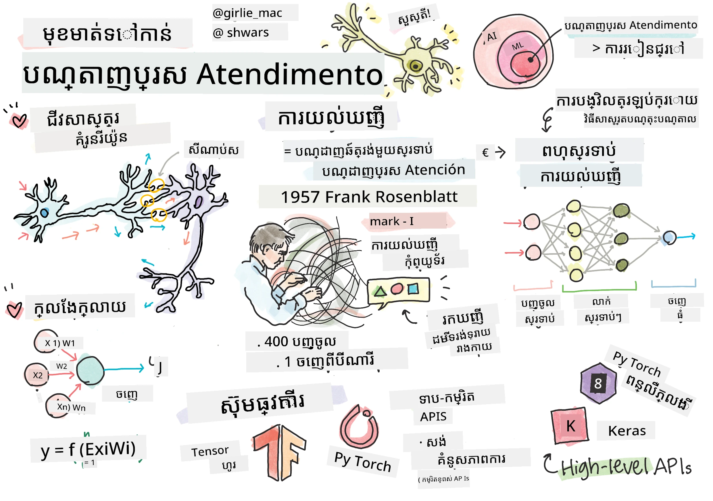
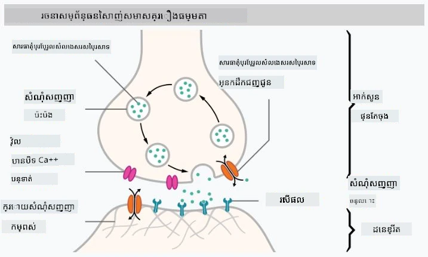
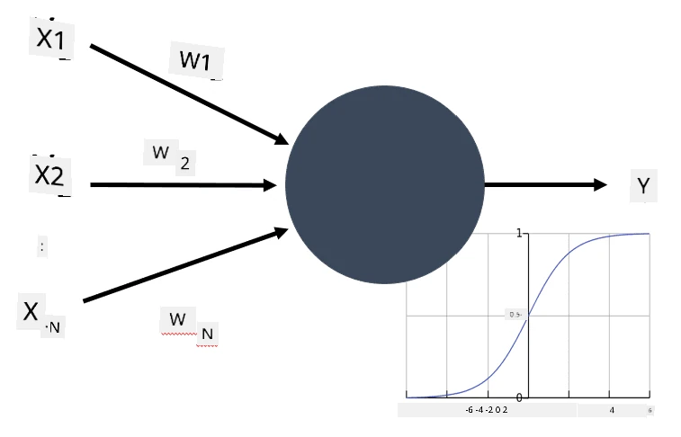

# ការ​ណែនាំ​ទៅកាន់បណ្តាញ​ប្រសាទ

ដូចដែល​យើង​បាន​ពិភាក្សា​នៅ​ក្នុង​ការ​ណែនាំ របៀប​មួយ​ក្នុងការ​ដើម្បីទាមទារជំនាញ​មួយ​គឺ​ដើម្បីបណ្តុះបណ្តាល **គំរូ​កុំព្យូទ័រ** ឬ **ខួរក្បាលសិប្បនិម្មិត**។ ចាប់តាំងពី​មធ្យមសតវត្សទី ២០ អ្នក​ស្រាវជ្រាវ​បាន​សាកល្បង​គំរូ​គណិតវិទ្យាច្រើន ដល់ពេល​ឆ្នាំ​កន្លងមកទិសដៅនេះ​បានបង្ហាញថា​មានភាពជោគជ័យយ៉ាងខ្លាំង។ គំរូ​គណិតវិទ្យា​ទាំងនេះ​នៃខួរក្បាលត្រូវបានហៅ​ថា **បណ្តាញប្រសាទ**។

> ម្តងម្កាល បណ្តាញប្រសាទ​ត្រូវបានហៅជា *បណ្តាញប្រសាទសិប្បនិម្មិត* (Artificial Neural Networks), ANNs ដើម្បីបង្ហាញ​ថា​យើងកំពុងនិយាយអំពីគំរូ មិនមែនបណ្តាញ​ប្រសាទពិតប្រាកដទេ។

## ការស្វែងយល់ម៉ាសុីន

បណ្តាញប្រសាទគឺជាផ្នែកមួយនៃវិស័យធំឈ្មោះថា **ការស្វែងយល់ម៉ាសុីន** ដែលមានគោលបំណងប្រើទិន្នន័យដើម្បីបណ្តុះបណ្តាលគំរូកុំព្យូទ័រដែលអាចដោះស្រាយបញ្ហា។ ការស្វែងយល់ម៉ាសុីនគឺជាផ្នែកធំនៃបញ្ញាសិប្បនិម្មិត តែយើងមិនគ្របដណ្តប់ ML បុរាណក្នុងមេរៀននេះឡើយ។

> អញ្ជើញចូលមើលមេរៀនបំបែក​ផ្សេងទៀត​របស់យើង **[ការស្វែងយល់ម៉ាសុីនសម្រាប់អ្នកដើម](http://github.com/microsoft/ml-for-beginners)** ដើម្បីរៀនបន្ថែមអំពីការស្វែងយល់ម៉ាសុីនបុរាណ។

ក្នុងការស្វែងយល់ម៉ាសុីន យើងសន្មត់ថា​យើងមានឈុតទិន្នន័យមួយនៃឧទាហរណ៍ **X** និងតម្លៃលទ្ធផលដែលផ្គូផ្គងគ្នា **Y**។ ឧទាហរណ៍ជាទូទៅជាវ៉ិចទ័រវិមាត្រ N ដែលមាន **លក្ខណៈ** ហើយលទ្ធផលហៅថា **ស្លាក**។

យើងនឹងពិចារណាបញ្ហាការស្វែងយល់ម៉ាសុីនច្រើនប្រើបំផុតពីរប្រភេទ៖

* **ការបែងចែកជាប្រភេទ (Classification)** ដែលយើងត្រូវបែងចែកវត្ថុបញ្ចូលទៅប្រភេទពីរឬច្រើនជាង។
* **ការសម្រួល (Regression)** ដែលយើងត្រូវទាយទម្លាក់គណនា​ចំនួន​ចំពោះគំរូបញ្ចូលនីមួយៗ។

> នៅពេលតំណាងបញ្ចូល និង លទ្ធផលជា​តង់ស័រ ឈុតទិន្នន័យបញ្ចូលគឺជាម៉ាទ្រីសទំហំ M&times;N ដែល M ជាចំនួនគំរូ និង N ជាចំនួនលក្ខណៈ។ ស្លាកលទ្ធផល Y គឺជាវ៉ិចទ័រទំហំ M។

ក្នុងមេរៀននេះ យើងគ្រាន់តែផ្ដោតលើគំរូបណ្តាញប្រសាទប៉ុណ្ណោះ។

## គំរូនៃប្រសាទមួយកោណ

ពីរូបវិទ្យាចំណេះ ដឹងថា​ខួរក្បាលរបស់យើងមានកោណប្រសាទ (neurons) តែមួយៗមាន "បញ្ចូល" (dendrites) ច្រើន និង "លទ្ធផល" តែមួយ (axon)។ ទាំង dendrites និង axons អាចផ្ទេរនូវសញ្ញា​អគ្គីសនី​បាន ហើយការតភ្ជាប់រវាងពួកវា — ហៅថា synapses — អាចបង្ហាញកម្រិតនៃការបញ្ចេញភ្លើងមិន​ស្មើគ្នា ដែលត្រូវបានគ្រប់គ្រងដោយ neurotransmitters។

 | 
----|----
ប្រសាទ​ពិតប្រាកដ *([រូបភាព](https://en.wikipedia.org/wiki/Synapse#/media/File:SynapseSchematic_lines.svg) ពីវិគីភីឌា)* | ប្រសាទសិប្បនិម្មិត *(រូបភាពដោយអ្នករៀបចំមេរៀន)*

ដូចនេះ គំរូគណិតវិទ្យាមូលដ្ឋានសម្រួលនៃប្រសាទមានបញ្ចូលច្រើន X1, ..., XN និងលទ្ធផល Y ជាមួយលេខបិទ W1, ..., WN។ លទ្ធផលត្រូវគណនា​ដូចជា៖

ដែល f ជា **មុខងារ​សកម្ម​ភាព** មិនស្មើខ្សែ។

> គំរូពាក់កណ្តាលដំបូងនៃប្រសាទត្រូវបានពិពណ៌នានៅក្នុងអត្ថបទបុរាណ [A logical calculus of the ideas immanent in nervous activity](https://www.cs.cmu.edu/~./epxing/Class/10715/reading/McCulloch.and.Pitts.pdf) និពន្ធដោយ Warren McCullock និង Walter Pitts ឆ្នាំ ១៩៤៣។ Donald Hebb ក្នុងសៀវភៅ "[The Organization of Behavior: A Neuropsychological Theory](https://books.google.com/books?id=VNetYrB8EBoC)" បានស្នើកិច្ចវិធីបណ្តុះបណ្តាលបណ្តាញទាំងនោះ។

## នៅក្នុងផ្នែកនេះ

នៅក្នុង​ផ្នែកនេះ យើង​នឹងរៀនអំពី៖
* [Perceptron](03-Perceptron/README.md), មួយក្នុងគំរូបណ្តាញប្រសាទដំបូងៗសម្រាប់ការបែងចែកប្រភេទពីរប្រភេទ
* [បណ្តាញរាប់ស្រទាប់](04-OwnFramework/README.md) ជាមួយកំណត់ត្រាគូសម្រាប់ [របៀបបង្កើតស៊ុមចរន្តផ្ទាល់ខ្លួន](04-OwnFramework/OwnFramework.ipynb)
* [ស៊ុមបណ្តាញប្រសាទ](05-Frameworks/README.md), ជាមួយកំណត់ត្រាទាំងនេះ៖ [PyTorch](05-Frameworks/IntroPyTorch.ipynb) និង [Keras/Tensorflow](05-Frameworks/IntroKerasTF.ipynb)
* [ការបញ្ចោញអតិ](../../../../lessons/3-NeuralNetworks/05-Frameworks#overfitting)

---

<!-- CO-OP TRANSLATOR DISCLAIMER START -->
**ការបដិសេធ**:
ឯកសារនេះត្រូវបានបម្លែងភាសា ដោយប្រើសេវាបម្លែងភាសា AI [Co-op Translator](https://github.com/Azure/co-op-translator)។ ទោះយើងខ្ញុំមានក្តីប្រាថ្នាឱ្យបានច្បាស់លាស់ តែសូមយល់ដឹងថាការបម្លែងដោយស្វ័យប្រវត្តិក៏អាចមានកំហុសឬភាពមិនត្រឹមត្រូវ។ ឯកសារដើមជាភាសាទីតាំងគួរត្រូវបានគេប្រើជាប្រភពច្បាស់លាស់។ សម្រាប់ព័ត៌មានសំខាន់ៗ សូមណែនាំឱ្យប្រើប្រាស់ការប្រែដោយមនុស្សជំនាញ។ យើងខ្ញុំមិនទទួលខុសត្រូវចំពោះការយល់ច្រឡំ ឬការបកស្រាយខុសបន្ទាប់ពីការប្រើប្រាស់ការបម្លែងនេះនោះទេ។
<!-- CO-OP TRANSLATOR DISCLAIMER END -->