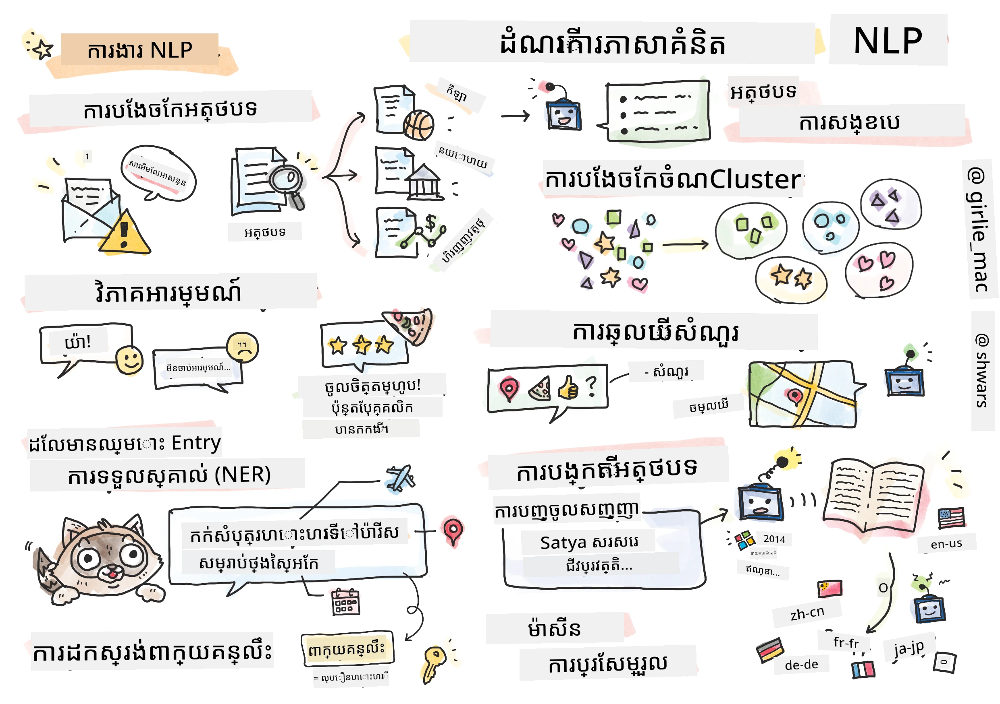

# ការដំណើរការភាសាធម្មជាតិ



ក្នុងផ្នែកនេះ យើងនឹងផ្ដោតលើការប្រើបណ្ដាញប្រសាទដើម្បីដោះស្រាយភារកិច្ចដែលទាក់ទងទៅនឹង **ការដំណើរការភាសាធម្មជាតិ (NLP)**។ មានបញ្ហា NLP ជាច្រើនដែលយើងចង់ឲ្យកុំព្យូទ័រជាច្រើនអាចដោះស្រាយបាន៖

* **ចាត់ថ្នាក់អត្ថបទ** គឺជាបញ្ហាប្រភេទចាត់ថ្នាក់ទូទៅដែលទាក់ទងនឹងលំដាប់អត្ថបទ។ ឧទាហរណ៍រួមមានការចាត់ថ្នាក់សារអ៊ីមែលថាជា spam ឬមិនមែន spam, ឬស្វែងចែកអត្ថបទជាប្រភេទកីឡា, ពាណិជ្ជកម្ម, នយោបាយ, ល។ ចំពោះការអភិវឌ្ឍឧបករណ៍ឆាត បូត យើងត្រូវការយល់ពីអ្វីដែលអ្នកប្រើប្រាស់ចង់និយាយ - ក្នុងករណីនេះយើងកំពុងដំណើរការជាមួយ **ការចាត់ថ្នាក់បំណង**។ ភាគច្រើន នៅក្នុងការចាត់ថ្នាក់បំណង យើងត្រូវដោះស្រាយជាច្រើនប្រភេទ។
* **វិភាគអារម្មណ៍** គឺជាបញ្ហាប្រភេទសម្រុក ដែលយើងត្រូវផ្ដល់លេខមួយ (អារម្មណ៍) ដែលផ្គូរផ្គងនឹងវិជ្ជមាន/អវិជ្ជមាននៃអត្ថន័យឃ្លា។ ជំនាន់ខ្ពស់ជាងនេះនៃវិភាគអារម្មណ៍គឺ **វិភាគអារម្មណ៍ផ្អែកលើជ្រុងនៃអត្ថន័យ** (ABSA) ដែលយើងផ្ដល់អារម្មណ៍មិនមែនទៅលើឃ្លាទាំងមូលទេ ប៉ុន្តែទៅលើផ្នែកផ្សេងគ្នារបស់វា (ជ្រុង), ឧ. *នៅភោជនីយដ្ឋាននេះ ខ្ញុំចូលចិត្តម្ហូបប៉ុន្តែបរិយាកាសគឺអាក្រក់*។
* **ការទទួលស្គាល់អត្តសញ្ញាណឈ្មោះ** (NER) ជាបញ្ហានៃការដកយកអត្តសញ្ញាណខ្លះៗពីអត្ថបទ។ ឧទាហរណ៍ យើងត្រូវយល់ថាក្នុងឃ្លា *ខ្ញុំត្រូវធ្វើដំណើរទៅប៉ារីសថ្ងៃស្អែក* ពាក្យ *ថ្ងៃស្អែក* មានន័យថា DATE ហើយ *ប៉ារីស* ជា LOCATION។  
* **ការដកស្រង់ពាក្យគន្លឹះ** ស្រដៀងទៅនឹង NER តែក្នុងករណីនេះយើងត្រូវដកស្រង់ពាក្យដែលសំខាន់ចំពោះអត្ថន័យនៃឃ្លាដោយស្វ័យប្រវត្តិ ដោយគ្មានការបណ្តុះបណ្តាលជាមុនសម្រាប់ប្រភេទអត្តសញ្ញាណជាក់លាក់។
* **ការតំបន់សំណុំអត្ថបទ** អាចមានប្រយោជន៍នៅពេលយើងចង់ក្រុមគ្នាឃ្លាដែលស្រដៀងគ្នា​ ឧ. សំណើសុំដែលស្រដៀងគ្នានៅក្នុងការសន្ទនាគាំទ្របច្ចេកទេស។
* **ការឆ្លើយសំណួរ** មានន័យថា ហត្ថកម្មរបស់ម៉ូឌែលក្នុងការឆ្លើយសំណួរជាក់លាក់មួយ។ ម៉ូឌែលទទួលអត្ថបទមួយ និងសំណួរជាអំណូនិតិច្ច ហើយត្រូវផ្តល់កន្លែងក្នុងអត្ថបទដែលមានចំលើយសំណួរនោះ (ឬ ពេលខ្លះបង្កើតអត្ថបទចំលើយ)។
* **ការបង្កើតអត្ថបទ** គឺជាសមត្ថភាពរបស់ម៉ូឌែលក្នុងការបង្កើតអត្ថបទថ្មី។ វាអាចនិយាយថាជាភារកិច្ចចាត់ថ្នាក់ដែលទាយតាមអក្សរឬពាក្យបន្ទាប់ដោយផ្អែកលើ *ចំណាំអត្ថបទ* ជាមួយ។ ម៉ូឌែលបង្កើតអត្ថបទកម្រិតខ្ពស់ ដូចជា GPT-3 អាចដោះស្រាយភារកិច្ច NLP ផ្សេងទៀតដូចជា ចាត់ថ្នាក់ ដោយប្រើបច្ចេកទេសហៅថា [prompt programming](https://towardsdatascience.com/software-3-0-how-prompting-will-change-the-rules-of-the-game-a982fbfe1e0) ឬ [prompt engineering](https://medium.com/swlh/openai-gpt-3-and-prompt-engineering-dcdc2c5fcd29)
* **ការសង្ខេបអត្ថបទ** គឺជាវិធីសាស្រ្តដែលយើងចង់ឲ្យកុំព្យូទ័រអាច "អាន" អត្ថបទវែង និងសង្ខេបវាជាឃ្លាប៉ុន្មាន។
* **ការប្រែភាសា ដោយម៉ាស៊ីន** អាចមើលឃើញថាជាប្រមូលផ្តុំរវាងការយល់អត្ថបទមួយភាសា និងការបង្កើតអត្ថបទភាសាផ្សេងទៀត។

ដំបូង ភារកិច្ចជាច្រើននៃ NLP ត្រូវបានដោះស្រាយដោយវិធីសាស្រ្តបុរាណដូចជា វិន័យវចនាស័ក្ត្រ។ ឧ. ក្នុងការប្រែភាសាម៉ាស៊ីន កម្មវិធីផ្សាយពាណិជ្ជកម្មត្រូវបានប្រើដើម្បីផ្លាស់ប្តូរការសម្រង់ដើមទៅជារុក្ខជាតិសំរឹទ្ធិភាព សង្វាក់នោះសម្រង់សំរឹទ្ធិភាពកម្រិតខ្ពស់ត្រូវបានដកស្រង់ ដើម្បីតំណាងឲ្យអត្ថន័យនៃឃ្លា ហើយផ្អែកលើអត្ថន័យ និងវិន័យភាសាគោលលទ្ធផលត្រូវបានបង្កើត។ នៅពេលនេះ ភារកិច្ច NLP ជាច្រើនត្រូវបានដោះស្រាយប្រសើរជាងមុនដោយបណ្ដាញប្រសាទ។

> វិធីសាស្រ្តបុរាណជាច្រើននៃ NLP ត្រូវបានអនុវត្តក្នុងបណ្ណាល័យ Python ឈ្មោះ [Natural Language Processing Toolkit (NLTK)](https://www.nltk.org)។ មានសៀវភៅ [NLTK Book](https://www.nltk.org/book/) ដែលអាចប្រើបានតាមអ៊ិនធឺរណែត ដែលគ្របដណ្តប់ពីរបៀបដោះស្រាយភារកិច្ច NLP ផ្សេងៗដោយប្រើ NLTK។

នៅក្នុងថ្នាក់សិក្សារបស់យើង យើងគ្រាន់តែផ្ដោតលើការប្រើបណ្ដាញប្រសាទសម្រាប់ NLP ហើយយើងនឹងប្រើ NLTK នៅពេលត្រូវការ។

យើងបានរៀនពីការប្រើបណ្ដាញប្រសាទសម្រាប់ដោះស្រាយទិន្នន័យតារាង និងរូបភាពរួចហើយ។ ភាពខុសគ្នាចម្បងរវាងប្រភេទទិន្នន័យនោះ និងអត្ថបទគឺអត្ថបទមានលំដាប់ប្រវែងខុសគ្នា ម្យ៉ាងវិញទំហំបញ្ចូលនៅក្នុងរូបភាពត្រូវបានដឹងជាមុន។ ខណៈដែលបណ្ដាញកុងវ៉ូលូសិនអាចរកលំនាំពីទិន្នន័យបញ្ចូល ប៉ុន្តែលំនាំនៅក្នុងអត្ថបទស្មុគស្មាញជាង។ ឧ. អាចមានការបដិសេធបានបំបែកពីប្រធានបទដោយប្រើពាក្យជាច្រើន (ឧ. *ខ្ញុំមិនចូលចិត្តក្រូចទទឹម* ទំនេីប *ខ្ញុំមិនចូលចិត្តក្រូចទទឹមធំហើយពណ៌ផ្កាពណ៌រុក្ខជាតិ*), ហើយវាគួរត្រូវបានអត្ថាធិប្បាយឲ្យដឹងថាជាលំនាំដូចគ្នា។ ដូច្នេះ ដើម្បីដោះស្រាយភាសាយើងត្រូវណែនាំប្រភេទបណ្ដាញប្រសាទថ្មីៗ ដូចជា *បណ្ដាញប្រសាទសំងាត់* និង *transformers*។

## ដំឡើងបណ្ណាល័យ

ប្រសិនបើអ្នកកំពុងប្រើការដំឡើង Python តាមទីតាំងមូលដើម្បីរត់ថ្នាក់ទិញនេះ អ្នកប្រហែលជាត្រូវដំឡើងបណ្ណាល័យដែលចាំបាច់សម្រាប់ NLP ដោយប្រើពាក្យបញ្ជាខាងក្រោម៖

**សម្រាប់ PyTorch**
```bash
pip install -r requirements-pytorch.txt
```
**សម្រាប់ TensorFlow**
```bash
pip install -r requirements-tf.txt
```

> អ្នកអាចសាកល្បង NLP ជាមួយ TensorFlow នៅ [Microsoft Learn](https://docs.microsoft.com/learn/modules/intro-natural-language-processing-tensorflow/?WT.mc_id=academic-77998-cacaste)

## ការជ្រាបដំណឹងអំពី GPU

ក្នុងផ្នែកនេះ ក្នុងខ្លះឧទាហរណ៍យើងនឹងបណ្តុះបណ្តាលម៉ូឌែលធំៗមួយចំនួន។
* **ប្រើកុំព្យូទ័រដែលគាំទ្រ GPU**: គួរប្រើកុំព្យូទ័រដែលគាំទ្រ GPU ដើម្បីកាត់បន្ថយរយៈពេលរង់ចាំពេលធ្វើការជាមួយម៉ូឌែលធំ។
* **កំណត់ការចំណាយសមត្ថភាព GPU**: ការរត់លើ GPU អាចនាំឲ្យមានស្ថានភាពដែលផ្ទាំង GPU ផុតដល់លំដាប់ដោយពិសេសពេលបណ្តុះម៉ូឌែលធំ។
* **ការប្រើប្រាស់សមត្ថភាព GPU**: បរិមាណសមត្ថភាព GPU ដែលប្រើពេលបណ្តុះបណ្តាលអាស្រ័យលើអត្តការណ៍នានា រួមមានទំហំនៃមីនីបះ។
* **កាត់បន្ថយទំហំនៃមីនីបះ**: ប្រសិនបើអ្នកជួបបញ្ហាសមត្ថភាព GPU សូមពិចារណាកាត់បន្ថយទំហំនៃមីនីបះនៅក្នុងកូដជាជម្រើស។
* **ការដោះស្រាយសមត្ថភាព TensorFlow GPU**: កំណែចាស់នៃ TensorFlow ប្រហែលមិនបញ្ចេញសមត្ថភាព GPU ពេលបណ្តុះម៉ូឌែលច្រើនក្នុងកណ្តាល Python ដោយត្រឹមត្រូវ។ ដើម្បីគ្រប់គ្រងការប្រើប្រាស់សមត្ថភាព GPU គួរតែកំណត់ TensorFlow ឲ្យកំណត់សមត្ថភាព GPU តែតាមតម្រូវការ។
* **ការបញ្ចូលកូដ**: ដើម្បីកំណត់ TensorFlow ឲ្យបន្តការចំណាយសមត្ថភាព GPU បន្ថែមតែពេលចាំបាច់ សូមបញ្ចូលកូដខាងក្រោមក្នុងកំណត់ហេតុរបស់អ្នក៖

```python
physical_devices = tf.config.list_physical_devices('GPU') 
if len(physical_devices)>0:
    tf.config.experimental.set_memory_growth(physical_devices[0], True) 
```

ប្រសិនបើអ្នកមានចំណាប់អារម្មណ៍ក្នុងការសិក្សាអំពី NLP ពីទស្សនវិស័យ ML ប្រពៃណី សូមចូលមើល [ជំពូកមេរៀននេះ](https://github.com/microsoft/ML-For-Beginners/tree/main/6-NLP)

## នៅក្នុងផ្នែកនេះ
នៅក្នុងផ្នែកនេះ យើងនឹងរៀនអំពី៖

* [ការបង្ហាញអត្ថបទជាធឺស័រ](13-TextRep/README.md)
* [ការបញ្ចូលពាក្យជាទ្វេមាត្រ](14-Embeddings/README.md)
* [ការគ្រប់គ្រងភាសា](15-LanguageModeling/README.md)
* [បណ្ដាញប្រសាទសំងាត់](16-RNN/README.md)
* [បណ្ដាញផលិតកម្ម](17-GenerativeNetworks/README.md)
* [Transformers](18-Transformers/README.md)

---

<!-- CO-OP TRANSLATOR DISCLAIMER START -->
**ការបដិសេធ**:
ឯកសារនេះត្រូវបានបម្លែងភាសា ដោយប្រើសេវាបម្លែងភាសា AI [Co-op Translator](https://github.com/Azure/co-op-translator)។ ទោះយើងខ្ញុំមានក្តីប្រាថ្នាឱ្យបានច្បាស់លាស់ តែសូមយល់ដឹងថាការបម្លែងដោយស្វ័យប្រវត្តិក៏អាចមានកំហុសឬភាពមិនត្រឹមត្រូវ។ ឯកសារដើមជាភាសាទីតាំងគួរត្រូវបានគេប្រើជាប្រភពច្បាស់លាស់។ សម្រាប់ព័ត៌មានសំខាន់ៗ សូមណែនាំឱ្យប្រើប្រាស់ការប្រែដោយមនុស្សជំនាញ។ យើងខ្ញុំមិនទទួលខុសត្រូវចំពោះការយល់ច្រឡំ ឬការបកស្រាយខុសបន្ទាប់ពីការប្រើប្រាស់ការបម្លែងនេះនោះទេ។
<!-- CO-OP TRANSLATOR DISCLAIMER END -->