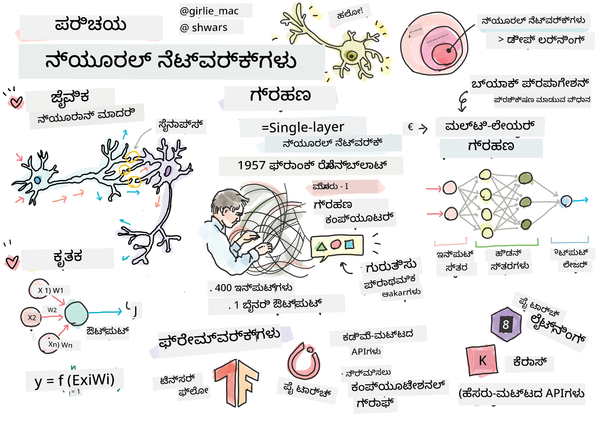
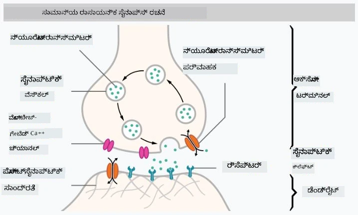
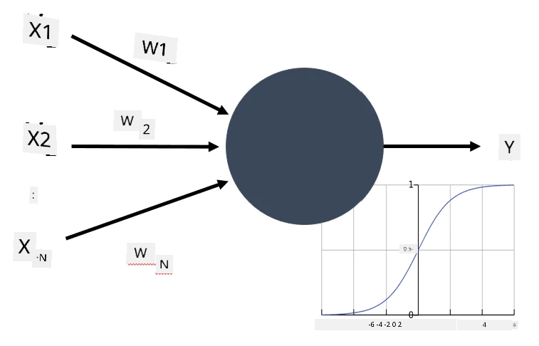

# ನುರಳ ಬಜಕಗಳಿಗೆ ಪರಿಚಯ

ಪರಿಚಯದಲ್ಲಿ ನಾವು ಚರ್ಚಿಸಿದಂತೆ, ಬುದ್ಧಿಮತ್ತೆ ಸಾಧಿಸುವ ಒಂದು ಮಾರ್ಗವೆಂದರೆ **ಕಂಪ್ಯೂಟರ್ ಮಾದರಿ** ಅಥವಾ **ಕೃತಕ ಮೆದುಳು** ಅನ್ನು ತರಬೇತುಗೊಳಿಸುವುದು. 20ನೇ ಶತಮಾನದ ಮಧ್ಯಭಾಗದಿಂದ, ಸಂಶೋಧಕರು ವಿವಿಧ ಗಣಿತೀಯ ಮಾದರಿಗಳನ್ನು ಪ್ರಯತ್ನಿಸಿದರು, ಇತ್ತೀಚಿನ ವರ್ಷಗಳಲ್ಲಿ ಈ ದಿಕ್ಕು ದೊಡ್ಡ ಯಶಸ್ಸು ಸಾಬೀತಾಗಿದೆ. ಮೆದುಳಿನ ಇಂಥ ಗಣಿತೀಯ ಮಾದರಿಗಳನ್ನು **ನುರಳ ಬಜಕಗಳು** ಎಂದು ಕರೆಯುತ್ತಾರೆ.

> ಕೆಲವು ಸಲ ನುರಳ ಬಜಕಗಳನ್ನು *ಕೃತಕ ನುರಳ ಬಜಕಗಳು* (Artificial Neural Networks), ANN ಎನ್ನುವರು, ಏಕೆಂದರೆ ನಾವು ಮಾದರಿಗಳನ್ನು ಚರ್ಚಿಸುತ್ತಿದ್ದೇವೆ, ನಿಜವಾದ ನಯೂರಾನ್ ಜಾಲಗಳನ್ನು ಅಲ್ಲ.

## ಯಂತ್ರ ಅಧ್ಯಯನ

ನುರಳ ಬಜಕಗಳು ದೊಡ್ಡ ಶಾಖೆಯ ಒಂದು ಭಾಗ, ಅದನ್ನು **ಯಂತ್ರ ಅಧ್ಯಯನ** (Machine Learning) ಎಂದು ಕರೆಯುತ್ತಾರೆ, ಇದರ ಗುರಿ ಡೇಟಾವನ್ನು ಉಪಯೋಗಿಸಿ ಸಮಸ್ಯೆಗಳನ್ನು ಪರಿಹರಿಸುವ ಕಂಪ್ಯೂಟರ್ ಮಾದರಿಗಳನ್ನು ತರಬೇತುಗೊಳಿಸುವುದು. ಯಂತ್ರ ಅಧ್ಯಯನವು ಕೃತಕ ಬುದ್ಧಿಮತ್ತೆಯ ಪ್ರಮುಖ ಭಾಗವಾದರೂ, ನಾವು ಈ ಪಠ್ಯಕ್ರಮದಲ್ಲಿ ಸಾಂಪ್ರದಾಯಿಕ ಯಂತ್ರ ಅಧ್ಯಯನವನ್ನು ಒಳಗೊಂಡಿಲ್ಲ.

> ನಮ್ಮ ವ್ಯತ್ಯಾಸವಾದ **[ಯಂತ್ರ ಅಧ್ಯಯನ ಆರಂಭಿಕರಿಗಾಗಿ](http://github.com/microsoft/ml-for-beginners)** ಪಠ್ಯಕ್ರಮವನ್ನು ಭೇಟಿ ನೀಡಿ ಸಾಂಪ್ರದಾಯಿಕ ಯಂತ್ರ ಅಧ್ಯಯನವನ್ನು ಇನ್ನಷ್ಟು ತಿಳಿದುಕೊಳ್ಳಿ.

ಯಂತ್ರ ಅಧ್ಯಯನದಲ್ಲಿ, ನಮಗೆ ಉದಾಹರಣೆಗಳ ಡೇಟಾಸೆಟ್ **X** ಮತ್ತು ಅನುಕೂಲವಾದ ಫಲಿತಾಂಶ ಮೌಲ್ಯಗಳ **Y** ಇರುತ್ತವೆ ಎಂದು ಅಂದುಕೊಳ್ಳಲಾಗುತ್ತದೆ. ಉದಾಹರಣೆಗಳು ಬಹುತೆಕ N-ಗಾತ್ರದ ವೆಕ್ಟರ್‌ಗಳು ಆಗಿದ್ದು, ಅವು **ಲಕ್ಷಣಗಳನ್ನೊಳಗೊಂಡಿರುತ್ತವೆ**, ಮತ್ತು ಫಲಿತಾಂಶಗಳನ್ನು **ಲೇಬಲ್ಗಳು** ಎಂದು ಕರೆಯುತ್ತೇವೆ.

ನಾವು ಯಂತ್ರ ಅಧ್ಯಯನದ ಎರಡು ಅತ್ಯಂತ ಸಾಮಾನ್ಯ ಸಮಸ್ಯೆಗಳನ್ನು ಪರಿಗಣಿಸುವೆವು:

* **ವರ್ಗೀಕರಣ** (Classification), ಇಲ್ಲಿ ನಮಗೆ ಇನ್ಪುಟ್ ವಸ್ತುವನ್ನು ಎರಡು ಅಥವಾ ಹೆಚ್ಚಿನ ವರ್ಗಗಳಿಗೆ ವರ್ಗೀಕರಿಸುವುದಿರುತ್ತದೆ.
* **ರಿಗ್ರೆಷನ್** (Regression), ಇಲ್ಲಿ ನಮಗೆ ಪ್ರತಿಯೊಂದು ಇನ್ಪುಟ್ ನಿದರ್ಶನಕ್ಕೆ ಸಂಖ್ಯಾತ್ಮಕ ಮೌಲ್ಯವನ್ನು ಪೂರ್ವ ನಿರೀಕ್ಷಿಸುವುದಿರುತ್ತದೆ.

> ಇನ್ಪುಟ್ ಮತ್ತು ಔಟ್ಪುಟ್‌ಗಳನ್ನು ಟೆನ್ಸರ್‌ಗಳಾಗಿ ಪ್ರತಿನಿಧಿಸುವಾಗ, ಇನ್ಪುಟ್ ಡೇಟಾಸೆಟ್ M&times;N ಗಾತ್ರದ ಮ್ಯಾಟ್ರಿಕ್ಸ್ ಆಗಿದ್ದು, ಇಲ್ಲಿ M ನಿದರ್ಶನಗಳ ಸಂಖ್ಯೆ ಮತ್ತು N ಲಕ್ಷಣಗಳ ಸಂಖ್ಯೆ. ಔಟ್ಪುಟ್ ಲೇಬಲ್ಗಳು Y M ಗಾತ್ರದ ವೆಕ್ಟರ್ ಆಗಿವೆ.

ಈ ಪಠ್ಯಕ್ರಮದಲ್ಲಿ, ನಾವು ನುರಳ ಬಜಕ ಮಾದರಿಗಳ ಮೇಲೆಯೇ ಕೇಂದ್ರಿತವಾಗಿರುತ್ತೇವೆ.

## ನಯೂರಾನ್‌ನ ಮಾದರಿ

ಜೀವಶಾಸ್ತ್ರದಿಂದ, ನಮ್ಮ ಮೆದುಳು ನಯೂರಾಲ್ ಸೆಲ್ಸ್ (ನಯೂರಾನ್ಸ್) ರಿಂದ ಕೂಡಿದೆ, ಪ್ರತಿಯೊಂದು ಕೇಂದ್ರದಲ್ಲಿ ಅನೇಕ "ಇನ್ಪುಟ್ಸ್" (ಡೆನ್ಡ್ರೈಟ್ಸ್) ಮತ್ತು ಒಂದು "ಔಟ್ಪುಟ್" (ಆಕ್ಸಾನ್) ಇರುತ್ತದೆ. ಡೆನ್ಡ್ರೈಟ್ಸ್ ಮತ್ತು ಆಕ್ಸಾನ್ಸ್ ಎರಡು ವಿದ್ಯುತ್ ಸಂಕೇತಗಳನ್ನು ಸಾಗಿಸುವ ಸಾಮರ್ಥ್ಯ ಹೊಂದಿವೆ, ಮತ್ತು ಅವುಗಳ ನಡುವಿನ ಸಂಪರ್ಕಗಳನ್ನು ಸೈನಾಪ್ಸಿಸ್‌ಗಳು ಎಂದು ಕರೆಯುತ್ತಾರೆ — ಇವು ಮೊತ್ತ ಮೊದಲಾದ ವಾಹಕತೆ ಹೊಂದಿರುವುದನ್ನು ನ್ಯೂರೋ ಟ್ರಾನ್ಸ್ಮಿಟರ್‌ಗಳು ನಿಯಂತ್ರಿಸುತ್ತವೆ.

 | 
----|----
ನಿಜವಾದ ನಯೂರಾನ್ *([ಚಿತ್ರ](https://en.wikipedia.org/wiki/Synapse#/media/File:SynapseSchematic_lines.svg) ವಿಕಿಪೀಡಿಯದಿಂದ)* | ಕೃತಕ ನಯೂರಾನ್ *(ಚಿತ್ರಲೇಖಕನ ಚಿತ್ರ)*

ಹೀಗಾಗಿ, ನಯೂರಾನ್‌ನ ಸರ್ವಸಾಮಾನ್ಯ ಗಣಿತೀಯ ಮಾದರಿ ಹಲವಾರು ಇನ್ಪುಟ್ ಗಳನ್ನು ಹೊಂದಿದ್ದು X1, ..., XN ಮತ್ತು ಒಂದು ಔಟ್ಪುಟ್ Y ಮತ್ತು ತೂಕಗಳ ಸರಣಿಯಿವೆ W1, ..., WN. ಔಟ್ಪುಟ್ ಈ ರೀತಿಯಾಗಿ ಲೆಕ್ಕಿಸಲಾಗುತ್ತದೆ:

ಇಲ್ಲಿ f ಎಂದರೆ ಯಾವುದೋ ಅರೆರೇಖಾಗತವಲ್ಲದ **ಸಕ್ರಿಯೀಕರಣ ಕಾರ್ಯ**.

> ನಯೂರಾನ್‌ಗಳ ಆರಂಭಿಕ ಮಾದರಿಗಳನ್ನು 1943 ರಲ್ಲಿ ವಾರನ್ ಮೆಕಕಲೊಕ್ ಮತ್ತು ವಾಲ್ಟರ್ ಪಿಟ್ಸ್ ಅವರು ಬರೆಯಲಾದ [ತಪ್ಪಿಸು ಚಟುವಟಿಕೆಯಲ್ಲಿ ಆಲೋಚನೆಗಳ ತಾರ್ಕಿಕ ಕ್ಯಾಲ್ಕ್ಯೂಲೆಸ್](https://www.cs.cmu.edu/~./epxing/Class/10715/reading/McCulloch.and.Pitts.pdf) ಎಂಬ ಶಾಸ್ತ್ರೀಯ ಪ್ರಬಂಧದಲ್ಲಿ ವಿವರಿಸಲಾಗಿದೆ. ಡೊನಾಲ್ಡ್ ಹೆಬ್ ತನ್ನ ಪುಸ್ತಕ "[ವರ್ತನೆ ಸಂಘಟನೆಯು: ಒಂದು ನರಮಾನಸಿಕ ಸಿದ್ಧಾಂತ](https://books.google.com/books?id=VNetYrB8EBoC)" ನಲ್ಲಿ ಆ ಜಾಲಗಳನ್ನು ತರಬೇತುಗೊಳಿಸುವ ವಿಧಾನವನ್ನು ಸೂಚಿಸಿದ್ದಾರೆ.

## ಈ ವಿಭಾಗದಲ್ಲಿ

ಈ ವಿಭಾಗದಲ್ಲಿ ನಾವು ಈ ವಿಷಯಗಳನ್ನು ಕಲಿತೇವೆ:
* [ಪರ್ಸೆಪ್ಟ್ರಾನ್](03-Perceptron/README.md), ಎರಡು ವರ್ಗಗಳ ವರ್ಗೀಕರಣಕ್ಕಾಗಿ ಮೊದಲನೆಯ ನುರಳ ಬಜಕ ಮಾದರಿಗಳಲ್ಲಿ ಒಂದಾಗಿದ್ದು
* [ಬಹು-ಮಟ್ಟದ ಜಾಲಗಳು](04-OwnFramework/README.md) ಜೊತೆಗೆ ಹೊರಗಿನ ನೋಟುಬುಕ್ [ನಮ್ಮದೇ ಫ್ರೇಮ್ವರ್ಕ್ ಅನ್ನು ನಿರ್ಮಿಸುವದು ಹೇಗೆ](04-OwnFramework/OwnFramework.ipynb)
* [ನುರಳ ಜಾಲ ಫ್ರೇಮ್ವರ್ಕ್‌ಗಳು](05-Frameworks/README.md), ಇವುಗಳ ನೋಟುಬುಕ್‌ಗಳು: [ಪೈಟಾರ್ಚ್](05-Frameworks/IntroPyTorch.ipynb) ಮತ್ತು [ಕೇರಾಸ್/ಟೆನ್ಸರ್‌ಫ್ಲೋ](05-Frameworks/IntroKerasTF.ipynb)
* [ಓವರ್‌ಫಿಟಿಂಗ್](../../../../lessons/3-NeuralNetworks/05-Frameworks#overfitting)

---

<!-- CO-OP TRANSLATOR DISCLAIMER START -->
**ಅಸ್ವೀಕಾರ**:
ಈ ದಸ್ತಾವೇಜು AI ಅನುವಾದ ಸೇವೆ [Co-op Translator](https://github.com/Azure/co-op-translator) ಬಳಸಿ ಅನುವಾದಿಸಲಾಗಿದೆ. ನಾವು ನಿಖರತೆಯನ್ನು ಸಾಧಿಸಲು ಪ್ರಯತ್ನಿಸುತ್ತಿದ್ದರೂ, ದಯವಿಟ್ಟು ಗಮನಿಸಿ, ಸ್ವಯಂಚಾಲಿತ ಅನುವಾದಗಳಲ್ಲಿ ದೋಷಗಳು ಅಥವಾ ಅಸಡ್ಡೆಗಳು ಇರಬಹುದು. ಮೂಲ ಭಾಷೆಯಲ್ಲಿರುವ ಮೂಲ ದಸ್ತಾವೇಜು ಪ್ರಾಮಾಣಿಕ ಮೂಲವೆಂದು ಪರಿಗಣಿಸಬೇಕು. ಪ್ರಮುಖ ಮಾಹಿತಿಗಾಗಿ, ವೃತ್ತಿಪರ ಮಾನವ ಅನುವಾದವನ್ನು ಶಿಫಾರಸು ಮಾಡಲಾಗುತ್ತದೆ. ಈ ಅನುವಾದವನ್ನು ಬಳಸುವ ಮೂಲಕ ಉಂಟಾಗುವ ಯಾವುದೇ ತಪ್ಪು ಅರ್ಥಗಳ ಅಥವಾ ತಪ್ಪು ವ್ಯಾಖ್ಯಾನಗಳ ಬಗ್ಗೆ ನಾವು ಹೊಣೆಗಾರರಲ್ಲ.
<!-- CO-OP TRANSLATOR DISCLAIMER END -->