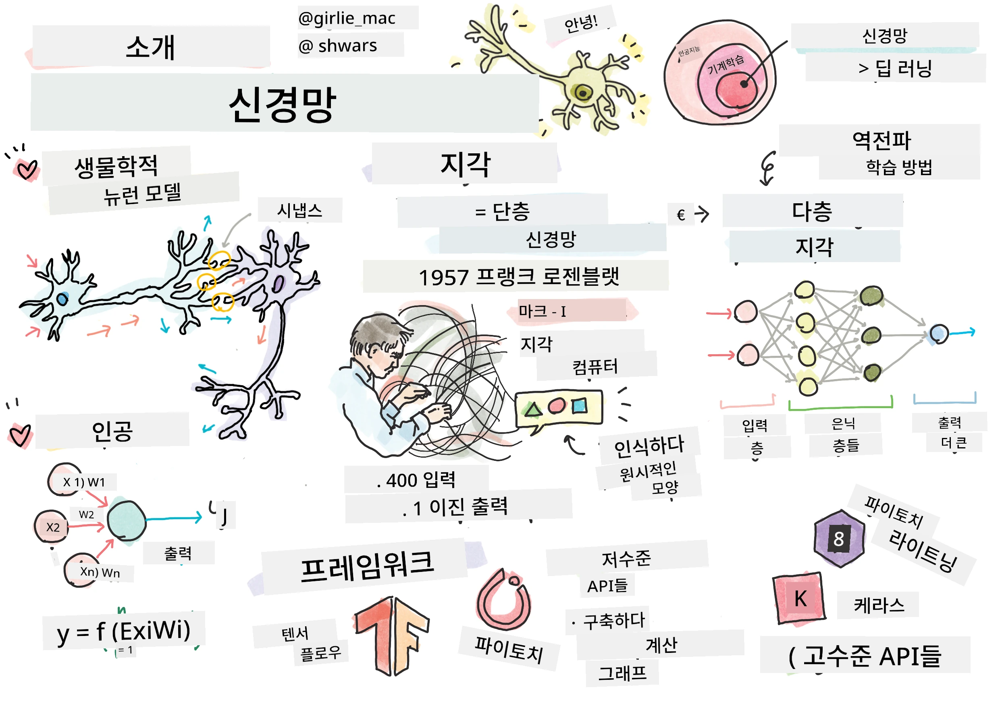
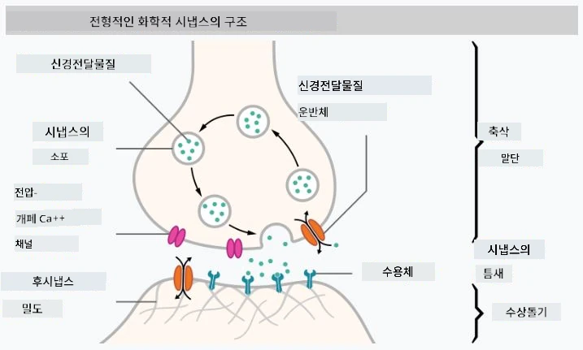

# 신경망 소개

서론에서 논의했듯이, 지능을 달성하는 방법 중 하나는 **컴퓨터 모델** 또는 <strong>인공 두뇌</strong>를 훈련시키는 것입니다. 20세기 중반부터 연구자들은 다양한 수학적 모델을 시도해 왔으며, 최근 몇 년간 이 방향이 크게 성공을 거두었습니다. 뇌의 이러한 수학적 모델은 <strong>신경망</strong>이라고 불립니다.

> 때로 신경망은 모델임을 나타내기 위해 *인공 신경망*(Artificial Neural Networks, ANNs)이라고 부르기도 합니다. 이는 실제 뉴런 네트워크가 아님을 강조하는 표현입니다.

## 머신 러닝

신경망은 <strong>머신 러닝</strong>이라는 더 큰 학문 분야의 일부로, 머신 러닝은 데이터를 사용해 문제를 해결할 수 있는 컴퓨터 모델을 학습시키는 것이 목표입니다. 머신 러닝은 인공지능의 큰 부분을 차지하지만, 이 교육 과정에서는 고전적인 머신 러닝은 다루지 않습니다.

> 고전 머신 러닝에 대해 더 알고 싶다면, 별도의 **[초보자를 위한 머신 러닝](http://github.com/microsoft/ml-for-beginners)** 교육 과정을 방문하세요.

머신 러닝에서는 예제 데이터셋 <strong>X</strong>와 해당하는 출력 값 <strong>Y</strong>가 있다고 가정합니다. 예제는 종종 <strong>특징(feature)</strong>으로 구성된 N차원 벡터이고, 출력은 <strong>레이블(label)</strong>이라고 불립니다.

우리는 가장 흔한 두 가지 머신 러닝 문제를 고려할 것입니다:

* 입력 객체를 두 개 이상의 클래스로 분류해야 하는 **분류(classification)** 문제
* 각 입력 샘플에 대해 숫자 값을 예측해야 하는 **회귀(regression)** 문제

> 입력과 출력을 텐서로 표현할 때, 입력 데이터셋은 M×N 크기의 행렬이며 M은 샘플 수, N은 특징 수를 의미합니다. 출력 레이블 Y는 크기 M인 벡터입니다.

이 교육 과정에서는 신경망 모델에만 집중할 것입니다.

## 뉴런 모델

생물학에서 우리는 뇌가 여러 개의 "입력"(수상돌기)과 하나의 "출력"(축삭)을 가진 신경세포(뉴런)로 구성되어 있다는 것을 알고 있습니다. 수상돌기와 축삭 모두 전기 신호를 전달할 수 있으며, 이들 사이의 연결인 시냅스는 다양한 전도성을 가질 수 있고 신경전달물질에 의해 조절됩니다.

 | 
----|----
실제 뉴런 *([이미지](https://en.wikipedia.org/wiki/Synapse#/media/File:SynapseSchematic_lines.svg) 위키피디아 출처)* | 인공 뉴런 *(저자 이미지)*

따라서 뉴런의 가장 단순한 수학 모델은 여러 입력 X1, ..., XN과 출력 Y, 그리고 일련의 가중치 W1, ..., WN를 포함합니다. 출력은 다음과 같이 계산됩니다:

여기서 f는 어떤 비선형 <strong>활성화 함수</strong>입니다.

> 초기 뉴런 모델들은 1943년 Warren McCullock과 Walter Pitts가 발표한 고전 논문 [A logical calculus of the ideas immanent in nervous activity](https://www.cs.cmu.edu/~./epxing/Class/10715/reading/McCulloch.and.Pitts.pdf)에서 설명되었습니다. Donald Hebb는 그의 저서 "[The Organization of Behavior: A Neuropsychological Theory](https://books.google.com/books?id=VNetYrB8EBoC)"에서 이러한 네트워크를 학습시키는 방법을 제안했습니다.

## 이 섹션에서

이 섹션에서는 다음을 배웁니다:
* [퍼셉트론](03-Perceptron/README.md), 두 개의 클래스 분류를 위한 초기 신경망 모델 중 하나
* [다층 네트워크](04-OwnFramework/README.md)와 짝을 이루는 노트북 [자체 프레임워크 구축 방법](04-OwnFramework/OwnFramework.ipynb)
* [신경망 프레임워크](05-Frameworks/README.md)와 함께하는 노트북들: [PyTorch](05-Frameworks/IntroPyTorch.ipynb)와 [Keras/Tensorflow](05-Frameworks/IntroKerasTF.ipynb)
* [과적합](../../../../lessons/3-NeuralNetworks/05-Frameworks#overfitting)

---

<!-- CO-OP TRANSLATOR DISCLAIMER START -->
**면책 조항**:
이 문서는 AI 번역 서비스 [Co-op Translator](https://github.com/Azure/co-op-translator)를 사용하여 번역되었습니다. 정확성을 기하기 위해 노력하고 있으나, 자동 번역은 오류나 부정확한 부분이 있을 수 있음을 유의하시기 바랍니다. 원본 문서의 원어본이 권위 있는 자료로 간주되어야 합니다. 중요한 정보의 경우, 전문가의 인간 번역을 권장합니다. 이 번역 사용으로 인해 발생하는 오해나 잘못된 해석에 대해 당사는 책임을 지지 않습니다.
<!-- CO-OP TRANSLATOR DISCLAIMER END -->