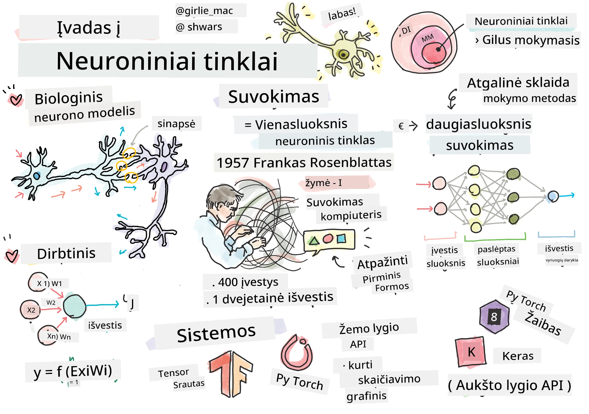
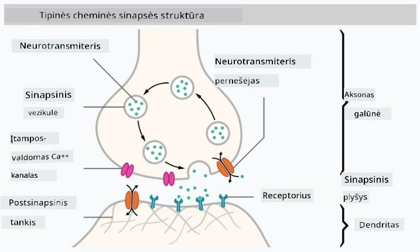
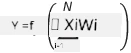

# Įvadas į neuroninius tinklus

Kaip aptarėme įvade, vienas iš būdų pasiekti intelektą yra apmokyti **kompiuterinį modelį** arba **dirbtinį smegenų modelį**. Nuo XX a. vidurio mokslininkai bandė įvairius matematinius modelius, kol pastaraisiais metais ši kryptis pasirodė esanti itin sėkminga. Tokie smegenų matematiniamodeliai vadinami **neuroniniais tinklais**.

> Kartais neuroniniai tinklai vadinami *dirbtiniais neuroniniais tinklais* (angl. Artificial Neural Networks, ANN), norint pabrėžti, kad kalbame apie modelius, o ne tikrus neuronų tinklus.

## Mašininis mokymasis

Neuroniniai tinklai yra didesnės disciplinos dalis, vadinamos **mašininiu mokymusi**, kurios tikslas yra naudoti duomenis kompiuterinių modelių mokymui, kurie gali spręsti uždavinius. Mašininis mokymasis sudaro didelę dirbtinio intelekto dalį, tačiau šioje programoje klasikinio MM neaptarsime.

> Apsilankykite mūsų atskirame **[Mašininio mokymosi pradedantiesiems](http://github.com/microsoft/ml-for-beginners)** kurse, norėdami sužinoti daugiau apie klasikinį mašininį mokymąsi.

Mašininiame mokymesi darome prielaidą, kad turime pavyzdžių duomenų rinkinį **X** ir atitinkamus išėjimo dydžius **Y**. Pavyzdžiai dažnai būna N-matmenų vektoriai, sudaryti iš **savybių**, o išėjimai vadinami **etiketėmis**.

Apsvarstysime du labiausiai paplitusius mašininio mokymosi uždavinius:

* **Klasifikaciją**, kai reikia įvesties objektą priskirti dviem ar daugiau klasėms.
* **Regresiją**, kai reikia prognozuoti skaitinę reikšmę kiekvienam įvesties pavyzdžiui.

> Vaizduojant įėjimus ir išėjimus kaip tenzorius, įvesties duomenų rinkinys yra M×N matricos dydžio, kur M – pavyzdžių skaičius, o N – savybių skaičius. Išėjimo etiketės Y yra M dydžio vektorius.

Šioje programoje mes sutelksime dėmesį tik į neuroninių tinklų modelius.

## Neurono modelis

Iš biologijos žinome, kad mūsų smegenys susideda iš neuronų, kurių kiekvienas turi keletą „įvesčių“ (dendritų) ir vieną „išvestį“ (aksoną). Tiek dendritai, tiek aksonai gali perduoti elektrinius signalus, o jungtys tarp jų – vadinamos sinapsėmis – gali turėti skirtingą laidumą, kurį reguliuoja neurotransmiteriai.

 | 
----|----
Tikras neuronas *([Paveikslėlis](https://en.wikipedia.org/wiki/Synapse#/media/File:SynapseSchematic_lines.svg) iš Vikipedijos)* | Dirbtinis neuronas *(Paveikslėlis autoriaus)*

Taigi, paprasčiausias neurono matematkinis modelis turi kelias įvestis X1, ..., XN ir vieną išvestį Y, taip pat svorius W1, ..., WN. Išvestis apskaičiuojama pagal formulę:

kur f yra tam tikra nelinijinė **aktyvacijos funkcija**.

> Ankstyvieji neurono modeliai aprašyti klasikinėje 1943 m. Warren McCullock ir Walter Pitts mokslinio darbo „[A logical calculus of the ideas immanent in nervous activity](https://www.cs.cmu.edu/~./epxing/Class/10715/reading/McCulloch.and.Pitts.pdf)“. Donald Hebb savo knygoje „[Elgesio organizavimas: neuropsichologinė teorija](https://books.google.com/books?id=VNetYrB8EBoC)“ pasiūlė, kaip tuos tinklus galima apmokyti.

## Šiame skyriuje

Šiame skyriuje sužinosime apie:
* [Perceptroną](03-Perceptron/README.md), vieną iš ankstyviausių neuroninių tinklų modelių dviklasinei klasifikacijai
* [Daugiasluoksnius tinklus](04-OwnFramework/README.md) su pridėtiniu užrašu „kaip sukurti savo sistemą“ [how to build our own framework](04-OwnFramework/OwnFramework.ipynb)
* [Neuroninių tinklų karkasus](05-Frameworks/README.md), su šiais užrašais: [PyTorch](05-Frameworks/IntroPyTorch.ipynb) ir [Keras/Tensorflow](05-Frameworks/IntroKerasTF.ipynb)
* [Permokymąsi](../../../../lessons/3-NeuralNetworks/05-Frameworks#overfitting)

---

<!-- CO-OP TRANSLATOR DISCLAIMER START -->
**Atsakomybės apribojimas**:
Šis dokumentas buvo išverstas naudojant dirbtinio intelekto vertimo paslaugą [Co-op Translator](https://github.com/Azure/co-op-translator). Nors siekiame tikslumo, prašome atkreipti dėmesį, kad automatiniai vertimai gali turėti klaidų ar netikslumų. Originalus dokumentas jo gimtąja kalba laikomas autoritetingu šaltiniu. Svarbiai informacijai rekomenduojama naudoti profesionalų žmogiškąjį vertimą. Mes neatsakome už jokius nesusipratimus ar neteisingą interpretaciją, kilusią naudojantis šiuo vertimu.
<!-- CO-OP TRANSLATOR DISCLAIMER END -->