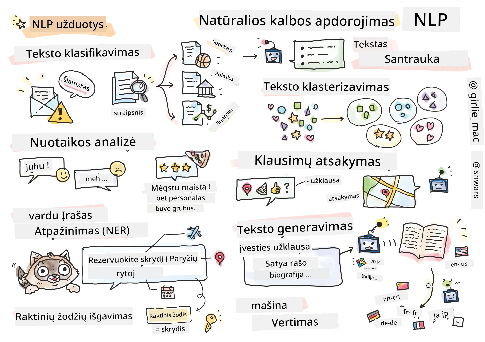

# Natūralios kalbos apdorojimas



Šiame skyriuje daugiausia dėmesio skirsime giliųjų neuroninių tinklų taikymui užduotims, susijusioms su **natūralios kalbos apdorojimu (NLP)**. Yra daug NLP problemų, kurias norime, kad kompiuteriai sugebėtų spręsti:

* **Teksto klasifikacija** yra tipinė klasifikavimo problema, susijusi su teksto sekomis. Pavyzdžiai – el. laiškų klasifikavimas kaip šlamštas arba ne, arba straipsnių skirstymas į sportą, verslą, politiką ir kt. Taip pat kuriant pokalbių robotus dažnai reikia suprasti, ką vartotojas norėjo pasakyti – šiuo atveju dirbame su **intencijos klasifikacija**. Dažnai intencijos klasifikacijoje reikia susidoroti su daugeliu kategorijų.
* **Nuotaikos analizė** yra tipinė regresijos problema, kai reikia priskirti skaičių (nuotaiką), atspindintį, kiek teigiama/neigiama yra sakinio prasmė. Sudėtingesnė nuotaikos analizės versija yra **aspektu pagrįsta nuotaikos analizė** (ABSA), kai nuotaika priskiriama ne visam sakiniui, o skirtingoms jo dalims (aspektams), pvz. *Šiame restorane man patiko virtuvė, bet atmosfera buvo siaubinga*.
* **Pavadintų entitetų atpažinimas** (NER) reiškia tam tikrų entitetų ištekimą iš teksto problemą. Pavyzdžiui, gali reikėti suprasti, kad frazėje *Man reikia rytoj skristi į Paryžių* žodis *rytoj* reiškia DATĄ, o *Paryžius* yra Vieta.  
* **Reikšminių žodžių išskyrimas** yra panašus į NER, bet žodžius, svarbius sakinio prasmėi, reikia automatiškai išskirti be išankstinio mokymo konkrečioms entitetų kategorijoms.
* **Teksto klasterizavimas** gali būti naudingas, kai norime sugrupuoti panašius sakinius, pavyzdžiui tekninės pagalbos pokalbių panašias užklausas.
* **Klausimų atsakymas** reiškia modelio gebėjimą atsakyti į konkretų klausimą. Modelis gauna teksto ištrauką ir klausimą kaip įvestis ir turi nurodyti vietą tekste, kur yra klausimo atsakymas (arba kartais generuoti atsakymo tekstą).
* **Teksto generavimas** yra modelio gebėjimas kurti naują tekstą. Jį galima laikyti klasifikavimo užduotimi, kuri prognozuoja kitą raidę/žodį pagal tam tikrą *teksto užuominą*. Pažangūs teksto generavimo modeliai, tokie kaip GPT-3, sugeba spręsti ir kitas NLP užduotis, pavyzdžiui, klasifikaciją, naudojant techniką, vadinamą [užuominos programavimu](https://towardsdatascience.com/software-3-0-how-prompting-will-change-the-rules-of-the-game-a982fbfe1e0) arba [užuominos inžinerija](https://medium.com/swlh/openai-gpt-3-and-prompt-engineering-dcdc2c5fcd29)
* **Teksto santrauka** yra technika, kai norime, kad kompiuteris „perskaitytų“ ilgą tekstą ir apibendrintų jį keliomis sakiniais.
* **Mašininis vertimas** gali būti laikomas teksto supratimo vienoje kalboje ir teksto generavimo kitoje kalboje deriniu.

Iš pradžių daugumą NLP užduočių spręndavo tradiciniais metodais, tokiais kaip gramatikos. Pavyzdžiui, mašininiame vertime buvo naudojami sintaksės analizatoriai, kurie pradinius sakinius paversdavo sintaksės medžiu, tada buvo išgaunami aukštesnio lygio semantiniai dariniai, atspindintys sakinio prasmę, ir remiantis šia prasme bei tiksline kalbos gramatika generuojamas rezultatas. Šiandien daugelį NLP užduočių efektyviau sprendžia neuroniniai tinklai.

> Daugelis klasikinių NLP metodų įgyvendinti [Natural Language Processing Toolkit (NLTK)](https://www.nltk.org) Python bibliotekoje. Yra puiki prieinama [NLTK knyga](https://www.nltk.org/book/), kurioje aptariama, kaip skirtingos NLP užduotys sprendžiamos naudojant NLTK.

Mūsų kurse daugiausia dėmesio skirsime neuroninių tinklų taikymui NLP, o NLTK naudosime prireikus.

Jau mokėmės apie neuroninių tinklų taikymą darbui su lenteliniu duomenimis ir vaizdais. Pagrindinis skirtumas tarp tokių duomenų ir teksto yra tas, kad tekstas yra kintamo ilgio seka, o paveikslėlių atveju įvesties dydis žinomas iš anksto. Nors konvoliuciniai tinklai gali išskirti šablonus iš įvesties duomenų, teksto šablonai yra sudėtingesni. Pvz., neigimas gali būti atskirtas nuo temos daugelio žodžių tarpu (pvz., *Man nepatinka apelsinai*, palyginti su *Man nepatinka tie dideli spalvingi gardūs apelsinai*), ir tai vis dar turi būti interpretuojama kaip vienas šablonas. Todėl kalbai apdoroti reikia naujų neuroninių tinklų tipų, tokių kaip *rekursiniai tinklai* ir *transformeriai*.

## Bibliotekų įdiegimas

Jei naudojate vietinę Python diegimą šiam kursui vykdyti, jums gali prireikti įdiegti visas reikalingas NLP bibliotekas naudodami šias komandas:

**PyTorch atveju**
```bash
pip install -r requirements-pytorch.txt
```
**TensorFlow atveju**
```bash
pip install -r requirements-tf.txt
```

> Galite išbandyti NLP su TensorFlow platformoje [Microsoft Learn](https://docs.microsoft.com/learn/modules/intro-natural-language-processing-tensorflow/?WT.mc_id=academic-77998-cacaste)

## GPU perspėjimas

Šiame skyriuje kai kuriuose pavyzdžiuose treniruosime gana didelius modelius.
* **Naudokite kompiuterį, palaikantį GPU**: Patartina vykdyti savo sąsiuvinius kompiuteryje su GPU, kad sumažintumėte laukimo laiką dirbant su dideliais modeliais.
* **GPU atminties apribojimai**: Veikiant su GPU gali nutikti, kad baigsis GPU atmintis, ypač treniruojant didelius modelius.
* **GPU atminties naudojimas**: GPU atminties kiekis, sunaudojamas mokymo metu, priklauso nuo daugelio veiksnių, įskaitant mini partijos dydį.
* **Mažinkite mini partijos dydį**: Jei susiduriate su GPU atminties problemomis, apsvarstykite galimybę sumažinti mini partijos dydį savo kode.
* **TensorFlow GPU atminties atlaisvinimas**: Senesnės TensorFlow versijos gali neteisingai atlaisvinti GPU atmintį treniruojant kelis modelius per vieną Python branduolį. Norėdami efektyviai valdyti GPU atminties naudojimą, galite konfigūruoti TensorFlow taip, kad GPU atmintis būtų skiriama tik pagal poreikį.
* **Kodo įtraukimas**: Norėdami nurodyti TensorFlow palaipsniui didinti GPU atminties paskirstymą tik prireikus, įtraukite šį kodą į savo sąsiuvinius:

```python
physical_devices = tf.config.list_physical_devices('GPU') 
if len(physical_devices)>0:
    tf.config.experimental.set_memory_growth(physical_devices[0], True) 
```

Jei norite mokytis NLP iš klasikinės ML perspektyvos, apsilankykite [šiame pamokų rinkinyje](https://github.com/microsoft/ML-For-Beginners/tree/main/6-NLP)

## Šiame skyriuje
Šiame skyriuje išmoksime apie:

* [Teksto atvaizdavimą kaip tensorius](13-TextRep/README.md)
* [Žodžių įdėklus](14-Embeddings/README.md)
* [Kalbos modeliavimą](15-LanguageModeling/README.md)
* [Rekursinius neuroninius tinklus](16-RNN/README.md)
* [Generatyvius tinklus](17-GenerativeNetworks/README.md)
* [Transformerius](18-Transformers/README.md)

---

<!-- CO-OP TRANSLATOR DISCLAIMER START -->
**Atsakomybės apribojimas**:
Šis dokumentas buvo išverstas naudojant dirbtinio intelekto vertimo paslaugą [Co-op Translator](https://github.com/Azure/co-op-translator). Nors siekiame tikslumo, prašome atkreipti dėmesį, kad automatiniai vertimai gali turėti klaidų ar netikslumų. Originalus dokumentas jo gimtąja kalba laikomas autoritetingu šaltiniu. Svarbiai informacijai rekomenduojama naudoti profesionalų žmogiškąjį vertimą. Mes neatsakome už jokius nesusipratimus ar neteisingą interpretaciją, kilusią naudojantis šiuo vertimu.
<!-- CO-OP TRANSLATOR DISCLAIMER END -->