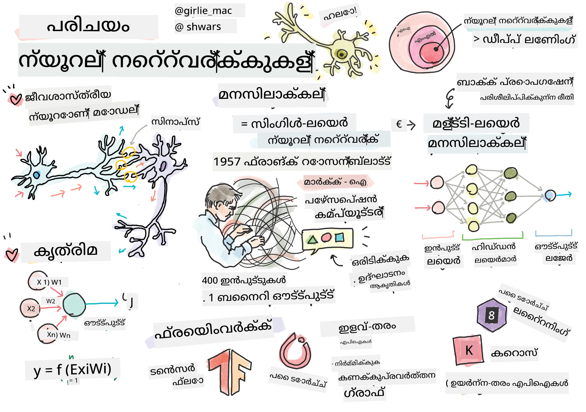
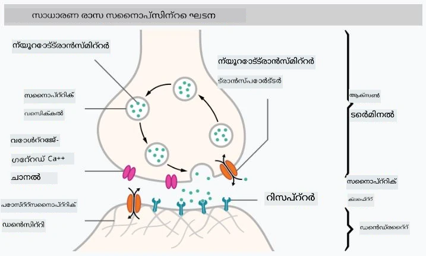
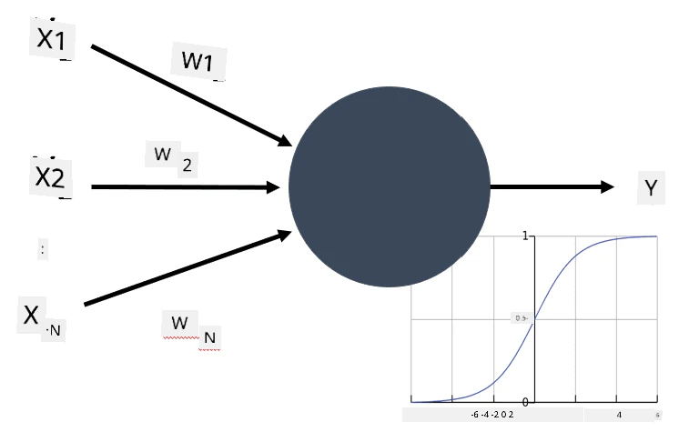

# ന്യൂറൽ നെറ്റ്വർക്കുകളുടെ പരിചയം

പരിചയത്തിൽ ചർച്ചചെയ്തതുപോലെ, ബുദ്ധിമുട്ട് നേടാനുള്ള ഒരു ഉപാധിയാണ് **കമ്പ്യൂട്ടർ മോഡൽ** അല്ലെങ്കിൽ **കല്പിത മസ്തिष്കം** പരിശീലിപ്പിക്കൽ. 20-ആം നൂറ്റാണ്ടിന്റെ മദ്ധ്യത്തിൽ നിന്ന് ഗവേഷകർ വിവിധ ഗണിത മോഡലുകൾ പരീക്ഷിച്ചു, പക്ഷേ അടുത്ത വർഷങ്ങളിൽ ഈ ദിശ വളരെ വിജയകരമെന്ന് തെളിഞ്ഞിരിക്കുന്നു. മസ്തിഷ്കത്തിന്റെ ഇതിനൊരു ഗണിത മോഡലാണ് **ന്യൂറൽ നെറ്റ്വർക്കുകൾ** എന്ന് പറയുന്നു.

> ചിലപ്പോൾ ന്യൂറൽ നെറ്റ്വർക്കുകൾ മോഡലുകളാണെന്ന് വ്യക്തമാക്കാൻ *കല്പിത ന്യൂറൽ നെറ്റ്വർക്കുകൾ* എന്നു വിളിക്കുന്നു, ANNs.

## യന്ത്രം പഠനം

ന്യൂറൽ നെറ്റ്വർക്കുകൾ **യന്ത്രം പഠനം** എന്ന വലിയ ശാഖയുടെ ഭാഗമാണ്, ഇതിന്റെ ലക്ഷ്യം ഉപയോക്തൃ ഡാറ്റ ഉപയോഗിച്ച് പ്രശ്നങ്ങൾ പരിഹരിക്കാൻ കഴിയുന്ന കമ്പ്യൂട്ടർ മോഡലുകൾ പരിശീലിപ്പിക്കുക എന്നതാണ്. യന്ത്രം പഠനം കല്പിത ബുദ്ധിമുട്ടിന്റെ വലിയൊരു ഭാഗമാണ്, എങ്കിലും ഈ പാഠ്യപദ്ധതിയിൽ പരമ്പരാഗത ML ഉൾപ്പെടുത്തുന്നില്ല.

> പരമ്പരാഗത യന്ത്രം പഠനം കൂടുതൽ മനസ്സിലാക്കുവാൻ ഞങ്ങളുടെ **[Machine Learning for Beginners](http://github.com/microsoft/ml-for-beginners)** പാഠ്യപരിപാടി സന്ദർശിക്കുക.

യന്ത്രം പഠനത്തിൽ, ചില ഉദാഹരണങ്ങളുടെ ഡാറ്റാസെറ്റ് **X** ഉം യോജിക്കുന്ന output മൂല്യങ്ങൾ **Y** ഉം ഉള്ളതായി കാണുന്നു. ഉദാഹരണങ്ങൾ സാധാരണയായി N-അളവിലുള്ള വെക്റ്ററുകൾ ആണ്, അവയ്ക്ക് ഉള്ള **ഫീച്ചറുകൾ**, output-കൾ **ലെബലുകൾ** എന്നു വിളിക്കുന്നു.

ഏറ്റവും സാധാരണമായ രണ്ട് യന്ത്രം പഠന പ്രശ്നങ്ങൾ പരിഗണിക്കാം:

* **വർഗ്ഗീകരണം**, যেখানে ഒരു ഇൻപുട്ട് വസ്തുവിനെ രണ്ട് അല്ലെങ്കിൽ കൂടുതൽ ക്ലാസുകളിലും വിഭജിക്കണം.
* **രേഖാസംഖ്യാനയം**, ഓരോ ഇൻപുട്ട് സാമ്പിളിനും ഒരു സംഖ്യാ മൂല്യം പ്രവചിക്കണം.

> Tensor-കളുടെ രൂപത്തിൽ ഇൻപുട്ടുകളും ഔട്ട്പുട്ടുകളും പ്രതിനിധീകരിക്കുമ്പോൾ, ഇൻപുട്ട് ഡാറ്റാസെറ്റ് M&times;N വലുപ്പമുള്ള ഒരു മാട്രിക്സ് ആണ്, ഇവിടെ M സാമ്പിളുകളുടെ എണ്ണം, N ഫീച്ചറുകളുടെ എണ്ണം ആണ്. ഔട്ട്പുട്ട് ലേബലുകൾ Y M വലുപ്പമുള്ള വെക്റ്റർ ആണ്.

ഈ പാഠ്യത്തിൽ, നാം ന്യൂറൽ നെറ്റ്വർക്കുകൾ മോഡലുകൾ മാത്രമേ പരിഗണിക്കൂ.

## ഒരു ന്യൂറോൺ മോഡൽ

ജീവശാസ്ത്രത്തിൽ, മസ്തിഷ്കം ന്യൂറൽ സെല്ലുകളായ (ന്യൂറോണുകൾ) അടങ്ങിയിരിക്കുന്നു, അവയിൽ ഓരോന്നിലും പല "ഇൻപുട്ടുകൾ" (ഡെൻഡ്രൈറ്റുകൾ) ഉം ഒറ്റ "ഔട്ട്പുട്ട്" (അക്സോൺ) ഉം ഉണ്ട്. ഡെൻഡ്രൈറ്റുകളും അക്സോൺ-ഉം വൈദ്യുതി സിഗ്നലുകൾ പകർക്കാനാകും, ഇവയ്ക്കിടയിലെ ബന്ധങ്ങൾ എന്നറിയപ്പെടുന്നത് സിനാപ്സുകൾ ആണ്, അവയുടെ പ്രસારണമാനനില വീതമുള്ള വ്യത്യാസങ്ങൾ ന്യൂട്രോൺ ട്രാൻസ്മിറ്ററുകൾ നിയന്ത്രിക്കുന്നു.

 | 
----|----
യഥാർത്ഥ ന്യൂറോൺ *([ചിത്രം](https://en.wikipedia.org/wiki/Synapse#/media/File:SynapseSchematic_lines.svg) വിക്കിപീഡിയയിൽ നിന്നുള്ളത്)* | കല്പിത ന്യൂറോൺ *(ഛായാചിത്രം ലേഖകданായിട്ടുള്ളത്)*

അതിനാൽ, ഒരു ന്യൂറോണിന്റെ ഏറ്റവും ലളിതമായ ഗണിത മോഡൽ ചില ഇൻപുട്ടുകൾ X1, ..., XN ഉം ഒരു ഔട്ട്പുട്ട് Y ഉം, കൂടാതെ ഒരു നിര ഭാരങ്ങൾ W1, ..., WN ഉം അടങ്ങുന്നു. ഔട്ട്പുട്ട് കണക്കാക്കുന്നത്:

ഇവിടെ f ഏതെങ്കിലും നോൺ-ലൈൻ എക്‌ടിവേഷൻ ഫംഗ്ഷനാണ്.

> വാറൺ മക്കുലോക്ക്, വാള്റ്റർ പിറ്റ്സ് എന്നിവരുടെ 1943-ലെ പാരമ്പര്യ പത്രമായ [A logical calculus of the ideas immanent in nervous activity](https://www.cs.cmu.edu/~./epxing/Class/10715/reading/McCulloch.and.Pitts.pdf) ലെ തുടക്ക മാതൃകകൾ. ഡൊണാൾഡ് ഹെബ് തന്റെ പുസ്തകം "[The Organization of Behavior: A Neuropsychological Theory](https://books.google.com/books?id=VNetYrB8EBoC)"-ൽ ആ നെറ്റ്വർക്കുകൾ എങ്ങനെ പരിശീലിപ്പിക്കാമെന്ന് നിർദേശിച്ചു.

## ഈ വിഭാഗത്തിൽ

ഈ വിഭാഗത്തിൽ നാം പഠിക്കാം:
* [പേഴ്‌സെപ്ട്രോൺ](03-Perceptron/README.md), രണ്ട് ക്ലാസ് വർഗ്ഗീകരണത്തിനുള്ള ആദ്യകാല ന്യൂറൽ നെറ്റ്വർക്ക് മോഡൽ
* [ബഹുസ്തരപ്പെട്ട നെറ്റ്വർക്കുകൾ](04-OwnFramework/README.md) എന്നതും അതിന്റെ ಜೊതെയുള്ള നോട്ട്ബുക്ക് [ഞങ്ങളുടെ ഫ്രെയിംവർക്ക് എങ്ങനെ നിർമ്മിക്കാം](04-OwnFramework/OwnFramework.ipynb)
* [ന്യൂറൽ നെറ്റ്വർക്ക് ഫ്രെയിംവർക്കുകൾ](05-Frameworks/README.md), ഇവിടെയുള്ള നോട്ട്ബുക്കുകൾ: [PyTorch](05-Frameworks/IntroPyTorch.ipynb) and [Keras/Tensorflow](05-Frameworks/IntroKerasTF.ipynb)
* [ഒവർഫിറ്റിംഗ്](../../../../lessons/3-NeuralNetworks/05-Frameworks#overfitting)

---

<!-- CO-OP TRANSLATOR DISCLAIMER START -->
**അറിയിപ്പ്**:
ഈ രേഖ AI പരിഭാഷാ സേവനം [Co-op Translator](https://github.com/Azure/co-op-translator) ഉപയോഗിച്ച് പരിഭാഷപ്പെടുത്തിയതാണ്. ഞങ്ങൾ കൃത്യതയ്ക്കായി ശ്രമിക്കുന്നുവെങ്കിലും, ഓട്ടോമേറ്റഡ് പരിഭാഷകളിൽ പിഴവുകൾ അല്ലെങ്കിൽ തെറ്റായ വിവരങ്ങൾ ഉണ്ടാകാൻ സാധ്യതയുണ്ട്. അതിന്റെ സ്വാഭാവിക ഭാഷയിലുള്ള അസൽ രേഖയാണ് പ്രാമാണികമായ ഉറവിടമായി പരിഗണിക്കേണ്ടത്. നിർണായകമായ വിവരങ്ങൾക്ക്, പ്രൊഫഷണൽ മനുഷ്യ പരിഭാഷ ശുപാർശ ചെയ്യുന്നു. ഈ പരിഭാഷ ഉപയോഗിച്ച് ഉണ്ടാകുന്ന തെറ്റിദ്ധാരണകൾ അല്ലെങ്കിൽ തെറ്റായ വ്യാഖ്യാനങ്ങൾക്കായി ഞങ്ങൾ ഉത്തരവാദികളല്ല.
<!-- CO-OP TRANSLATOR DISCLAIMER END -->