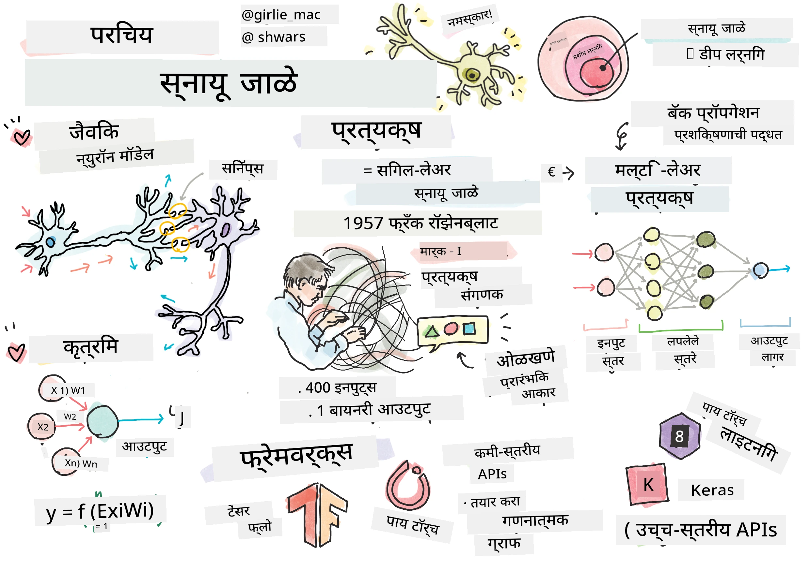
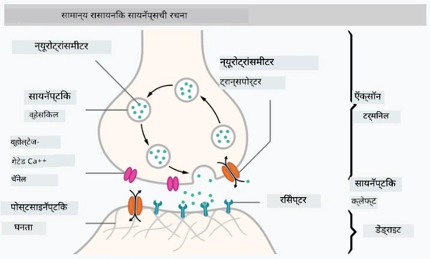
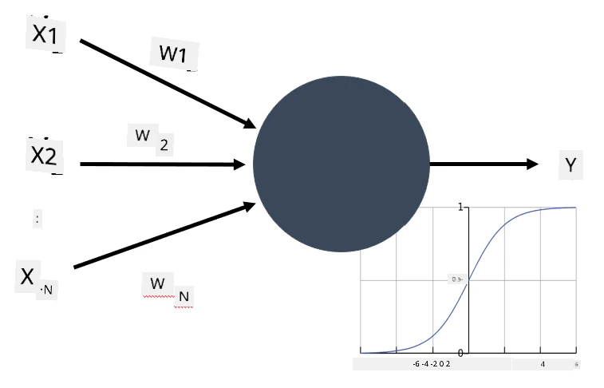

# न्यूरल नेटवर्क्सची ओळख

जसे आपण परिचयात चर्चा केली, बुद्धिमत्ता साध्य करण्याच्या एका पद्धती म्हणजे **कॉम्प्युटर मॉडेल** किंवा **कृत्रिम मेंदू** प्रशिक्षण देणे. 20 व्या शतकाच्या मध्यापासून, संशोधकांनी विविध गणितीय मॉडेल्स वापरले, जोपर्यंत अलीकडील वर्षांमध्ये हा मार्ग खूप यशस्वी ठरला नाही. मेंदूच्या अशा गणितीय मॉडेल्सना **न्यूरल नेटवर्क्स** म्हणतात.

> कधी कधी न्यूरल नेटवर्क्सला *कृत्रिम न्यूरल नेटवर्क्स*, ANNs असेही म्हणतात, जेणेकरून आपण खऱ्या न्यूरॉन्सच्या नेटवर्क्सबद्दल नव्हे तर मॉडेल्सबद्दल बोलत आहोत हे सूचित करता येईल.

## मशीन लर्निंग

न्यूरल नेटवर्क्स हा **मशीन लर्निंग** या मोठ्या क्षेत्राचा भाग आहे, ज्याचा उद्देश डेटा वापरून त्या कॉम्प्युटर मॉडेल्सना प्रशिक्षित करणे आहे जे समस्यांचे निराकरण करू शकतात. मशीन लर्निंग ही कृत्रिम बुद्धिमत्तेचा एक मोठा भाग आहे, मात्र या अभ्यासक्रमात आम्ही पारंपरिक मशीन लर्निंगचा समावेश करत नाही.

> पारंपरिक मशीन लर्निंगबद्दल अधिक जाणून घेण्यासाठी आमच्या स्वतंत्र **[Machine Learning for Beginners](http://github.com/microsoft/ml-for-beginners)** अभ्यासक्रमाला भेट द्या.

मशीन लर्निंगमध्ये, आपण समजतो की आपल्याकडे काही उदाहरणांचा संच **X** आणि त्याच्याशी संबंधित आउटपुट मूल्ये **Y** आहेत. उदाहरणे सामान्यतः N-आयामी वेक्टर असतात ज्यात **विविध वैशिष्ट्ये** असतात आणि आउटपुटना **लेबले** म्हणतात.

आपण दोन सर्वसाधारण मशीन लर्निंग समस्या पाहणार आहोत:

* **वर्गीकरण (Classification)**, जिथे आपल्याला इनपुट वस्तू दोन किंवा अधिक वर्गांमध्ये वर्गीकृत करायची असते.
* **रेग्रेशन (Regression)**, जिथे आपल्याला प्रत्येक इनपुट नमुन्यासाठी एक संख्यात्मक मूल्य भविष्यवाणी करायची असते.

> इनपुट्स आणि आउटपुट्स टेन्सर्सच्या स्वरूपात दर्शवताना, इनपुट डेटासेट M×N आकाराचा मॅट्रिक्स असतो, जिथे M म्हणजे नमुन्यांची संख्या आणि N म्हणजे वैशिष्ट्यांची संख्या. आउटपुट लेबले Y हा M आकाराचा वेक्टर असतो.

या अभ्यासक्रमात, आपण फक्त न्यूरल नेटवर्क मॉडेल्सवर लक्ष केंद्रित करू.

## न्यूरॉनचे मॉडेल

जीवशास्त्रापासून, आपल्याला माहित आहे की आपला मेंदू न्यूरल पेशींनी (न्यूरॉन्सने) बनलेला आहे, ज्यापैकी प्रत्येकाकडे अनेक "इनपुट्स" (डेंड्राइट्स) आणि एकल "आउटपुट" (ऍक्‍सन) असतो. डेंड्राइट्स आणि ऍक्‍सन्स दोघेही विद्युत सिग्नल्स शकतात, आणि त्यांच्यातील कनेक्शन्स — ज्याला सायनॅप्स म्हणतात — विविध प्रमाणांमध्ये चालकता दर्शवू शकतात, जी न्यूरोट्रांसमीटरसद्वारे नियंत्रित केली जाते.

 | 
----|----
खरा न्यूरॉन *([प्रतिमा](https://en.wikipedia.org/wiki/Synapse#/media/File:SynapseSchematic_lines.svg) विकिपिडियावरून)* | कृत्रिम न्यूरॉन *(प्रतिमा लेखकालाची)*

त्यामुळे, न्यूरॉन्सचा सर्वात सोपा गणितीय मॉडेल काही इनपुट्स X1, ..., XN आणि एक आउटपुट Y, तसेच वजनांची मालिका W1, ..., WN यांचा समावेश करतो. आउटपुट अशी गणना केली जाते:

जिथे f हा काही नॉन-लिनिअर **सक्रियता फंक्शन** आहे.

> न्यूरॉनच्या सुरुवातीच्या मॉडेलचा वर्णन वारन मॅककलॉक आणि वाल्टर पिट्स यांच्या 1943 मधील क्लासिक पेपर [A logical calculus of the ideas immanent in nervous activity](https://www.cs.cmu.edu/~./epxing/Class/10715/reading/McCulloch.and.Pitts.pdf) मध्ये दिले आहे. डोनाल्ड हेब यांनी त्यांच्या पुस्तक "[The Organization of Behavior: A Neuropsychological Theory](https://books.google.com/books?id=VNetYrB8EBoC)" मध्ये अशा नेटवर्क्स कसे प्रशिक्षण देता येतात हे प्रस्तावित केले.

## या विभागात

या विभागात आपण शिकणार आहोत:
* [पर्सेप्ट्रॉन](03-Perceptron/README.md), दोन-वर्ग वर्गीकरणासाठी न्यूरल नेटवर्क्समधील एक सुरुवातीचे मॉडेल
* [मल्टी-लेयर्ड नेटवर्क्स](04-OwnFramework/README.md) एक सोबतचा नोटबुक [आपले स्वतःचे फ्रेमवर्क कसे तयार करावे](04-OwnFramework/OwnFramework.ipynb)
* [न्यूरल नेटवर्क फ्रेमवर्क्स](05-Frameworks/README.md), जे नोटबुक्ससह: [पायटॉर्च](05-Frameworks/IntroPyTorch.ipynb) आणि [केरस/टेन्सरफ्लो](05-Frameworks/IntroKerasTF.ipynb)
* [ओव्हरफिटिंग](../../../../lessons/3-NeuralNetworks/05-Frameworks#overfitting)

---

<!-- CO-OP TRANSLATOR DISCLAIMER START -->
**अस्वीकरण**:
हा दस्तऐवज AI भाषांतर सेवा [Co-op Translator](https://github.com/Azure/co-op-translator) चा वापर करून अनुवादित केला आहे. जरी आम्ही अचूकतेसाठी प्रयत्न करतो, तरी कृपया लक्षात घ्या की स्वयंचलित भाषांतरांमध्ये त्रुटी किंवा अचूकतेची कमतरता असू शकते. मूळ दस्तऐवज त्याच्या मूळ भाषेत अधिकृत स्रोत मानला पाहिजे. महत्त्वाची माहिती असल्यास, व्यावसायिक मानवी भाषांतराची शिफारस केली जाते. या भाषांतराच्या वापरामुळे उद्भवणाऱ्या कोणत्याही गैरसमज किंवा चुकीच्या अर्थलावणीसाठी आम्ही जबाबदार नाही.
<!-- CO-OP TRANSLATOR DISCLAIMER END -->