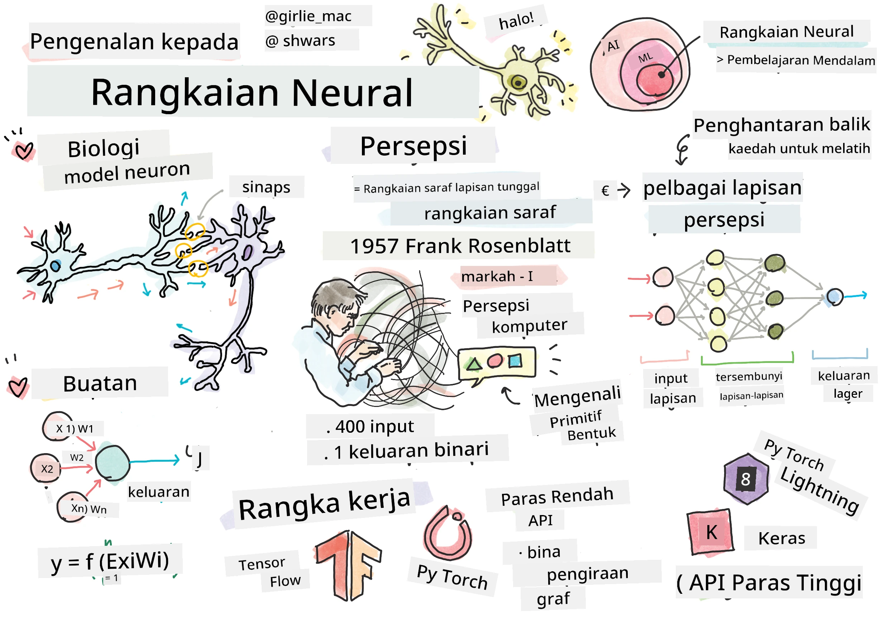
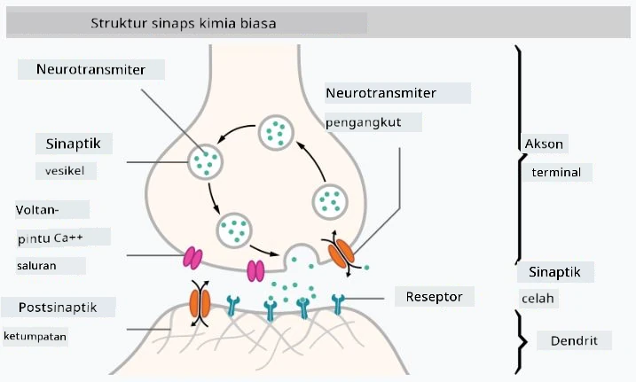

# Pengenalan kepada Rangkaian Neural

Seperti yang telah kami bincangkan dalam pengenalan, salah satu cara untuk mencapai kecerdasan adalah melatih **model komputer** atau **otak buatan**. Sejak pertengahan abad ke-20, para penyelidik mencuba pelbagai model matematik, sehingga pada tahun-tahun kebelakangan ini arah ini terbukti sangat berjaya. Model matematik otak sebegini dipanggil **rangkaian neural**.

> Kadang-kadang rangkaian neural dipanggil *Rangkaian Neural Buatan*, ANNs, untuk menunjukkan bahawa kita bercakap tentang model, bukan rangkaian sebenar neuron.

## Pembelajaran Mesin

Rangkaian Neural adalah sebahagian daripada disiplin yang lebih besar yang dipanggil **Pembelajaran Mesin**, yang bertujuan menggunakan data untuk melatih model komputer yang mampu menyelesaikan masalah. Pembelajaran Mesin membentuk bahagian besar Kecerdasan Buatan, namun, kami tidak membincangkan ML klasik dalam kurikulum ini.

> Lawati kurikulum **[Pembelajaran Mesin untuk Pemula](http://github.com/microsoft/ml-for-beginners)** kami yang berasingan untuk belajar lebih lanjut tentang Pembelajaran Mesin klasik.

Dalam Pembelajaran Mesin, kita mengandaikan bahawa kita mempunyai set data contoh **X**, dan nilai output yang berpadanan **Y**. Contoh selalunya adalah vektor N-dimensi yang terdiri daripada **ciri-ciri**, dan output dipanggil **label**.

Kita akan pertimbangkan dua masalah pembelajaran mesin yang paling biasa:

* **Klasifikasi**, di mana kita perlu mengklasifikasikan objek input ke dalam dua atau lebih kelas.
* **Regresi**, di mana kita perlu meramalkan nombor berangka untuk setiap sampel input.

> Apabila mewakili input dan output sebagai tensor, set data input adalah matriks berukuran M&times;N, di mana M adalah bilangan sampel dan N adalah bilangan ciri. Label output Y adalah vektor berukuran M.

Dalam kurikulum ini, kami hanya akan fokus pada model rangkaian neural.

## Model Neuron

Dari sains biologi, kita mengetahui bahawa otak kita terdiri daripada sel neural (neuron), yang masing-masing mempunyai beberapa "input" (dendrit) dan satu "output" (akson). Kedua-dua dendrit dan akson boleh menghantar isyarat elektrik, dan sambungan antara mereka — dikenali sebagai sinaps — boleh menunjukkan tahap kebolehkendalian yang berbeza, yang dikawal oleh neurotransmitter.

 | 
----|----
Neuron Sebenar *([Imej](https://en.wikipedia.org/wiki/Synapse#/media/File:SynapseSchematic_lines.svg) dari Wikipedia)* | Neuron Buatan *(Imej oleh Penulis)*

Oleh itu, model matematik neuron yang paling ringkas mengandungi beberapa input X1, ..., XN dan output Y, serta satu siri berat W1, ..., WN. Output dikira sebagai:

di mana f adalah beberapa **fungsi pengaktifan** tak linear.

> Model neuron awal diterangkan dalam kertas klasik [A logical calculus of the ideas immanent in nervous activity](https://www.cs.cmu.edu/~./epxing/Class/10715/reading/McCulloch.and.Pitts.pdf) oleh Warren McCullock dan Walter Pitts pada tahun 1943. Donald Hebb dalam bukunya "[The Organization of Behavior: A Neuropsychological Theory](https://books.google.com/books?id=VNetYrB8EBoC)" mencadangkan cara rangkaian tersebut boleh dilatih.

## Dalam Bahagian Ini

Dalam bahagian ini kita akan belajar tentang:
* [Perceptron](03-Perceptron/README.md), salah satu model rangkaian neural terawal untuk klasifikasi dua kelas
* [Rangkaian berlapis pelbagai](04-OwnFramework/README.md) dengan nota bergandingan [cara membina rangka kerja kita sendiri](04-OwnFramework/OwnFramework.ipynb)
* [Rangkaian Kerja Rangkaian Neural](05-Frameworks/README.md), dengan nota-nota ini: [PyTorch](05-Frameworks/IntroPyTorch.ipynb) dan [Keras/Tensorflow](05-Frameworks/IntroKerasTF.ipynb)
* [Overfitting](../../../../lessons/3-NeuralNetworks/05-Frameworks#overfitting)

---

<!-- CO-OP TRANSLATOR DISCLAIMER START -->
**Penafian**:
Dokumen ini telah diterjemahkan menggunakan perkhidmatan terjemahan AI [Co-op Translator](https://github.com/Azure/co-op-translator). Walaupun kami berusaha untuk ketepatan, sila ambil maklum bahawa terjemahan automatik mungkin mengandungi kesilapan atau ketidaktepatan. Dokumen asal dalam bahasa asalnya harus dianggap sebagai sumber yang sahih. Untuk maklumat penting, terjemahan oleh manusia profesional adalah disyorkan. Kami tidak bertanggungjawab terhadap sebarang salah faham atau salah tafsir yang timbul daripada penggunaan terjemahan ini.
<!-- CO-OP TRANSLATOR DISCLAIMER END -->