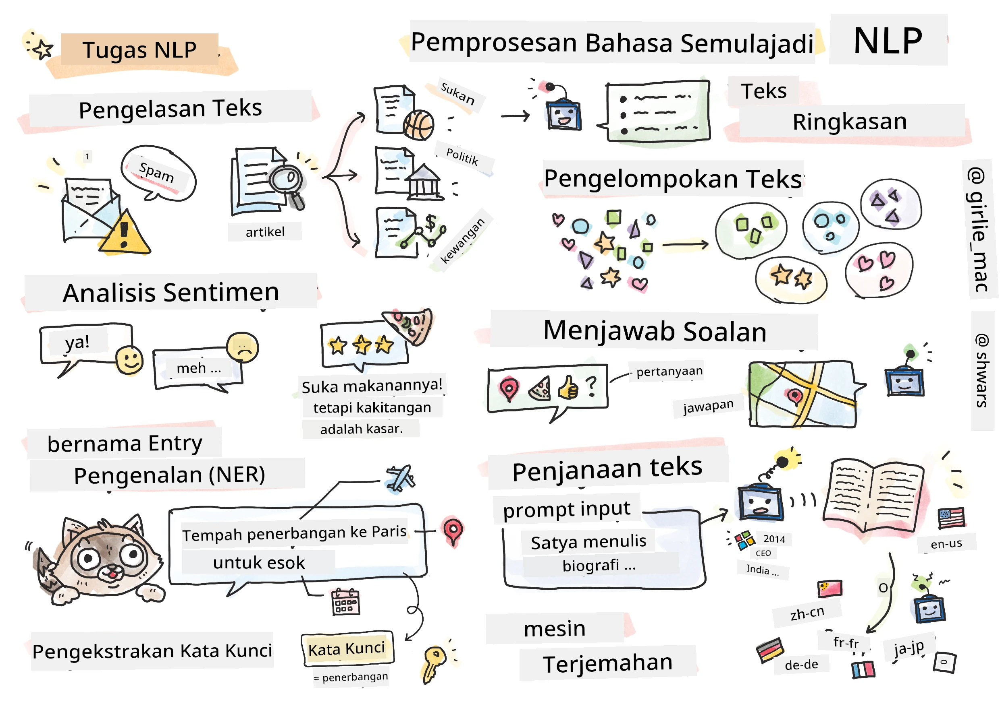

# Pemprosesan Bahasa Semula Jadi



Dalam seksyen ini, kita akan memfokuskan pada penggunaan Rangkaian Neural untuk mengendalikan tugas-tugas berkaitan **Pemprosesan Bahasa Semula Jadi (NLP)**. Terdapat banyak masalah NLP yang mahu kita komputer dapat menyelesaikan:

* **Klasifikasi teks** adalah masalah klasifikasi tipikal yang berkaitan dengan urutan teks. Contohnya termasuk mengklasifikasikan mesej e-mel sebagai spam vs. bukan spam, atau mengkategorikan artikel sebagai sukan, perniagaan, politik, dsb. Juga, apabila membangunkan chat bot, kita sering perlu memahami apa yang pengguna ingin katakan -- dalam kes ini kita mengendalikan **klasifikasi niat**. Selalunya, dalam klasifikasi niat kita perlu mengendalikan banyak kategori.
* **Analisis sentimen** adalah masalah regresi tipikal, di mana kita perlu memberikan nombor (sentimen) yang sepadan dengan betapa positif/negatifnya makna sesuatu ayat. Versi analisis sentimen yang lebih maju ialah **analisis sentimen berasaskan aspek** (ABSA), di mana kita memberikan sentimen bukan kepada keseluruhan ayat, tetapi bahagian-bahagiannya yang berbeza (aspek), contohnya *Di restoran ini, saya suka masakannya, tetapi suasananya sangat buruk*.
* **Pengecaman Entiti Bernama** (NER) merujuk kepada masalah mengekstrak entiti tertentu dari teks. Sebagai contoh, kita mungkin perlu memahami bahawa dalam frasa *Saya perlu terbang ke Paris esok* perkataan *esok* merujuk kepada TARIKH, dan *Paris* ialah LOKASI.
* **Pengekstrakan kata kunci** adalah serupa dengan NER, tetapi kita perlu mengekstrak perkataan yang penting kepada makna ayat secara automatik, tanpa pra-latihan untuk jenis entiti tertentu.
* **Pengelompokan teks** boleh berguna apabila kita ingin mengelompokkan ayat yang serupa, contohnya, permintaan yang serupa dalam perbualan sokongan teknikal.
* **Menjawab soalan** merujuk kepada keupayaan model untuk menjawab soalan tertentu. Model menerima petikan teks dan soalan sebagai input, dan ia perlu menyediakan tempat dalam teks di mana jawapan kepada soalan tersebut terkandung (atau, kadang-kadang, menjana teks jawapan).
* **Penjanaan Teks** adalah keupayaan model untuk menjana teks baru. Ia boleh dianggap sebagai tugas klasifikasi yang meramalkan huruf/kata seterusnya berdasarkan *petunjuk teks*. Model penjanaan teks yang canggih, seperti GPT-3, mampu menyelesaikan tugas NLP lain seperti klasifikasi menggunakan teknik yang dipanggil [pengaturcaraan petunjuk](https://towardsdatascience.com/software-3-0-how-prompting-will-change-the-rules-of-the-game-a982fbfe1e0) atau [kejuruteraan petunjuk](https://medium.com/swlh/openai-gpt-3-and-prompt-engineering-dcdc2c5fcd29)
* **Ringkasan teks** adalah teknik apabila kita mahu komputer "membaca" teks panjang dan meringkaskannya dalam beberapa ayat.
* **Penterjemahan mesin** boleh dilihat sebagai gabungan kefahaman teks dalam satu bahasa, dan penjanaan teks dalam bahasa yang lain.

Pada mulanya, kebanyakan tugas NLP diselesaikan menggunakan kaedah tradisional seperti tatabahasa. Contohnya, dalam penterjemahan mesin parser digunakan untuk mengubah ayat awal menjadi pohon sintaksis, kemudian struktur semantik tahap tinggi diekstrak untuk mewakili makna ayat, dan berdasarkan makna ini serta tatabahasa bahasa sasaran, hasilnya dijana. Kini, banyak tugas NLP lebih berkesan diselesaikan menggunakan rangkaian neural.

> Banyak kaedah NLP klasik dilaksanakan dalam perpustakaan Python [Natural Language Processing Toolkit (NLTK)](https://www.nltk.org). Terdapat [Buku NLTK](https://www.nltk.org/book/) hebat yang tersedia dalam talian yang menerangkan bagaimana pelbagai tugas NLP boleh diselesaikan menggunakan NLTK.

Dalam kursus kami, kami akan memfokuskan kebanyakannya pada penggunaan Rangkaian Neural untuk NLP, dan kami akan menggunakan NLTK jika diperlukan.

Kami sudah belajar tentang menggunakan rangkaian neural untuk mengendalikan data tabular dan imej. Perbezaan utama antara jenis data tersebut dan teks ialah teks adalah urutan dengan panjang berubah-ubah, manakala saiz input dalam kes imej diketahui terlebih dahulu. Walaupun rangkaian konvolusi boleh mengekstrak corak dari data input, corak dalam teks lebih kompleks. Contohnya, kita boleh ada penafian yang terpisah dari subjek dengan jarak bagi banyak perkataan (contohnya *Saya tidak suka oren*, vs. *Saya tidak suka oren yang besar, berwarna-warni dan sedap itu*), dan itu masih harus ditafsirkan sebagai satu corak. Oleh itu, untuk mengendalikan bahasa kita perlu memperkenalkan jenis rangkaian neural baru, seperti *rangkaian rekuren* dan *transformer*.

## Pasangkan Perpustakaan

Jika anda menggunakan pemasangan Python tempatan untuk menjalankan kursus ini, anda mungkin perlu memasang semua perpustakaan yang diperlukan untuk NLP menggunakan arahan berikut:

**Untuk PyTorch**
```bash
pip install -r requirements-pytorch.txt
```
**Untuk TensorFlow**
```bash
pip install -r requirements-tf.txt
```

> Anda boleh mencuba NLP dengan TensorFlow di [Microsoft Learn](https://docs.microsoft.com/learn/modules/intro-natural-language-processing-tensorflow/?WT.mc_id=academic-77998-cacaste)

## Amaran GPU

Dalam seksyen ini, dalam beberapa contoh kita akan melatih model yang agak besar.
* **Gunakan Komputer yang Mempunyai GPU**: Disarankan untuk menjalankan buku nota anda pada komputer yang mempunyai GPU untuk mengurangkan masa menunggu apabila bekerja dengan model besar.
* **Had Memori GPU**: Menjalankan pada GPU mungkin menyebabkan anda kehabisan memori GPU, terutamanya apabila melatih model besar.
* **Penggunaan Memori GPU**: Jumlah memori GPU yang digunakan semasa latihan bergantung pada pelbagai faktor, termasuk saiz minibatch.
* **Kurangkan Saiz Minibatch**: Jika anda menghadapi isu memori GPU, pertimbangkan untuk mengurangkan saiz minibatch dalam kod anda sebagai satu penyelesaian.
* **Pelepasan Memori GPU TensorFlow**: Versi TensorFlow yang lebih lama mungkin tidak melepaskan memori GPU dengan betul apabila melatih beberapa model dalam satu kernel Python. Untuk menguruskan penggunaan memori GPU dengan lebih berkesan, anda boleh mengkonfigurasi TensorFlow supaya hanya memperuntukkan memori GPU bila diperlukan.
* **Penyertaan Kod**: Untuk menetapkan TensorFlow agar memori GPU hanya berkembang apabila perlu, sertakan kod berikut dalam buku nota anda:

```python
physical_devices = tf.config.list_physical_devices('GPU') 
if len(physical_devices)>0:
    tf.config.experimental.set_memory_growth(physical_devices[0], True) 
```

Jika anda berminat untuk belajar tentang NLP dari perspektif ML klasik, lawati [rangka pelajaran ini](https://github.com/microsoft/ML-For-Beginners/tree/main/6-NLP)

## Dalam Seksian Ini
Dalam seksyen ini kita akan belajar mengenai:

* [Mewakili teks sebagai tensor](13-TextRep/README.md)
* [Persembahan Perkataan](14-Embeddings/README.md)
* [Pemodelan Bahasa](15-LanguageModeling/README.md)
* [Rangkaian Neural Rekuren](16-RNN/README.md)
* [Rangkaian Generatif](17-GenerativeNetworks/README.md)
* [Transformer](18-Transformers/README.md)

---

<!-- CO-OP TRANSLATOR DISCLAIMER START -->
**Penafian**:
Dokumen ini telah diterjemahkan menggunakan perkhidmatan terjemahan AI [Co-op Translator](https://github.com/Azure/co-op-translator). Walaupun kami berusaha untuk ketepatan, sila ambil maklum bahawa terjemahan automatik mungkin mengandungi kesilapan atau ketidaktepatan. Dokumen asal dalam bahasa asalnya harus dianggap sebagai sumber yang sahih. Untuk maklumat penting, terjemahan oleh manusia profesional adalah disyorkan. Kami tidak bertanggungjawab terhadap sebarang salah faham atau salah tafsir yang timbul daripada penggunaan terjemahan ini.
<!-- CO-OP TRANSLATOR DISCLAIMER END -->