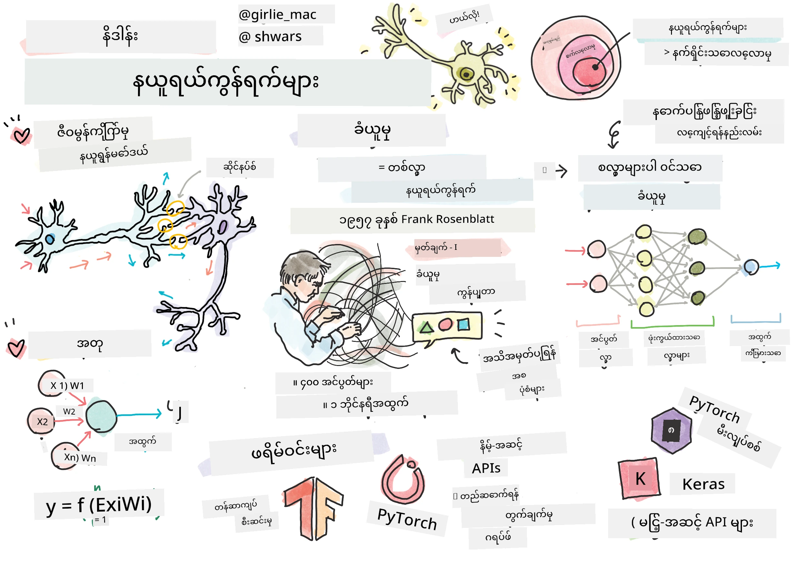
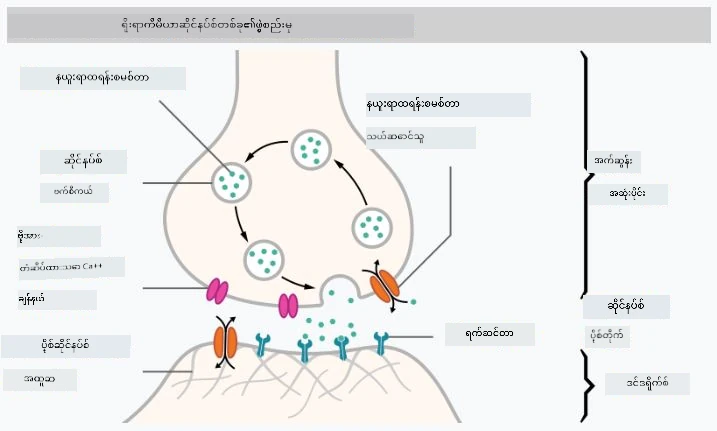
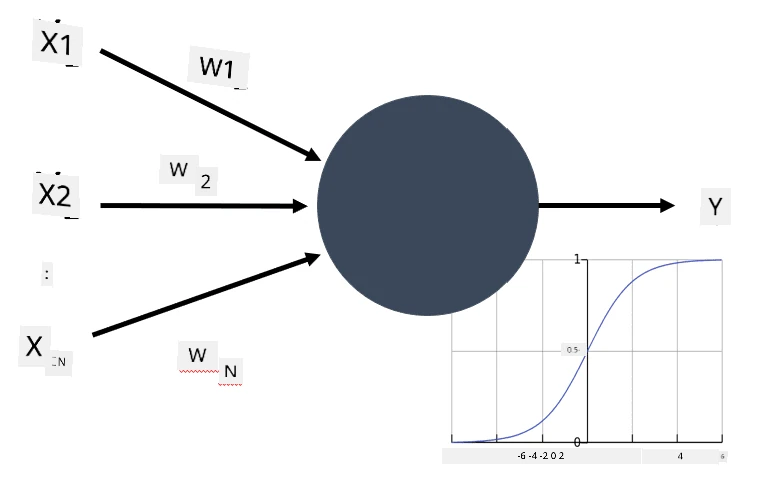

# နျူရယ်ကွန်ယက်များ၏ အစီအစဉ်မိတ်ဆက်

အကြောင်းအရာမိတ်ဆက်တွင် ဆွေးနွေးခဲ့သလို၊ တစ်ခုသော ဉာဏ်ရည်ရရှိစေရန် နည်းလမ်းများမှာ **ကွန်ပျူတာမော်ဒယ်** သို့မဟုတ် **စက်ရုပ်ဦးနှောက်** ကို လေ့ကျင့်ခြင်း ဖြစ်သည်။ ၂၀-မြောက်ရာစုလယ်ပိုင်းမှစ၍ ရှာဖွေသူများသည် သင်္ချာမော်ဒယ်အမျိုးမျိုးကို စမ်းသပ်ကြည့်ခဲ့ပြီး၊ နောက်ပိုင်းနှစ်များတွင် ဤလမ်းကြောင်းသည် အလွန်အောင်မြင်ကြောင်း သက်သေအထောက်အထားများ ရရှိခဲ့သည်။ ဦးနှောက်၏ ဤသင်္ချာမော်ဒယ်များကို **နျူရယ်ကွန်ယက်များ** ဟုခေါ်သည်။

> နျူရယ်ကွန်ယက်များကို *Artificial Neural Networks* သို့မဟုတ် ANNs ဟု ခေါ်ဆိုကြသည်၊ ဤသည်ကြောင့် တကယ့်နျူရွန်ကွန်ယက်မဟုတ်ဘဲ မော်ဒယ်များကို ပြောဆိုနေကြသည်ဟု တွေးနိုင်သည်။

## စက်သင်ကြားမှု

နျူရယ်ကွန်ယက်များမှာ အကြီးမားဆုံးဌာနတစ်ခုဖြစ်သော **စက်သင်ကြားမှု** (Machine Learning) ၏ အစိတ်အပိုင်းဖြစ်ပြီး၊ ၎င်း၏ရည်ရွယ်ချက်မှာ ပရိုဘလင်များကို ဖြေရှင်းနိုင်သော ကွန်ပျူတာမော်ဒယ်များကို ဒေတာအသုံးပြု၍ သင်ကြားခြင်းဖြစ်သည်။ စက်သင်ကြားမှုသည် အတုအလိမ့် ဉာဏ်ရည်၏ အစိတ်အပိုင်းကြီးတစ်ခု ဖြစ်သော်လည်း၊ ယခုသင်ခန်းစာတွင် ရိုးရိုး ML များကို မဖော်ပြတော့ပါ။

> ကျွန်ုပ်တို့၏ သီးခြားထားသော **[စက်သင်ကြားမှု အခြေပြု လမ်းညွှန်များ](http://github.com/microsoft/ml-for-beginners)** စာရင်းသွင်းစာမျက်နှာကို သွားရောက်လေ့လာနိုင်ပါသည်။

စက်သင်ကြားမှုတွင်၊ ဥပမာဒေတာအစုအဖွဲ့ **X** နှင့် ယင်းနှင့် ကိုက်ညီသော ထုတ်လွှင့်တန်ဖိုးများ **Y** ရှိကြောင်း ကောက်ယူသည်။ ဥပမာများများအား N-အတိုင်းအတာဗက်တာများဖြစ်ပြီး **အင်္ဂါရပ်များ** ပါဝင်သည်၊ ထွက်ရှိရာများကို **အမှတ်အသားများ** ဟုခေါ်သည်။

ကျွန်ုပ်တို့သည် စက်သင်ကြားမှုပြဿနာ အများဆုံး ၂ မျိုးကို စဉ်းစားမည် -

* **အတန်းခွဲခြားခြင်း** (Classification) ၊ ထည့်သွင်းသော အရာဝတ္ထုကို နှစ်ခု သို့မဟုတ် ထိုထက်ပိုသော အတန်းများသို့ ခွဲခြားသတ်မှတ်ရန် လိုအပ်သည့် ပြဿနာ။
* **အောင်ျမင်မှုခန့်မှန်းခြင်း** (Regression) ၊ ထည့်သွင်းသော နမူနာတစ်ခုစီအတွက် ကိန်းဂဏန်းတန်ဖိုးကို ခန့်မှန်းရန် လိုအပ်သည့် ပြဿနာ။

> ထည့်သွင်းမှုများနှင့် ထွက်ရှိမှုများကို တင်ဆက်သောအခါ၊ ထည့်သွင်းဒေတာအစုသည် M×N အရွယ်အစား မက်ထရစ်စ်ဖြစ်သည်။ M သည် နမူနာအရေအတွက်ဖြစ်ပြီး N သည် အင်္ဂါရပ်အရေအတွက်ဖြစ်သည်။ ထွက်ရှိမှုအမှတ်အသား Y သည် M အရွယ်အစား ဗက်တာဖြစ်သည်။

ယခု သင်ခန်းစာတွင် ကျွန်ုပ်တို့သည် နျူရယ်ကွန်ယက် မော်ဒယ်များပဲ အာရုံစိုက်ပါမည်။

## နျူရွန်၏ မော်ဒယ်တစ်ခု

ဇီဝဗေဒအရ ကျွန်ုပ်တို့ ဦးနှောက်တွင် နျူရင်ဆဲလ်များ (neurons) ပါဝင်ပြီး၊ ၎င်းတိုင်းတွင် "ထည့်သွင်းရာ" (dendrites) များအများအပြားနှင့် "ထွက်ရှိရာ" တစ်ခု (axon) ရှိသည်။ dendrites နှင့် axons နှစ်ခုလုံးသည် လျှပ်စစ်သင်္ကေတများ ဆက်သွယ်ပေးနိုင်ပြီး၊ ၎င်းတို့၏ချိတ်ဆက်မှုများအား synapses ဟုခေါ်သည်၊ ၎င်းသည် ကွန်ဒတ်တိဗန့်နည်းဟူသော မျိုးစုံရှိကာ မြင့်ခတ်မှုများသည် neurotransmitters များဖြင့် ထိန်းညှိဖြစ်သည်။

 | 
----|----
တကယ့် နျူရွန် *([ပုံ](https://en.wikipedia.org/wiki/Synapse#/media/File:SynapseSchematic_lines.svg) Wikipedia မှ)* | အတု နျူရွန် *(ပုံအနုပညာရှင်မှ ဖန်တီး)* 

ထို့ကြောင့် နျူရွန်၏ ရိုးရှင်းဆုံး သင်္ချာမော်ဒယ်သည် အထဲသို့ ထည့်သွင်းများ X1, ..., XN နှင့် ထွက်ရှိမှု Y တစ်ခု၊ နှင့် အလေးချိန်များ W1, ..., WN များပါဝင်သည်။ ထွက်ရှိမှုကို စစ်ဆင်သည်မှာ -

သည်မှာ f သည် မညီမျှသည့် **ဖွင့်လှစ်မှုလုပ်ဆောင်ချက်** ဖြစ်သည်။

> နျူရွန်၏ စတင်ခံရသည့် မော်ဒယ်များကို ၁၉၄၃ ခုနှစ်တွင် Warren McCullock နှင့် Walter Pitts တို့ရေးသားသော [A logical calculus of the ideas immanent in nervous activity](https://www.cs.cmu.edu/~./epxing/Class/10715/reading/McCulloch.and.Pitts.pdf) စာတမ်းတွင် ဖော်ပြခဲ့သည်။ Donald Hebb သည် သူ၏စာအုပ် "[The Organization of Behavior: A Neuropsychological Theory](https://books.google.com/books?id=VNetYrB8EBoC)" တွင် ထိုကွန်ယက်များကို စက်သင်ကြားနိုင်မည့် နည်းလမ်းကို ပင်ရှင်းပြခဲ့သည်။

## ဤအခန်းတွင်

ဤအခန်းတွင် ကျွန်ုပ်တို့ သင်ယူမည့်အချက်များမှာ -
* [Perceptron](03-Perceptron/README.md), နှစ်အတန်းခွဲခြားမှုတွင် အသုံးပြုသော နျူရယ်ကွန်ယက့် မော်ဒယ်အစောပိုင်းတစ်ခု
* [ပေါင်းစပ်ထပ်များကြိုးကြော့ကွန်ရက်များ](04-OwnFramework/README.md) နှင့် သက်ဆိုင်သော မှတ်စုစာအုပ် [ကျွန်ုပ်တို့၏ ကိုယ်ပိုင် ဖွဲ့စည်းပုံတစ်ခုကို ဘယ်လို တည်ဆောက်မလဲ](04-OwnFramework/OwnFramework.ipynb)
* [နယူးရယ်ကွန်ရက် ဖွဲ့စည်းပုံများ](05-Frameworks/README.md), ဤမှတ်စုစာအုပ်များဖြင့်: [PyTorch](05-Frameworks/IntroPyTorch.ipynb) နှင့် [Keras/Tensorflow](05-Frameworks/IntroKerasTF.ipynb)
* [အော်ဗာဖစ်တင်း](../../../../lessons/3-NeuralNetworks/05-Frameworks#overfitting)

---

<!-- CO-OP TRANSLATOR DISCLAIMER START -->
**ပြောကြားချက်**
ဤစာတမ်းကို AI ဘာသာပြန်ဝန်ဆောင်မှု [Co-op Translator](https://github.com/Azure/co-op-translator) အသုံးပြု၍ ဘာသာပြန်ထားပါသည်။ ကျွန်ုပ်တို့သည် တိကျမှန်ကန်မှုအတွက် ကြိုးပမ်းနေသော်လည်း၊ စက်ကိရိယာဘာသာပြန်ခြင်းများတွင် အမှားများ သို့မဟုတ် မှားယွင်းချက်များ ပါဝင်နိုင်ကြောင်း သတိပြုပါရန် လိုအပ်ပါသည်။ မူလစာတမ်းကို မူရင်းဘာသာဖြင့်သာ ယုံကြည်စိတ်ချရသော အချက်အလက်အဖြစ် သတ်မှတ်သင့်သည်။ အရေးကြီးသည့် သတင်းအချက်အလက်များအတွက် ပရော်ဖက်ရှင်နယ် လူသားဘာသာပြန်သူဝန်ဆောင်မှုကို အကြံပြုပါသည်။ ဤဘာသာပြန်ချက်ကို အသုံးပြုခြင်းမှ ဖြစ်ပေါ်လာသော နားလည်မှုကွာခြားမှုများ သို့မဟုတ် မမှန်ကန်သော အသုံးပြုမှုများအတွက် ကျွန်ုပ်တို့ တာဝန်မခံပါ။
<!-- CO-OP TRANSLATOR DISCLAIMER END -->