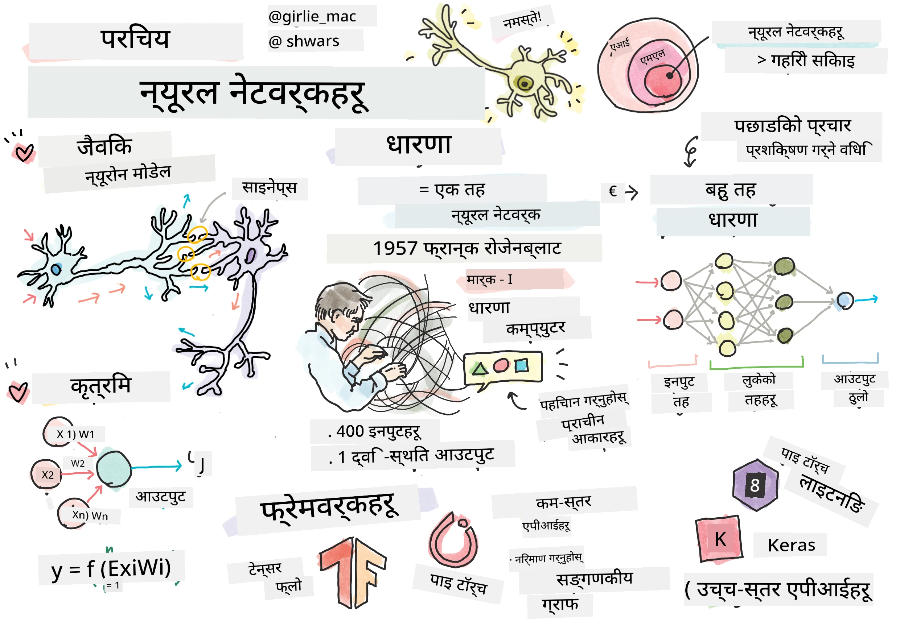
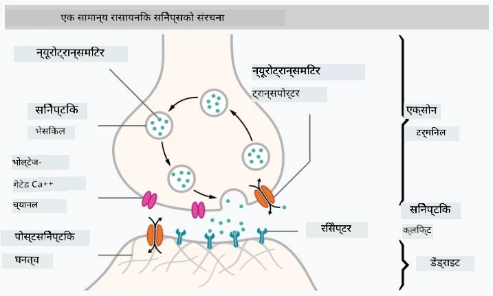
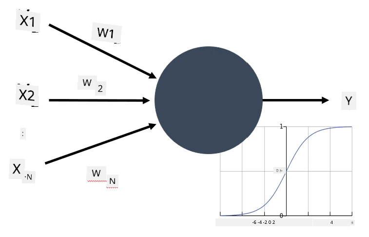

# न्युरल नेटवर्कहरूमा परिचय

जस्तै हामीले परिचयमा छलफल गर्यौं, बुद्धिमत्ता हासिल गर्ने एउटा तरिका भनेको **कम्प्युटर मोडेल** वा **कृत्रिम मस्तिष्क** तालिम दिनु हो। बीसौं शताब्दीको मध्यदेखि, अनुसन्धानकर्ताहरूले विभिन्न गणितीय मोडेलहरू प्रयास गरे, र हालका वर्षहरूमा यस क्षेत्रले अत्यन्त सफल प्रमाणित भयो। मस्तिष्कका यस्ता गणितीय मोडेलहरूलाई **न्युरल नेटवर्क** भनिन्छ।

> कहिलेकाहीँ न्युरल नेटवर्कलाई *कृत्रिम न्युरल नेटवर्क* (Artificial Neural Networks), ANNs भनेर पनि चिनिन्छ, जसले जनाउँछ कि हामी मोडेलहरूको कुरा गरिरहेका छौं, वास्तविक न्यूरोनहरूको नेटवर्क होइन।

## मेशिन लर्निङ

न्युरल नेटवर्कहरू ठूलो विषयवस्तु **मेशिन लर्निङ** को एउटा हिस्सा हुन्, जसको उद्देश्य छ डेटा प्रयोग गरेर समस्या समाधान गर्न सक्ने कम्प्युटर मोडेलहरूलाई तालिम दिनु हो। मेशिन लर्निङ कृत्रिम बुद्धिमत्ताको ठूलो भाग हो, तर यस पाठ्यक्रममा हामी पारम्परिक ML समावेश गरेका छैनौं।

> थप जानकारीका लागि हाम्रो अलग **[मेशिन लर्निङ प्रारम्भिकहरूका लागि](http://github.com/microsoft/ml-for-beginners)** पाठ्यक्रम हेर्नुहोस्।

मेशिन लर्निङमा, हामीसँग उदाहरणहरूको एउटा डेटासेट **X** र तिनीहरूका सम्बद्ध आउटपुट मानहरू **Y** हुन्छन् भन्ने मानिन्छ। उदाहरणहरू प्रायः N-आयामी भेक्टरहरू हुन्छन् जुन **विशेषताहरू** बाट बनेका हुन्छन्, र आउटपुटलाई **लेबलहरू** भनिन्छ।

हामी दुई सबैभन्दा सामान्य मेशिन लर्निङ समस्या विचार गर्नेछौं:

* **वर्गीकरण**, जहाँ हामीलाई कुनै इनपुट वस्तुलाई दुई वा बढी वर्गहरूमा वर्गीकृत गर्नुपर्छ।
* **रेग्रेसन**, जहाँ हामीलाई प्रत्येक इनपुट नमुनाका लागि संख्यात्मक मान अनुमान लगाउनुपर्छ।

> इनपुट र आउटपुटहरू टेन्सरको रूपमा प्रतिनिधित्व गर्दा, इनपुट डेटासेट M×N आकारको म्याट्रिक्स हुन्छ, जहाँ M नमुनाहरूको संख्या र N विशेषताहरूको संख्या हो। आउटपुट लेबल Y M आकारको भेक्टर हो।

यस पाठ्यक्रममा, हामी केवल न्युरल नेटवर्क मोडेलहरूमा केन्द्रित हुनेछौं।

## न्यूरोनको मोडेल

जीवविज्ञानबाट, हामीलाई थाहा छ कि हाम्रो मस्तिष्क न्यूरल कोषहरू (न्यूरोनहरू) बाट बनेको छ, तीमध्ये प्रत्येकसँग धेरै "इनपुटहरू" (डेन्ड्राइटहरू) र एकल "आउटपुट" (एक्सन) हुन्छ। दुवै डेन्ड्राइट र एक्सनले विद्युत सिग्नल प्रवाह गर्न सक्छन्, र तिनीहरूका बीचका कनेक्शनहरू—जसलाई सिन्याप्स भनिन्छ—विद्युत प्रवाहको भिन्न स्तर देखाउन सक्छन्, जुन न्यूरोट्रान्समिटरहरूले नियन्त्रण गर्छन्।

 | 
----|----
वास्तविक न्यूरोन *([Image](https://en.wikipedia.org/wiki/Synapse#/media/File:SynapseSchematic_lines.svg) विकिपीडियाबाट)* | कृत्रिम न्यूरोन *(लेखकद्वारा चित्र)*

यसैले, न्यूरोनको सबैभन्दा सरल गणितीय मोडेलमा धेरै इनपुटहरू X1, ..., XN र एक आउटपुट Y, र वजनहरूको श्रृंखला W1, ..., WN हुन्छ। आउटपुट यसरी गणना गरिन्छ:

जहाँ f कुनै गैर-रेखीय **सक्रियता कार्य** हो।

> न्यूरोनका प्रारम्भिक मोडेलहरू 1943 मा वारेन म्याककुलक र वाल्टर पिट्स द्वारा लेखिएको क्लासिक पेपर [A logical calculus of the ideas immanent in nervous activity](https://www.cs.cmu.edu/~./epxing/Class/10715/reading/McCulloch.and.Pitts.pdf) मा वर्णन गरिएका थिए। डोनाल्ड हेबले आफ्नो पुस्तक "[The Organization of Behavior: A Neuropsychological Theory](https://books.google.com/books?id=VNetYrB8EBoC)" मा यी नेटवर्कहरूलाई कसरी तालिम दिने भन्ने प्रस्ताव गरे।

## यस भागमा

यस भागमा हामी सिक्नेछौं:
* [पर्सेप्ट्रन](03-Perceptron/README.md), दुई वर्गीकरणका लागि सबैभन्दा प्रारम्भिक न्युरल नेटवर्क मोडेलहरू मध्ये एक
* [बहु-परत नेटवर्कहरू](04-OwnFramework/README.md) र एउटा जोडिएको नोटबुक [आफ्नो फ्रेमवर्क कसरी बनाउने](04-OwnFramework/OwnFramework.ipynb)
* [न्युरल नेटवर्क फ्रेमवर्कहरू](05-Frameworks/README.md), जसमा यी नोटबुकहरू छन्: [PyTorch](05-Frameworks/IntroPyTorch.ipynb) र [Keras/Tensorflow](05-Frameworks/IntroKerasTF.ipynb)
* [ओभरफिटिङ](../../../../lessons/3-NeuralNetworks/05-Frameworks#overfitting)

---

<!-- CO-OP TRANSLATOR DISCLAIMER START -->
**अस्वीकरण**:
यो दस्तावेज़ AI अनुवाद सेवा [Co-op Translator](https://github.com/Azure/co-op-translator) प्रयोग गरेर अनुवाद गरिएको हो। हामी सही हुन प्रयास गर्छौं, तर कृपया जानकार हुनुस् कि स्वचालित अनुवादमा त्रुटिहरू वा अशुद्धताहरू हुन सक्छन्। मूल दस्तावेज़ यसको मूल भाषामा आधिकारिक स्रोत मानिनुपर्छ। महत्वपूर्ण जानकारीका लागि व्यावसायिक मानव अनुवाद सिफारिस गरिन्छ। यस अनुवादको प्रयोगबाट उत्पन्न कुनै पनि गलत बुझाइ वा त्रुटिको लागि हामी जिम्मेवार छैनौं।
<!-- CO-OP TRANSLATOR DISCLAIMER END -->