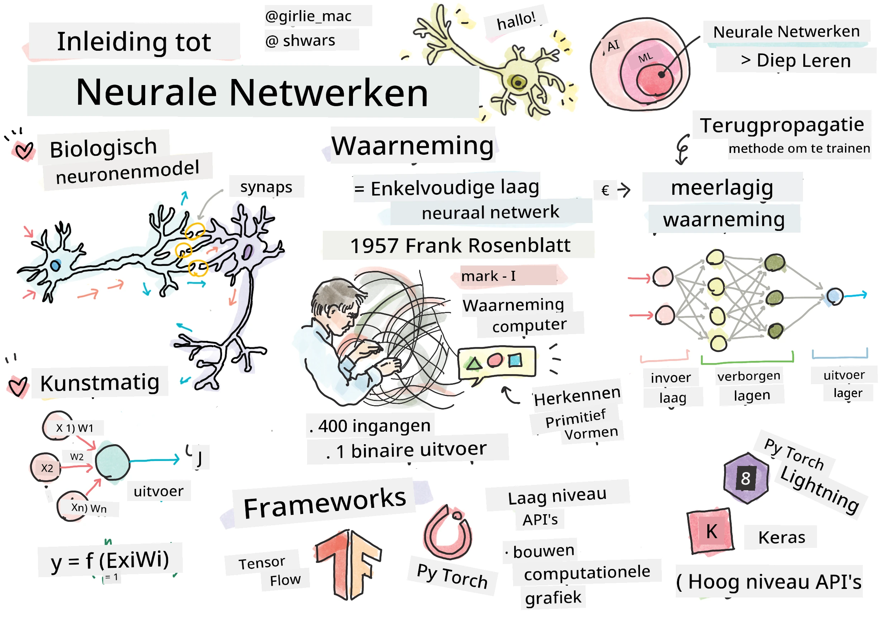
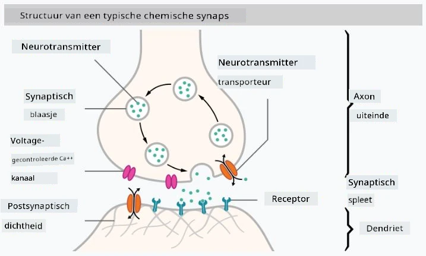

# Inleiding tot Neurale Netwerken

Zoals we in de introductie hebben besproken, is een van de manieren om intelligentie te bereiken het trainen van een **computermodel** of een **kunstmatig brein**. Sinds het midden van de 20ste eeuw hebben onderzoekers verschillende wiskundige modellen geprobeerd, totdat deze richting in de afgelopen jaren zeer succesvol bleek. Dergelijke wiskundige modellen van het brein worden **neurale netwerken** genoemd.

> Soms worden neurale netwerken *kunstmatige neurale netwerken*, ANNs, genoemd om aan te geven dat we het over modellen hebben, niet over echte netwerken van neuronen.

## Machine Learning

Neurale netwerken maken deel uit van een grotere discipline genaamd **Machine Learning**, waarvan het doel is om met behulp van data computermodellen te trainen die problemen kunnen oplossen. Machine Learning vormt een groot deel van Kunstmatige Intelligentie, maar we behandelen klassieke ML niet in dit curriculum.

> Bezoek ons aparte **[Machine Learning voor Beginners](http://github.com/microsoft/ml-for-beginners)** curriculum om meer te leren over klassieke Machine Learning.

In Machine Learning gaan we ervan uit dat we een dataset hebben met voorbeelden **X**, en bijbehorende outputwaarden **Y**. Voorbeelden zijn vaak N-dimensionale vectoren die bestaan uit **kenmerken**, en outputs worden **labels** genoemd.

We zullen de twee meest voorkomende machine learning problemen bekijken:

* **Classificatie**, waarbij we een invoerobject in twee of meer klassen moeten indelen.
* **Regressie**, waarbij we een numeriek getal moeten voorspellen voor elk van de invoer samples.

> Wanneer inputs en outputs als tensors worden weergegeven, is de input dataset een matrix van grootte M&times;N, waarbij M het aantal samples is en N het aantal kenmerken. Output labels Y is de vector van grootte M.

In dit curriculum richten we ons alleen op neurale netwerk modellen.

## Een Model van een Neuron

Uit de biologie weten we dat ons brein bestaat uit neurale cellen (neuronen), elk met meerdere "ingangen" (dendrieten) en een enkele "uitgang" (axon). Zowel dendrieten als axonen kunnen elektrische signalen geleiden, en de verbindingen tussen hen — bekend als synapsen — kunnen verschillende gradaties van geleiding vertonen die worden gereguleerd door neurotransmitters.

 | 
----|----
Echte Neuron *([Afbeelding](https://en.wikipedia.org/wiki/Synapse#/media/File:SynapseSchematic_lines.svg) van Wikipedia)* | Kunstmatige Neuron *(Afbeelding door Auteur)*

Dus bevat het eenvoudigste wiskundige model van een neuron meerdere ingangen X1, ..., XN en een uitgang Y, en een reeks gewichten W1, ..., WN. Een uitgang wordt als volgt berekend:

waarbij f een niet-lineaire **activatiefunctie** is.

> Vroege modellen van neuronen werden beschreven in het klassieke artikel [A logical calculus of the ideas immanent in nervous activity](https://www.cs.cmu.edu/~./epxing/Class/10715/reading/McCulloch.and.Pitts.pdf) door Warren McCullock en Walter Pitts in 1943. Donald Hebb stelde in zijn boek "[The Organization of Behavior: A Neuropsychological Theory](https://books.google.com/books?id=VNetYrB8EBoC)" de manier voor waarop deze netwerken kunnen worden getraind.

## In deze Sectie

In deze sectie leren we over:
* [Perceptron](03-Perceptron/README.md), een van de vroegste neurale netwerkmodellen voor tweeklassenclassificatie
* [Gelaagde netwerken](04-OwnFramework/README.md) met een bijbehorende notebook [hoe we ons eigen framework bouwen](04-OwnFramework/OwnFramework.ipynb)
* [Neurale Netwerk Frameworks](05-Frameworks/README.md), met deze notebooks: [PyTorch](05-Frameworks/IntroPyTorch.ipynb) en [Keras/Tensorflow](05-Frameworks/IntroKerasTF.ipynb)
* [Overfitting](../../../../lessons/3-NeuralNetworks/05-Frameworks#overfitting)

---

<!-- CO-OP TRANSLATOR DISCLAIMER START -->
**Disclaimer**:
Dit document is vertaald met behulp van de AI vertaaldienst [Co-op Translator](https://github.com/Azure/co-op-translator). Hoewel we streven naar nauwkeurigheid, dient u er rekening mee te houden dat geautomatiseerde vertalingen fouten of onnauwkeurigheden kunnen bevatten. Het originele document in de oorspronkelijke taal moet worden beschouwd als de gezaghebbende bron. Voor kritieke informatie wordt professionele menselijke vertaling aanbevolen. Wij zijn niet aansprakelijk voor eventuele misverstanden of verkeerde interpretaties die voortvloeien uit het gebruik van deze vertaling.
<!-- CO-OP TRANSLATOR DISCLAIMER END -->