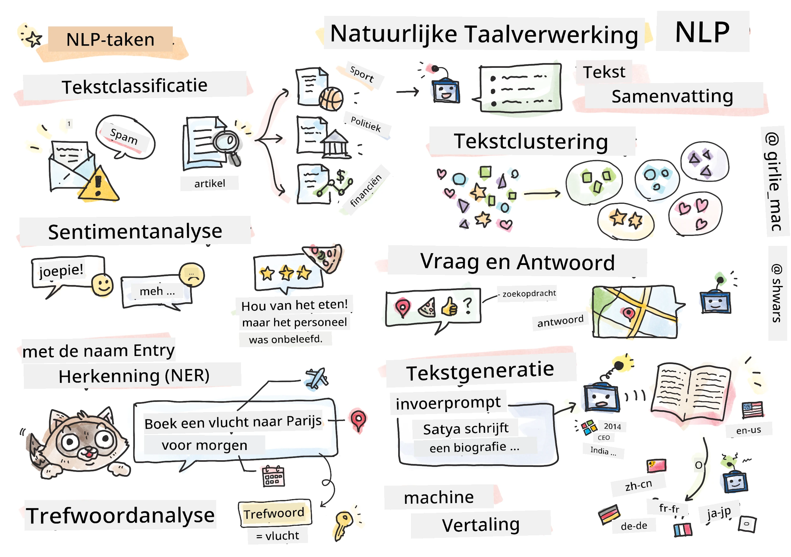

# Natuurlijke Taalverwerking



In deze sectie zullen we ons richten op het gebruik van neurale netwerken om taken gerelateerd aan **natuurlijke taalverwerking (NLP)** aan te pakken. Er zijn veel NLP-problemen die we willen dat computers kunnen oplossen:

* **Tekstclassificatie** is een typisch classificatieprobleem dat betrekking heeft op tekstreeksen. Voorbeelden zijn het classificeren van e-mailberichten als spam versus geen spam, of het categoriseren van artikelen als sport, zaken, politiek, enz. Ook wanneer we chatbots ontwikkelen, moeten we vaak begrijpen wat een gebruiker wilde zeggen -- in dit geval hebben we te maken met **intentieclassificatie**. Vaak moeten we bij intentieclassificatie omgaan met veel categorieën.
* **Sentimentanalyse** is een typisch regressieprobleem, waarbij we een getal (een sentiment) moeten toekennen dat overeenkomt met hoe positief/negatief de betekenis van een zin is. Een geavanceerdere versie van sentimentanalyse is **aspectgebaseerde sentimentanalyse** (ABSA), waarbij we sentiment niet aan de gehele zin toekennen, maar aan verschillende delen ervan (aspecten), bv. *In dit restaurant vond ik de keuken leuk, maar de sfeer was verschrikkelijk*.
* **Named Entity Recognition** (NER) verwijst naar het probleem van het extraheren van bepaalde entiteiten uit tekst. Bijvoorbeeld, we moeten begrijpen dat in de zin *Ik moet morgen naar Parijs vliegen* het woord *morgen* verwijst naar DATUM, en *Parijs* een LOCATIE is.  
* **Trefwoordanalyse** lijkt op NER, maar we moeten automatisch woorden extraheren die belangrijk zijn voor de betekenis van de zin, zonder vooraf te trainen voor specifieke entiteitstypen.
* **Tekstclustering** kan nuttig zijn wanneer we vergelijkbare zinnen willen groeperen, bijvoorbeeld, soortgelijke verzoeken in technische ondersteuningsgesprekken.
* **Vraagbeantwoording** verwijst naar het vermogen van een model om een specifieke vraag te beantwoorden. Het model ontvangt een tekstpassage en een vraag als input, en moet een plek in de tekst aanwijzen waar het antwoord op de vraag staat (of soms het antwoord genereren).
* **Tekstgeneratie** is het vermogen van een model om nieuwe tekst te genereren. Het kan worden beschouwd als een classificatietaak die de volgende letter/het volgende woord voorspelt op basis van een *tekstprompt*. Geavanceerde tekstgeneratiemodellen, zoals GPT-3, kunnen ook andere NLP-taken oplossen zoals classificatie met behulp van een techniek genaamd [prompt programming](https://towardsdatascience.com/software-3-0-how-prompting-will-change-the-rules-of-the-game-a982fbfe1e0) of [prompt engineering](https://medium.com/swlh/openai-gpt-3-and-prompt-engineering-dcdc2c5fcd29)
* **Tekstsamenvatting** is een techniek waarbij we willen dat een computer lange tekst "leest" en samenvat in een paar zinnen.
* **Machinevertaling** kan worden gezien als een combinatie van tekstbegrip in de ene taal en tekstgeneratie in een andere taal.

Aanvankelijk werden de meeste NLP-taken opgelost met traditionele methoden zoals grammatica's. Zo werden in machinevertaling parsers gebruikt om de oorspronkelijke zin te transformeren in een syntaxisboom, vervolgens werden hogere semantische structuren geëxtraheerd om de betekenis van de zin te representeren, en op basis van die betekenis en grammatica van de doeltaal werd het resultaat gegenereerd. Tegenwoordig worden veel NLP-taken effectiever opgelost met neurale netwerken.

> Veel klassieke NLP-methoden zijn geïmplementeerd in de [Natural Language Processing Toolkit (NLTK)](https://www.nltk.org) Python-bibliotheek. Er is een uitstekende [NLTK-boek](https://www.nltk.org/book/) online beschikbaar dat behandelt hoe verschillende NLP-taken kunnen worden opgelost met NLTK.

In onze cursus zullen we ons voornamelijk richten op het gebruik van neurale netwerken voor NLP, en we zullen NLTK gebruiken waar nodig.

We hebben al geleerd hoe we neurale netwerken gebruiken voor tabulaire data en afbeeldingen. Het belangrijkste verschil tussen die datatypes en tekst is dat tekst een sequentie van variabele lengte is, terwijl bij afbeeldingen de inputgrootte van tevoren bekend is. Terwijl convolutionele netwerken patronen kunnen extraheren uit inputdata, zijn patronen in tekst complexer. Bijvoorbeeld, een ontkenning kan losstaan van het onderwerp en toch een bepaald patroon vormen over meerdere woorden (bv. *Ik hou niet van sinaasappels* versus *Ik hou niet van die grote kleurrijke smakelijke sinaasappels*), en dat zou nog steeds als één patroon moeten worden geïnterpreteerd. Daarom moeten we om taal te verwerken nieuwe soorten neurale netwerken introduceren, zoals *recurrente netwerken* en *transformers*.

## Bibliotheken installeren

Als je een lokale Python-installatie gebruikt om deze cursus te volgen, moet je mogelijk alle benodigde bibliotheken voor NLP installeren met de volgende commando's:

**Voor PyTorch**
```bash
pip install -r requirements-pytorch.txt
```
**Voor TensorFlow**
```bash
pip install -r requirements-tf.txt
```

> Je kunt NLP met TensorFlow proberen op [Microsoft Learn](https://docs.microsoft.com/learn/modules/intro-natural-language-processing-tensorflow/?WT.mc_id=academic-77998-cacaste)

## GPU-waarschuwing

In deze sectie zullen we in sommige voorbeelden vrij grote modellen trainen.
* **Gebruik een computer met GPU-ondersteuning**: Het is aan te raden je notebooks op een computer met GPU-ondersteuning uit te voeren om wachttijden bij grote modellen te verkorten.
* **GPU-geheugenbeperkingen**: Het draaien op een GPU kan ertoe leiden dat je GPU-geheugen opraken, vooral bij training van grote modellen.
* **GPU-geheugengebruik**: De hoeveelheid GPU-geheugen die tijdens training wordt verbruikt, hangt af van verschillende factoren, waaronder de minibatchgrootte.
* **Minimaliseer minibatchgrootte**: Als je GPU-geheugenproblemen ondervindt, overweeg dan om de minibatchgrootte in je code te verkleinen als mogelijke oplossing.
* **Vrijgave van GPU-geheugen in TensorFlow**: Oudere versies van TensorFlow geven mogelijk GPU-geheugen niet correct vrij bij het trainen van meerdere modellen binnen één Python-kernel. Om het GPU-geheugengebruik effectief te beheren, kun je TensorFlow zo instellen dat het GPU-geheugen alleen naar behoefte toewijst.
* **Code-invoeging**: Om TensorFlow in te stellen om het GPU-geheugen alleen toe te wijzen als dat nodig is, voeg je de volgende code toe aan je notebooks:

```python
physical_devices = tf.config.list_physical_devices('GPU') 
if len(physical_devices)>0:
    tf.config.experimental.set_memory_growth(physical_devices[0], True) 
```

Als je NLP wilt leren vanuit een klassieke ML-perspectief, bezoek dan [deze reeks lessen](https://github.com/microsoft/ML-For-Beginners/tree/main/6-NLP)

## In deze sectie
In deze sectie zullen we leren over:

* [Tekst representeren als tensors](13-TextRep/README.md)
* [Woordinbeddingen](14-Embeddings/README.md)
* [Taalmodellering](15-LanguageModeling/README.md)
* [Recurrente neurale netwerken](16-RNN/README.md)
* [Generatieve netwerken](17-GenerativeNetworks/README.md)
* [Transformers](18-Transformers/README.md)

---

<!-- CO-OP TRANSLATOR DISCLAIMER START -->
**Disclaimer**:
Dit document is vertaald met behulp van de AI vertaaldienst [Co-op Translator](https://github.com/Azure/co-op-translator). Hoewel we streven naar nauwkeurigheid, dient u er rekening mee te houden dat geautomatiseerde vertalingen fouten of onnauwkeurigheden kunnen bevatten. Het originele document in de oorspronkelijke taal moet worden beschouwd als de gezaghebbende bron. Voor kritieke informatie wordt professionele menselijke vertaling aanbevolen. Wij zijn niet aansprakelijk voor eventuele misverstanden of verkeerde interpretaties die voortvloeien uit het gebruik van deze vertaling.
<!-- CO-OP TRANSLATOR DISCLAIMER END -->