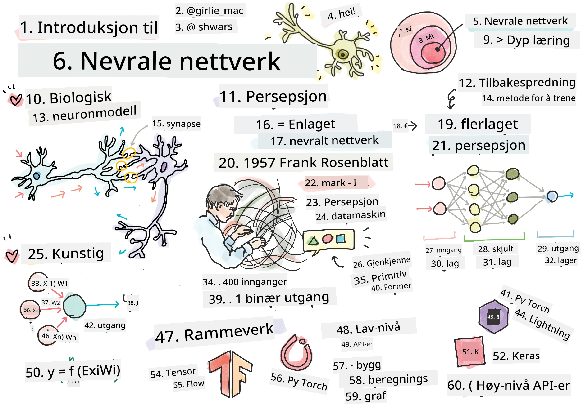
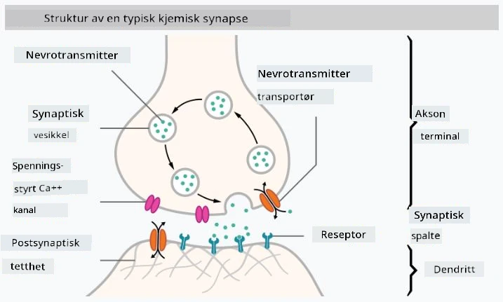
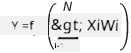

# Introduksjon til nevrale nettverk

Som vi diskuterte i introduksjonen, er en av måtene å oppnå intelligens på å trene en **datamodell** eller en **kunstig hjerne**. Siden midten av 1900-tallet har forskere prøvd forskjellige matematiske modeller, helt til denne retningen i de senere år viste seg å være svært vellykket. Slike matematiske modeller av hjernen kalles **nevrale nettverk**.

> Noen ganger kalles nevrale nettverk *kunstig nevrale nettverk*, ANN, for å indikere at vi snakker om modeller, ikke ekte nettverk av nevroner.

## Maskinlæring

Nevrale nettverk er en del av en større disiplin kalt **maskinlæring**, hvis mål er å bruke data til å trene datamodeller som er i stand til å løse problemer. Maskinlæring utgjør en stor del av kunstig intelligens, men vi dekker ikke klassisk ML i dette pensumet.

> Besøk vårt separate **[Maskinlæring for nybegynnere](http://github.com/microsoft/ml-for-beginners)** pensum for å lære mer om klassisk maskinlæring.

I maskinlæring antar vi at vi har et datasett av eksempler **X**, og tilhørende utdataverdier **Y**. Eksemplene er ofte N-dimensjonale vektorer som består av **egenskaper**, og utdata kalles **etiketter**.

Vi vil vurdere de to vanligste maskinlæringsproblemene:

* **Klassifisering**, der vi må klassifisere et inndataobjekt i to eller flere klasser.
* **Regresjon**, der vi må forutsi et numerisk tall for hvert av inndataeksemplene.

> Når vi representerer inndata og utdata som tensorer, er inndatasetet en matrise på størrelse M&times;N, der M er antall prøver og N er antall egenskaper. Utdataetiketter Y er en vektor av størrelse M.

I dette pensumet vil vi kun fokusere på nevrale nettverksmodeller.

## En modell av en nevron

Fra biologi vet vi at hjernen vår består av nerveceller (nevroner), hver av dem har flere "innganger" (dendritter) og en enkelt "utgang" (akson). Både dendritter og aksoner kan føre elektriske signaler, og forbindelsene mellom dem — kjent som synapser — kan ha varierende grader av ledningsevne, som reguleres av nevrotransmittere.

 | 
----|----
Ekte nevron *([Bilde](https://en.wikipedia.org/wiki/Synapse#/media/File:SynapseSchematic_lines.svg) fra Wikipedia)* | Kunstig nevron *(Bilde av forfatter)*

Dermed inneholder den enkleste matematiske modellen av en nevron flere innganger X1, ..., XN og en utgang Y, og en rekke vekter W1, ..., WN. En utgang beregnes som:

hvor f er en ikke-lineær **aktiveringsfunksjon**.

> Tidlige modeller av nevroner ble beskrevet i den klassiske artikkelen [A logical calculus of the ideas immanent in nervous activity](https://www.cs.cmu.edu/~./epxing/Class/10715/reading/McCulloch.and.Pitts.pdf) av Warren McCullock og Walter Pitts i 1943. Donald Hebb foreslo i sin bok "[The Organization of Behavior: A Neuropsychological Theory](https://books.google.com/books?id=VNetYrB8EBoC)" måten slike nettverk kan trenes på.

## I denne seksjonen

I denne seksjonen vil vi lære om:
* [Perceptron](03-Perceptron/README.md), en av de tidligste nevrale nettverksmodellene for to-klasseklassifisering
* [Flerlags nettverk](04-OwnFramework/README.md) med en tilhørende notatbok [hvordan bygge vår egen rammeverk](04-OwnFramework/OwnFramework.ipynb)
* [Nevrale nettverksrammeverk](05-Frameworks/README.md), med disse notatbøkene: [PyTorch](05-Frameworks/IntroPyTorch.ipynb) og [Keras/Tensorflow](05-Frameworks/IntroKerasTF.ipynb)
* [Overtilpasning](../../../../lessons/3-NeuralNetworks/05-Frameworks#overfitting)

---

<!-- CO-OP TRANSLATOR DISCLAIMER START -->
**Ansvarsfraskrivelse**:
Dette dokumentet er oversatt ved hjelp av AI-oversettelsestjenesten [Co-op Translator](https://github.com/Azure/co-op-translator). Selv om vi streber etter nøyaktighet, vær oppmerksom på at automatiske oversettelser kan inneholde feil eller unøyaktigheter. Det opprinnelige dokumentet på originalspråket skal betraktes som den autoritative kilden. For kritisk informasjon anbefales profesjonell menneskelig oversettelse. Vi er ikke ansvarlige for eventuelle misforståelser eller feiltolkninger som oppstår ved bruk av denne oversettelsen.
<!-- CO-OP TRANSLATOR DISCLAIMER END -->