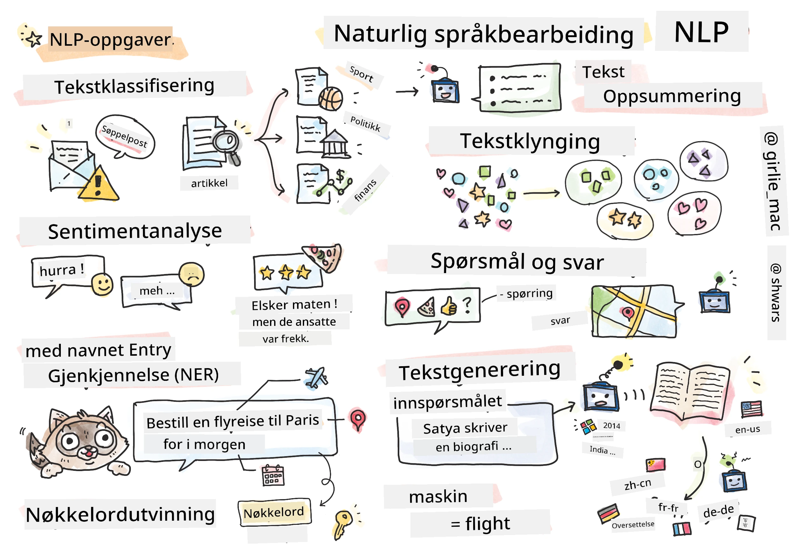

# Naturlig Språkbehandling



I denne seksjonen vil vi fokusere på å bruke nevrale nettverk for å håndtere oppgaver knyttet til **Naturlig Språkbehandling (NLP)**. Det finnes mange NLP-problemer vi ønsker at datamaskiner skal kunne løse:

* **Tekstklassifisering** er et typisk klassifiseringsproblem knyttet til tekstsekvenser. Eksempler inkluderer klassifisering av e-postmeldinger som spam vs. ikke-spam, eller kategorisering av artikler som sport, business, politikk, osv. Når vi utvikler chatbots, trenger vi ofte å forstå hva en bruker ønsket å si — i dette tilfellet jobber vi med **intensjonsklassifisering**. Ofte må vi håndtere mange kategorier i intensjonsklassifisering.
* **Sentimentanalyse** er et typisk regresjonsproblem, der vi må tilskrive et nummer (en sentiment) som tilsvarer hvor positiv/negativ betydningen av en setning er. En mer avansert versjon av sentimentanalyse er **aspektbasert sentimentanalyse** (ABSA), hvor vi tilskriver sentiment ikke til hele setningen, men til forskjellige deler av den (aspekter), f.eks. *I denne restauranten likte jeg maten, men atmosfæren var forferdelig*.
* **Navngitt enhetsgjenkjenning** (NER) refererer til problemet med å trekke ut visse enheter fra tekst. For eksempel må vi kunne forstå at i setningen *Jeg må fly til Paris i morgen* refererer ordet *i morgen* til DATO, og *Paris* er et STED.  
* **Nøkkelorduttrekking** er likt NER, men vi må automatisk trekke ut ord som er viktige for betydningen av setningen, uten forhåndstrening for spesifikke enhetstyper.
* **Tekstgruppering** kan være nyttig når vi ønsker å gruppere lignende setninger, for eksempel lignende forespørsler i kundesupportsamtaler.
* **Spørsmål og svar** refererer til modellens evne til å svare på et spesifikt spørsmål. Modellen får et tekstutdrag og et spørsmål som inndata, og må gi stedet i teksten hvor svaret på spørsmålet finnes (eller noen ganger generere svaret som tekst).
* **Tekstgenerering** er modellens evne til å generere ny tekst. Det kan betraktes som en klassifiseringsoppgave som predikerer neste bokstav/ord basert på en *tekstledetråd*. Avanserte tekstgenereringsmodeller, som GPT-3, kan løse andre NLP-oppgaver som klassifisering ved hjelp av en teknikk kalt [prompt programming](https://towardsdatascience.com/software-3-0-how-prompting-will-change-the-rules-of-the-game-a982fbfe1e0) eller [prompt engineering](https://medium.com/swlh/openai-gpt-3-and-prompt-engineering-dcdc2c5fcd29)
* **Tekstsammendrag** er en teknikk hvor vi ønsker at en datamaskin "leser" lang tekst og oppsummerer den i noen få setninger.
* **Maskinoversettelse** kan sees på som en kombinasjon av tekstforståelse på ett språk og tekstgenerering på et annet språk.

Opprinnelig ble de fleste NLP-oppgaver løst med tradisjonelle metoder som grammatikk. For eksempel i maskinoversettelse ble parser brukt til å omdanne den opprinnelige setningen til et syntakstre, deretter ble høyere nivå semantiske strukturer hentet ut for å representere setningens mening, og basert på denne meningen og grammatikken i målspråket ble resultatet generert. I dag løses mange NLP-oppgaver mer effektivt ved bruk av nevrale nettverk.

> Mange klassiske NLP-metoder er implementert i [Natural Language Processing Toolkit (NLTK)](https://www.nltk.org) Python-bibliotek. Det finnes en flott [NLTK-bok](https://www.nltk.org/book/) tilgjengelig på nettet som dekker hvordan ulike NLP-oppgaver kan løses med NLTK.

I vårt kurs vil vi hovedsakelig fokusere på å bruke nevrale nettverk for NLP, og vi vil bruke NLTK der det er nødvendig.

Vi har allerede lært om bruk av nevrale nettverk for å håndtere tabulære data og bilder. Hovedforskjellen mellom disse dataene og tekst er at tekst er en sekvens med variabel lengde, mens inndatastrørrelse for bilder er kjent på forhånd. Mens konvolusjonsnett kan trekke ut mønstre fra inndata, er mønstrene i tekst mer komplekse. F.eks., kan vi ha negasjon som er atskilt fra subjektet med et vilkårlig antall ord (f.eks. *Jeg liker ikke appelsiner*, vs. *Jeg liker ikke de store fargerike smakfulle appelsinene*), og dette bør fortsatt tolkes som ett mønster. For å håndtere språk må vi derfor introdusere nye typer nevrale nettverk, som *rekurrente nettverk* og *transformere*.

## Installer biblioteker

Hvis du bruker lokal Python-installasjon for å kjøre dette kurset, kan det hende du må installere alle nødvendige biblioteker for NLP ved å bruke følgende kommandoer:

**For PyTorch**
```bash
pip install -r requirements-pytorch.txt
```
**For TensorFlow**
```bash
pip install -r requirements-tf.txt
```

> Du kan prøve NLP med TensorFlow på [Microsoft Learn](https://docs.microsoft.com/learn/modules/intro-natural-language-processing-tensorflow/?WT.mc_id=academic-77998-cacaste)

## Advarsel om GPU

I denne seksjonen vil vi i noen av eksemplene trene ganske store modeller.
* **Bruk en datamaskin med GPU**: Det anbefales å kjøre notatbøkene dine på en datamaskin med GPU for å redusere ventetiden når du jobber med store modeller.
* **GPU-minnebegrensninger**: Kjøring på GPU kan føre til at du går tom for GPU-minne, spesielt når du trener store modeller.
* **GPU-minneforbruk**: Mengden GPU-minne som forbrukes under trening, avhenger av ulike faktorer, inkludert minibatch-størrelsen.
* **Minimer minibatch-størrelsen**: Hvis du opplever problemer med GPU-minnet, vurder å redusere minibatch-størrelsen i koden din som en mulig løsning.
* **TensorFlow GPU-minnefrigjøring**: Eldre versjoner av TensorFlow frigjør kanskje ikke GPU-minne korrekt når flere modeller trenes i samme Python-kjerne. For å håndtere GPU-minneeffektivt, kan du konfigurere TensorFlow til bare å allokere GPU-minne etter behov.
* **Kodeinkludering**: For å sette TensorFlow til å øke GPU-minnetildeling bare når det er nødvendig, inkluder følgende kode i notatbøkene dine:

```python
physical_devices = tf.config.list_physical_devices('GPU') 
if len(physical_devices)>0:
    tf.config.experimental.set_memory_growth(physical_devices[0], True) 
```

Hvis du er interessert i å lære om NLP fra et klassisk ML-perspektiv, besøk [denne leksjonsserien](https://github.com/microsoft/ML-For-Beginners/tree/main/6-NLP)

## I denne seksjonen
I denne seksjonen vil vi lære om:

* [Representasjon av tekst som tensorer](13-TextRep/README.md)
* [Ordbiblioteker](14-Embeddings/README.md)
* [Språkmodellering](15-LanguageModeling/README.md)
* [Rekurrente nevrale nettverk](16-RNN/README.md)
* [Generative nettverk](17-GenerativeNetworks/README.md)
* [Transformere](18-Transformers/README.md)

---

<!-- CO-OP TRANSLATOR DISCLAIMER START -->
**Ansvarsfraskrivelse**:
Dette dokumentet er oversatt ved hjelp av AI-oversettelsestjenesten [Co-op Translator](https://github.com/Azure/co-op-translator). Selv om vi streber etter nøyaktighet, vær oppmerksom på at automatiske oversettelser kan inneholde feil eller unøyaktigheter. Det opprinnelige dokumentet på originalspråket skal betraktes som den autoritative kilden. For kritisk informasjon anbefales profesjonell menneskelig oversettelse. Vi er ikke ansvarlige for eventuelle misforståelser eller feiltolkninger som oppstår ved bruk av denne oversettelsen.
<!-- CO-OP TRANSLATOR DISCLAIMER END -->