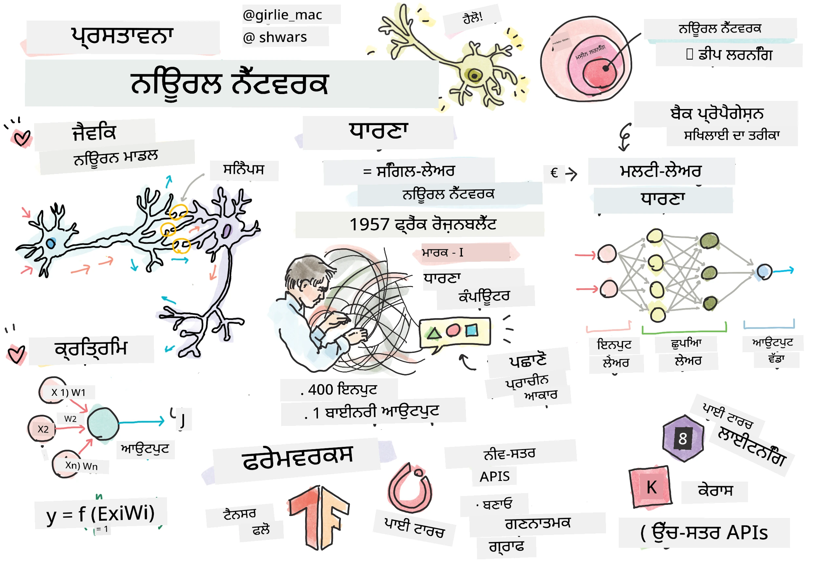
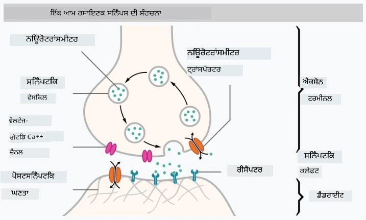
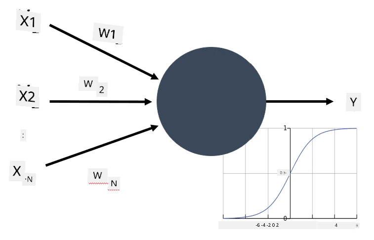

# ਨਿਊਰਲ ਨੈੱਟਵਰਕਸ ਦਾ ਪਰਚਿਆ

ਜਿਵੇਂ ਕਿ ਅਸੀਂ ਪਰਚਿਆ ਵਿੱਚ ਗੱਲ ਕੀਤੀ, ਗਿਆਨ ਪ੍ਰਾਪਤ ਕਰਨ ਦੇ ਇੱਕ ਤਰੀਕੇ ਵਜੋਂ ਇੱਕ **ਕੰਪਿਊਟਰ ਮਾਡਲ** ਜਾਂ ਇੱਕ **ਕৃত੍ਰਿਮ ਦਿਮਾਗ਼** ਨੂੰ ਪ੍ਰਸ਼ਿੱਖਤ ਕਰਨਾ ਹੈ। 20ਵੀਂ ਸਦੀ ਦੇ ਮੱਧ ਤੋਂ, ਖੋਜਕਾਰ ਵੱਖ-ਵੱਖ ਗਣਿਤਮੂਲਕ ਮਾਡਲਾਂ ਦੀ ਕੋਸ਼ਿਸ਼ ਕਰਦੇ ਰਹੇ, ਜਦ ਤੱਕ ਕਿ ਹਾਲ ਹੀ ਦੇ ਸਾਲਾਂ ਵਿੱਚ ਇਹ ਦਿਸ਼ਾ ਬਹੁਤ ਸਫਲ ਸਾਬਤ ਹੋਈ। ਇਸ ਤਰ੍ਹਾਂ ਦੀਆਂ ਦਿਮਾਗ਼ ਦੇ ਗਣਿਤਮੂਲਕ ਮਾਡਲਾਂ ਨੂੰ **ਨਿਊਰਲ ਨੈੱਟਵਰਕਸ** ਕਿਹਾ ਜਾਂਦਾ ਹੈ।

> ਕਈ ਵਾਰੀ ਨਿਊਰਲ ਨੈੱਟਵਰਕਸ ਨੂੰ *ਕ੍ਰਿਤ੍ਰਿਮ ਨਿਊਰਲ ਨੈੱਟਵਰਕਸ*, ANNs ਕਿਹਾ ਜਾਂਦਾ ਹੈ, ਤਾਂ ਕਿ ਇਹ ਦਰਸਾਇਆ ਜਾ ਸਕੇ ਕਿ ਸਾਨੂੰ ਮਾਡਲਾਂ ਦੀ ਗੱਲ ਕਰ ਰਹੇ ਹਾਂ, ਅਸਲ ਨਿਊਰੋਨਾਂ ਦੇ ਜਾਲਾਂ ਦੀ ਨਹੀਂ।

## ਮਸ਼ੀਨ ਲਰਨਿੰਗ

ਨਿਊਰਲ ਨੈੱਟਵਰਕਸ ਇੱਕ ਵੱਡੇ ਵਿਭਾਗ ਦਾ ਹਿੱਸਾ ਹਨ ਜਿਸਨੂੰ **ਮਸ਼ੀਨ ਲਰਨਿੰਗ** ਕਿਹਾ ਜਾਂਦਾ ਹੈ, ਜਿਸਦਾ ਟੀਚਾ ਡਾਟਾ ਦੀ ਵਰਤੋਂ ਕਰਕੇ ਉਹ ਕੰਪਿਊਟਰ ਮਾਡਲ ਤਿਆਰ ਕਰਨਾ ਹੈ ਜੋ ਸਮੱਸਿਆਵਾਂ ਦਾ ਹੱਲ ਕਰ ਸਕਣ। ਮਸ਼ੀਨ ਲਰਨਿੰਗ ਕ੍ਰਿਤ੍ਰਿਮ ਬੁਧੀ ਦਾ ਇੱਕ ਵੱਡਾ ਹਿੱਸਾ ਹੈ, ਪਰ ਅਸੀਂ ਇਸ ਕ੍ਰਿਕੁਲਮ ਵਿੱਚ ਸਰਲ ਮਸ਼ੀਨ ਲਰਨਿੰਗ ਨੂੰ ਕਵਰ ਨਹੀਂ ਕਰਦੇ।

> ਸਾਡਾ ਵੱਖਰਾ **[ਮਸ਼ੀਨ ਲਰਨਿੰਗ ਫਾਰ ਬਿਗਿਨਰਜ਼](http://github.com/microsoft/ml-for-beginners)** ਕ੍ਰਿਕੁਲਮ ਵੇਖੋ ਜਿੱਥੇ ਤੁਸੀਂ ਕਲਾਸਿਕ ਮਸ਼ੀਨ ਲਰਨਿੰਗ ਬਾਰੇ ਵਧੇਰੇ ਸਿੱਖ ਸਕਦੇ ਹੋ।

ਮਸ਼ੀਨ ਲਰਨਿੰਗ ਵਿੱਚ ਅਸੀਂ ਮਾਨਦੇ ਹਾਂ ਕਿ ਸਾਡੇ ਕੋਲ ਕੁਝ ਉਦਾਹਰਣਾਂ ਦਾ ਡਾਟਾਸੈੱਟ **X** ਹੈ, ਅਤੇ ਉਸਦੇ ਤਰਤੰਤਰ ਆਉਟਪੁੱਟ ਮੁੱਲ **Y** ਹਨ। ਉਦਾਹਰਣਾਂ ਅਕਸਰ N-ਆਯਾਮੀ ਵੇਕਟਰ ਹੁੰਦੇ ਹਨ ਜੋ **ਫੀਚਰਜ਼** ਤੋਂ ਬਣੇ ਹੁੰਦੇ ਹਨ, ਅਤੇ ਆਉਟਪੁੱਟ ਨੂੰ **ਲੇਬਲਸ** ਕਿਹਾ ਜਾਂਦਾ ਹੈ।

ਅਸੀਂ ਦੋ ਸਭ ਤੋਂ ਆਮ ਮਸ਼ੀਨ ਲਰਨਿੰਗ ਸਮੱਸਿਆਵਾਂ ਬਾਰੇ ਸੋਚਾਂਗੇ:

* **ਕਲਾਸੀਫਿਕੇਸ਼ਨ**, ਜਿਸ ਵਿੱਚ ਸਾਨੂੰ ਇੱਕ ਇਨਪੁੱਟ ਵਸਤੂ ਨੂੰ ਦੋ ਜਾਂ ਵੱਧ ਕਲਾਸਾਂ ਵਿੱਚ ਵੰਡਣਾ ਹੁੰਦਾ ਹੈ।
* **ਰੇਗ੍ਰੈਸ਼ਨ**, ਜਿਸ ਵਿੱਚ ਸਾਨੂੰ ਹਰ ਇਨਪੁੱਟ ਨਮੂਨੇ ਲਈ ਇੱਕ ਸੰਖਿਆਤਮਕ ਨੰਬਰ ਦਾ ਅੰਦਾਜ਼ਾ ਲਗਾਉਣਾ ਹੁੰਦਾ ਹੈ।

> ਜਦੋਂ ਇਨਪੁੱਟ ਅਤੇ ਆਉਟਪੁੱਟ ਨੂੰ ਟੈਂਸਰਾਂ ਵਜੋਂ ਦਰਸਾਇਆ ਜਾਂਦਾ ਹੈ, ਤਾਂ ਇਨਪੁੱਟ ਡਾਟਾਸੈੱਟ ਦਾ ਮੈਟਰਿਕਸ M×N ਆਕਾਰ ਦਾ ਹੁੰਦਾ ਹੈ, ਜਿੱਥੇ M ਨਮੂਨਿਆਂ ਦੀ ਗਿਣਤੀ ਹੈ ਅਤੇ N ਫੀਚਰਜ਼ ਦੀ ਗਿਣਤੀ ਹੈ। ਆਉਟਪੁੱਟ ਲੇਬਲ Y ਦਾ ਵੇਕਟਰ ਆਕਾਰ M ਦਾ ਹੁੰਦਾ ਹੈ।

ਇਸ ਕ੍ਰਿਕੁਲਮ ਵਿੱਚ ਅਸੀਂ ਸਿਰਫ ਨਿਊਰਲ ਨੈੱਟਵਰਕ ਮਾਡਲਾਂ 'ਤੇ ਧਿਆਨ ਦੇਵਾਂਗੇ।

## ਨਿਊਰਾਨ ਦਾ ਮਾਡਲ

ਜੀਵ ਵਿਗਿਆਨ ਤੋਂ ਸਾਨੂੰ ਪਤਾ ਹੈ ਕਿ ਸਾਡਾ ਦਿਮਾਗ਼ ਨਿਊਰਲ ਸੈੱਲਾਂ (ਨਿਊਰਾਨ) ਦਾ ਬਣਿਆ ਹੁੰਦਾ ਹੈ, ਹਰ ਇੱਕ ਸੈੱਲ ਵਿੱਚ ਬਹੁਤ ਸਾਰੇ "ਇਨਪੁੱਟ" (ਡੈਂਡਰਾਈਟਸ) ਅਤੇ ਇੱਕ "ਆਊਟਪੁੱਟ" (ਐਕਸੋਨ) ਹੁੰਦਾ ਹੈ। ਡੈਂਡਰਾਈਟਸ ਅਤੇ ਐਕਸੋਨ ਦੋਹਾਂ ਬਿਜਲੀ ਸੰਕੇਤ ਚਲਾ ਸਕਦੇ ਹਨ, ਅਤੇ ਉਨ੍ਹਾਂ ਵਿਚਕਾਰ ਦੇ ਕਨੈਕਸ਼ਨ — ਜਿਨ੍ਹਾਂ ਨੂੰ ਸਾਇਨੈਪਸ ਕਿਹਾ ਜਾਂਦਾ ਹੈ — ਵੱਖ-ਵੱਖ ਡਿਗਰੀਆਂ ਦੀ ਚਾਲਕਤਾ ਦਿਖਾਉਂਦੇ ਹਨ, ਜੋ ਨਿਊਰੋਟ੍ਰਾਂਸਮੀਟਰਾਂ ਦੁਆਰਾ ਕੰਟਰੋਲ ਹੁੰਦੀ ਹੈ।

 | 
----|----
ਅਸਲ ਨਿਊਰਾਨ *([ਚਿੱਤਰ](https://en.wikipedia.org/wiki/Synapse#/media/File:SynapseSchematic_lines.svg) ਵਿਕੀਪੀਡੀਆ ਤੋਂ)* | ਕ੍ਰਿਤ੍ਰਿਮ ਨਿਊਰਾਨ *(ਚਿੱਤਰ ਲੇਖਕ ਦੁਆਰਾ)*

ਇਸ ਤਰ੍ਹਾਂ, ਨਿਊਰਾਨ ਦਾ ਸਆਧਾਰਣ ਗਣਿਤਮੂਲਕ ਮਾਡਲ ਕਈ ਇਨਪੁੱਟ X1, ..., XN ਅਤੇ ਇੱਕ ਆਊਟਪੁੱਟ Y, ਅਤੇ ਇੱਕ ਸੀਰੀਜ਼ ਵਜ਼ਨਾਂ W1, ..., WN ਨੂੰ ਰੱਖਦਾ ਹੈ। ਇੱਕ ਆਊਟਪੁੱਟ ਇਸ ਤਰ੍ਹਾਂ ਨਿਕਲਦਾ ਹੈ:

ਜਿੱਥੇ f ਕੋਈ ਗੈਰ-ਰੇਖੀ **ਘੁਟਨਾ ਫੰਕਸ਼ਨ** ਹੈ।

> ਨਿਊਰਾਨ ਦੇ ਪਹਿਲੇ ਮਾਡਲ 1943 ਵਿੱਚ ਵਾਰਨ ਮੈਕਕੱਲੌਕ ਅਤੇ ਵਾਲਟਰ ਪਿਟਸ ਦੁਆਰਾ ਕਲਾਸਿਕ ਪੇਪਰ [A logical calculus of the ideas immanent in nervous activity](https://www.cs.cmu.edu/~./epxing/Class/10715/reading/McCulloch.and.Pitts.pdf) ਵਿੱਚ ਵਰਣਿਤ ਕੀਤੇ ਗਏ ਸਨ। ਡੋਨਾਲਡ ਹੇਬ ਨੇ ਆਪਣੀ ਪੁਸਤਕ "[The Organization of Behavior: A Neuropsychological Theory](https://books.google.com/books?id=VNetYrB8EBoC)" ਵਿੱਚ ਇਸ ਤਰ੍ਹਾਂ ਦੇ ਨੈੱਟਵਰਕਸ ਨੂੰ ਪ੍ਰਸ਼ਿੱਖਤ ਕਰਨ ਦਾ ਤਰੀਕਾ ਦਿੱਤਾ।

## ਇਸ ਭਾਗ ਵਿੱਚ

ਇਸ ਭਾਗ ਵਿੱਚ ਅਸੀਂ ਸਿੱਖਾਂਗੇ:
* [ਪਰਸੈਪਟਰਾਨ](03-Perceptron/README.md), ਦੋ-ਕਲਾਸ ਕਲਾਸੀਫਿਕੇਸ਼ਨ ਲਈ ਸਭ ਤੋਂ ਪਹਿਲਾਂ ਬਣੇ ਨਿਊਰਲ ਨੈੱਟਵਰਕ ਮਾਡਲਾਂ ਵਿੱਚੋਂ ਇੱਕ
* [ਬਹੁ-ਪੜ੍ਹਾਈ ਵਾਲੇ ਨੈੱਟਵਰਕ](04-OwnFramework/README.md) ਇੱਕ ਜੋੜੀ ਬੈਚ ਨਾਲ [ਸਾਡਾ ਖੁਦ ਦਾ ਫ੍ਰੇਮਵਰਕ ਕਿਵੇਂ ਬਣਾਇਆ ਜਾਵੇ](04-OwnFramework/OwnFramework.ipynb)
* [ਨਿਊਰਲ ਨੈੱਟਵਰਕ ਫ੍ਰੇਮਵਰਕ](05-Frameworks/README.md), ਇਹਨਾਂ ਨੋਟਬੁੱਕਾਂ ਨਾਲ: [ਪਾਇਟਾਰਚ](05-Frameworks/IntroPyTorch.ipynb) ਅਤੇ [ਕੇਰਾਸ/ਟੈਂਸਰਫਲੋ](05-Frameworks/IntroKerasTF.ipynb)
* [ਓਵਰਫਿਟਿੰਗ](../../../../lessons/3-NeuralNetworks/05-Frameworks#overfitting)

---

<!-- CO-OP TRANSLATOR DISCLAIMER START -->
**ਅਸਵੀਕਾਰੋਪਣ**:
ਇਸ ਦਸਤਾਵੇਜ਼ ਦਾ ਅਨੁਵਾਦ ਏਆਈ ਅਨੁਵਾਦ ਸੇਵਾ [Co-op Translator](https://github.com/Azure/co-op-translator) ਦੀ ਵਰਤੋਂ ਕਰਕੇ ਕੀਤਾ ਗਿਆ ਹੈ। ਜਦੋਂ ਕਿ ਅਸੀਂ ਸਹੀਤਾਵਾਂ ਲਈ ਯਤਨਸ਼ੀਲ ਹਾਂ, ਕਿਰਪਾ ਕਰਕੇ ਧਿਆਨ ਰੱਖੋ ਕਿ ਸਵੈਚਾਲਿਤ ਅਨੁਵਾਦਾਂ ਵਿੱਚ ਗਲਤੀਆਂ ਜਾਂ ਅਸਮੱਤਿਆਵਾਂ ਹੋ ਸਕਦੀਆਂ ਹਨ। ਮੂਲ ਦਸਤਾਵੇਜ਼ ਆਪਣੀ ਮੂਲ ਭਾਸ਼ਾ ਵਿੱਚ ਅਧਿਕਾਰਕ ਸਰੋਤ ਮੰਨਿਆ ਜਾਣਾ ਚਾਹੀਦਾ ਹੈ। ਜਰੂਰੀ ਜਾਣਕਾਰੀ ਲਈ, ਪੇਸ਼ੇਵਰ ਮਨੁੱਖੀ ਅਨੁਵਾਦ ਦੀ ਸਿਫ਼ਾਰਸ਼ ਕੀਤੀ ਜਾਂਦੀ ਹੈ। ਅਸੀਂ ਇਸ ਅਨੁਵਾਦ ਦੇ ਉਪਯੋਗ ਤੋਂ ਪੈਦਾ ਹੋਣ ਵਾਲੀਆਂ ਕਿਸੇ ਵੀ ਗਲਤਫਹਿਮੀਆਂ ਜਾਂ ਗਲਤ ਵਿਆਖਿਆਵਾਂ ਲਈ ਜਵਾਬਦੇਹ ਨਹੀਂ ਹਾਂ।
<!-- CO-OP TRANSLATOR DISCLAIMER END -->