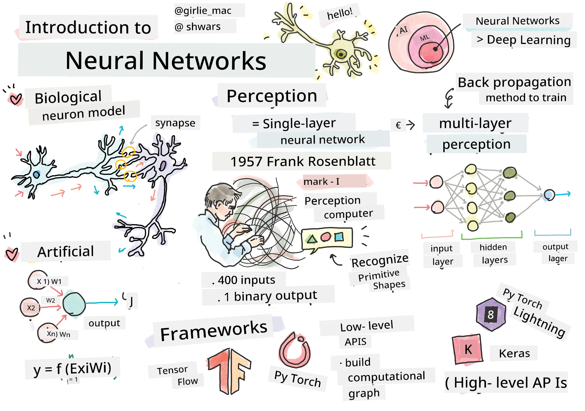
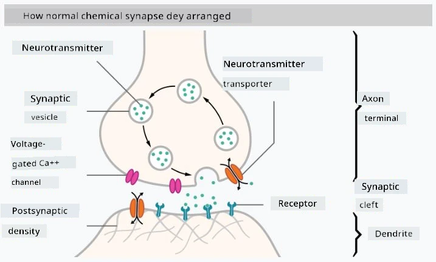

# Introduction to Neural Networks

As we discuss for di introduction, one way we fit get intelligence na to train **computer model** or **artificial brain**. Since middle of 20th century, researchers don try different mathematical model dem, till for recent years dis kain direction don show say e dey very successful. Dis kain mathematical model dem of brain na **neural networks** dem dey call am.

> Sometimes dem go dey call neural networks *Artificial Neural Networks*, ANNs, to show say we dey talk about models, no be real neuron networks.

## Machine Learning

Neural Networks na part of bigger subject wey dem dey call **Machine Learning**, wey the koko na to use data train computer model dem wey fit solve problem. Machine Learning na big part of Artificial Intelligence, but for dis curriculum we no go cover classical ML.

> Visit our separate **[Machine Learning for Beginners](http://github.com/microsoft/ml-for-beginners)** curriculum to sabi more about classic Machine Learning.

For Machine Learning, we believe say we get some dataset of examples **X**, plus output values **Y** wey match. Examples dem often na N-dimensional vectors wey get **features**, and outputs na **labels**.

We go consider di two most common machine learning problem dem:

* **Classification**, wey we need classify input object into two or more classes.
* **Regression**, wey we need predict number for each input sample.

> When we represent inputs and outputs as tensors, input dataset na matrix wey size M&times;N, wey M na number of samples and N na number of features. Output labels Y na vector wey size M.

For dis curriculum, we go focus only on neural network models.

## Model of One Neuron

From biology, we sabi say our brain get neural cells (neurons), each one get many "inputs" (dendrites) and one "output" (axon). Both dendrites and axons fit carry electrical signals, and the connection dem between them — wey dem dey call synapses — fit get different level of conductivity, and neurotransmitters dey control am.

 | 
----|----
Real Neuron *([Image](https://en.wikipedia.org/wiki/Synapse#/media/File:SynapseSchematic_lines.svg) from Wikipedia)* | Artificial Neuron *(Image by Author)*

So, the simplest mathematical model for neuron get plenti inputs X1, ..., XN plus output Y, together with weights W1, ..., WN. We dey calculate output like this:

where f na some non-linear **activation function**.

> Early neuron models dem get description inside classical paper [A logical calculus of the ideas immanent in nervous activity](https://www.cs.cmu.edu/~./epxing/Class/10715/reading/McCulloch.and.Pitts.pdf) wey Warren McCullock and Walter Pitts write for 1943. Donald Hebb for him book "[The Organization of Behavior: A Neuropsychological Theory](https://books.google.com/books?id=VNetYrB8EBoC)" propose how dem fit train any kain networks like dis.

## For Dis Section

For dis section, we go learn about:
* [Perceptron](03-Perceptron/README.md), one of di oldest neural network model for two-class classification
* [Multi-layered networks](04-OwnFramework/README.md) wey get paired notebook [how to build our own framework](04-OwnFramework/OwnFramework.ipynb)
* [Neural Network Frameworks](05-Frameworks/README.md), with these notebooks dem: [PyTorch](05-Frameworks/IntroPyTorch.ipynb) and [Keras/Tensorflow](05-Frameworks/IntroKerasTF.ipynb)
* [Overfitting](../../../../lessons/3-NeuralNetworks/05-Frameworks#overfitting)

---

<!-- CO-OP TRANSLATOR DISCLAIMER START -->
**Disclaimer**:
Dis document don translate wit AI translation service [Co-op Translator](https://github.com/Azure/co-op-translator). Even tho we dey try make am correct, abeg make you know say automated translation fit get errors or mistakes. Di original document for dia own language na im be di correct source. For important info, make person wey sabi human translation do am. We no go responsible for any misunderstanding or wrong understanding wey fit happen because of dis translation.
<!-- CO-OP TRANSLATOR DISCLAIMER END -->