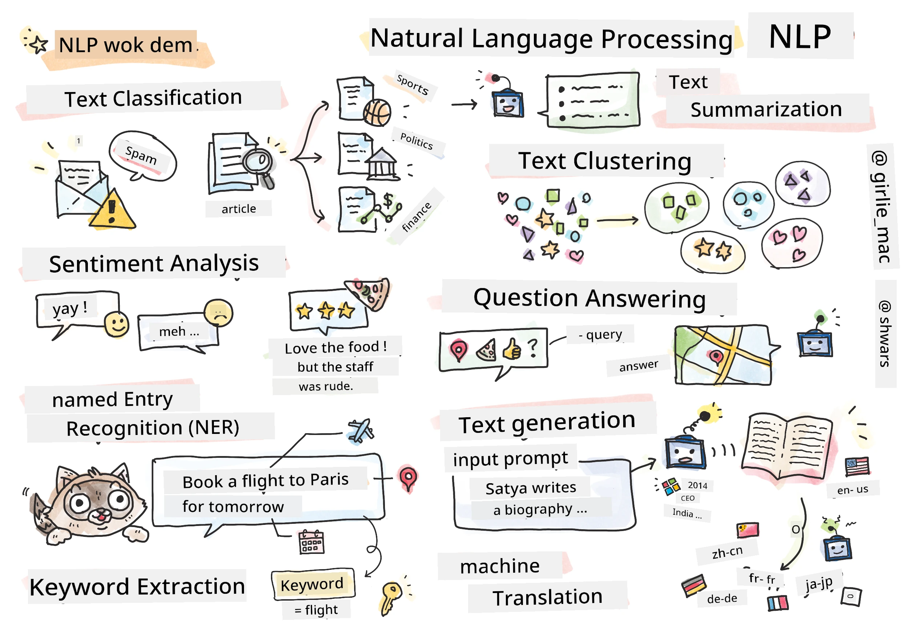

# Natural Language Processing



For dis section, we go focus for how Neural Networks fit handle mata wey concern **Natural Language Processing (NLP)**. Plenty NLP wahala dey wey we wan make komputa fit solve:

* **Text classification** na normal classification problem wey concern text sequences. Example na to classify e-mail message as spam or no-spam, or put article for categories like sport, business, politics, etc. E still dey useful for chat bots wey need understand wetin person dey try talk - dis one na **intent classification**. For intent classification, we fit get plenty categories.
* **Sentiment analysis** na normal regression problem, wey we need give number (sentiment) wey match how positive or negative d meaning of the sentence be. One better version of sentiment analysis na **aspect-based sentiment analysis** (ABSA), wey no go put sentiment for the whole sentence but for different parts of am (aspects), eg. *For dis restaurant, I like the cuisine, but the atmosphere no too good*.
* **Named Entity Recognition** (NER) mean say we dey try find certain entities for text. For example, we gats sabi say for the phrase *I need to fly to Paris tomorrow*, the word *tomorrow* mean DATE, and *Paris* na LOCATION.  
* **Keyword extraction** resemble NER well but here we go try extract important words for the meaning of the sentence wey komputa go fit do automatically, no pre-training for particular entity types.
* **Text clustering** dey useful when we wan group sentences wey resemble, for example, similar questions for technical support talk.
* **Question answering** na the ability wey model get to answer one specific question. The model go receive text passage plus question as input, then e go give place for the text wey get the answer (or sometimes e go generate the answer).
* **Text Generation** na the power wey model get to create new text. E fit considered as classification task wey predict next letter or word based on *text prompt*. Advanced text generation models like GPT-3 fit solve other NLP tasks like classification with one technique wey dem dey call [prompt programming](https://towardsdatascience.com/software-3-0-how-prompting-will-change-the-rules-of-the-game-a982fbfe1e0) or [prompt engineering](https://medium.com/swlh/openai-gpt-3-and-prompt-engineering-dcdc2c5fcd29)
* **Text summarization** na technique wey mean say we want make komputa "read" long text then summarize am for small sentences.
* **Machine translation** be like say you dey combine text understanding for one language with text generation for another language.

Before, most NLP tasks dem dey solve with old-old methods like grammars. For example, for machine translation, dem dey use parsers to change original sentence to syntax tree, then dem go extract higher level semantic structures to represent d meaning, then based on the meaning and grammar of target language, dem go generate d result. But now, neural networks dey solve plenty NLP tasks better.

> Plenty old school NLP methods dem dey inside [Natural Language Processing Toolkit (NLTK)](https://www.nltk.org) Python library. One correct [NLTK Book](https://www.nltk.org/book/) dey online wey explain how different NLP tasks fit solve wit NLTK.

For our course, we go mainly focus for neural networks for NLP, and we go use NLTK when e necessary.

We don already learn how neural networks dey work with tabular data and images. One big difference between those data and text be say text na sequence wey fit get different lengths, but image input size dey fixed. Convolutional networks fit find patterns for input data, but for text, patterns dey more complicated. Example, negation fit dey far from subject for plenty words (eg. *I do not like oranges*, vs. *I do not like those big colorful tasty oranges*), but that one suppose still mean one pattern. So to fit handle language, we gots put new neural network types like *recurrent networks* and *transformers*.

## Install Libraries

If you dey use local Python installation run this course, you fit need to install all di libraries wey NLP need with these commands:

**For PyTorch**
```bash
pip install -r requirements-pytorch.txt
```
**For TensorFlow**
```bash
pip install -r requirements-tf.txt
```

> You fit try NLP wit TensorFlow on [Microsoft Learn](https://docs.microsoft.com/learn/modules/intro-natural-language-processing-tensorflow/?WT.mc_id=academic-77998-cacaste)

## GPU Warning

For this section, for some examples we go dey train big models.
* **Use a GPU-Enabled Computer**: E good make you run your notebooks for GPU-enabled computer so dat waiting time go reduce when you dey work wit big models.
* **GPU Memory Constraints**: If you run am for GPU, e fit happen say GPU memory no go enough, especially if you dey train big models.
* **GPU Memory Consumption**: How much GPU memory you go use when you dey train depend on different tins including minibatch size.
* **Minimize Minibatch Size**: If you get GPU memory wahala, try reduce the minibatch size for your code as one solution.
* **TensorFlow GPU Memory Release**: Old TensorFlow versions no dey release GPU memory well when you dey train different models for inside one Python kernel. To handle GPU memory well, you fit set TensorFlow to use GPU memory only as e need am.
* **Code Inclusion**: To make TensorFlow start to grow GPU memory allocation only as e need am, put this code for your notebooks:

```python
physical_devices = tf.config.list_physical_devices('GPU') 
if len(physical_devices)>0:
    tf.config.experimental.set_memory_growth(physical_devices[0], True) 
```

If you want learn about NLP from classic ML side, visit [dis suite of lessons](https://github.com/microsoft/ML-For-Beginners/tree/main/6-NLP)

## In this Section
For dis section, we go learn about:

* [Representing text as tensors](13-TextRep/README.md)
* [Word Embeddings](14-Embeddings/README.md)
* [Language Modeling](15-LanguageModeling/README.md)
* [Recurrent Neural Networks](16-RNN/README.md)
* [Generative Networks](17-GenerativeNetworks/README.md)
* [Transformers](18-Transformers/README.md)

---

<!-- CO-OP TRANSLATOR DISCLAIMER START -->
**Disclaimer**:
Dis document don translate wit AI translation service [Co-op Translator](https://github.com/Azure/co-op-translator). Even tho we dey try make am correct, abeg make you know say automated translation fit get errors or mistakes. Di original document for dia own language na im be di correct source. For important info, make person wey sabi human translation do am. We no go responsible for any misunderstanding or wrong understanding wey fit happen because of dis translation.
<!-- CO-OP TRANSLATOR DISCLAIMER END -->