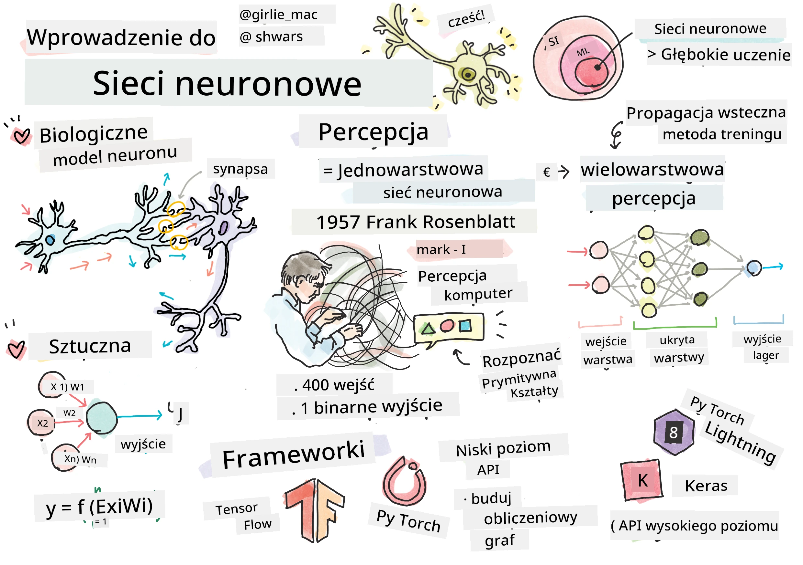
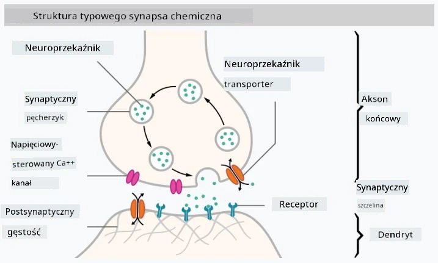

# Wprowadzenie do Sieci Neuronowych

Jak omówiliśmy we wprowadzeniu, jednym ze sposobów osiągnięcia inteligencji jest trenowanie **modelu komputerowego** lub **sztucznego mózgu**. Od połowy XX wieku badacze próbowali różnych modeli matematycznych, aż w ostatnich latach ten kierunek okazał się niezwykle skuteczny. Takie matematyczne modele mózgu nazywane są **sieciami neuronowymi**.

> Czasami sieci neuronowe nazywane są *sztucznymi sieciami neuronowymi* (ANN), aby zaznaczyć, że mówimy o modelach, a nie o prawdziwych sieciach neuronów.

## Uczenie Maszynowe

Sieci neuronowe są częścią większej dziedziny zwanej **uczeniem maszynowym**, której celem jest wykorzystanie danych do trenowania modeli komputerowych zdolnych do rozwiązywania problemów. Uczenie maszynowe stanowi dużą część sztucznej inteligencji, jednak klasyczne ML nie jest objęte tym materiałem.

> Odwiedź nasz oddzielny **[kurs Uczenie maszynowe dla początkujących](http://github.com/microsoft/ml-for-beginners)**, aby dowiedzieć się więcej o klasycznym uczeniu maszynowym.

W uczeniu maszynowym zakładamy, że mamy jakiś zbiór przykładów **X** oraz odpowiadające im wartości wyjściowe **Y**. Przykłady to często wektory N-wymiarowe składające się z **cech**, a wyjścia nazywane są **etykietami**.

Rozważymy dwa najczęściej występujące problemy uczenia maszynowego:

* **Klasyfikację**, gdzie musimy zaklasyfikować obiekt wejściowy do dwóch lub więcej klas.
* **Regresję**, gdzie musimy przewidzieć liczbę rzeczywistą dla każdego z próbek wejściowych.

> Reprezentując wejścia i wyjścia jako tensory, zbiór wejściowy to macierz o rozmiarze M&times;N, gdzie M to liczba próbek, a N to liczba cech. Etykiety wyjściowe Y są wektorem o rozmiarze M.

W tym kursie skupimy się wyłącznie na modelach sieci neuronowych.

## Model Neuronu

Z biologii znamy, że nasz mózg składa się z komórek nerwowych (neuronów), z których każdy posiada wiele "wejść" (dendrytów) i jedno "wyjście" (akson). Zarówno dendryty, jak i aksony przewodzą sygnały elektryczne, a połączenia między nimi — zwane synapsami — wykazują różne stopnie przewodności, które są regulowane przez neuroprzekaźniki.

 | 
----|----
Prawdziwy neuron *([Obraz](https://en.wikipedia.org/wiki/Synapse#/media/File:SynapseSchematic_lines.svg) z Wikipedii)* | Sztuczny neuron *(Obraz autora)*

Najprostszy model matematyczny neuronu zawiera więc kilka wejść X1, ..., XN oraz wyjście Y, a także szereg wag W1, ..., WN. Wyjście oblicza się jako:

gdzie f to jakaś nieliniowa **funkcja aktywacji**.

> Wczesne modele neuronów opisano w klasycznym artykule [A logical calculus of the ideas immanent in nervous activity](https://www.cs.cmu.edu/~./epxing/Class/10715/reading/McCulloch.and.Pitts.pdf) Warrena McCullocka i Waltera Pittsa z 1943 roku. Donald Hebb w swojej książce "[The Organization of Behavior: A Neuropsychological Theory](https://books.google.com/books?id=VNetYrB8EBoC)" zaproponował sposób trenowania takich sieci.

## W tej sekcji

W tej sekcji nauczymy się o:
* [Perceptronie](03-Perceptron/README.md), jednym z najwcześniejszych modeli sieci neuronowych do klasyfikacji dwuklasowej
* [Sieciach wielowarstwowych](04-OwnFramework/README.md) wraz z towarzyszącym notatnikiem [jak zbudować własny framework](04-OwnFramework/OwnFramework.ipynb)
* [Frameworkach sieci neuronowych](05-Frameworks/README.md), z notatnikami: [PyTorch](05-Frameworks/IntroPyTorch.ipynb) i [Keras/Tensorflow](05-Frameworks/IntroKerasTF.ipynb)
* [Przeuczeniu](../../../../lessons/3-NeuralNetworks/05-Frameworks#overfitting)

---

<!-- CO-OP TRANSLATOR DISCLAIMER START -->
**Zastrzeżenie**:
Niniejszy dokument został przetłumaczony za pomocą usługi tłumaczenia AI [Co-op Translator](https://github.com/Azure/co-op-translator). Choć dążymy do dokładności, prosimy pamiętać, że automatyczne tłumaczenia mogą zawierać błędy lub niedokładności. Oryginalny dokument w jego języku źródłowym należy uznawać za autorytatywne źródło. W przypadku informacji krytycznych zalecane jest skorzystanie z profesjonalnego tłumaczenia wykonanego przez człowieka. Nie ponosimy odpowiedzialności za jakiekolwiek nieporozumienia lub błędne interpretacje wynikające z użycia tego tłumaczenia.
<!-- CO-OP TRANSLATOR DISCLAIMER END -->