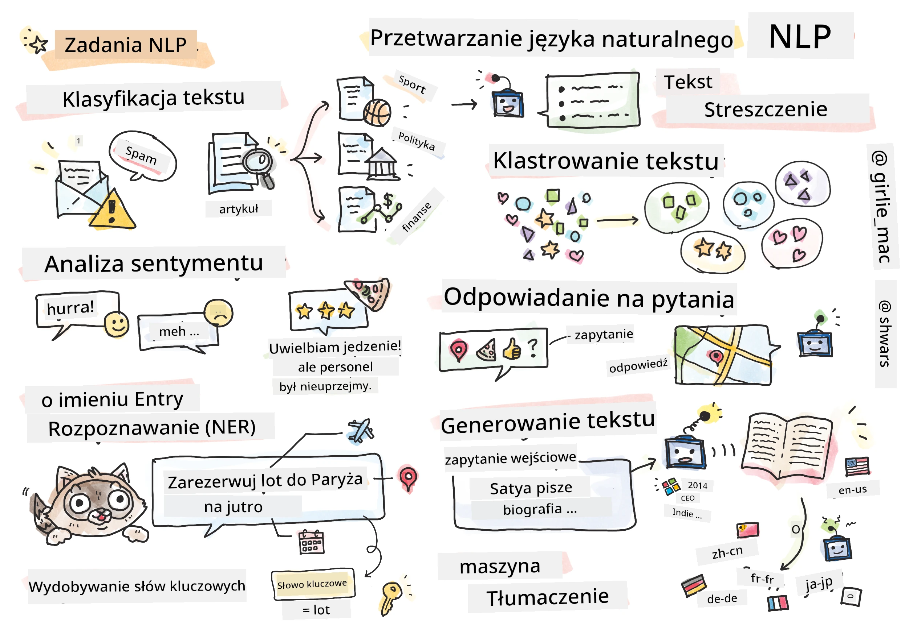

# Przetwarzanie języka naturalnego



W tej sekcji skupimy się na wykorzystaniu sieci neuronowych do obsługi zadań związanych z **przetwarzaniem języka naturalnego (NLP)**. Istnieje wiele problemów NLP, które chcemy, aby komputery potrafiły rozwiązywać:

* **Klasyfikacja tekstu** to typowy problem klasyfikacji dotyczący sekwencji tekstowych. Przykładami są klasyfikowanie wiadomości e-mail jako spam lub nie-spam, albo kategoryzowanie artykułów jako sport, biznes, polityka itd. Również podczas tworzenia chatbotów często musimy zrozumieć, co użytkownik chciał powiedzieć — w tym przypadku mamy do czynienia z **klasyfikacją intencji**. Często w klasyfikacji intencji musimy radzić sobie z wieloma kategoriami.
* **Analiza sentymentu** to typowy problem regresji, gdzie musimy przypisać liczbę (sentyment) odpowiadającą temu, jak pozytywne/negatywne jest znaczenie zdania. Bardziej zaawansowaną wersją analizy sentymentu jest **analiza sentymentu oparta na aspektach** (ABSA), gdzie przypisujemy sentyment nie do całego zdania, lecz do różnych jego części (aspektów), np. *W tej restauracji podobała mi się kuchnia, ale atmosfera była okropna*.
* **Rozpoznawanie nazwanych jednostek** (NER) odnosi się do problemu wyodrębniania określonych jednostek z tekstu. Na przykład, być może musimy zrozumieć, że w zdaniu *Muszę polecieć do Paryża jutro* słowo *jutro* odnosi się do DATY, a *Paryż* to MIEJSCE.  
* **Ekstrakcja słów kluczowych** jest podobna do NER, ale musimy automatycznie wyodrębnić słowa ważne dla znaczenia zdania, bez uprzedniego trenowania na konkretne typy jednostek.
* **Klasteryzacja tekstu** może być przydatna, gdy chcemy grupować podobne zdania, na przykład podobne zapytania w rozmowach wsparcia technicznego.
* **Odpowiadanie na pytania** odnosi się do zdolności modelu do udzielenia odpowiedzi na konkretne pytanie. Model otrzymuje fragment tekstu oraz pytanie jako dane wejściowe i musi wskazać miejsce w tekście, gdzie zawarta jest odpowiedź (lub czasem wygenerować tekst odpowiedzi).
* **Generowanie tekstu** to zdolność modelu do generowania nowego tekstu. Można to traktować jako zadanie klasyfikacji, które przewiduje kolejną literę/słowo na podstawie jakiegoś *promptu tekstowego*. Zaawansowane modele generowania tekstu, takie jak GPT-3, potrafią rozwiązywać inne zadania NLP, takie jak klasyfikacja, wykorzystując technikę nazwaną [programowaniem promptów](https://towardsdatascience.com/software-3-0-how-prompting-will-change-the-rules-of-the-game-a982fbfe1e0) lub [inżynierią promptów](https://medium.com/swlh/openai-gpt-3-and-prompt-engineering-dcdc2c5fcd29)
* **Streszczanie tekstu** to technika, gdy chcemy, aby komputer "przeczytał" długi tekst i podsumował go w kilku zdaniach.
* **Tłumaczenie maszynowe** można traktować jako kombinację rozumienia tekstu w jednym języku i generowania tekstu w innym.

Początkowo większość zadań NLP rozwiązywano przy użyciu tradycyjnych metod, takich jak gramatyki. Na przykład w tłumaczeniu maszynowym używano parserów do przekształcenia zdania początkowego w drzewo składniowe, następnie wyodrębniano wyższe poziomy struktur semantycznych, które reprezentowały znaczenie zdania, a na podstawie tego znaczenia i gramatyki języka docelowego generowano wynik. Obecnie wiele zadań NLP jest skuteczniej rozwiązywanych przy użyciu sieci neuronowych.

> Wiele klasycznych metod NLP jest zaimplementowanych w bibliotece Pythona [Natural Language Processing Toolkit (NLTK)](https://www.nltk.org). Dostępna jest również świetna [książka NLTK](https://www.nltk.org/book/) online, która tłumaczy, jak różne zadania NLP można rozwiązać przy pomocy NLTK.

W naszym kursie skupimy się głównie na używaniu sieci neuronowych do NLP, a tam, gdzie będzie to potrzebne, użyjemy NLTK.

Już nauczyliśmy się wykorzystywać sieci neuronowe do pracy z danymi tabelarycznymi i obrazami. Główna różnica między tymi typami danych a tekstem polega na tym, że tekst jest sekwencją o zmiennej długości, podczas gdy rozmiar wejścia w przypadku obrazów jest znany z góry. Podczas gdy sieci konwolucyjne potrafią wydobywać wzorce z danych wejściowych, wzorce w tekście są bardziej złożone. Na przykład możemy mieć negację oddaloną od podmiotu o dowolną liczbę słów (np. *Nie lubię pomarańczy* vs. *Nie lubię tych dużych kolorowych smacznych pomarańczy*), a mimo to powinno to być interpretowane jako jeden wzorzec. Dlatego do obsługi języka musimy wprowadzić nowe typy sieci neuronowych, takie jak *sieci rekurencyjne* i *transformery*.

## Instalacja bibliotek

Jeśli używasz lokalnej instalacji Pythona do uruchamiania tego kursu, może być konieczne zainstalowanie wszystkich wymagalnych bibliotek do NLP za pomocą następujących poleceń:

**Dla PyTorch**
```bash
pip install -r requirements-pytorch.txt
```
**Dla TensorFlow**
```bash
pip install -r requirements-tf.txt
```

> Możesz spróbować NLP z TensorFlow na [Microsoft Learn](https://docs.microsoft.com/learn/modules/intro-natural-language-processing-tensorflow/?WT.mc_id=academic-77998-cacaste)

## Ostrzeżenie dotyczące GPU

W tej sekcji w niektórych przykładach będziemy trenować całkiem duże modele.
* **Korzystaj z komputera z GPU**: Zaleca się uruchamianie notebooków na komputerze z aktywnym GPU, aby skrócić czas oczekiwania przy pracy z dużymi modelami.
* **Ograniczenia pamięci GPU**: Praca na GPU może prowadzić do sytuacji, gdy zabraknie pamięci GPU, zwłaszcza przy trenowaniu dużych modeli.
* **Zużycie pamięci GPU**: Ilość pamięci GPU zużywana podczas trenowania zależy od różnych czynników, w tym od rozmiaru minibatcha.
* **Minimalizuj rozmiar minibatcha**: Jeśli napotkasz problemy związane z pamięcią GPU, rozważ zmniejszenie rozmiaru minibatcha w kodzie jako potencjalne rozwiązanie.
* **Zwalnianie pamięci GPU w TensorFlow**: Starsze wersje TensorFlow mogą nie zwalniać poprawnie pamięci GPU podczas trenowania wielu modeli w jednym jądrze Pythona. Aby efektywnie zarządzać wykorzystaniem pamięci GPU, można skonfigurować TensorFlow tak, by przydzielał pamięć GPU tylko w razie potrzeby.
* **Włączenie kodu**: Aby ustawić TensorFlow tak, by zwiększał przydział pamięci GPU tylko wtedy, gdy jest to potrzebne, dołącz następujący kod do swoich notebooków:

```python
physical_devices = tf.config.list_physical_devices('GPU') 
if len(physical_devices)>0:
    tf.config.experimental.set_memory_growth(physical_devices[0], True) 
```

Jeśli jesteś zainteresowany nauką NLP z klasycznej perspektywy uczenia maszynowego, odwiedź [ten zestaw lekcji](https://github.com/microsoft/ML-For-Beginners/tree/main/6-NLP)

## W tej sekcji
W tej sekcji nauczymy się o:

* [Reprezentowaniu tekstu jako tensorów](13-TextRep/README.md)
* [Wekotryzacji słów](14-Embeddings/README.md)
* [Modelowaniu języka](15-LanguageModeling/README.md)
* [Rekurencyjnych sieciach neuronowych](16-RNN/README.md)
* [Sieciach generatywnych](17-GenerativeNetworks/README.md)
* [Transformery](18-Transformers/README.md)

---

<!-- CO-OP TRANSLATOR DISCLAIMER START -->
**Zastrzeżenie**:
Niniejszy dokument został przetłumaczony za pomocą usługi tłumaczenia AI [Co-op Translator](https://github.com/Azure/co-op-translator). Choć dążymy do dokładności, prosimy pamiętać, że automatyczne tłumaczenia mogą zawierać błędy lub niedokładności. Oryginalny dokument w jego języku źródłowym należy uznawać za autorytatywne źródło. W przypadku informacji krytycznych zalecane jest skorzystanie z profesjonalnego tłumaczenia wykonanego przez człowieka. Nie ponosimy odpowiedzialności za jakiekolwiek nieporozumienia lub błędne interpretacje wynikające z użycia tego tłumaczenia.
<!-- CO-OP TRANSLATOR DISCLAIMER END -->