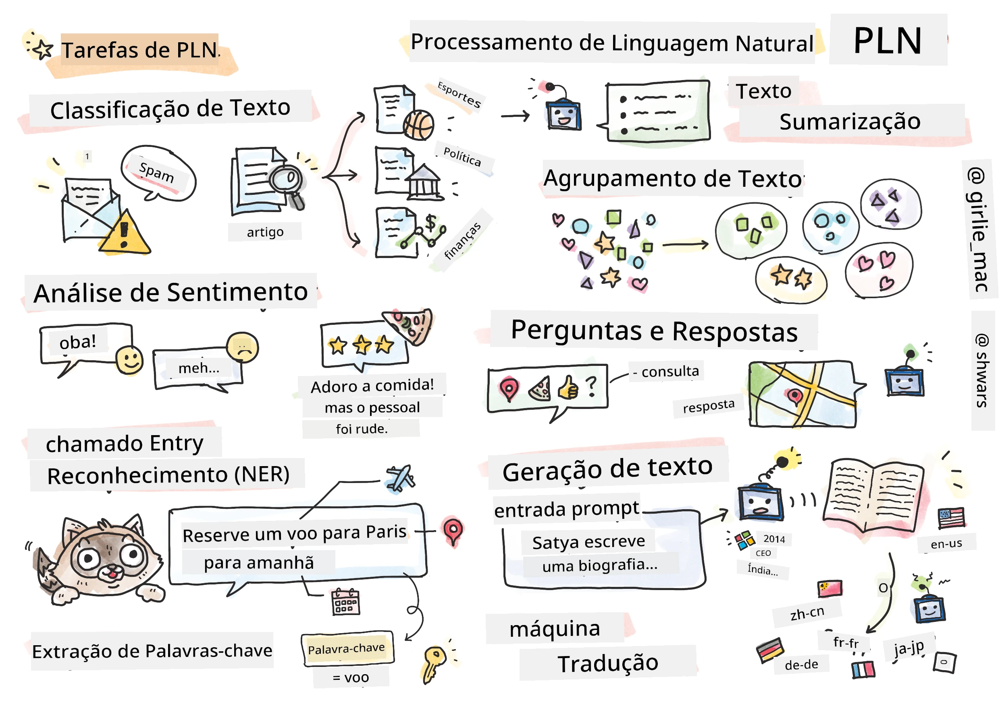

# Processamento de Linguagem Natural



Nesta seção, focaremos em usar Redes Neurais para lidar com tarefas relacionadas a **Processamento de Linguagem Natural (PLN)**. Existem muitos problemas de PLN que queremos que os computadores consigam resolver:

* **Classificação de texto** é um problema típico de classificação envolvendo sequências de texto. Exemplos incluem classificar mensagens de e-mail como spam vs. não-spam, ou categorizar artigos como esportes, negócios, política, etc. Além disso, ao desenvolver chat bots, muitas vezes precisamos entender o que o usuário quis dizer – neste caso, estamos lidando com **classificação de intenção**. Frequentemente, na classificação de intenção, precisamos lidar com muitas categorias.
* **Análise de sentimento** é um problema típico de regressão, onde precisamos atribuir um número (um sentimento) correspondente a quão positivo/negativo é o significado de uma frase. Uma versão mais avançada da análise de sentimento é a **análise de sentimento baseada em aspectos** (ABSA), onde atribuímos sentimentos não à frase inteira, mas a diferentes partes dela (aspectos), ex.: *Neste restaurante, gostei da cozinha, mas o ambiente estava péssimo*.
* **Reconhecimento de Entidades Nomeadas** (NER) refere-se ao problema de extrair certas entidades do texto. Por exemplo, podemos precisar entender que na frase *Preciso voar para Paris amanhã* a palavra *amanhã* refere-se a DATA, e *Paris* é um LOCAL.  
* **Extração de palavras-chave** é semelhante ao NER, mas precisamos extrair automaticamente palavras importantes para o significado da frase, sem pré-treinamento para tipos específicos de entidades.
* **Agrupamento de texto** pode ser útil quando queremos agrupar frases semelhantes, por exemplo, solicitações similares em conversas de suporte técnico.
* **Resposta a perguntas** refere-se à capacidade de um modelo responder a uma pergunta específica. O modelo recebe uma passagem de texto e uma pergunta como entradas e precisa fornecer um local no texto onde está contida a resposta da pergunta (ou, às vezes, gerar o texto da resposta).
* **Geração de texto** é a capacidade de um modelo gerar texto novo. Pode ser considerado como uma tarefa de classificação que prevê a próxima letra/palavra com base em algum *prompt de texto*. Modelos avançados de geração de texto, como GPT-3, são capazes de resolver outras tarefas de PLN como classificação usando uma técnica chamada [programação de prompt](https://towardsdatascience.com/software-3-0-how-prompting-will-change-the-rules-of-the-game-a982fbfe1e0) ou [engenharia de prompt](https://medium.com/swlh/openai-gpt-3-and-prompt-engineering-dcdc2c5fcd29)
* **Resumo de texto** é uma técnica para quando queremos que um computador "leia" um texto longo e o resuma em poucas frases.
* **Tradução automática** pode ser vista como uma combinação do entendimento do texto em uma língua e geração de texto em outra.

Inicialmente, a maioria das tarefas de PLN eram resolvidas usando métodos tradicionais como gramáticas. Por exemplo, na tradução automática, analisadores sintáticos eram usados para transformar a frase inicial em uma árvore sintática, depois estruturas semânticas de nível superior eram extraídas para representar o significado da frase, e baseado nesse significado e na gramática do idioma alvo, o resultado era gerado. Atualmente, muitas tarefas de PLN são resolvidas de forma mais eficaz usando redes neurais.

> Muitos métodos clássicos de PLN são implementados na biblioteca Python [Natural Language Processing Toolkit (NLTK)](https://www.nltk.org). Existe um ótimo [Livro do NLTK](https://www.nltk.org/book/) disponível online que aborda como diferentes tarefas de PLN podem ser resolvidas usando NLTK.

Em nosso curso, focaremos principalmente no uso de Redes Neurais para PLN, e usaremos o NLTK quando necessário.

Já aprendemos sobre o uso de redes neurais para lidar com dados tabulares e imagens. A principal diferença entre esses tipos de dados e texto é que o texto é uma sequência de comprimento variável, enquanto o tamanho da entrada no caso de imagens é conhecido antecipadamente. Enquanto redes convolucionais podem extrair padrões dos dados de entrada, os padrões em texto são mais complexos. Por exemplo, podemos ter negação separada do sujeito por um número arbitrário de palavras (ex.: *Eu não gosto de laranjas*, vs. *Eu não gosto daquelas grandes laranjas coloridas e saborosas*), e isso ainda deve ser interpretado como um padrão. Assim, para lidar com linguagem, precisamos introduzir novos tipos de redes neurais, como *redes recorrentes* e *transformers*.

## Instalar Bibliotecas

Se você estiver usando uma instalação local do Python para executar este curso, poderá precisar instalar todas as bibliotecas necessárias para PLN usando os seguintes comandos:

**Para PyTorch**
```bash
pip install -r requirements-pytorch.txt
```
**Para TensorFlow**
```bash
pip install -r requirements-tf.txt
```

> Você pode experimentar PLN com TensorFlow no [Microsoft Learn](https://docs.microsoft.com/learn/modules/intro-natural-language-processing-tensorflow/?WT.mc_id=academic-77998-cacaste)

## Aviso sobre GPU

Nesta seção, em alguns exemplos, treinaremos modelos bastante grandes.
* **Use um Computador com GPU**: É recomendável executar seus notebooks em um computador com GPU para reduzir o tempo de espera ao trabalhar com modelos grandes.
* **Limitações de Memória da GPU**: Executar na GPU pode levar a situações onde você fica sem memória de GPU, especialmente ao treinar modelos grandes.
* **Consumo de Memória da GPU**: A quantidade de memória da GPU consumida durante o treinamento depende de vários fatores, incluindo o tamanho do minibatch.
* **Minimize o Tamanho do Minibatch**: Se você encontrar problemas de memória de GPU, considere reduzir o tamanho do minibatch no seu código como uma solução potencial.
* **Liberação de Memória GPU no TensorFlow**: Versões antigas do TensorFlow podem não liberar a memória da GPU corretamente ao treinar múltiplos modelos dentro de um mesmo kernel Python. Para gerenciar o uso da memória da GPU de forma eficaz, você pode configurar o TensorFlow para alocar a memória da GPU somente conforme a necessidade.
* **Inclusão de Código**: Para configurar o TensorFlow para aumentar a alocação de memória da GPU apenas quando necessário, inclua o seguinte código em seus notebooks:

```python
physical_devices = tf.config.list_physical_devices('GPU') 
if len(physical_devices)>0:
    tf.config.experimental.set_memory_growth(physical_devices[0], True) 
```

Se você tem interesse em aprender sobre PLN a partir de uma perspectiva clássica de ML, visite [esta suíte de lições](https://github.com/microsoft/ML-For-Beginners/tree/main/6-NLP)

## Nesta Seção
Nesta seção, vamos aprender sobre:

* [Representando texto como tensores](13-TextRep/README.md)
* [Word Embeddings](14-Embeddings/README.md)
* [Modelagem de Linguagem](15-LanguageModeling/README.md)
* [Redes Neurais Recorrentes](16-RNN/README.md)
* [Redes Gerativas](17-GenerativeNetworks/README.md)
* [Transformers](18-Transformers/README.md)

---

<!-- CO-OP TRANSLATOR DISCLAIMER START -->
**Aviso Legal**:
Este documento foi traduzido usando o serviço de tradução por IA [Co-op Translator](https://github.com/Azure/co-op-translator). Embora nos esforcemos pela precisão, por favor, esteja ciente de que traduções automatizadas podem conter erros ou imprecisões. O documento original em seu idioma nativo deve ser considerado a fonte autorizada. Para informações críticas, recomenda-se tradução profissional humana. Não nos responsabilizamos por quaisquer mal-entendidos ou interpretações incorretas decorrentes do uso desta tradução.
<!-- CO-OP TRANSLATOR DISCLAIMER END -->