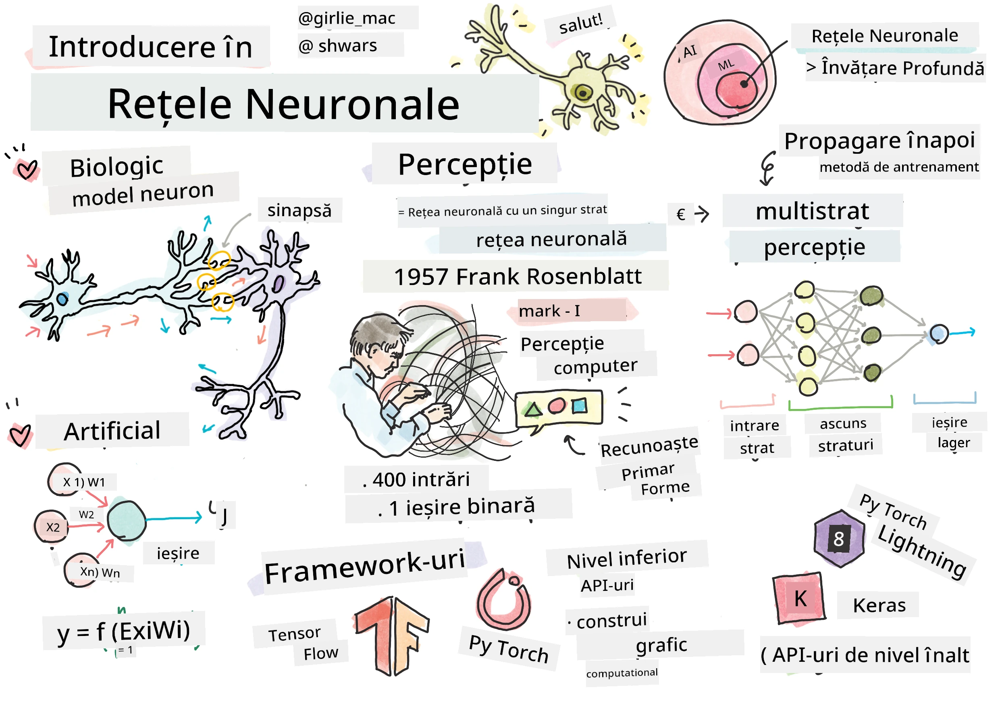
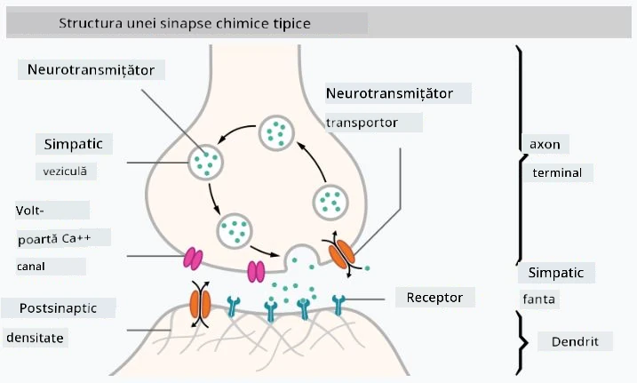
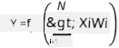

# Introducere în Rețelele Neuronale

Așa cum am discutat în introducere, unul dintre modurile de a atinge inteligența este să antrenăm un **model de calculator** sau un **creier artificial**. Din mijlocul secolului XX, cercetătorii au încercat diferite modele matematice, până când în ultimii ani această direcție s-a dovedit a fi extrem de de succes. Astfel de modele matematice ale creierului sunt numite **rețele neuronale**.

> Uneori rețelele neuronale sunt numite *Rețele Neuronale Artificiale*, ANN-uri, pentru a indica faptul că vorbim despre modele, nu rețele reale de neuroni.

## Învățarea Automată

Rețelele neuronale fac parte dintr-o disciplină mai largă numită **Învățare Automată**, al cărei scop este să folosească date pentru a antrena modele de calculator capabile să rezolve probleme. Învățarea Automată constituie o mare parte din Inteligența Artificială, însă nu acoperim în mod clasic Învățarea Automată în acest curriculum.

> Vizitați curriculum-ul nostru separat **[Învățarea Automată pentru Începători](http://github.com/microsoft/ml-for-beginners)** pentru a afla mai multe despre Învățarea Automată clasică.

În Învățarea Automată, presupunem că avem un set de date cu exemple **X**, și valorile de ieșire corespunzătoare **Y**. Exemplele sunt adesea vectori N-dimensionali care constau în **caracteristici**, iar ieșirile sunt numite **etichete**.

Vom considera cele două probleme cele mai comune în învățarea automată:

* **Clasificare**, unde trebuie să clasificăm un obiect de intrare în două sau mai multe clase.
* **Regresie**, unde trebuie să prezicem un număr numeric pentru fiecare dintre eșantioanele de intrare.

> Atunci când reprezentăm intrările și ieșirile ca tensori, setul de date de intrare este o matrice de dimensiune M&times;N, unde M este numărul de eșantioane și N este numărul de caracteristici. Etichetele de ieșire Y sunt vectorul de dimensiune M.

În acest curriculum, ne vom concentra doar pe modelele de rețele neuronale.

## Un Model al Neuronului

Din biologie știm că creierul nostru constă din celule neuronale (neuroni), fiecare având multiple "intrări" (dendrite) și o singură "ieșire" (axon). Atât dendritele, cât și axonii pot conduce semnale electrice, iar conexiunile dintre ele — cunoscute ca sinapse — pot prezenta grade variabile de conductivitate, reglate de neurotransmițători.

 | 
----|----
Neuron Real *([Imagine](https://en.wikipedia.org/wiki/Synapse#/media/File:SynapseSchematic_lines.svg) de pe Wikipedia)* | Neuron Artificial *(Imagine de Autor)*

Astfel, cel mai simplu model matematic al unui neuron conține mai multe intrări X1, ..., XN și o ieșire Y, precum și o serie de ponderi W1, ..., WN. O ieșire este calculată ca:

unde f este o **funcție de activare** non-liniară.

> Primele modele ale neuronului au fost descrise în lucrarea clasică [Un calcul logic al ideilor imanente în activitatea nervoasă](https://www.cs.cmu.edu/~./epxing/Class/10715/reading/McCulloch.and.Pitts.pdf) de Warren McCullock și Walter Pitts în 1943. Donald Hebb, în cartea sa "[Organizarea Comportamentului: O Teorie Neuropsihologică](https://books.google.com/books?id=VNetYrB8EBoC)", a propus modul în care aceste rețele pot fi antrenate.

## În această Secțiune

În această secțiune vom învăța despre:
* [Perceptron](03-Perceptron/README.md), unul dintre primele modele de rețele neuronale pentru clasificarea în două clase
* [Rețele multi-stratificate](04-OwnFramework/README.md) cu un caiet asociat [cum să construim propriul nostru cadru](04-OwnFramework/OwnFramework.ipynb)
* [Cadre pentru Rețele Neuronale](05-Frameworks/README.md), cu aceste caiete: [PyTorch](05-Frameworks/IntroPyTorch.ipynb) și [Keras/Tensorflow](05-Frameworks/IntroKerasTF.ipynb)
* [Overfitting](../../../../lessons/3-NeuralNetworks/05-Frameworks#overfitting)

---

<!-- CO-OP TRANSLATOR DISCLAIMER START -->
**Declinare a responsabilității**:
Acest document a fost tradus folosind serviciul de traducere AI [Co-op Translator](https://github.com/Azure/co-op-translator). În timp ce ne străduim pentru acuratețe, vă rugăm să rețineți că traducerile automate pot conține erori sau inexactități. Documentul original în limba sa nativă trebuie considerat sursa autorizată. Pentru informații critice, se recomandă traducerea profesională realizată de un om. Nu ne asumăm responsabilitatea pentru eventualele neînțelegeri sau interpretări greșite care decurg din utilizarea acestei traduceri.
<!-- CO-OP TRANSLATOR DISCLAIMER END -->