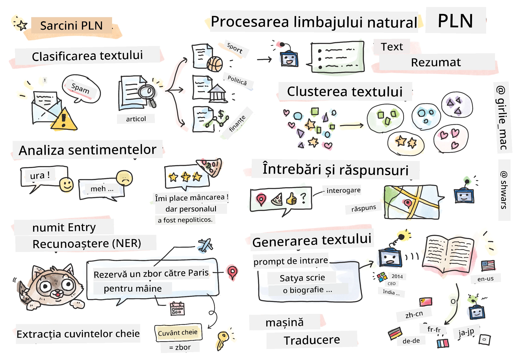

# Procesarea Limbajului Natural



În această secțiune, ne vom concentra pe utilizarea rețelelor neuronale pentru a gestiona sarcini legate de **Procesarea Limbajului Natural (NLP)**. Există multe probleme NLP pe care dorim să le poată rezolva computerele:

* **Clasificarea textului** este o problemă tipică de clasificare referitoare la secvențe de text. Exemple includ clasificarea mesajelor de e-mail ca spam vs. non-spam sau categorizarea articolelor ca sport, afaceri, politică etc. De asemenea, când dezvoltăm chatboți, adesea avem nevoie să înțelegem ce a vrut să spună un utilizator – în acest caz ne ocupăm de **clasificarea intențiilor**. De multe ori, în clasificarea intențiilor, trebuie să gestionăm multe categorii.
* **Analiza sentimentelor** este o problemă tipică de regresie, unde trebuie să atribuim un număr (un sentiment) corespunzător cât de pozitiv/negativ este înțelesul unei propoziții. O versiune mai avansată a analizei sentimentelor este **analiza sentimentelor bazată pe aspecte** (ABSA), unde atribuim sentiment nu întregii propoziții, ci diferitelor părți ale acesteia (aspecte), de ex. *În acest restaurant, mi-a plăcut bucătăria, dar atmosfera a fost groaznică*.
* **Recunoașterea entităților denumite** (NER) se referă la problema extragerii anumitor entități din text. De exemplu, poate trebuie să înțelegem că în expresia *Trebuie să zbor la Paris mâine* cuvântul *mâine* se referă la DATA, iar *Paris* este o LOCALIZARE.  
* **Extracția de cuvinte cheie** este asemănătoare cu NER, dar trebuie să extragem cuvintele importante pentru sensul propoziției automat, fără pregătire prealabilă pentru tipuri specifice de entități.
* **Clustering-ul textului** poate fi util atunci când dorim să grupăm împreună propoziții similare, de exemplu, cereri similare în conversațiile de suport tehnic.
* **Răspunsul la întrebări** se referă la abilitatea unui model de a răspunde la o întrebare specifică. Modelul primește ca intrare un pasaj de text și o întrebare și trebuie să furnizeze un loc în text unde se conține răspunsul la întrebare (sau, uneori, să genereze textul răspunsului).
* **Generarea de text** este capacitatea unui model de a genera text nou. Poate fi considerată o sarcină de clasificare care prezice următoarea literă/cuvânt pe baza unui *prompt textual*. Modelele avansate de generare a textului, cum ar fi GPT-3, pot rezolva și alte sarcini NLP, cum ar fi clasificarea, utilizând o tehnică numită [programare prin prompt](https://towardsdatascience.com/software-3-0-how-prompting-will-change-the-rules-of-the-game-a982fbfe1e0) sau [inginerie prompt](https://medium.com/swlh/openai-gpt-3-and-prompt-engineering-dcdc2c5fcd29)
* **Sumarizarea textului** este o tehnică prin care dorim ca un calculator să „citească” un text lung și să-l rezume în câteva propoziții.
* **Traducerea automată** poate fi văzută ca o combinație între înțelegerea textului într-o limbă și generarea textului într-o altă limbă.

Inițial, majoritatea sarcinilor NLP erau rezolvate folosind metode tradiționale, cum ar fi gramatica. De exemplu, în traducerea automată se foloseau parcurgeri pentru a transforma propoziția inițială într-un arbore sintactic, apoi erau extrase structuri semantice de nivel superior pentru a reprezenta sensul propoziției, iar pe baza acestui sens și a gramaticii limbii țintă se genera rezultatul. În prezent, multe sarcini NLP sunt rezolvate mai eficient folosind rețele neuronale.

> Multe metode clasice NLP sunt implementate în biblioteca Python [Natural Language Processing Toolkit (NLTK)](https://www.nltk.org). Există o carte grozavă [NLTK Book](https://www.nltk.org/book/) disponibilă online care acoperă cum pot fi rezolvate diferite sarcini NLP folosind NLTK.

În cursul nostru, ne vom concentra mai ales pe utilizarea rețelelor neuronale pentru NLP și vom folosi NLTK unde este nevoie.

Am învățat deja despre utilizarea rețelelor neuronale pentru a gestiona date tabelare și imagini. Diferența principală între aceste tipuri de date și text este că textul este o secvență de lungime variabilă, în timp ce dimensiunea intrării în cazul imaginilor este cunoscută dinainte. În timp ce rețelele convoluționale pot extrage tipare din datele de intrare, tiparele din text sunt mai complexe. De ex., putem avea o negație separată de subiect într-un mod arbitrar pentru multe cuvinte (de ex. *Nu îmi plac portocalele*, față de *Nu îmi plac acele portocale mari, colorate și gustoase*), iar acestea ar trebui totuși interpretate ca un singur tipar. Astfel, pentru a gestiona limbajul, trebuie să introducem noi tipuri de rețele neuronale, cum ar fi *rețele recurente* și *transformere*.

## Instalarea bibliotecilor

Dacă utilizați o instalare locală de Python pentru a rula acest curs, este posibil să trebuiască să instalați toate bibliotecile necesare pentru NLP folosind următoarele comenzi:

**Pentru PyTorch**
```bash
pip install -r requirements-pytorch.txt
```
**Pentru TensorFlow**
```bash
pip install -r requirements-tf.txt
```

> Puteți încerca NLP cu TensorFlow pe [Microsoft Learn](https://docs.microsoft.com/learn/modules/intro-natural-language-processing-tensorflow/?WT.mc_id=academic-77998-cacaste)

## Atenționare GPU

În această secțiune, în unele exemple vom antrena modele destul de mari.
* **Folosiți un calculator cu GPU**: Este recomandat să rulați notebook-urile pe un calculator cu GPU pentru a reduce timpii de așteptare când lucrați cu modele mari.
* **Limitări de memorie GPU**: Utilizarea unui GPU poate duce la situații în care memoria GPU se epuizează, mai ales când antrenați modele mari.
* **Consum de memorie GPU**: Cantitatea de memorie GPU consumată în timpul antrenamentului depinde de mai mulți factori, inclusiv dimensiunea minibatch-ului.
* **Minimizați dimensiunea minibatch-ului**: Dacă întâmpinați probleme cu memoria GPU, luați în considerare reducerea dimensiunii minibatch-ului în codul dvs. ca o posibilă soluție.
* **Eliberarea memoriei GPU în TensorFlow**: Versiunile mai vechi de TensorFlow pot să nu elibereze corect memoria GPU când antrenați mai multe modele într-un singur kernel Python. Pentru a gestiona eficient utilizarea memoriei GPU, puteți configura TensorFlow să aloce memoria GPU doar când este necesar.
* **Includerea codului**: Pentru a seta TensorFlow să crească alocarea memoriei GPU doar când este nevoie, includeți următorul cod în notebook-urile dumneavoastră:

```python
physical_devices = tf.config.list_physical_devices('GPU') 
if len(physical_devices)>0:
    tf.config.experimental.set_memory_growth(physical_devices[0], True) 
```

Dacă sunteți interesat să învățați despre NLP dintr-o perspectivă clasică ML, vizitați [această suită de lecții](https://github.com/microsoft/ML-For-Beginners/tree/main/6-NLP)

## În această secțiune
În această secțiune vom învăța despre:

* [Reprezentarea textului ca tensori](13-TextRep/README.md)
* [Word Embeddings](14-Embeddings/README.md)
* [Modelarea limbajului](15-LanguageModeling/README.md)
* [Rețele neuronale recurente](16-RNN/README.md)
* [Rețele generative](17-GenerativeNetworks/README.md)
* [Transformere](18-Transformers/README.md)

---

<!-- CO-OP TRANSLATOR DISCLAIMER START -->
**Declinare a responsabilității**:
Acest document a fost tradus folosind serviciul de traducere AI [Co-op Translator](https://github.com/Azure/co-op-translator). În timp ce ne străduim pentru acuratețe, vă rugăm să rețineți că traducerile automate pot conține erori sau inexactități. Documentul original în limba sa nativă trebuie considerat sursa autorizată. Pentru informații critice, se recomandă traducerea profesională realizată de un om. Nu ne asumăm responsabilitatea pentru eventualele neînțelegeri sau interpretări greșite care decurg din utilizarea acestei traduceri.
<!-- CO-OP TRANSLATOR DISCLAIMER END -->