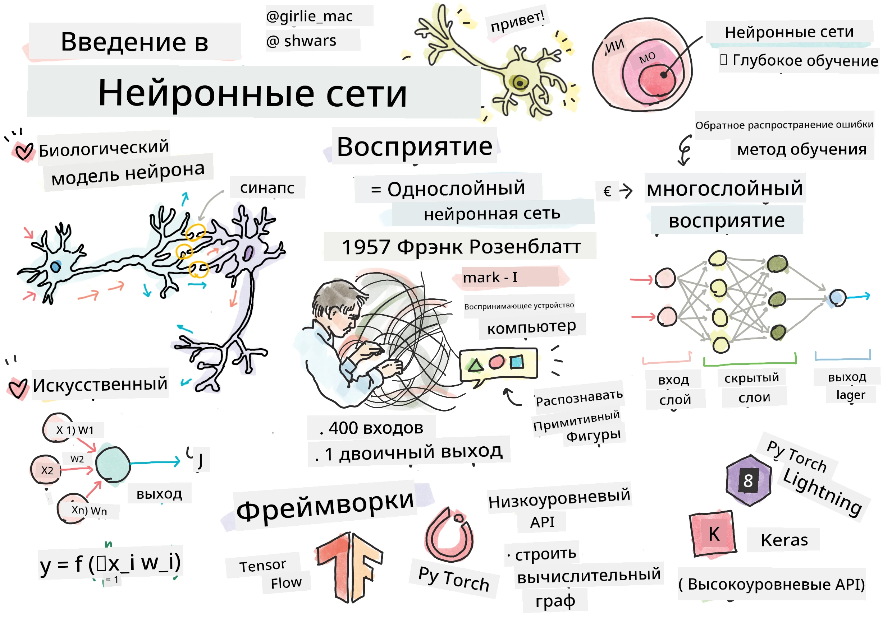
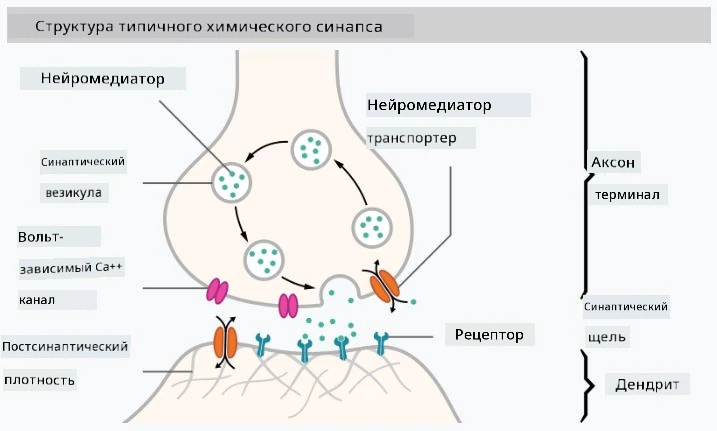

# Введение в нейронные сети

Как обсуждалось во введении, одним из способов достижения интеллекта является обучение **компьютерной модели** или **искусственного мозга**. С середины 20-го века исследователи пробовали разные математические модели, пока в последние годы это направление не показало огромный успех. Такие математические модели мозга называются **нейронными сетями**.

> Иногда нейронные сети называют *Искусственными нейронными сетями*, ИНС, чтобы указать, что речь идет о моделях, а не о реальных сетях нейронов.

## Машинное обучение

Нейронные сети — часть более широкой дисциплины под названием **Машинное обучение**, целью которой является использование данных для обучения компьютерных моделей, способных решать задачи. Машинное обучение составляет большую часть Искусственного Интеллекта, однако в этой программе мы не рассматриваем классическое МО.

> Посетите нашу отдельную программу **[Машинное обучение для начинающих](http://github.com/microsoft/ml-for-beginners)**, чтобы узнать больше о классическом машинном обучении.

В машинном обучении мы предполагаем, что у нас есть некоторый набор данных с примерами **X** и соответствующими выходными значениями **Y**. Примеры часто представляют собой N-мерные векторы, состоящие из **признаков**, а выходы называются **метками**.

Рассмотрим две наиболее распространённые задачи машинного обучения:

* **Классификация**, где необходимо отнести входной объект к двум или более классам.
* **Регрессия**, где необходимо предсказать числовое значение для каждого входного примера.

> При представлении входов и выходов в виде тензоров, входной набор данных представляет собой матрицу размера M&times;N, где M — количество примеров, а N — количество признаков. Выходные метки Y представляют собой вектор размера M.

В этой программе мы сосредоточимся только на моделях нейронных сетей.

## Модель нейрона

Из биологии известно, что наш мозг состоит из нервных клеток (нейронов), каждая из которых имеет несколько «входов» (дендритов) и один «выход» (аксону). И дендриты, и аксоны могут проводить электрические сигналы, а соединения между ними — синапсы — обладают различными уровнями проводимости, которая регулируется нейромедиаторами.

 | 
----|----
Реальный нейрон *([Изображение](https://en.wikipedia.org/wiki/Synapse#/media/File:SynapseSchematic_lines.svg) из Википедии)* | Искусственный нейрон *(изображение автора)*

Таким образом, самая простая математическая модель нейрона содержит несколько входов X1, ..., XN и один выход Y, а также набор весов W1, ..., WN. Выход вычисляется как:

где f — некоторая нелинейная **функция активации**.

> Ранние модели нейрона были описаны в классической статье [Логическое исчисление идей, имманентных нервной деятельности](https://www.cs.cmu.edu/~./epxing/Class/10715/reading/McCulloch.and.Pitts.pdf) Уоррена МакКаллаха и Уолтера Питтса в 1943 году. Дональд Хебб в своей книге "[Организация поведения: нейропсихологическая теория](https://books.google.com/books?id=VNetYrB8EBoC)" предложил способ обучения таких сетей.

## В этом разделе

В этом разделе мы изучим:
* [Перцептрон](03-Perceptron/README.md), одну из первых моделей нейронных сетей для задачи двуклассовой классификации
* [Многослойные сети](04-OwnFramework/README.md) с сопутствующей тетрадкой [как построить собственный фреймворк](04-OwnFramework/OwnFramework.ipynb)
* [Фреймворки нейронных сетей](05-Frameworks/README.md) с этими тетрадками: [PyTorch](05-Frameworks/IntroPyTorch.ipynb) и [Keras/Tensorflow](05-Frameworks/IntroKerasTF.ipynb)
* [Переобучение](../../../../lessons/3-NeuralNetworks/05-Frameworks#overfitting)

---

<!-- CO-OP TRANSLATOR DISCLAIMER START -->
**Отказ от ответственности**:
Этот документ был переведен с использованием сервиса машинного перевода [Co-op Translator](https://github.com/Azure/co-op-translator). Несмотря на наши усилия по обеспечению точности, имейте в виду, что автоматический перевод может содержать ошибки или неточности. Оригинальный документ на его исходном языке следует считать авторитетным источником. Для получения критически важной информации рекомендуется обратиться к профессиональному человеческому переводу. Мы не несем ответственности за любые недоразумения или неправильные толкования, возникшие в результате использования этого перевода.
<!-- CO-OP TRANSLATOR DISCLAIMER END -->