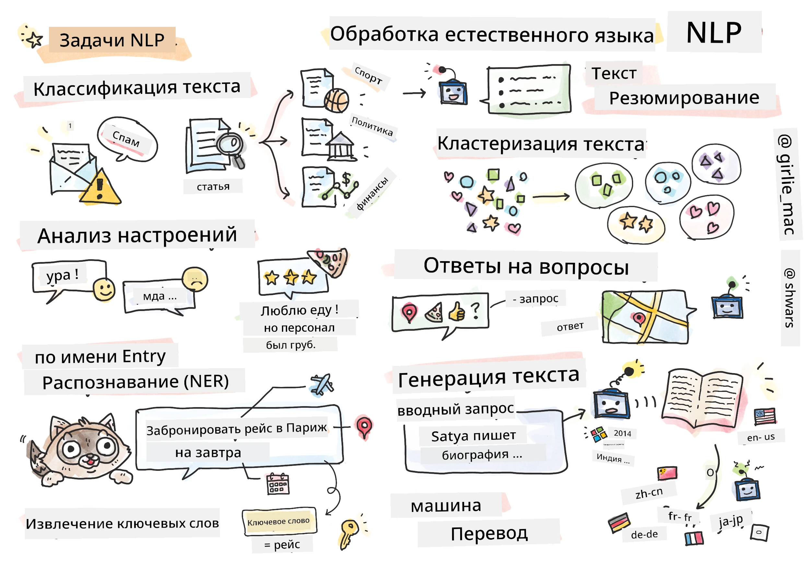

# Обработка естественного языка



В этом разделе мы сосредоточимся на использовании нейронных сетей для решения задач, связанных с **обработкой естественного языка (NLP)**. Существует множество проблем NLP, которые мы хотим, чтобы компьютеры могли решать:

* **Классификация текста** — типичная задача классификации, связанная с последовательностями текста. Примеры включают классификацию электронных писем как спам или не спам, либо категоризацию статей по темам: спорт, бизнес, политика и т.д. Также при разработке чат-ботов часто нужно понять, что пользователь хотел сказать — в этом случае мы имеем дело с **классификацией намерений**. Часто в задачах классификации намерений нужно обрабатывать множество категорий.
* **Анализ настроений** — типичная задача регрессии, где нужно присвоить число (настроение), отражающее насколько позитивно или негативно значение предложения. Более продвинутый вариант анализа настроений — это **анализ настроений по аспектам** (ABSA), где настроение присваивается не всему предложению целиком, а его разным частям (аспектам), например, *В этом ресторане мне понравилась кухня, но атмосфера была ужасной*.
* **Распознавание именованных сущностей** (NER) — это задача извлечения определённых сущностей из текста. Например, нужно понять, что в фразе *Мне нужно полететь в Париж завтра* слово *завтра* относится к ДАТЕ, а *Париж* — к МЕСТОПОЛОЖЕНИЮ.  
* **Извлечение ключевых слов** похоже на NER, но предполагает автоматическое извлечение слов, важных для смысла предложения, без предварительного обучения на конкретные типы сущностей.
* **Кластеризация текста** может быть полезна, когда нужно сгруппировать похожие предложения, например, схожие запросы в разговорах службы технической поддержки.
* **Ответы на вопросы** — это способность модели отвечать на конкретный вопрос. Модель получает на вход текст и вопрос, и должна определить место в тексте, где содержится ответ (или, иногда, сгенерировать текст ответа).
* **Генерация текста** — это способность модели создавать новый текст. Это можно рассматривать как задачу классификации, которая предсказывает следующую букву/слово на основе некоторого *текстового подсказки*. Продвинутые модели генерации текста, такие как GPT-3, способны решать и другие задачи обработки естественного языка, такие как классификация, используя метод, называемый [prompt programming](https://towardsdatascience.com/software-3-0-how-prompting-will-change-the-rules-of-the-game-a982fbfe1e0) или [prompt engineering](https://medium.com/swlh/openai-gpt-3-and-prompt-engineering-dcdc2c5fcd29)
* **Суммаризация текста** — это техника, при которой мы хотим, чтобы компьютер "прочитал" длинный текст и кратко изложил его в нескольких предложениях.
* **Машинный перевод** можно рассматривать как сочетание понимания текста на одном языке и генерации текста на другом языке.

Изначально большинство задач обработки естественного языка решались с помощью традиционных методов, таких как грамматики. Например, в машинном переводе парсеры использовались для преобразования исходного предложения в синтаксическое дерево, затем извлекались более высокоуровневые семантические структуры для представления смысла предложения, и на основе этого смысла и грамматики целевого языка генерировался результат. В настоящее время многие задачи обработки естественного языка эффективнее решаются с использованием нейронных сетей.

> Многие классические методы обработки естественного языка реализованы в Python-библиотеке [Natural Language Processing Toolkit (NLTK)](https://www.nltk.org). В сети доступна отличная [книга по NLTK](https://www.nltk.org/book/), в которой рассказывается, как разные задачи обработки естественного языка можно решить с помощью NLTK.

В нашем курсе мы в основном сосредоточимся на использовании нейронных сетей для обработки естественного языка, а NLTK будем использовать там, где это необходимо.

Мы уже изучали использование нейронных сетей для работы с табличными данными и изображениями. Главное отличие этих типов данных от текста в том, что текст — это последовательность переменной длины, тогда как размер входных данных в случае изображений известен заранее. В то время как сверточные сети могут извлекать паттерны из входных данных, паттерны в тексте сложнее. Например, отрицание может быть отделено от подлежащего произвольным количеством слов (например, *I do not like oranges*, и *I do not like those big colorful tasty oranges*), и это всё равно должно интерпретироваться как один паттерн. Следовательно, для работы с языком нам нужны новые типы нейронных сетей, такие как *рекуррентные сети* и *трансформеры*.

## Установка библиотек

Если вы используете локальную установку Python для прохождения этого курса, возможно, вам потребуется установить все необходимые библиотеки для NLP с помощью следующих команд:

**Для PyTorch**
```bash
pip install -r requirements-pytorch.txt
```
**Для TensorFlow**
```bash
pip install -r requirements-tf.txt
```

> Вы можете попробовать NLP с TensorFlow на [Microsoft Learn](https://docs.microsoft.com/learn/modules/intro-natural-language-processing-tensorflow/?WT.mc_id=academic-77998-cacaste)

## Предупреждение о GPU

В этом разделе в некоторых примерах мы будем обучать достаточно большие модели.
* **Используйте компьютер с поддержкой GPU**: Рекомендуется запускать ноутбуки на компьютере с поддержкой GPU, чтобы сократить время ожидания при работе с большими моделями.
* **Ограничения памяти GPU**: При работе на GPU может возникнуть ситуация, когда недостаточно видеопамяти GPU, особенно при обучении больших моделей.
* **Потребление видеопамяти GPU**: Объем видеопамяти, используемый во время обучения, зависит от различных факторов, включая размер мини-батча.
* **Минимизируйте размер мини-батча**: Если возникают проблемы с памятью GPU, рассмотрите возможность уменьшения размера мини-батча в вашем коде.
* **Освобождение памяти GPU в TensorFlow**: Старые версии TensorFlow могут некорректно освобождать память GPU при обучении нескольких моделей в одном ядре Python. Для эффективного управления использованием памяти GPU вы можете настроить TensorFlow так, чтобы видеопамять выделялась по мере необходимости.
* **Включение кода**: Чтобы настроить TensorFlow на динамическое выделение памяти GPU, добавьте следующий код в ваши ноутбуки:

```python
physical_devices = tf.config.list_physical_devices('GPU') 
if len(physical_devices)>0:
    tf.config.experimental.set_memory_growth(physical_devices[0], True) 
```

Если вам интересно изучать NLP с классической точки зрения машинного обучения, посетите [этот набор уроков](https://github.com/microsoft/ML-For-Beginners/tree/main/6-NLP)

## В этом разделе
В этом разделе мы изучим:

* [Представление текста в виде тензоров](13-TextRep/README.md)
* [Векторные представления слов](14-Embeddings/README.md)
* [Языковое моделирование](15-LanguageModeling/README.md)
* [Рекуррентные нейронные сети](16-RNN/README.md)
* [Генеративные сети](17-GenerativeNetworks/README.md)
* [Трансформеры](18-Transformers/README.md)

---

<!-- CO-OP TRANSLATOR DISCLAIMER START -->
**Отказ от ответственности**:
Этот документ был переведен с использованием сервиса машинного перевода [Co-op Translator](https://github.com/Azure/co-op-translator). Несмотря на наши усилия по обеспечению точности, имейте в виду, что автоматический перевод может содержать ошибки или неточности. Оригинальный документ на его исходном языке следует считать авторитетным источником. Для получения критически важной информации рекомендуется обратиться к профессиональному человеческому переводу. Мы не несем ответственности за любые недоразумения или неправильные толкования, возникшие в результате использования этого перевода.
<!-- CO-OP TRANSLATOR DISCLAIMER END -->