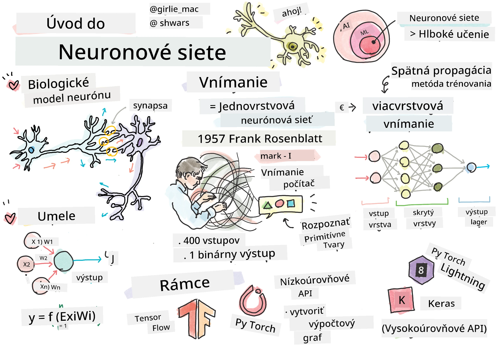
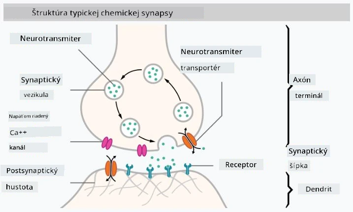

# Úvod do neurónových sietí

Ako sme diskutovali v úvode, jedným zo spôsobov, ako dosiahnuť inteligenciu, je vytrénovať **počítačový model** alebo **umelý mozog**. Od polovice 20. storočia vedci skúšali rôzne matematické modely, až kým sa v posledných rokoch tento smer ukázal ako veľmi úspešný. Takéto matematické modely mozgu sa nazývajú **neurónové siete**.

> Niekedy sa neurónové siete nazývajú *umelé neurónové siete*, ANS, aby sa naznačilo, že hovoríme o modeloch, nie skutočných sieťach neurónov.

## Strojové učenie

Neurónové siete sú súčasťou širšej disciplíny nazývanej **strojové učenie**, ktorej cieľom je použiť dáta na vytrénovanie počítačových modelov, ktoré sú schopné riešiť problémy. Strojové učenie tvorí veľkú časť umelej inteligencie, avšak v tomto kurze nebudeme pokrývať klasické ML.

> Navštívte náš samostatný **[kurz Strojové učenie pre začiatočníkov](http://github.com/microsoft/ml-for-beginners)**, aby ste sa dozvedeli viac o klasickom strojovom učení.

V strojovom učení predpokladáme, že máme nejakú množinu príkladov **X** a zodpovedajúce výstupné hodnoty **Y**. Príklady sú často N-dimenzionálne vektory zložené z **vlastností** a výstupy sa nazývajú **štítky**.

Budeme sa zaoberať dvoma najbežnejšími problémami strojového učenia:

* **Klasifikácia**, kde potrebujeme zaradiť vstupný objekt do dvoch alebo viacerých tried.
* **Regresia**, kde potrebujeme predpovedať číselnú hodnotu pre každý vstupný príklad.

> Pri reprezentácii vstupov a výstupov ako tenzorov je vstupný dataset maticou veľkosti M&times;N, kde M je počet príkladov a N je počet vlastností. Výstupné štítky Y sú vektor veľkosti M.

V tomto kurze sa budeme zameriavať len na modely neurónových sietí.

## Model neurónu

Z biológie vieme, že náš mozog sa skladá z neurálnych buniek (neurónov), z ktorých každý má viacero "vstupov" (dendrity) a jeden "výstup" (axon). Dendrity aj axóny vedú elektrické signály a spojenia medzi nimi – známe ako synapsy – môžu mať rôzne stupne vodivosti, ktoré sú riadené neurotransmitermi.

 | 
----|----
Skutočný neurón *([Obrázok](https://en.wikipedia.org/wiki/Synapse#/media/File:SynapseSchematic_lines.svg) z Wikipédie)* | Umelý neurón *(Obrázok autora)*

Takže najjednoduchší matematický model neurónu obsahuje niekoľko vstupov X1, ..., XN a jeden výstup Y, a sériu váh W1, ..., WN. Výstup sa vypočíta ako:

kde f je nejaká nelineárna **aktivačná funkcia**.

> Prvé modely neurónov boli popísané v klasickom článku [A logical calculus of the ideas immanent in nervous activity](https://www.cs.cmu.edu/~./epxing/Class/10715/reading/McCulloch.and.Pitts.pdf) od Warrena McCullocka a Waltera Pitta z roku 1943. Donald Hebb vo svojej knihe "[The Organization of Behavior: A Neuropsychological Theory](https://books.google.com/books?id=VNetYrB8EBoC)" navrhol spôsob, ako takéto siete trénovať.

## V tejto sekcii

V tejto sekcii sa naučíme o:
* [Perceptron](03-Perceptron/README.md), jednom z najskorších modelov neurónových sietí pre dvojtriednu klasifikáciu
* [Viacvrstvových sieťach](04-OwnFramework/README.md) s doplnkovým zápisníkom [ako si vybudovať vlastný framework](04-OwnFramework/OwnFramework.ipynb)
* [Frameworky neurónových sietí](05-Frameworks/README.md), s týmito zápisníkmi: [PyTorch](05-Frameworks/IntroPyTorch.ipynb) a [Keras/Tensorflow](05-Frameworks/IntroKerasTF.ipynb)
* [Overfitting](../../../../lessons/3-NeuralNetworks/05-Frameworks#overfitting)

---

<!-- CO-OP TRANSLATOR DISCLAIMER START -->
**Vyhlásenie o zodpovednosti**:
Tento dokument bol preložený pomocou AI prekladateľskej služby [Co-op Translator](https://github.com/Azure/co-op-translator). Hoci sa snažíme o presnosť, vezmite prosím na vedomie, že automatické preklady môžu obsahovať chyby alebo nepresnosti. Pôvodný dokument v jeho natívnom jazyku by mal byť považovaný za autoritatívny zdroj. Pre kritické informácie sa odporúča profesionálny ľudský preklad. Nie sme zodpovední za žiadne nedorozumenia alebo nesprávne interpretácie vyplývajúce z použitia tohto prekladu.
<!-- CO-OP TRANSLATOR DISCLAIMER END -->