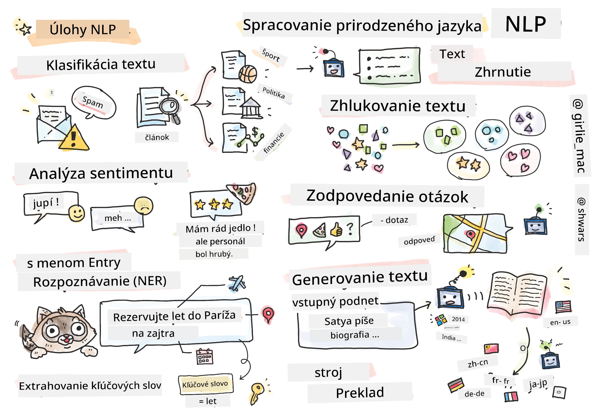

# Spracovanie prirodzeného jazyka



V tejto sekcii sa zameriame na využitie neurónových sietí na riešenie úloh súvisiacich so **spracovaním prirodzeného jazyka (NLP)**. Existuje mnoho problémov NLP, ktoré chceme, aby počítače dokázali riešiť:

* **Klasifikácia textu** je typický klasifikačný problém týkajúci sa textových sekvencií. Príklady zahŕňajú klasifikáciu e-mailových správ ako spam vs. nespam alebo kategorizáciu článkov ako šport, obchod, politika atď. Tiež pri vývoji chatbotov často potrebujeme pochopiť, čo používateľ chcel povedať – v tomto prípade ide o **klasifikáciu zámeru**. Často musíme pri klasifikácii zámeru pracovať s mnohými kategóriami.
* **Analýza sentimentu** je typický regresný problém, kde je potrebné priradiť číselnú hodnotu (sentiment) určujúcu, ako pozitívny/negatívny je význam vety. Pokročilejšia verzia analýzy sentimentu je **analýza sentimentu založená na aspektoch** (ABSA), kde priraďujeme sentiment nielen celej vete, ale rôznym jej častiam (aspektom), napr. *V tejto reštaurácii sa mi páčila kuchyňa, ale atmosféra bola hrozná*.
* **Rozpoznávanie pomenovaných entít** (NER) sa týka problému vyťaženia určitých entít z textu. Napríklad, môžeme potrebovať pochopiť, že vo vetě *Musím zajtra letieť do Paríža* slovo *zajtra* odkazuje na DÁTUM a *Paríž* je MIESTO.  
* **Extrahovanie kľúčových slov** je podobné NER, ale potrebujeme automaticky extrahovať slová dôležité pre význam vety bez predtrénovania pre konkrétne typy entít.
* **Zhlukovanie textu** môže byť užitočné, keď chceme zoskupiť podobné vety, napríklad podobné požiadavky v rozhovoroch technickej podpory.
* **Odpovedanie na otázky** je schopnosť modelu odpovedať na konkrétnu otázku. Model dostane ako vstupy textový úryvok a otázku, a má nájsť miesto v texte, kde je obsahovaná odpoveď (alebo niekedy vygenerovať samotný text odpovede).
* **Generovanie textu** je schopnosť modelu vytvárať nový text. Môže sa považovať za klasifikačný problém, ktorý predpovedá nasledujúce písmeno/slovo na základe určitého *textového podnetu*. Pokročilé modely generovania textu, ako GPT-3, dokážu riešiť aj iné NLP úlohy ako klasifikáciu pomocou techniky nazývanej [programovanie podnetmi](https://towardsdatascience.com/software-3-0-how-prompting-will-change-the-rules-of-the-game-a982fbfe1e0) alebo [inžinierstvo podnetov](https://medium.com/swlh/openai-gpt-3-and-prompt-engineering-dcdc2c5fcd29)
* **Zhrnutie textu** je technika, kedy chceme, aby počítač „prečítal“ dlhý text a zhrnul ho v niekoľkých vetách.
* **Strojový preklad** možno považovať za kombináciu porozumenia textu v jednom jazyku a generovania textu v inom jazyku.

Spočiatku sa väčšina úloh NLP riešila tradičnými metódami ako gramatiky. Napríklad pri strojovom preklade sa používali parsre na transformáciu počiatočnej vety do syntaktického stromu, potom sa extrahovali vyššie úrovne sémantických štruktúr predstavujúcich význam vety a na základe tohto významu a gramatiky cieľového jazyka sa generoval výsledok. Dnes sa mnohé NLP úlohy efektívnejšie riešia pomocou neurónových sietí.

> Mnohé klasické metódy NLP sú implementované v Pythonove knižnici [Natural Language Processing Toolkit (NLTK)](https://www.nltk.org). Existuje skvelá [NLTK kniha](https://www.nltk.org/book/) dostupná online, ktorá pokrýva, ako sa rôzne NLP úlohy dajú riešiť pomocou NLTK.

V našom kurze sa budeme prevažne zameriavať na využitie neurónových sietí pre NLP a v prípade potreby budeme používať NLTK.

Už sme sa naučili, ako používať neurónové siete na prácu s tabuľkovými dátami a obrazmi. Hlavný rozdiel medzi týmito typmi dát a textom je v tom, že text je sekvencia s premennou dĺžkou, zatiaľ čo veľkosť vstupu v prípade obrazov je vopred známa. Kým konvolučné siete dokážu vyťažiť vzory zo vstupných dát, vzory v texte sú komplikovanejšie. Napríklad negácia môže byť od subjektu vzdialená o ľubovoľný počet slov (napr. *Nemám rád pomaranče* vs. *Nemám rád tie veľké farebné chutné pomaranče*), a to by sa stále malo interpretovať ako jeden vzor. Na zvládnutie jazyka teda potrebujeme zaviesť nové typy neurónových sietí, ako sú *rekurentné siete* a *transformery*.

## Inštalácia knižníc

Ak používate lokálnu inštaláciu Pythonu na spustenie tohto kurzu, môže byť potrebné nainštalovať všetky požadované knižnice pre NLP pomocou nasledujúcich príkazov:

**Pre PyTorch**
```bash
pip install -r requirements-pytorch.txt
```
**Pre TensorFlow**
```bash
pip install -r requirements-tf.txt
```

> NLP môžete vyskúšať s TensorFlow na [Microsoft Learn](https://docs.microsoft.com/learn/modules/intro-natural-language-processing-tensorflow/?WT.mc_id=academic-77998-cacaste)

## Upozornenie na GPU

V tejto sekcii budeme v niektorých príkladoch trénovať pomerne veľké modely.
* **Používajte počítač s GPU**: Odporúča sa spúšťať notebooky na počítači s povoleným GPU, aby sa znížili časy čakania pri práci s veľkými modelmi.
* **Obmedzenia pamäte GPU**: Práca na GPU môže viesť k situáciám, keď vám dôjde pamäť GPU, najmä pri trénovaní veľkých modelov.
* **Spotreba pamäte GPU**: Množstvo pamäte GPU, ktorú trénovanie spotrebuje, závisí od rôznych faktorov vrátane veľkosti minibatchu.
* **Minimalizujte veľkosť minibatchu**: Ak narazíte na problémy s pamäťou GPU, zvážte zmenšenie veľkosti minibatchu vo vašom kóde ako možné riešenie.
* **Uvoľňovanie pamäte GPU v TensorFlow**: Staršie verzie TensorFlow nemusia správne uvoľniť pamäť GPU pri trénovaní viacerých modelov v jednom Pythone jadre. Na efektívne riadenie využitia pamäte GPU môžete TensorFlow nastaviť tak, aby pamäť alokoval iba podľa potreby.
* **Zahrnutie kódu**: Ak chcete nastaviť TensorFlow tak, aby alokoval pamäť GPU postupne, zahrňte do vašich notebookov nasledujúci kód:

```python
physical_devices = tf.config.list_physical_devices('GPU') 
if len(physical_devices)>0:
    tf.config.experimental.set_memory_growth(physical_devices[0], True) 
```

Ak máte záujem o učenie sa NLP z klasickej perspektívy strojového učenia, navštívte [túto sadu lekcií](https://github.com/microsoft/ML-For-Beginners/tree/main/6-NLP)

## V tejto sekcii
V tejto sekcii sa naučíme o:

* [Reprezentácii textu ako tenzorov](13-TextRep/README.md)
* [Vstupoch slov](14-Embeddings/README.md)
* [Jazykovom modelovaní](15-LanguageModeling/README.md)
* [Rekurentných neurónových sieťach](16-RNN/README.md)
* [Generatívnych sieťach](17-GenerativeNetworks/README.md)
* [Transformeroch](18-Transformers/README.md)

---

<!-- CO-OP TRANSLATOR DISCLAIMER START -->
**Vyhlásenie o zodpovednosti**:
Tento dokument bol preložený pomocou AI prekladateľskej služby [Co-op Translator](https://github.com/Azure/co-op-translator). Hoci sa snažíme o presnosť, vezmite prosím na vedomie, že automatické preklady môžu obsahovať chyby alebo nepresnosti. Pôvodný dokument v jeho natívnom jazyku by mal byť považovaný za autoritatívny zdroj. Pre kritické informácie sa odporúča profesionálny ľudský preklad. Nie sme zodpovední za žiadne nedorozumenia alebo nesprávne interpretácie vyplývajúce z použitia tohto prekladu.
<!-- CO-OP TRANSLATOR DISCLAIMER END -->