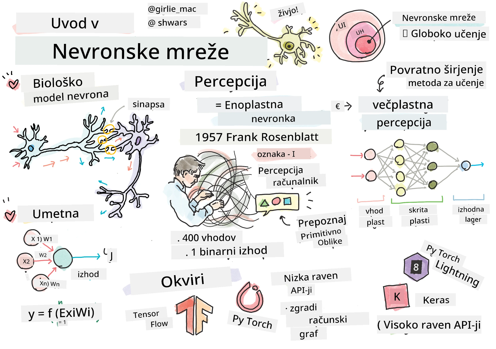
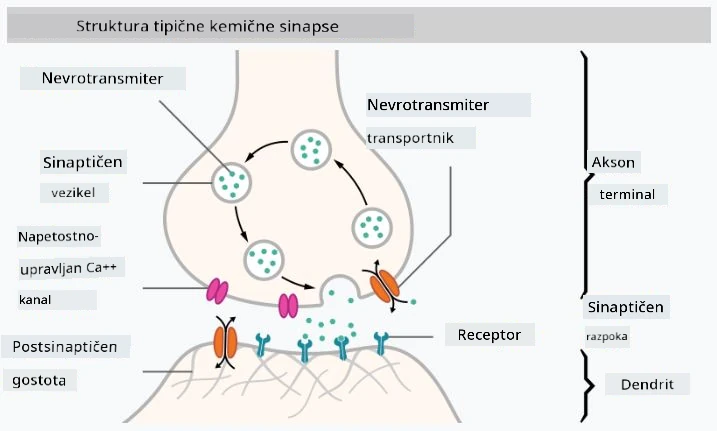

# Uvod v nevronske mreže

Kot smo omenili v uvodu, je eden od načinov za dosego inteligence treniranje **računalniškega modela** ali **umetnega možgana**. Od sredine 20. stoletja so raziskovalci preizkušali različne matematične modele, dokler se zadnja leta ta smer ni izkazala za zelo uspešno. Takšni matematični modeli možganov se imenujejo **nevronske mreže**.

> Včasih nevronske mreže imenujemo *umetne nevronske mreže*, ANN, da bi poudarili, da govorimo o modelih, ne o pravih mrežah nevronov.

## Strojno učenje

Nevronske mreže so del širše discipline, imenovane **strojno učenje**, katere cilj je uporaba podatkov za treniranje računalniških modelov, ki lahko rešujejo probleme. Strojno učenje predstavlja velik del umetne inteligence, vendar v tem kurikulu ne obravnavamo klasičnega strojnega učenja.

> Obiščite naš ločen **[Strojno učenje za začetnike](http://github.com/microsoft/ml-for-beginners)**, da se naučite več o klasičnem strojnem učenju.

V strojnem učenju predpostavljamo, da imamo nek nabor podatkov primerov **X** in pripadajoče izhodne vrednosti **Y**. Primeri so pogosto N-dimenzionalni vektorji, ki vsebujejo **značilke**, izhodi pa se imenujejo **oznake**.

Obravnavali bomo dve najpogostejši težavi strojnemu učenju:

* **Klasifikacija**, kjer je potrebno vhodni objekt razvrstiti v dve ali več razredov.
* **Regresija**, kjer moramo za vsak vhodni vzorec napovedati številčno vrednost.

> Pri predstavitvi vhodov in izhodov kot tenzorjev je vhodni nabor podatkov matrika velikosti M&times;N, kjer je M število vzorcev, N pa število značilk. Izhodne oznake Y so vektor velikosti M.

V tem kurikulu se bomo osredotočili samo na modele nevronskih mrež.

## Model nevrona

Iz biologije vemo, da naš možgan sestavljajo nevronske celice (nevroni), od katerih ima vsak več "vhodov" (dendriti) in en sam "izhod" (akson). Tako dendriti kot aksoni prenašajo električne signale, povezave med njimi – znane kot sinapse – pa lahko kažejo različne stopnje prevodnosti, ki jih uravnavajo nevrotransmitorji.

 | 
----|----
Pravi nevron *([Slika](https://en.wikipedia.org/wiki/Synapse#/media/File:SynapseSchematic_lines.svg) iz Wikipedije)* | Umetni nevron *(Slika avtorja)*

Tako najpreprostejši matematični model nevrona vsebuje več vhodov X1, ..., XN in izhod Y ter vrsto uteži W1, ..., WN. Izhod se izračuna kot:

kjer je f neka nelinearna **aktivacijska funkcija**.

> Zgodnji modeli nevronov so bili opisani v klasičnem članku [A logical calculus of the ideas immanent in nervous activity](https://www.cs.cmu.edu/~./epxing/Class/10715/reading/McCulloch.and.Pitts.pdf) Warrena McCullocka in Walterja Pittsa iz leta 1943. Donald Hebb je v svoji knjigi "[The Organization of Behavior: A Neuropsychological Theory](https://books.google.com/books?id=VNetYrB8EBoC)" predstavil način treniranja teh mrež.

## V tem poglavju

V tem poglavju se bomo naučili o:
* [Perceptronu](03-Perceptron/README.md), enem od prvih modelov nevronskih mrež za klasifikacijo dveh razredov
* [Večplastnih mrežah](04-OwnFramework/README.md) s priloženim zvezkom [kako zgraditi svoj lasten okvir](04-OwnFramework/OwnFramework.ipynb)
* [Okvirih za nevronske mreže](05-Frameworks/README.md), s temi zvezki: [PyTorch](05-Frameworks/IntroPyTorch.ipynb) in [Keras/Tensorflow](05-Frameworks/IntroKerasTF.ipynb)
* [Preprileganju](../../../../lessons/3-NeuralNetworks/05-Frameworks#overfitting)

---

<!-- CO-OP TRANSLATOR DISCLAIMER START -->
**Omejitev odgovornosti**:
Ta dokument je bil preveden z uporabo AI prevajalske storitve [Co-op Translator](https://github.com/Azure/co-op-translator). Čeprav si prizadevamo za natančnost, vas prosimo, da upoštevate, da avtomatizirani prevodi lahko vsebujejo napake ali netočnosti. Izvirni dokument v njegovem izvirnem jeziku je treba obravnavati kot avtoritativni vir. Za kritične informacije je priporočljiv strokovni človeški prevod. Ne odgovarjamo za morebitna nesporazume ali napačne interpretacije, ki izhajajo iz uporabe tega prevoda.
<!-- CO-OP TRANSLATOR DISCLAIMER END -->