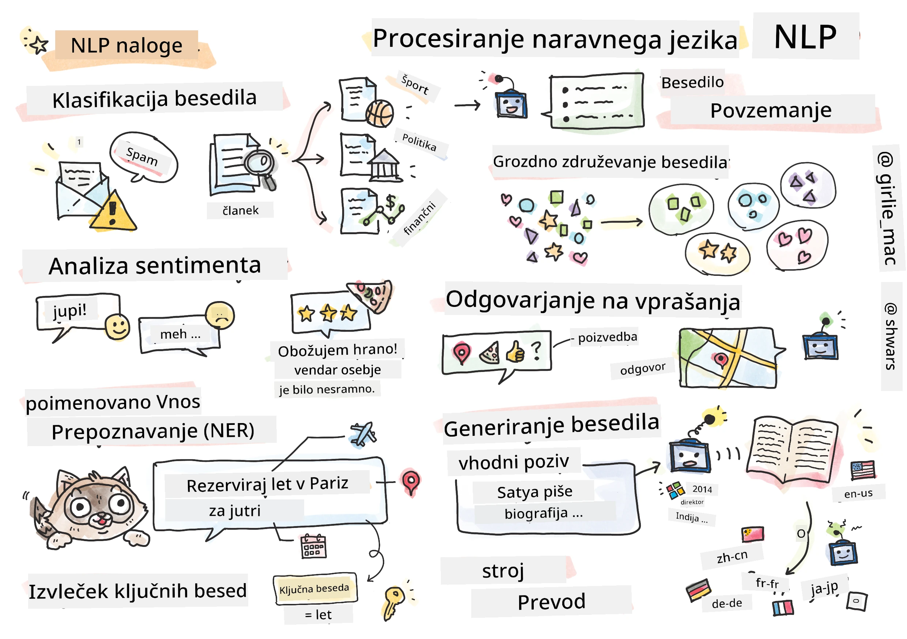

# Procesiranje naravnega jezika



V tem poglavju se bomo osredotočili na uporabo nevronskih mrež za reševanje nalog povezanih z **procesiranjem naravnega jezika (NLP)**. Obstaja veliko problemov NLP, ki jih želimo, da jih računalniki znajo rešiti:

* **Klasifikacija besedil** je tipičen problem klasifikacije, ki se nanaša na tekstovne zaporedja. Primeri vključujejo razvrščanje e-poštnih sporočil kot nezaželeno pošto ali ne, ali kategorizacijo člankov kot šport, poslovanje, politika, itd. Tudi pri razvoju klepetalnih robotov pogosto potrebujemo razumeti, kaj je uporabnik želel povedati -- v tem primeru gre za **klasifikacijo namena**. Pogosto pri klasifikaciji namena moramo obravnavati veliko kategorij.
* **Analiza sentimenta** je tipičen problem regresije, kjer moramo pripisati številko (sentiment), ki ustreza, kako pozitiven/negativen je pomen stavka. Naprednejša različica analize sentimenta je **analiza sentimenta glede na vidike** (ABSA), kjer sentiment pripisujemo ne celotnemu stavku, ampak različnim delom stavka (vidikom), npr. *V tej restavraciji mi je bila všeč kuhinja, vendar je bila atmosfera grozna*.
* **Prepoznavanje imenovanih entitet** (NER) se nanaša na problem izvlečenja določenih entitet iz besedila. Na primer, morda moramo razumeti, da v frazi *Moram jutri leteti v Pariz* beseda *jutri* predstavlja DATUM, *Pariz* pa LOKACIJO.  
* **Izvlečenje ključnih besed** je podobno NER, vendar moramo samodejno izvleči pomembne besede za pomen stavka, brez predhodnega učenja za določene tipe entitet.
* **Grupiranje besedil** je lahko uporabno, ko želimo združiti podobne stavke, na primer podobne zahteve v pogovorih tehnične podpore.
* **Odgovarjanje na vprašanja** se nanaša na sposobnost modela, da odgovori na specifično vprašanje. Model prejme besedilni odlomek in vprašanje kot vhod, in mora zagotoviti mesto v besedilu, kjer je odgovor na vprašanje (ali včasih generirati odgovor).
* **Generiranje besedil** je sposobnost modela, da ustvari novo besedilo. Lahko ga gledamo kot klasifikacijsko nalogo, ki napoveduje naslednjo črko/besedo na podlagi neke *besedilne namige*. Napredni modeli generiranja besedil, kot je GPT-3, znajo reševati tudi druge NLP naloge, kot je klasifikacija, z uporabo tehnike, imenovane [prompt programming](https://towardsdatascience.com/software-3-0-how-prompting-will-change-the-rules-of-the-game-a982fbfe1e0) ali [prompt engineering](https://medium.com/swlh/openai-gpt-3-and-prompt-engineering-dcdc2c5fcd29)
* **Povzemanje besedil** je tehnika, ko želimo, da računalnik "prebere" dolgo besedilo in ga povzema v nekaj stavkih.
* **Strojno prevajanje** lahko razumemo kot kombinacijo razumevanja besedila v enem jeziku in generiranja besedila v drugem jeziku.

Sprva so bile večina NLP nalog reševane z uporabo tradicionalnih metod, kot so slovnice. Na primer, pri strojnih prevodih so parserji uporabljali za pretvorbo začetnega stavka v sintaktično drevo, nato pa so bile izvlečene višje semantične strukture za predstavljanje pomena stavka, in na podlagi tega pomena ter slovnice ciljnega jezika je bil generiran rezultat. Danes se veliko NLP nalog učinkoviteje rešuje z uporabo nevronskih mrež.

> Veliko klasičnih metod NLP je implementiranih v Python knjižnici [Natural Language Processing Toolkit (NLTK)](https://www.nltk.org). Na voljo je odličen [NLTK Book](https://www.nltk.org/book/) na spletu, ki pokriva, kako različne NLP naloge rešiti z uporabo NLTK.

V našem tečaju se bomo večinoma osredotočili na uporabo nevronskih mrež za NLP in uporabljali NLTK, kjer bo potrebno.

Že smo se naučili o uporabi nevronskih mrež za delo s tabelaričnimi podatki in slikami. Glavna razlika med temi vrstami podatkov in besedilom je, da je besedilo zaporedje spremenljive dolžine, medtem ko je velikost vhoda pri slikah vnaprej znana. Medtem ko konvolucijske mreže lahko izvlečejo vzorce iz vhodnih podatkov, so vzorci v besedilu bolj kompleksni. Na primer, lahko imamo negacijo, ločeno od subjekta, ki je lahko oddaljena za veliko besed (npr. *Ne maram pomaranč*, v primerjavi z *Ne maram tistih velikih barvitih okusnih pomaranč*), vendar naj bi se še vedno interpretiralo kot en vzorec. Zato za obdelavo jezika potrebujemo uvesti nove tipe nevronskih mrež, kot so *rekurentne mreže* in *transformerji*.

## Namestitev knjižnic

Če uporabljate lokalno Python namestitev za izvajanje tega tečaja, boste morda morali namestiti vse zahtevane knjižnice za NLP z uporabo naslednjih ukazov:

**Za PyTorch**
```bash
pip install -r requirements-pytorch.txt
```
**Za TensorFlow**
```bash
pip install -r requirements-tf.txt
```

> NLP s TensorFlow lahko preizkusite na [Microsoft Learn](https://docs.microsoft.com/learn/modules/intro-natural-language-processing-tensorflow/?WT.mc_id=academic-77998-cacaste)

## Opozorilo glede GPU

V tem poglavju bomo v nekaterih primerih trenirali kar velike modele.
* **Uporabite računalnik z omogočenim GPU-jem**: Priporočljivo je, da izvajate svoje zvezke na računalniku z omogočenim GPU-jem, da zmanjšate čakalne dobe pri delu z velikimi modeli.
* **Omejitve pomnilnika GPU**: Uporaba GPU-ja lahko vodi do situacij, ko zmanjka pomnilnika GPU, še posebej pri treniranju velikih modelov.
* **Poraba pomnilnika GPU**: Količina porabljenega pomnilnika GPU med treniranjem je odvisna od različnih dejavnikov, vključno z velikostjo minibatch.
* **Zmanjšajte velikost minibatch**: Če naletite na težave z GPU pomnilnikom, razmislite o zmanjšanju velikosti minibatch v svoji kodi kot možni rešitvi.
* **Sproščanje GPU pomnilnika v TensorFlow**: Starejše različice TensorFlow morda ne sproščajo GPU pomnilnika pravilno, ko trenirate več modelov znotraj enega Python jedra. Da bi učinkovito upravljali z uporabo GPU pomnilnika, lahko nastavite TensorFlow tako, da dodeljuje pomnilnik GPU samo po potrebi.
* **Vključitev kode**: Za nastavitev TensorFlow, da povečuje dodelitev GPU pomnilnika le, kadar je to potrebno, vključite naslednjo kodo v svoje zvezke:

```python
physical_devices = tf.config.list_physical_devices('GPU') 
if len(physical_devices)>0:
    tf.config.experimental.set_memory_growth(physical_devices[0], True) 
```

Če vas zanima učenje o NLP z vidika klasičnega strojnega učenja, obiščite [to zbirko lekcij](https://github.com/microsoft/ML-For-Beginners/tree/main/6-NLP)

## V tem poglavju
V tem poglavju se bomo naučili o:

* [Predstavljanju besedila kot tenzorjev](13-TextRep/README.md)
* [Vdelavah besed](14-Embeddings/README.md)
* [Modeliranju jezika](15-LanguageModeling/README.md)
* [Rekurentnih nevronskih mrežah](16-RNN/README.md)
* [Generativnih mrežah](17-GenerativeNetworks/README.md)
* [Transformerjih](18-Transformers/README.md)

---

<!-- CO-OP TRANSLATOR DISCLAIMER START -->
**Omejitev odgovornosti**:
Ta dokument je bil preveden z uporabo AI prevajalske storitve [Co-op Translator](https://github.com/Azure/co-op-translator). Čeprav si prizadevamo za natančnost, vas prosimo, da upoštevate, da avtomatizirani prevodi lahko vsebujejo napake ali netočnosti. Izvirni dokument v njegovem izvirnem jeziku je treba obravnavati kot avtoritativni vir. Za kritične informacije je priporočljiv strokovni človeški prevod. Ne odgovarjamo za morebitna nesporazume ali napačne interpretacije, ki izhajajo iz uporabe tega prevoda.
<!-- CO-OP TRANSLATOR DISCLAIMER END -->