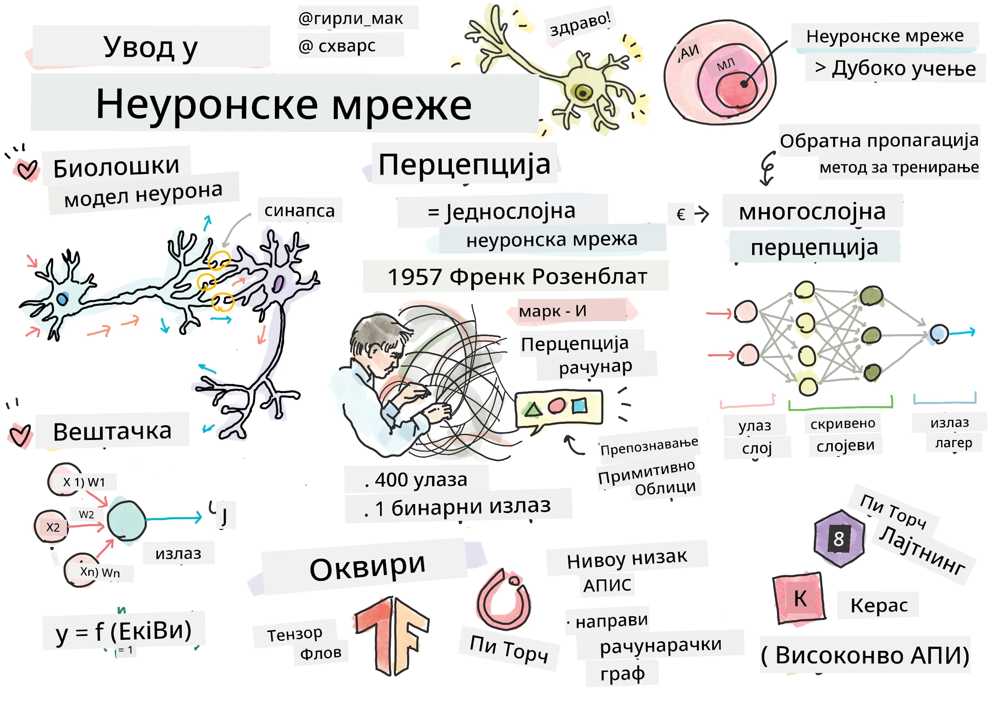
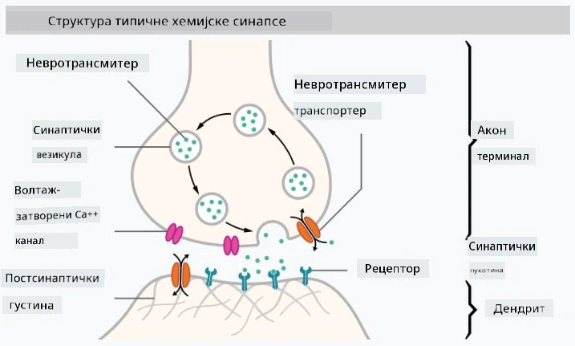

# Увод у неуронске мреже

Као што смо објаснили у уводу, један од начина за постизање интелигенције јесте тренирање **компјутерског модела** или **вештачког мозга**. Од средине 20. века, истраживачи су испробавали различите математичке моделе, све док се у последњим годинама овај правац није показао као изузетно успешан. Такви математички модели мозга називају се **неуронске мреже**.

> Понекад се неуронске мреже називају *Вештачке неуронске мреже*, ANNs, како би се указало да говоримо о моделима, а не о правим мрежама неурона.

## Машинско учење

Неуронске мреже су део шире дисциплине која се назива **машинско учење**, чији је циљ коришћење података за тренирање компјутерских модела који могу да решавају проблеме. Машинско учење чини велики део вештачке интелигенције, међутим, у овом курикулуму не обрађујемо класично машинско учење.

> Посетите наш посебан **[Курикулум за Машинско учење за почетнике](http://github.com/microsoft/ml-for-beginners)** да сазнате више о класичном машинском учењу.

У машинском учењу претпостављамо да имамо неки скуп података примера **X** и одговарајуће излазне вредности **Y**. Примери су често N-димензионални вектори који се састоје од **карактеристика**, а изласци се називају **ознаке**.

Разматраћемо два најчешћа проблема машинског учења:

* **Класификацију**, где треба да класификујемо улазни објекат у две или више класа.
* **Регресију**, где треба да предвидимо бројчану вредност за сваки узорак улаза.

> Када представљамо улазе и излазе као тензоре, улазни скуп података је матрица величине M&times;N, где је М број узорака, а N број карактеристика. Излазне ознаке Y су вектор величине M.

У овом курикулуму фокусираћемо се само на моделе неуронских мрежа.

## Модел неурона

Из биологије знамо да наш мозак сачињавају нервне ћелије (неурони), од којих сваки има више „улаза“ (дендрита) и један „излаз“ (аксон). Како дендрити тако и аксони могу преносити електричне сигнале, а везе између њих — познате као синапсе — могу показивати различите степене проводљивости, које регулишу неуротрансмитери.

 | 
----|----
Прави неурон *([Слика](https://en.wikipedia.org/wiki/Synapse#/media/File:SynapseSchematic_lines.svg) са Википедије)* | Вештачки неурон *(Слика аутора)*

Дакле, најједноставнији математички модел неурона садржи неколико улаза X1, ..., XN и један излаз Y, као и низ тежина W1, ..., WN. Излаз се израчунава као:

где је f нека нелинеарна **активирајућа функција**.

> Првобитни модели неурона описани су у класичном раду [Логички калкулус идеја иманентних нервној активности](https://www.cs.cmu.edu/~./epxing/Class/10715/reading/McCulloch.and.Pitts.pdf) Ворена МекКалока и Волтера Пита из 1943. Доналд Хеб у својој књизи "[Организација понашања: неуропсихолошка теорија](https://books.google.com/books?id=VNetYrB8EBoC)" предложио је начин на који се те мреже могу тренирати.

## У овом одељку

У овом одељку учићемо о:
* [Перцептрону](03-Perceptron/README.md), једном од раних модела неуронских мрежа за двокласну класификацију
* [Вишеслојним мрежама](04-OwnFramework/README.md) са придруженим блоком бележница [како изградити свој оквир](04-OwnFramework/OwnFramework.ipynb)
* [Оквирима неуронских мрежа](05-Frameworks/README.md), са овим бележницама: [PyTorch](05-Frameworks/IntroPyTorch.ipynb) и [Keras/Tensorflow](05-Frameworks/IntroKerasTF.ipynb)
* [Претренираности](../../../../lessons/3-NeuralNetworks/05-Frameworks#overfitting)

---

<!-- CO-OP TRANSLATOR DISCLAIMER START -->
**Изјава о одрицању одговорности**:
Овај документ је преведен коришћењем услуге за аутоматски превод [Co-op Translator](https://github.com/Azure/co-op-translator). Иако тежимо тачности, имајте у виду да аутоматски преводи могу садржати грешке или нетачности. Оригинални документ на његовом изворном језику треба сматрати ауторитативним извором. За критичне информације препоручује се професионални људски превод. Нисмо одговорни за било каква неспоразума или погрешна тумачења која произилазе из коришћења овог превода.
<!-- CO-OP TRANSLATOR DISCLAIMER END -->