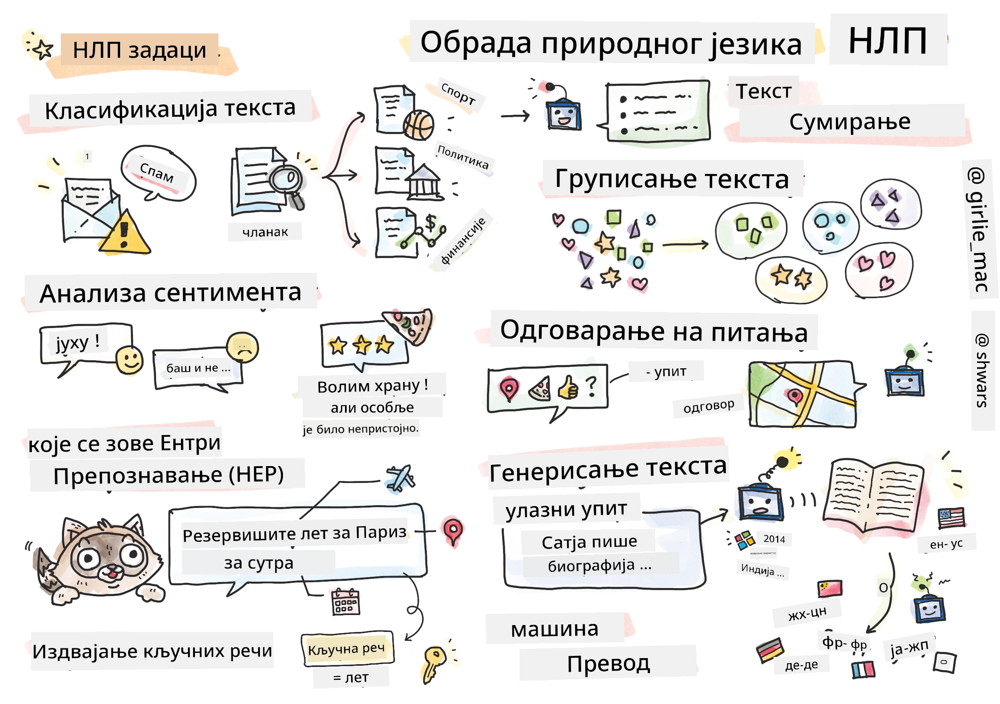

# Обрада природног језика



У овом одељку ћемо се фокусирати на коришћење неуронских мрежа за решавање задатака везаних за **обраду природног језика (ОПЈ)**. Постоји много проблема ОПЈ које желимо да рачунари могу да реше:

* **Класификација текста** је типичан проблем класификације везан за текстуалне низове. Примери укључују класификацију е-порука као спам или не-спам, или категоризацију чланака као спорт, бизнис, политика итд. Такође, када развијамо чатботове, често треба да разумемо шта је корисник желео да каже — у том случају се ради о **класификацији намере**. Често, код класификације намере, потребно је рукујемо са многим категоријама.
* **Анализа сентимента** је типичан проблем регресије, где треба доделити број (сентимент) који одговара колико је позитивно/негативно значење реченице. Напреднија верзија анализе сентимента је **анализа сентимента базирана на аспектима** (ABSA), где сентимент додељујемо не целој реченици, већ различитим деловима (аспектима), нпр. *У овом ресторану ми се допала кухиња, али је атмосфера била ужасна*.
* **Препознавање именованих ентитета** (NER) односи се на проблем извлачења одређених ентитета из текста. На пример, треба да разумемо да у фрази *Треба да летим за Париз сутра* реч *сутра* се односи на ДАТУМ, а *Париз* је ЛОКАЦИЈА.  
* **Извлачење кључних речи** је слично NER-у, али треба аутоматски извлачити речи важне за значење реченице, без претходног тренирања за конкретне типове ентитета.
* **Груписање текста** може бити корисно када желимо да скупимо сличне реченице заједно, на пример, сличне захтеве у техничкој подршци.
* **Одговарање на питања** представља способност модела да одговори на конкретно питање. Модел добија текст као улаз и питање, и треба да пружи положај у тексту где се одговор на питање налази (или понекад да генерише текст одговора).
* **Генерисање текста** је способност модела да генерише нови текст. Може се сматрати као задатак класификације који предвиђа следеће слово/реч на основу неког *текстуалног упита*. Напредни модели за генерисање текста, као што је GPT-3, могу решавати и друге ОПЈ задатке као што је класификација користећи технике зване [програмирање упита](https://towardsdatascience.com/software-3-0-how-prompting-will-change-the-rules-of-the-game-a982fbfe1e0) или [инжењеринг упита](https://medium.com/swlh/openai-gpt-3-and-prompt-engineering-dcdc2c5fcd29)
* **Сажимање текста** је техника када желимо да рачунар "прочита" дугачак текст и сажме га у неколико реченица.
* **Машински превод** може се посматрати као комбинација разумевања текста на једном језику и генерисања текста на другом.

Иницијално, већина ОПЈ задатака је решавана традиционалним методама као што су граматике. На пример, у машинском превођењу парсери су коришћени за трансформацију почетне реченице у синтаксно стабло, затим су из њега вадиле виши семантички структуре које представљају значење реченице, а на основу тог значења и граматике циљног језика се генерисао резултат. Данас, многи ОПЈ задаци се ефикасније решавају коришћењем неуронских мрежа.

> Многи класични ОПЈ методи су имплементирани у [Natural Language Processing Toolkit (NLTK)](https://www.nltk.org) Python библиотеци. Постоји одлична [NLTK књига](https://www.nltk.org/book/) доступна онлајн која покрива како се различити ОПЈ задаци могу решавати користећи NLTK.

У нашем курсу ћемо се углавном фокусирати на коришћење неуронских мрежа за ОПЈ, а NLTK ћемо користити где је потребно.

Већ смо научили о коришћењу неуронских мрежа за рад са табеларним подацима и сликама. Главна разлика између тих типова података и текста је у томе што је текст низ променљиве дужине, док је величина улаза код слика позната унапред. Док конволуцијске мреже могу извлачити обрасце из улазних података, обрасци у тексту су сложенији. На пример, може се десити да негација буде одвојена од субјекта са произвољним бројем речи (нпр. *Не волим поморанџе* у односу на *Не волим те велике шарене укусне поморанџе*) и то и даље треба интерпретирати као један образац. Стога, да бисмо руковали језиком, потребно је увести нове типове неуронских мрежа, као што су *рекурентне мреже* и *трансформери*.

## Инсталирање библиотеka

Ако користите локалну Python инсталацију за овај курс, можда ће вам требати да инсталирате све потребне библиотеке за ОПЈ користећи следеће команде:

**За PyTorch**
```bash
pip install -r requirements-pytorch.txt
```
**За TensorFlow**
```bash
pip install -r requirements-tf.txt
```

> Можете пробати ОПЈ са TensorFlow-ом на [Microsoft Learn](https://docs.microsoft.com/learn/modules/intro-natural-language-processing-tensorflow/?WT.mc_id=academic-77998-cacaste)

## Упозорење о GPU

У овом одељку ћемо, у неким примерима, тренирати прилично велике моделе.
* **Користите рачунар са GPU-ом**: Препоручује се да своје бележнице изводите на рачунару са GPU-ом како бисте смањили време чекања при раду са великим моделима.
* **Ограничења GPU меморије**: Рад на GPU-у може довести до ситуација када вам понестане GPU меморије, нарочито при тренирању великих модела.
* **Потрошња GPU меморије**: Количина GPU меморије потрошена током тренирања зависи од различитих фактора, укључујући величину минибатча.
* **Минимизирање величине минибатча**: Ако наиђете на проблеме са GPU меморијом, размислите о смањењу величине минибатча у вашем коду као потенцијалном решењу.
* **Ослобађање GPU меморије у TensorFlow-у**: Старије верзије TensorFlow-а можда неће правилно ослобађати GPU меморију када се тренира више модела унутар једног Python кернела. Да бисте ефикасно управљали коришћењем GPU меморије, можете конфигурисати TensorFlow да додељује GPU меморију само по потреби.
* **Укључивање кода**: Да бисте подесили TensorFlow да повећава доделу GPU меморије само када је потребно, убаците следећи код у ваше бележнице:

```python
physical_devices = tf.config.list_physical_devices('GPU') 
if len(physical_devices)>0:
    tf.config.experimental.set_memory_growth(physical_devices[0], True) 
```

Ако сте заинтересовани да учите о ОПЈ-у из класичне перспективе машинског учења, посетите [ове лекције](https://github.com/microsoft/ML-For-Beginners/tree/main/6-NLP)

## У овом одељку
У овом одељку ћемо научити о:

* [Презентацији текста као тензора](13-TextRep/README.md)
* [Ворд Ембедингс](14-Embeddings/README.md)
* [Језичко моделовање](15-LanguageModeling/README.md)
* [Рекурентне неуронске мреже](16-RNN/README.md)
* [Генеративне мреже](17-GenerativeNetworks/README.md)
* [Трансформери](18-Transformers/README.md)

---

<!-- CO-OP TRANSLATOR DISCLAIMER START -->
**Изјава о одрицању одговорности**:
Овај документ је преведен коришћењем услуге за аутоматски превод [Co-op Translator](https://github.com/Azure/co-op-translator). Иако тежимо тачности, имајте у виду да аутоматски преводи могу садржати грешке или нетачности. Оригинални документ на његовом изворном језику треба сматрати ауторитативним извором. За критичне информације препоручује се професионални људски превод. Нисмо одговорни за било каква неспоразума или погрешна тумачења која произилазе из коришћења овог превода.
<!-- CO-OP TRANSLATOR DISCLAIMER END -->