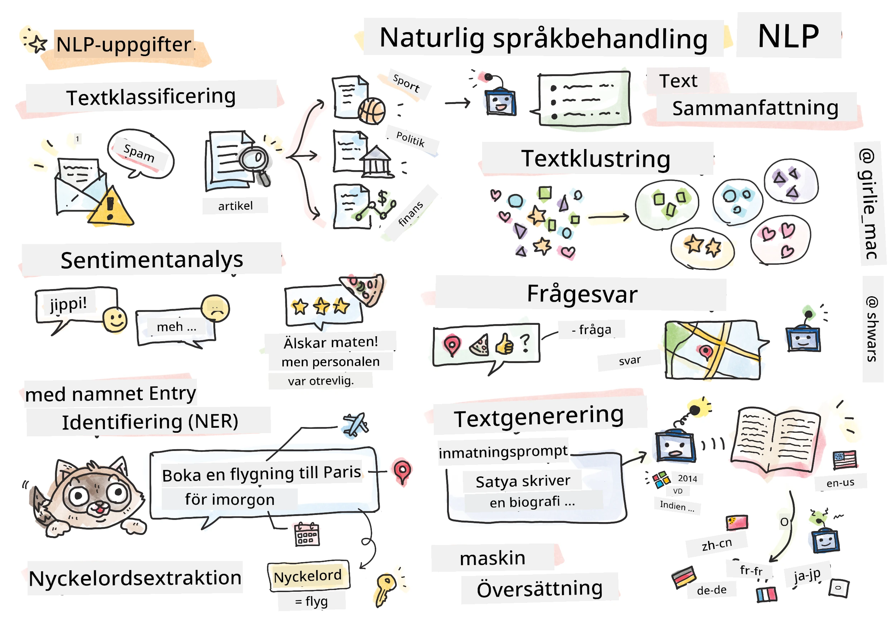

# Naturlig Språkbehandling



I denna sektion kommer vi att fokusera på att använda neurala nätverk för att hantera uppgifter relaterade till **Naturlig Språkbehandling (NLP)**. Det finns många NLP-problem som vi vill att datorer ska kunna lösa:

* **Textklassificering** är ett typiskt klassificeringsproblem som gäller textsekvenser. Exempel inkluderar att klassificera e-postmeddelanden som skräppost vs. ej skräppost, eller kategorisera artiklar som sport, affärer, politik, etc. När vi utvecklar chattbotar behöver vi ofta förstå vad en användare ville säga – i detta fall handlar det om **avsiktsklassificering**. Ofta, vid avsiktsklassificering, behöver vi hantera många kategorier.
* **Sentimentanalys** är ett typiskt regressionsproblem, där vi behöver tilldela ett nummer (ett sentiment) som motsvarar hur positiv/negativ betydelsen av en mening är. En mer avancerad version av sentimentanalys är **aspektbaserad sentimentanalys** (ABSA), där vi tilldelar sentiment inte till hela meningen, utan till olika delar av den (aspekter), t.ex. *På denna restaurang gillade jag maten, men atmosfären var förskräcklig*.
* **Named Entity Recognition** (NER) avser problemet att extrahera vissa entiteter från text. Till exempel kan vi behöva förstå att i frasen *Jag måste flyga till Paris imorgon* refererar ordet *imorgon* till DATUM, och *Paris* är en PLATS.  
* **Nyckelordsutvinning** är liknande NER, men vi behöver extrahera ord som är viktiga för meningen automatiskt, utan förutbildning för specifika entitetstyper.
* **Textklustring** kan vara användbart när vi vill gruppera liknande meningar, till exempel liknande förfrågningar i teknisk support-konversationer.
* **Frågesvar** hänvisar till en modells förmåga att svara på en specifik fråga. Modellen får som indata en textpassage och en fråga, och den behöver ge en plats i texten där svaret på frågan finns (eller ibland generera själva svarstexten).
* **Textgenerering** är en modells förmåga att generera ny text. Det kan betraktas som en klassificeringsuppgift som förutsäger nästa bokstav/ord baserat på någon *textprompt*. Avancerade textgenereringsmodeller, som GPT-3, kan lösa andra NLP-uppgifter som klassificering med en teknik kallad [promptprogrammering](https://towardsdatascience.com/software-3-0-how-prompting-will-change-the-rules-of-the-game-a982fbfe1e0) eller [promptengineering](https://medium.com/swlh/openai-gpt-3-and-prompt-engineering-dcdc2c5fcd29)
* **Textsummarisering** är en teknik när vi vill att en dator ska "läsa" lång text och sammanfatta den i några meningar.
* **Maskinöversättning** kan ses som en kombination av textförståelse på ett språk och textgenerering på ett annat.

Ursprungligen löstes de flesta NLP-uppgifter med traditionella metoder som grammatik. Till exempel användes parser i maskinöversättning för att omvandla en initial mening till ett syntaxträd, sedan extraherades högre semantiska strukturer för att representera meningen av meningen, och baserat på denna mening och grammatiken i målspråket genererades resultatet. Numera löses många NLP-uppgifter mer effektivt med neurala nätverk.

> Många klassiska NLP-metoder är implementerade i [Natural Language Processing Toolkit (NLTK)](https://www.nltk.org) Python-bibliotek. Det finns en utmärkt [NLTK Book](https://www.nltk.org/book/) tillgänglig online som täcker hur olika NLP-uppgifter kan lösas med NLTK.

I vår kurs kommer vi mest att fokusera på att använda neurala nätverk för NLP, och vi kommer att använda NLTK där det behövs.

Vi har redan lärt oss att använda neurala nätverk för att hantera tabulär data och bilder. Den huvudsakliga skillnaden mellan dessa datatyper och text är att text är en sekvens av variabel längd, medan inmatningsstorleken vid bilder är känd på förhand. Medan konvolutionsnätverk kan extrahera mönster från indata, är mönster i text mer komplexa. T.ex. kan vi ha negation separerad från subjektet med godtyckligt många ord (t.ex. *Jag gillar inte apelsiner*, vs. *Jag gillar inte dessa stora färgglada goda apelsiner*), och det bör fortfarande tolkas som ett mönster. Därför behöver vi nya typer av neurala nätverk för att hantera språk, som *rekurrenta nätverk* och *transformers*.

## Installera Bibliotek

Om du använder en lokal Python-installation för att köra denna kurs kan du behöva installera alla nödvändiga bibliotek för NLP med följande kommandon:

**För PyTorch**
```bash
pip install -r requirements-pytorch.txt
```
**För TensorFlow**
```bash
pip install -r requirements-tf.txt
```

> Du kan prova NLP med TensorFlow på [Microsoft Learn](https://docs.microsoft.com/learn/modules/intro-natural-language-processing-tensorflow/?WT.mc_id=academic-77998-cacaste)

## GPU-varning

I denna sektion kommer vi i några exempel att träna ganska stora modeller.
* **Använd en dator med GPU-stöd**: Det är rekommenderat att köra dina anteckningsböcker på en dator med GPU-stöd för att minska väntetiden när du arbetar med stora modeller.
* **Begränsningar i GPU-minnet**: Att köra på GPU kan leda till situationer där du får slut på GPU-minne, särskilt när du tränar stora modeller.
* **GPU-minnesförbrukning**: Mängden GPU-minne som används under träningen beror på olika faktorer, inklusive minibatchstorleken.
* **Minimera minibatch-storlek**: Om du stöter på problem med GPU-minnet, överväg att minska minibatch-storleken i din kod som en möjlig lösning.
* **TensorFlow GPU-minnesfrigivning**: Äldre versioner av TensorFlow kanske inte frigör GPU-minnet korrekt när du tränar flera modeller inom en Python-kernel. För att hantera GPU-minnesanvändning effektivt kan du konfigurera TensorFlow att allokera GPU-minne endast vid behov.
* **Kodinkludering**: För att ställa in TensorFlow att successivt öka GPU-minnesallokeringen vid behov, inkludera följande kod i dina anteckningsböcker:

```python
physical_devices = tf.config.list_physical_devices('GPU') 
if len(physical_devices)>0:
    tf.config.experimental.set_memory_growth(physical_devices[0], True) 
```

Om du är intresserad av att lära dig NLP från ett klassiskt maskininlärningsperspektiv, besök [denna lektionsserie](https://github.com/microsoft/ML-For-Beginners/tree/main/6-NLP)

## I denna sektion
I denna sektion kommer vi att lära oss om:

* [Att representera text som tensorer](13-TextRep/README.md)
* [Word Embeddings](14-Embeddings/README.md)
* [Språkmodellering](15-LanguageModeling/README.md)
* [Rekurrenta neurala nätverk](16-RNN/README.md)
* [Generativa nätverk](17-GenerativeNetworks/README.md)
* [Transformers](18-Transformers/README.md)

---

<!-- CO-OP TRANSLATOR DISCLAIMER START -->
**Ansvarsfriskrivning**:
Detta dokument har översatts med hjälp av AI-översättningstjänsten [Co-op Translator](https://github.com/Azure/co-op-translator). Även om vi strävar efter noggrannhet, var vänlig notera att automatiska översättningar kan innehålla fel eller brister. Det ursprungliga dokumentet på dess modersmål bör betraktas som den auktoritativa källan. För kritisk information rekommenderas professionell mänsklig översättning. Vi ansvarar inte för några missförstånd eller feltolkningar som uppstår till följd av användningen av denna översättning.
<!-- CO-OP TRANSLATOR DISCLAIMER END -->