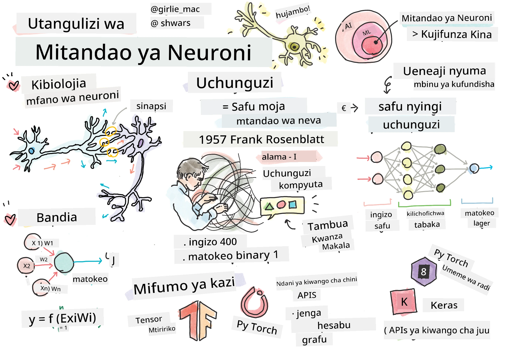
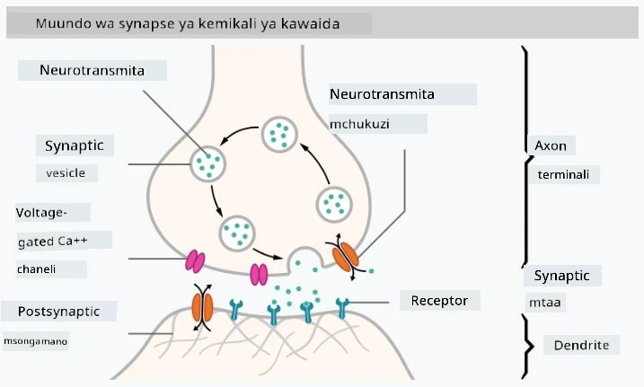
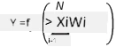

# Utangulizi wa Mitandao ya Neva

Kama tulivyojadili katika utangulizi, mojawapo ya njia za kupata akili ni kufundisha **mfano wa kompyuta** au **ubongo wa bandia**. Tangu katikati ya karne ya 20, watafiti walijaribu mifano mbalimbali ya kihisabati, hadi katika miaka ya hivi karibuni njia hii kuonesha mafanikio makubwa. Mifano kama hii ya kihisabati ya ubongo huitwa **mitandao ya neva**.

> Wakati mwingine mitandao ya neva huitwa *Mitandao ya Neva ya Bandia*, ANNs, kuonyesha kwamba tunazungumzia mifano, si mitandao halisi ya neva.

## Kujifunza Mashine

Mitandao ya Neva ni sehemu ya somo kubwa liitwalo **Kujifunza Mashine**, ambalo lina lengo la kutumia data kufundisha mifano ya kompyuta inayoweza kutatua matatizo. Kujifunza Mashine ni sehemu kubwa ya Akili Bandia, hata hivyo, hatujazingatia kujifunza mashine ya kawaida katika mtaala huu.

> Tembelea mtaala wetu tofauti wa **[Kujifunza Mashine kwa Waanzilishi](http://github.com/microsoft/ml-for-beginners)** ili kujifunza zaidi kuhusu Kujifunza Mashine ya kawaida.

Katika Kujifunza Mashine, tunadhani tunayo seti ya data ya mifano **X**, na thamani zinazolingana za matokeo **Y**. Mifano mara nyingi ni vector za N-dimensional zinazo kuwa na **vipengele**, na matokeo huitwa **lebo**.

Tutazingatia matatizo mawili ya kawaida ya kujifunza mashine:

* **Uainishaji**, ambapo tunahitaji kuainisha kitu cha kuingia katika darasa moja au zaidi.
* **Utabiri**, ambapo tunahitaji kutabiri nambari ya kihesabu kwa kila sampuli ya kuingia.

> Wakati wakionyesha ingizo na matokeo kama tensors, seti ya data ya kuingia ni matrice ya ukubwa M&times;N, ambapo M ni idadi ya sampuli na N ni idadi ya vipengele. Lebo za matokeo Y ni vector ya ukubwa M.

Katika mtaala huu, tutazingatia tu mifano ya mitandao ya neva.

## Mfano wa Neva

Kutoka kwa biolojia, tunajua kwamba ubongo wetu una seli za neva (neuron), kila moja ikiwa na "ingoja" nyingi (dendrites) na "matokeo" moja (axon). Dendrites na axons zote zinaweza kuendesha ishara za umeme, na muunganiko kati yao — unaojulikana kama synapses — unaweza kuonyesha viwango tofauti vya uendeshaji, vinavyodhibitiwa na neurotransmitters.

 | 
----|----
Neva Halisi *([Picha](https://en.wikipedia.org/wiki/Synapse#/media/File:SynapseSchematic_lines.svg) kutoka Wikipedia)* | Neva Bandia *(Picha na Mwandishi)*

Hivyo, mfano rahisi wa kihisabati wa neva una ingizo kadhaa X1, ..., XN na matokeo Y, pamoja na mfululizo wa uzito W1, ..., WN. Matokeo huhesabiwa kama:

ambapo f ni aina fulani ya **kazi ya uanzishaji** isiyo ya mstari.

> Mifano ya mwanzo ya neva ilielezewa katika karatasi ya klasik [A logical calculus of the ideas immanent in nervous activity](https://www.cs.cmu.edu/~./epxing/Class/10715/reading/McCulloch.and.Pitts.pdf) na Warren McCullock na Walter Pitts mwaka 1943. Donald Hebb katika kitabu chake "[The Organization of Behavior: A Neuropsychological Theory](https://books.google.com/books?id=VNetYrB8EBoC)" alipendekeza njia za kufundisha mitandao hiyo.

## Katika Sehemu Hii

Katika sehemu hii tutajifunza kuhusu:
* [Perceptron](03-Perceptron/README.md), mojawapo ya mifano ya zamani ya mitandao ya neva kwa uainishaji wa madarasa mawili
* [Mitandao yenye tabaka nyingi](04-OwnFramework/README.md) pamoja na daftari la mazoezi la pamoja [jinsi ya kujenga mfumo wetu](04-OwnFramework/OwnFramework.ipynb)
* [Mifumo ya Mitandao ya Neva](05-Frameworks/README.md), na daftari hizi: [PyTorch](05-Frameworks/IntroPyTorch.ipynb) na [Keras/Tensorflow](05-Frameworks/IntroKerasTF.ipynb)
* [Kupitiliza Kufanikisha](../../../../lessons/3-NeuralNetworks/05-Frameworks#overfitting)

---

<!-- CO-OP TRANSLATOR DISCLAIMER START -->
**Kionyozo**:
Hati hii imetafsiriwa kwa kutumia huduma ya tafsiri ya AI [Co-op Translator](https://github.com/Azure/co-op-translator). Ingawa tunajitahidi kupata usahihi, tafadhali fahamu kwamba tafsiri za kiotomatiki zinaweza kuwa na makosa au upungufu wa usahihi. Hati ya asili katika lugha yake halisi inapaswa kuchukuliwa kama chanzo cha mamlaka. Kwa taarifa muhimu, tafsiri ya kitaalamu inayofanywa na binadamu inapendekezwa. Hatutojibu kwa kuelewa vibaya au tafsiri potofu zinazotokea kutokana na matumizi ya tafsiri hii.
<!-- CO-OP TRANSLATOR DISCLAIMER END -->