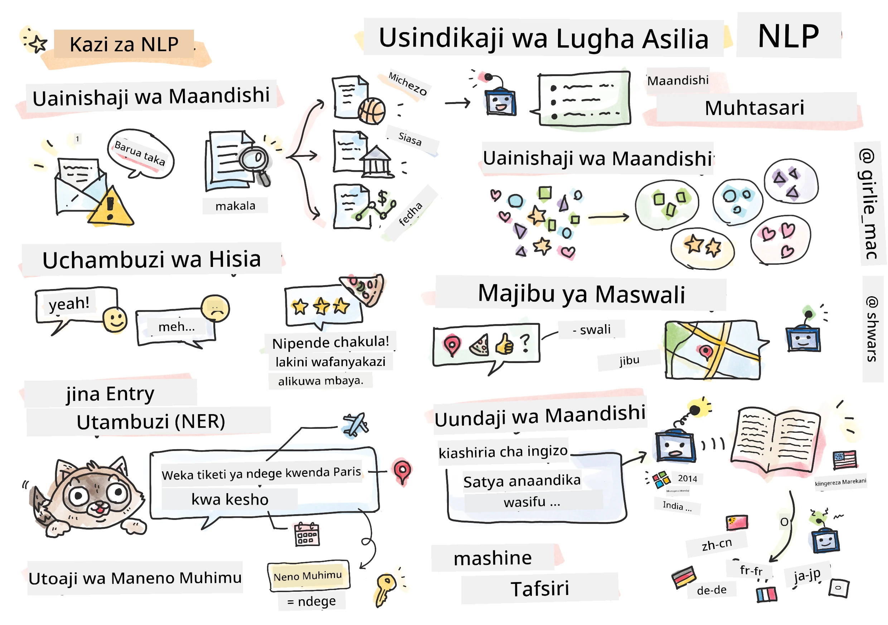

# Usindikaji Asili wa Lugha



Katika sehemu hii, tutazingatia kutumia Mitandao ya Neva kushughulikia kazi zinazohusiana na **Usindikaji Asili wa Lugha (NLP)**. Kuna matatizo mengi ya NLP tunayotaka kompyuta ziweze kuyatatua:

* **Uainishaji wa maandishi** ni tatizo la kimsingi la uainishaji linalohusu mfuatano wa maandishi. Mifano ni pamoja na kuainisha ujumbe wa barua pepe kama ni barua taka dhidi ya isiyo taka, au kuainisha makala kama michezo, biashara, siasa, n.k. Pia, tunapotengeneza roboti za mazungumzo, mara nyingi tunahitaji kuelewa yale mtumiaji alitaka kusema -- katika kesi hii tunashughulikia **uainishaji wa nia**. Mara nyingi, katika uainishaji wa nia tunahitaji kushughulikia makundi mengi.
* **Uchambuzi wa hisia** ni tatizo la mteremko la kawaida, ambapo tunahitaji kupeana nambari (hisia) inayolingana na jinsi maana ya sentensi ilivyo chanya/mbaya. Toleo lililoendelea zaidi la uchambuzi wa hisia ni **uchambuzi wa hisia unaozingatia vipengele** (ABSA), ambapo tunapeana hisia si kwa sentensi nzima, bali kwa sehemu tofauti za sentensi (vipengele), kwa mfano. *Katika mgahawa huu, nilipenda chakula, lakini hali ya hewa ilikuwa mbaya*.
* **Utambuzi wa Vitu Vyenye Majina** (NER) unahusu tatizo la kutoa vitu fulani kutoka kwenye maandishi. Kwa mfano, tunaweza kuhitaji kuelewa kuwa katika kifungu *Nahitaji kuruka kwenda Pariskesho* neno *kesho* linahusu TAREHE, na *Paris* ni MAHALI.  
* **Utoaji wa Maneno Muhimu** ni sawa na NER, lakini tunahitaji kutoa maneno muhimu kwa maana ya sentensi moja kwa moja, bila mafunzo ya awali kwa aina maalum za vitu.
* **Kukuza maandishi katika makundi** kunaweza kuwa msaada tunapotaka kuunganisha sentensi zinazofanana, kwa mfano, mahitaji yanayofanana katika mazungumzo ya msaada wa kiufundi.
* **Kujibu maswali** kunahusu uwezo wa mfano kujibu swali maalum. Mfano hupokea kipande cha maandishi na swali kama ingizo, na unahitaji kutoa mahali katika maandishi ambapo jibu la swali lipo (au, wakati mwingine, kuunda jibu la maandishi).
* **Uundaji wa maandishi** ni uwezo wa mfano kuunda maandishi mapya. Huweza kuzingatiwa kama kazi ya uainishaji inayotarajiwa herufi/neno linalofuata kulingana na *mti wa maandishi*. Miundo ya hali ya juu ya uundaji wa maandishi, kama GPT-3, zinaweza kutatua kazi nyingine za NLP kama uainishaji kwa kutumia mbinu inayoitwa [programu ya prompt](https://towardsdatascience.com/software-3-0-how-prompting-will-change-the-rules-of-the-game-a982fbfe1e0) au [ufundi wa prompt](https://medium.com/swlh/openai-gpt-3-and-prompt-engineering-dcdc2c5fcd29)
* **Ufafanuzi wa maandishi** ni mbinu tunapotaka kompyuta "kusoma" maandishi marefu na kuyasemea kwa sentensi chache.
* **Tafsiri ya mashine** inaweza kuonekana kama mchanganyiko wa kuelewa maandishi kwa lugha moja, na uundaji wa maandishi kwa lugha nyingine.

Awali, kazi nyingi za NLP zilitatuliwa kwa kutumia mbinu za jadi kama sarufi. Kwa mfano, katika tafsiri ya mashine, parsers zilitumiwa kubadilisha sentensi ya awali kuwa mti wa sarufi, kisha miundo ya semantiki ya ngazi ya juu ilitolewa kuwakilisha maana ya sentensi, na kulingana na maana hii na sarufi ya lugha lengwa, matokeo yalizalishwa. Siku hizi, kazi nyingi za NLP zinafanywa kwa ufanisi zaidi kwa kutumia mitandao ya neva.

> Mbinu nyingi za jadi za NLP zimejumuishwa katika maktaba ya Python ya [Natural Language Processing Toolkit (NLTK)](https://www.nltk.org). Kuna [Kitabu cha NLTK](https://www.nltk.org/book/) kikubwa kinachopatikana mtandaoni kinachojifunza jinsi kazi tofauti za NLP zinavyoweza kutatuliwa kwa kutumia NLTK.

Katika kozi yetu, tutazingatia zaidi kutumia Mitandao ya Neva kwa NLP, na tutatumia NLTK pale inapo hitajika.

Tayari tumekuwa tukijifunza kuhusu kutumia mitandao ya neva kushughulikia data za meza na picha. Tofauti kuu kati ya aina hizo za data na maandishi ni kwamba maandishi ni mfuatano wenye urefu wa tofauti, wakati ukubwa wa data ya picha unajulikana mapema. Wakati mitandao ya convolution inaweza kutoa mifumo kutoka kwenye data ingizo, mifumo katika maandishi ni tata zaidi. Kwa mfano, tunaweza kuwa na kutoelewana kufungamana na kichwa cha sentensi kwa maneno mengi (mfano. *Sichukii machungwa*, dhidi ya. *Sichukii machungwa makubwa, yenye rangi na ladha nzuri*), na hayo bado yanapaswa kufasiriwa kama mfumo mmoja. Hivyo, kushughulikia lugha tunahitaji kuanzisha aina mpya za mitandao ya neva, kama *mitandao ya kurudiwa* na *transformers*.

## Sakinisha Maktaba

Ikiwa unatumia usanidi wa Python wa kwenye kompyuta yako kuendesha kozi hii, huenda ukahitaji kusakinisha maktaba zote zinazohitajika kwa NLP kwa kutumia amri zifuatazo:

**Kwa PyTorch**
```bash
pip install -r requirements-pytorch.txt
```
**Kwa TensorFlow**
```bash
pip install -r requirements-tf.txt
```

> Unaweza kujaribu NLP kwa TensorFlow kwenye [Microsoft Learn](https://docs.microsoft.com/learn/modules/intro-natural-language-processing-tensorflow/?WT.mc_id=academic-77998-cacaste)

## Onyo la GPU

Katika sehemu hii, katika baadhi ya mifano tutakuwa tukifundisha miundo kubwa sana.
* **Tumia Kompyuta Iliyowezeshwa na GPU**: Inashauriwa kuendesha daftari zako kwenye kompyuta iliyowezeshwa na GPU ili kupunguza nyakati za kusubiri unapofanya kazi na miundo mikubwa.
* **Matarajio ya Kumbukumbu ya GPU**: Kuendesha kwenye GPU kunaweza kusababisha hali ambapo unakosa kumbukumbu ya GPU, hasa wakati wa kufundisha miundo mikubwa.
* **Matumizi ya Kumbukumbu ya GPU**: Kiasi cha kumbukumbu ya GPU kinachotumika wakati wa mafunzo kinategemea mambo mbalimbali, ikiwa ni pamoja na ukubwa wa minibatch.
* **Punguza Ukubwa wa Minibatch**: Ikiwa unakutana na matatizo ya kumbukumbu ya GPU, fikiria kupunguza ukubwa wa minibatch katika nambari yako kama suluhisho linalowezekana.
* **Kuachilia Kumbukumbu ya GPU katika TensorFlow**: Toleo za zamani za TensorFlow huenda zisitoachilie kumbukumbu ya GPU ipasavyo wakati wa kufundisha miundo mingi ndani ya kernel moja ya Python. Ili kudhibiti matumizi ya kumbukumbu ya GPU kwa ufanisi, unaweza kusanidi TensorFlow kutopeana kumbukumbu ya GPU isipokuwa unapohitaji.
* **Ujumuishaji wa Nambari**: Ili kuweka TensorFlow kupanua matumizi ya kumbukumbu ya GPU tu inapohitajika, jumuisha nambari ifuatayo katika daftari zako:

```python
physical_devices = tf.config.list_physical_devices('GPU') 
if len(physical_devices)>0:
    tf.config.experimental.set_memory_growth(physical_devices[0], True) 
```

Ikiwa una nia ya kujifunza kuhusu NLP kutoka kwa mtazamo wa ML wa jadi, tembelea [mfululizo huu wa masomo](https://github.com/microsoft/ML-For-Beginners/tree/main/6-NLP)

## Katika Sehemu Hii
Katika sehemu hii tuta jifunza kuhusu:

* [Kuwakilisha maandishi kama tensera](13-TextRep/README.md)
* [Ukuzaji wa Maneno](14-Embeddings/README.md)
* [Modeli ya Lugha](15-LanguageModeling/README.md)
* [Mitandao ya Neva ya Kurudiwa](16-RNN/README.md)
* [Mitandao ya Uundaji](17-GenerativeNetworks/README.md)
* [Transformers](18-Transformers/README.md)

---

<!-- CO-OP TRANSLATOR DISCLAIMER START -->
**Kionyozo**:
Hati hii imetafsiriwa kwa kutumia huduma ya tafsiri ya AI [Co-op Translator](https://github.com/Azure/co-op-translator). Ingawa tunajitahidi kupata usahihi, tafadhali fahamu kwamba tafsiri za kiotomatiki zinaweza kuwa na makosa au upungufu wa usahihi. Hati ya asili katika lugha yake halisi inapaswa kuchukuliwa kama chanzo cha mamlaka. Kwa taarifa muhimu, tafsiri ya kitaalamu inayofanywa na binadamu inapendekezwa. Hatutojibu kwa kuelewa vibaya au tafsiri potofu zinazotokea kutokana na matumizi ya tafsiri hii.
<!-- CO-OP TRANSLATOR DISCLAIMER END -->