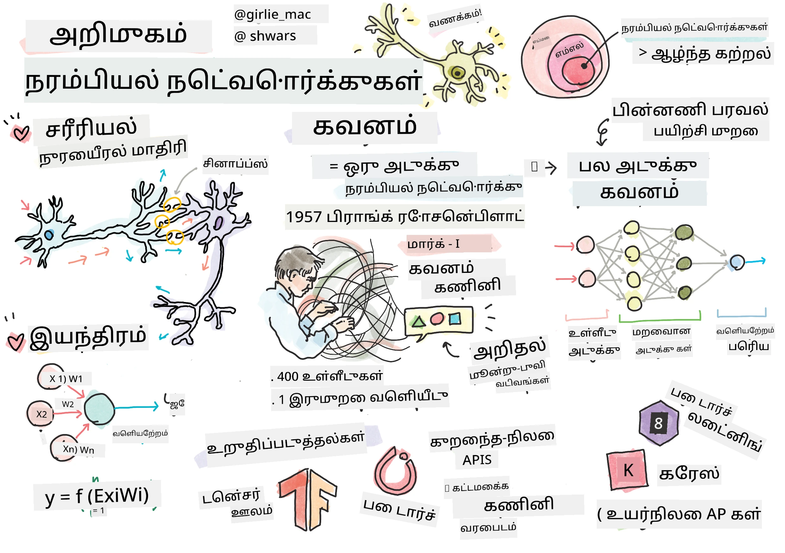
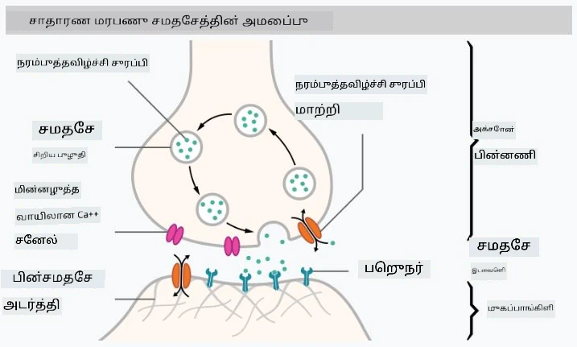
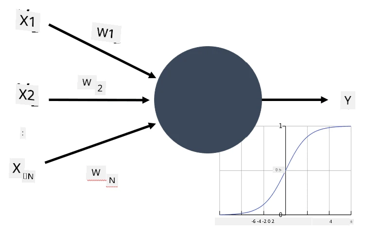
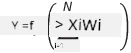

# நியூரல் நெட்வொர்க்குகளுக்கு அறிமுகம்

அறிமுகத்தில் நாம் விவாதித்தபடி, அறிவு பெறுவதற்கு வழியாக ஒன்றாக **கணினி மாதிரி** அல்லது **கைமதி மூளை** பயிற்றுவிப்பது ஆகும். 20ஆம் நூற்றாண்டின் நடுப்பகுதியிலிருந்து, ஆராய்ச்சியாளர்கள் பலவிதமான கணித மாதிரிகளை முயற்சி செய்தனர், சமீப காலங்களில் இந்த திசை பெரிதும் வெற்றிகரமானதாக நிரூபிக்கப்பட்டது. மூளையின் இப்படியான கணித மாதிரிகள் **நியூரல் நெட்வொர்க்குகள்** என்று அழைக்கப்படுகின்றன.

> சில நேரங்களில் நியூரல் நெட்வொர்க்குகளை *கைமதி நியூரல் நெட்வொர்க்குகள்*, ANNs என அழைக்கின்றனர், இதன் மூலம் நாம் உண்மையான நியூரான்களின் நெட்வொர்க்குகள் அல்ல, மாதிரிகள் பற்றி பேசுகிறோம் என்பதை குறிப்பிட.

## இயந்திரக் கற்றல்

நியூரல் நெட்வொர்க்குகள் **இயந்திரக் கற்றல்** என்ற பெரிய பாடத்திட்டத்தின் ஒரு பகுதியாகும், இதன் நோக்கம் கணினி மாதிரிகளை பயிற்றுவிக்க போது தரவுகளை பயன்படுத்தி பிரச்சனைகளை தீர்க்கும் திறனை பெறுவதாகும். இயந்திரக் கற்றல் செயற்கை நுண்ணறிவின் ஒரு பெரிய பகுதியை நிரப்புகிறது, ஆனால் நாம் இந்த பாடத்திட்டத்தில் பாரம்பரிய ML ஐ கையாளவில்லை.

> வகுப்பு மாணவர்களுக்கு தனியாக தயாரிக்கப்பட்ட **[இயந்திரக் கற்றல் ஆரம்பத்துவர்கள்](http://github.com/microsoft/ml-for-beginners)** பாடத்திட்டத்தைக் காணவும்.

இயந்திரக் கற்றலில், எங்களுக்கு சில எடுத்துக்காட்டு தரவுத்தொகுப்பு **X** மற்றும் அதனுடன் தொடர்புடைய வெளியீடு மதிப்புகள் **Y** உள்ளதாக கணிக்கிறோம். எடுத்துக்காட்டுகள் பெரும்பாலும் N-பரிமாண வکتர்கள் ஆகும், அவற்றில் **அம்சங்கள்**, மற்றும் வெளியீடுகள் **லேபிள்கள்** என அழைக்கப்படுகின்றன.

நாம் பரிசீலிக்கப்போகும் இரண்டு பொதுவான இயந்திரக் கற்றல் பிரச்சனைகள்:

* **வகைப்பாடு**, இதில் நுழையவுள்ள பொருளை இரண்டு அல்லது அதிலிருந்து மேலான வகைகளில் வகைப்படுத்த வேண்டியிருக்கும்.
* **திருக்கம்**, இதில் நுழையவுள்ள ஒவ்வொரு மாதிரிக்கும் ஒரு எண்கணித மதிப்பை முன்னறிவிப்பது.

> நுழைகள் மற்றும் வெளியீடுகளை டென்சர்களாக பிரதிநிதித்துவம் செய்யுகையில், நுழை தரவுத்தொகுப்பு M&times;N அளவுடைய அட்டவணம் ஆகும், இதில் M மாதிரிகளின் எண்ணிக்கை மற்றும் N அம்சங்களின் எண்ணிக்கை ஆகும். வெளியீட்டு லேபிள்கள் Y என்பது M அளவுடைய வெக்டர் ஆகும்.

இந்த பாடத்திட்டத்தில், நாங்கள் கொண்டு வருவது மட்டுமே நியூரல் நெட்வொர்க்கு மாதிரிகள்.

## நியூரானின் மாதிரி

உயிரியல் துறையிலிருந்து, நம் மூளை நியூரல் செல்ல்கள் (நியூரான்கள்) கொண்டுள்ளது என்பதை நாம் அறிவோம், அவற்றில் ஒவ்வொன்றிலும் பல "நுழைகள்" (டெண்டிரைட்ஸ்) மற்றும் ஒரு "வெளியீடு" (அக்சான்) இருக்கும். டெண்டிரைட்ஸும் அக்சான்களும் மின்சார சிக்னல்களை கடத்த முடியும், அவற்றுக்கு இடையேயான இணைப்புகள் — சைனாப்ஸ்கள் என்றழைக்கப்படுகின்றன — மாற்று அளவின் கடத்தல் திறனைக் காட்டும், இதைக் கையாள்வது நியூரோடிரான்ஸ்மிட்டர்களால் நடைபெறுகிறது.

 | 
----|----
உண்மையான நியூரான் *([படம்](https://en.wikipedia.org/wiki/Synapse#/media/File:SynapseSchematic_lines.svg) விகிப்பீடியா)* | செயற்கை நியூரான் *(ஆசிரியர் படம்)*

எனவே, ஒரு நியூரானின் மிக எளிமையான கணித மாதிரியில் பல நுழைகள் X1, ..., XN மற்றும் ஒரு வெளியீடு Y, மற்றும் நிறைய எடைகள் W1, ..., WN இருப்பவை. வெளியீடு கணக்கிடப்பட்டது:

இதில் f என்பது சில நேரடி அல்லாத **செயல்பாட்டு செயல்பாடு** ஆகும்.

> ஆரம்ப நியூரான் மாதிரிகள் 1943 ஆம் ஆண்டில் வொரன் மெக்கல்லொக் மற்றும் வால்டர் பிளிட்ட்ஸ் எழுதிய பாரம்பரிய கட்டுரையில் [நரம்புத்துறை செயல்களில் உள்ள எண்ணோர்களின் ஒரு தர்க்கக் கணக்கு](https://www.cs.cmu.edu/~./epxing/Class/10715/reading/McCulloch.and.Pitts.pdf) என்னும் தலைப்பு கொண்டு விவரிக்கப்பட்டன. டொனால்ட் ஹெப் தனது புத்தகத்தில் "[நடத்தை அமைப்பு: ஒரு நரம்பு உளவியல் தோய்மை](https://books.google.com/books?id=VNetYrB8EBoC)" அதுகாண் அந்த பிணைப்புகளை எப்படிப் பயிற்றுவிக்கலாம் என்பது முன்மொழிந்தார்.

## இந்த பிரிவில்

இந்த பகுதியில் நாம் கற்றுக் கொள்வோம்:
* [பெர்செப்ட்ரான்](03-Perceptron/README.md), இரண்டு வகை வகைப்பாட்டிற்கான ஆரம்ப நியூரல் நெட்வொர்க்கு மாதிரிகளில் ஒன்றாகும்
* [பல அடுக்கு நெட்வொர்க்குகள்](04-OwnFramework/README.md) அருகிலுள்ள குறிப்பு புத்தகத்துடன் [எங்கள் சொந்த கட்டமைப்பை எப்படி உருவாக்குவது](04-OwnFramework/OwnFramework.ipynb)
* [நியூரல் நெட்வொர்க் கட்டமைப்புகள்](05-Frameworks/README.md), இக்குறிப்புகளுடன்: [பைடார்ச்சி](05-Frameworks/IntroPyTorch.ipynb) மற்றும் [கேராஸ்/டென்சர்ஃப்லோ](05-Frameworks/IntroKerasTF.ipynb)
* [அதிகப்படியான படிப்பு](../../../../lessons/3-NeuralNetworks/05-Frameworks#overfitting)

---

<!-- CO-OP TRANSLATOR DISCLAIMER START -->
**மறுப்பு**:
இந்த ஆவணம் AI மொழிபெயர்ப்பு சேவை [Co-op Translator](https://github.com/Azure/co-op-translator) பயன்படுத்தி மொழிபெயர்க்கப்பட்டுள்ளது. நாங்கள் துல்லியத்திற்காக முயற்சி செய்துள்ளோம், ஆனால் தானாக செய்யப்படும் மொழிபெயர்ப்புகளில் பிழைகள் அல்லது தவறுகள் இருக்கலாம் என்பதை கவனத்தில் கொள்ளவும். அசல் ஆவணம் அதன் தாய்மொழியில் அதிகாரப்பூர்வ ஆதாரமாக கருதப்பட வேண்டும். முக்கியமான தகவல்களுக்கு, தொழில்நுட்பமான மனித மொழிபெயர்ப்பு பரிந்துரைக்கப்படுகிறது. இந்த மொழிபெயர்ப்பைப் பயன்படுத்துவதால் ஏற்படும் எந்த தவறான புரிதல்கள் அல்லது தவறான விளக்கத்திற்கும் நாங்கள் பொறுப்பில்வில்லை.
<!-- CO-OP TRANSLATOR DISCLAIMER END -->