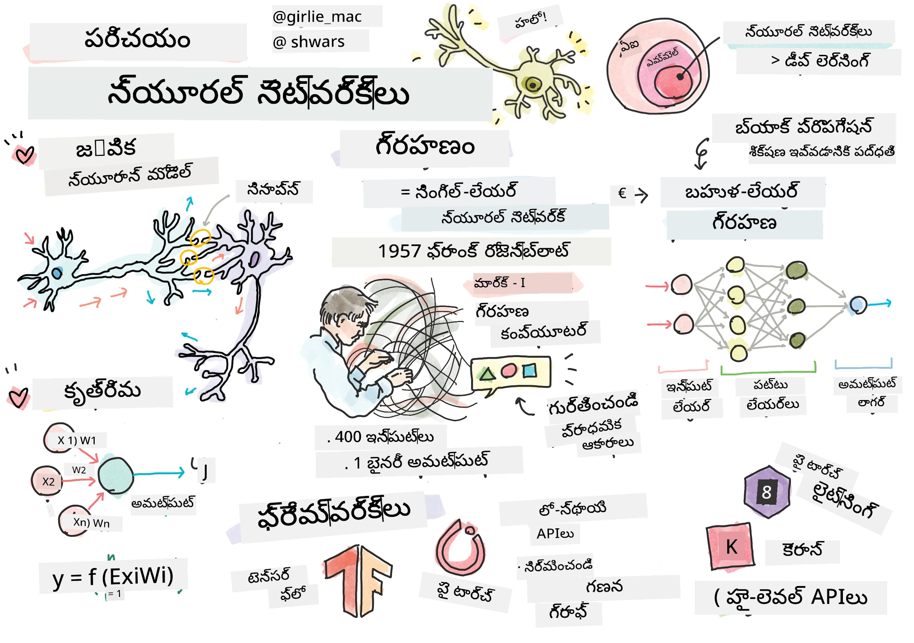
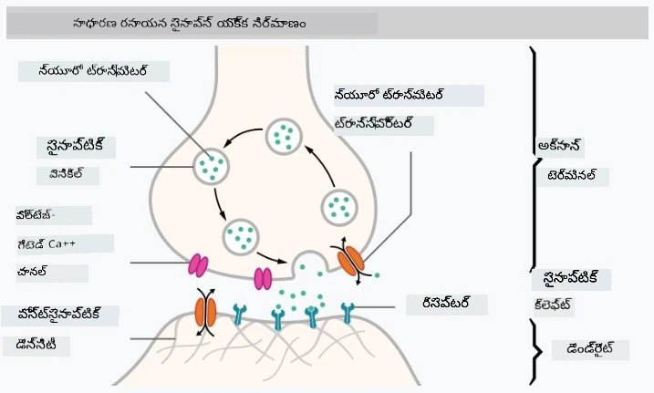
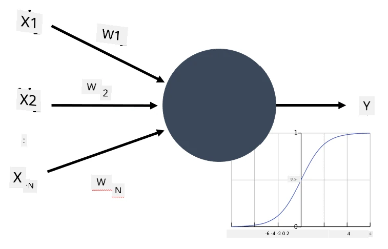

# న్యూరల్ నెట్వర్క్స్ పరిచయం

పరిచయంలో చర్చించినట్లుగా, బుద్దిమత్తును సాధించడానికి ఒక మార్గం **కంప్యూటర్ మోడల్** లేదా **కృత్రిమ మనసు** ను శిక్షణ ఇవ్వడం. 20వ శతాబ్ద మధ్యలో నుండి, పరిశోధకులు విభిన్న గణాంకీయ నమూనాలను ప్రయత్నించారు, తాజా సంవత్సరాల్లో ఈ దిశ చాలా విజయవంతమైంది. మనసు యొక్క అటువంటి గణాంకీయ నమూనాలను **న్యూరల్ నెట్వర్క్స్** అని పిలుస్తారు.

> కొన్ని సార్లు న్యూరల్ నెట్వర్క్స్‌ను *కృత్రిమ న్యూరల్ నెట్వర్క్స్*, ANNs అంటారు, మేము మోడల్స్ గురించి మాట్లాడుతున్నాం, నిజమైన న్యూరాన్ల నెట్వర్క్స్ గురించి కాదు అనడానికి.

## మెషీన్ లెర్నింగ్

న్యూరల్ నెట్వర్క్స్ ఒక పెద్ద శాఖ అయిన **మెషీన్ లెర్నింగ్** లో భాగం, దీని లక్ష్యం డేటాను ఉపయోగించి సమస్యలను పరిష్కరించగల కంప్యూటర్ మోడల్స్‌ను శిక్షణ ఇవ్వడం. మెషీన్ లెర్నింగ్ అనేది కృత్రిమ మేధస్సులో పెద్ద భాగంగా ఉంది, అయితే ఈ కర్యూలమ్ లో క్లాసిక్ మెషీన్ లెర్నింగ్ ని కవర్ చేయము.

> మరింత క్లాసిక్ మెషీన్ లెర్నింగ్ గురించి తెలుసుకోవాలంటే మా ప్రత్యేక **[మెషీన్ లెర్నింగ్ ఫర్ బిగినర్స్](http://github.com/microsoft/ml-for-beginners)** కర్యూలమ్ సందర్శించండి.

మెషీన్ లెర్నింగ్ లో మన వద్ద ఉదాహరణల డేటాసెట్ **X** మరియు సంబంధిత అవుట్పుట్ విలువలు **Y** ఉంటాయని అనుకుంటాం. ఉదాహరణలు సాధారణంగా N-పరిమాణాల వెక్టర్లు, అవి **ఫీచర్లు** కలిగి ఉంటాయి, అవుట్పుట్స్‌కు **లేబుల్లు** అంటారు.

మేము రెండు సాధారణ మెషీన్ లెర్నింగ్ సమస్యలను పరిశీలిస్తాము:

* **వర్గీకరణ**, ఇన్‌పుట్ ఆబ్జెక్టును రెండు లేదా అంతకంటే ఎక్కువ తరగతులలో వర్గీకరించాల్సినది.
* **రిగ్రెషన్**, ఇన్‌పుట్ నమూనా ప్రతి ఒక్కటి కోసం ఒక సంఖ్యను ఊహించాల్సినది.

> ఇన్‌పుట్ మరియు అవుట్పుట్‌లను టెన్సర్లుగా ప్రాతినిధ్యం చేస్తున్నప్పుడు, ఇన్‌పుట్ డేటాసెట్ M×N పరిమాణం గల మ్యాట్రిక్స్, దీనిలో M నమూనాల సంఖ్య, N ఫీచర్ల సంఖ్య. అవుట్పుట్ లేబుల్ Y హెచ్చినది M పరిమాణం గల వెక్టర్.

ఈ కర్యూలమ్ లో మేము కేవలం న్యూరల్ నెట్‌వర్క్ మోడళ్ళపైనే దృష్టి పెట్టుతాము.

## న్యూరాన్ యొక్క నమూనా

జీవశాస్త్రం నుండి మనకు తెలిసింది మన మెదడు న్యూరల్ కోశాలు (న్యూరాన్లు) తో తయారై ఉంటుంది, ప్రతి ఒక్కటి అనేక "ఇన్‌పుట్లు" (డెండ్రైట్స్) మరియు ఒక "అవుట్పుట్" (ఐక్సోన్) కలిగి ఉంటుంది. డెండ్రైట్స్, ఐక్సాన్స్ రెండూ విద్యుత్ సంకేతాలను ప్రసారం చేయగలవు, మరియు వాటి మధ్య ఉన్న కనెక్షన్లు - సైనాప్‌సులు అని పిలవబడే - వ్యత్యాస శక్తిని చూపగలవు, ఇవి న్యూరోట్రాన్స్‌మిటర్స్ చే నియంత్రించబడతాయి.

 | 
----|----
నిజమైన న్యూరాన్ *([చిత్రం](https://en.wikipedia.org/wiki/Synapse#/media/File:SynapseSchematic_lines.svg) వికీపీడియా నుండి)* | కృత్రిమ న్యూరాన్ *(చిత్రం రచయిత ద్వారా)*

అందువల్ల, సులభమైన గణాంకీయ నమూనా ఒక న్యూరాన్ అనేక ఇన్‌పుట్లు X1, ..., XN, ఒక అవుట్పుట్ Y, మరియు పారిశ్రామికాల W1, ..., WN కలిగి ఉంటుంది. అవుట్పుట్ ఇలా లెక్కించబడుతుంది:

ఇక్కడ f అనేది ఒక కొంత గెరిష్మీయమైన **సక్రియ ఫంక్షన్**.

> న్యూరాన్ మొదటి నమూనాలు 1943 లో వారెన్ మెక్కులాక్ మరియు వాల్టర్ పిట్స్ రాసిన క్లాసిక్ పేపర్ [A logical calculus of the ideas immanent in nervous activity](https://www.cs.cmu.edu/~./epxing/Class/10715/reading/McCulloch.and.Pitts.pdf) లో వివరించబడ్డాయి. డొనాల్డ్ హేబ్ తన పుస్తకం "[The Organization of Behavior: A Neuropsychological Theory](https://books.google.com/books?id=VNetYrB8EBoC)" లో ఆ నెట్వర్క్స్ ను శిక్షణ ఇవ్వడం ఎలా చేయాలో ప్రతిపాదించాడు.

## ఈ విభాగంలో

ఈ విభాగంలో మేము నేర్చుకుంటాము:
* [పర్సెప్ట్రాన్](03-Perceptron/README.md), రెండు తరగతుల వర్గీకరణకు ప్రారంభ న్యూరల్ నెట్‌వర్క్ మోడల్స్ ఒకటి
* [బహుళస్థాయి నెట్వర్క్స్](04-OwnFramework/README.md) తో జతబడి ఉన్న నోట్‌బుక్ [మా స్వంత ఫ్రేమ్‌వర్క్ ని నిర్మించటం ఎలా](04-OwnFramework/OwnFramework.ipynb)
* [న్యూరల్ నెట్‌వర్క్ ఫ్రేమ్‌వర్క్స్](05-Frameworks/README.md), వీటితో కూడిన నోట్‌బుక్స్: [పైటార్చ్](05-Frameworks/IntroPyTorch.ipynb) మరియు [కెరాస్/టెన్సర్‌ఫ్లో](05-Frameworks/IntroKerasTF.ipynb)
* [ఓవర్‌ఫిటింగ్](../../../../lessons/3-NeuralNetworks/05-Frameworks#overfitting)

---

<!-- CO-OP TRANSLATOR DISCLAIMER START -->
**అస్వీకరణ**:
ఈ పత్రం AI అనువాద సేవ [Co-op Translator](https://github.com/Azure/co-op-translator) ఉపయోగించి అనువదించబడింది. మేము ఖచ్చితత్వానికి ప్రయత్నిస్తున్నప్పటికీ, ఆటోమేటెడ్ అనువాదాలు తప్పులు లేదా అసమగ్రతలను కలిగి ఉండవచ్చు. దాని స్వదేశ భాషలో ఉన్న అసలు పత్రాన్ని అధికారం కలిగిన మూలంగా పరిగణించాలి. కీలకమైన సమాచారం కోసం, ప్రొఫెషనల్ మానవ అనువాదాన్ని సిఫారసు చేస్తాము. ఈ అనువాదం ఉపయోగం వల్ల కలిగే ఏవైనా అపార్థాలు లేదా తప్పుదారులు కోసం మేము బాధ్యత వహించము.
<!-- CO-OP TRANSLATOR DISCLAIMER END -->