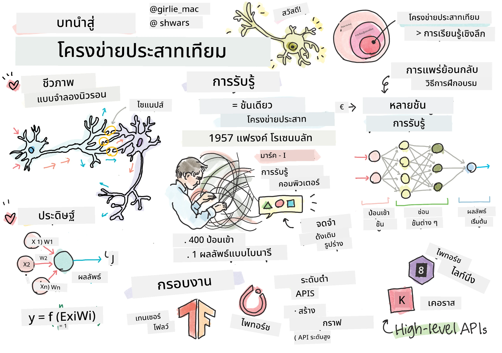
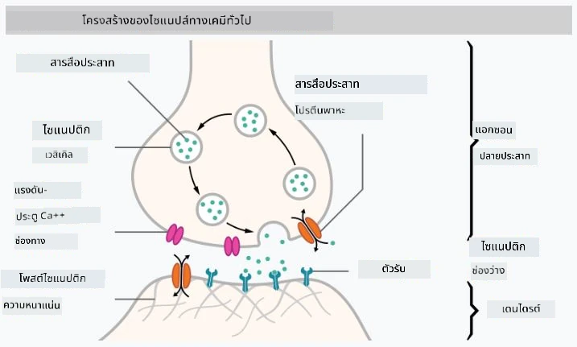
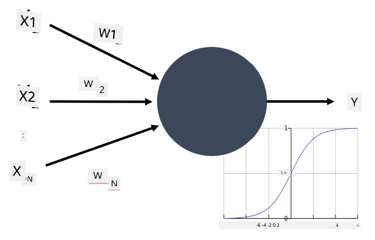

# บทนำสู่เครือข่ายประสาทเทียม

ดังที่เราได้พูดถึงในบทนำ วิธีหนึ่งในการสร้างความฉลาดคือการฝึก **แบบจำลองคอมพิวเตอร์** หรือ **สมองเทียม** ตั้งแต่กลางศตวรรษที่ 20 เป็นต้นมา นักวิจัยได้พยายามใช้แบบจำลองทางคณิตศาสตร์ต่าง ๆ จนกระทั่งในช่วงไม่กี่ปีมานี้ทิศทางนี้ก็ได้รับผลสำเร็จอย่างมาก แบบจำลองทางคณิตศาสตร์ของสมองเหล่านี้เรียกว่า **เครือข่ายประสาทเทียม**  

> บางครั้งเครือข่ายประสาทเทียมจะถูกเรียกว่า *Artificial Neural Networks* หรือ ANNs เพื่อระบุว่าเรากำลังพูดถึงแบบจำลอง ไม่ใช่เครือข่ายจริงของเซลล์ประสาท

## การเรียนรู้ของเครื่อง

เครือข่ายประสาทเทียมเป็นส่วนหนึ่งของสาขาที่ใหญ่กว่าที่เรียกว่า **การเรียนรู้ของเครื่อง** หรือ Machine Learning ซึ่งมีเป้าหมายในการใช้ข้อมูลเพื่อฝึกแบบจำลองคอมพิวเตอร์ที่สามารถแก้ปัญหาได้ การเรียนรู้ของเครื่องเป็นส่วนสำคัญของปัญญาประดิษฐ์ อย่างไรก็ดี เราจะไม่พูดถึงการเรียนรู้ของเครื่องแบบคลาสสิกในหลักสูตรนี้

> เยี่ยมชมหลักสูตรแยกต่างหากของเรา **[Machine Learning for Beginners](http://github.com/microsoft/ml-for-beginners)** เพื่อเรียนรู้เพิ่มเติมเกี่ยวกับการเรียนรู้ของเครื่องแบบคลาสสิก

ในการเรียนรู้ของเครื่อง เราสมมติว่าเรามีชุดข้อมูลตัวอย่าง **X** และค่าผลลัพธ์ที่สอดคล้องกัน **Y** ตัวอย่างมักจะเป็นเวกเตอร์หลายมิติที่ประกอบด้วย **คุณลักษณะ** และผลลัพธ์เรียกว่า **ป้ายกำกับ**

เราจะพิจารณาปัญหาการเรียนรู้ของเครื่องที่พบบ่อยที่สุด 2 ประการคือ:

* **การจำแนกประเภท** ซึ่งเราจำเป็นต้องจำแนกวัตถุอินพุตให้อยู่ในสองหรือมากกว่าชั้นเรียน
* **การถดถอย** ซึ่งเราจำเป็นต้องทำนายตัวเลขเชิงตัวเลขสำหรับแต่ละตัวอย่างอินพุต

> เมื่อแสดงอินพุตและเอาต์พุตในรูปแบบของเทนเซอร์ ชุดข้อมูลอินพุตคือเมทริกซ์ขนาด M&times;N โดยที่ M คือจำนวนตัวอย่าง และ N คือจำนวนคุณลักษณะ ป้ายกำกับเอาต์พุต Y เป็นเวกเตอร์ขนาด M

ในหลักสูตรนี้ เราจะมุ่งเน้นเฉพาะแบบจำลองเครือข่ายประสาทเทียมเท่านั้น

## แบบจำลองของเซลล์ประสาท

จากชีววิทยา เราทราบว่าสมองของเราประกอบด้วยเซลล์ประสาท ซึ่งแต่ละเซลล์มี "อินพุต" หลายตัว (เดนไดรต์) และ "เอาต์พุต" เดียว (แอกซอน) ทั้งเดนไดรต์และแอกซอนสามารถนำสัญญาณไฟฟ้าได้ และการเชื่อมต่อระหว่างพวกมันที่เรียกว่าสิเนปส์สามารถแสดงค่าการนำไฟฟ้าที่แตกต่างกันได้ ซึ่งถูกควบคุมโดยสารสื่อประสาท

 | 
----|----
เซลล์ประสาทจริง *([Image](https://en.wikipedia.org/wiki/Synapse#/media/File:SynapseSchematic_lines.svg) จาก Wikipedia)* | เซลล์ประสาทเทียม *(ภาพโดยผู้เขียน)*

ดังนั้น แบบจำลองทางคณิตศาสตร์พื้นฐานของเซลล์ประสาทจะประกอบด้วยอินพุตหลายตัว X1, ..., XN และเอาต์พุต Y พร้อมด้วยน้ำหนัก W1, ..., WN ผลลัพธ์จะถูกคำนวณเป็น:

โดยที่ f คือ **ฟังก์ชันการกระตุ้น** ที่ไม่เป็นเชิงเส้น

> แบบจำลองเซลล์ประสาทยุคแรกถูกอธิบายในบทความคลาสสิก [A logical calculus of the ideas immanent in nervous activity](https://www.cs.cmu.edu/~./epxing/Class/10715/reading/McCulloch.and.Pitts.pdf) โดย Warren McCullock และ Walter Pitts ในปี 1943 Donald Hebb ในหนังสือของเขา "[The Organization of Behavior: A Neuropsychological Theory](https://books.google.com/books?id=VNetYrB8EBoC)" ได้เสนอแนวทางในการฝึกเครือข่ายเหล่านี้

## ในส่วนนี้

ในส่วนนี้เราจะเรียนรู้เกี่ยวกับ:
* [Perceptron](03-Perceptron/README.md) หนึ่งในแบบจำลองเครือข่ายประสาทเทียมแรกสุดสำหรับการจำแนกประเภทสองชั้น
* [เครือข่ายหลายชั้น](04-OwnFramework/README.md) พร้อมกับโน้ตบุ๊คคู่มือ [วิธีสร้างเฟรมเวิร์กของเราเอง](04-OwnFramework/OwnFramework.ipynb)
* [เฟรมเวิร์กเครือข่ายประสาทเทียม](05-Frameworks/README.md) พร้อมกับโน้ตบุ๊คเหล่านี้: [PyTorch](05-Frameworks/IntroPyTorch.ipynb) และ [Keras/Tensorflow](05-Frameworks/IntroKerasTF.ipynb)
* [การเกิด overfitting](../../../../lessons/3-NeuralNetworks/05-Frameworks#overfitting)

---

<!-- CO-OP TRANSLATOR DISCLAIMER START -->
**ปฏิเสธความรับผิดชอบ**:
เอกสารนี้ได้รับการแปลโดยใช้บริการแปลภาษา AI [Co-op Translator](https://github.com/Azure/co-op-translator) ขณะที่เราพยายามให้ความถูกต้อง โปรดทราบว่าการแปลโดยอัตโนมัติอาจมีข้อผิดพลาดหรือความไม่ถูกต้อง เอกสารต้นฉบับในภาษาต้นทางควรถูกพิจารณาเป็นแหล่งข้อมูลที่เชื่อถือได้ สำหรับข้อมูลที่สำคัญ แนะนำให้ใช้การแปลโดยมนุษย์มืออาชีพ เราไม่รับผิดชอบต่อความเข้าใจผิดหรือการตีความที่ผิดพลาดที่เกิดขึ้นจากการใช้การแปลนี้
<!-- CO-OP TRANSLATOR DISCLAIMER END -->